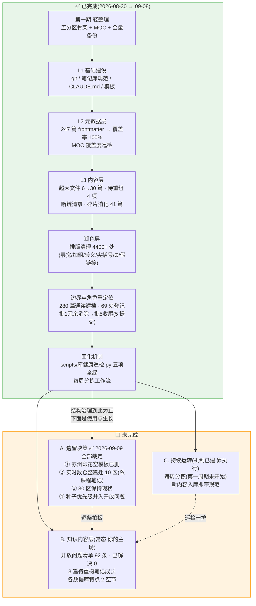

# 治理进度地图

> [!note] 用途
> 2026-09-09 绘制。个人知识库治理的全景进度:已完成的六层治理与未完成的三块剩余。配套细节见 [[第二期L3治理清单]] / [[文件角色档案与重组方案]] / [[每周分拣工作流]]。

## 流程图

## 一句话总结

**框架(结构/元数据/链接/排版/边界)已 100% 建成并锁定基线,四项遗留决策已于 2026-09-09 全部裁定清零;剩下的只有内容侧——以 [[开放问题清单]] 为主线的日常学习消化,和让每周分拣跑起来。**
