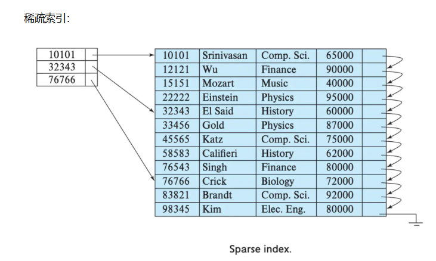
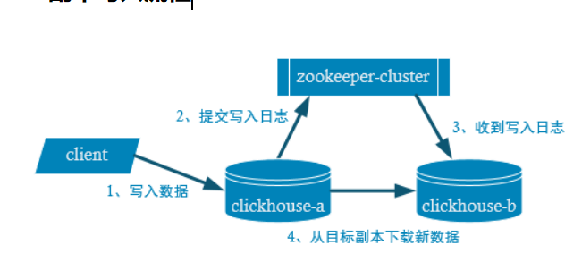

## 概述:列式存储数据库(DBMS)

使用C++语言编写，主要用于在线分析处理查询（OLAP），能够使用SQL查询实时生成分析数据报告。

Ø **采用行式存储时，数据在磁盘上的组织结构为：**

| 1 | 张三 | 18 | 2 | 李四 | 22 | 3 | 王五 | 34 |
| --- | --- | --- | --- | --- | --- | --- | --- | --- |

好处是想查某个人所有的属性时，可以通过一次磁盘查找加顺序读取就可以。但是当想查所有人的年龄时，需要不停的查找，或者全表扫描才行，遍历的很多数据都是不需要的。

  

#### 列式储存的好处：

对于列的聚合，计数，求和等统计操作原因优于行式存储。

由于某一列的数据类型都是相同的，针对于数据存储更容易进行数据压缩，每一列选择更优的数据压缩算法，大大提高了数据的压缩比重。

由于数据压缩比更好，一方面节省了磁盘空间，另一方面对于cache也有了更大的发挥空间。

​  

几乎覆盖了标准SQL的大部分语法，包括DDL和 DML，以及配套的各种函数，用户管理及权限管理，数据的备份与恢复。

​  

#### 多样化引擎

ClickHouse和MySQL类似，把表级的存储引擎插件化，根据表的不同需求可以设定不同的存储引擎。目前包括合并树、日志、接口和其他四大类20多种引擎。

​  

#### 高吞吐写入能力

ClickHouse采用类LSM Tree的结构，数据写入后定期在后台Compaction。通过类LSM tree的结构，ClickHouse在数据导入时全部是顺序append写，写入后数据段不可更改，在后台compaction时也是多个段merge sort后顺序写回磁盘。顺序写的特性，充分利用了磁盘的吞吐能力，即便在HDD上也有着优异的写入性能。

官方公开benchmark测试显示能够达到50MB-200MB/s的写入吞吐能力，按照每行100Byte估算，大约相当于50W-200W条/s的写入速度。

​  

#### 数据分区与线程级并行

ClickHouse将数据划分为多个partition，每个partition再进一步划分为多个index granularity(索引粒度)，然后通过多个CPU核心分别处理其中的一部分来实现并行数据处理。在这种设计下，单条Query就能利用整机所有CPU。极致的并行处理能力，极大的降低了查询延时。

所以，ClickHouse即使对于大量数据的查询也能够化整为零平行处理。但是有一个弊端就是对于单条查询使用多cpu，就不利于同时并发多条查询。所以对于高qps的查询业务，ClickHouse并不是强项。

​  

结论: ClickHouse像很多OLAP数据库一样，单表查询速度优于关联查询，而且ClickHouse的两者差距更为明显。

​  

## 数据类型  
  

#### 整型:

固定长度的整型，包括有符号整型或无符号整型。

整型范围（\-2n\-1~2n-1\-1）：

Int8 - [-128 : 127]

Int16 - [-32768 : 32767]

Int32 - [-2147483648 : 2147483647]

Int64 - [-9223372036854775808 : 9223372036854775807]

无符号整型范围（0~2^n-1）：

UInt8 - [0 : 255]

UInt16 - [0 : 65535]

UInt32 - [0 : 4294967295]

UInt64 - [0 : 18446744073709551615]

**使用场景：个数、数量、也可以存储型id。**

#### 浮点型

Float32 - float

Float64 – double

建议尽可能以整数形式存储数据。例如，将固定精度的数字转换为整数值，如时间用毫秒为单位表示，因为浮点型进行计算时可能引起四舍五入的误差。

**使用场景：一般数据值比较小，不涉及大量的统计计算，精度要求不高的时候。比如保存商品的重量。**

#### 布尔型

没有单独的类型来存储布尔值。可以使用UInt8 类型，取值限制为 0 或 1。

Deciaml型:

有符号的浮点数，可在加、减和乘法运算过程中保持精度。对于除法，最低有效数字会被丢弃（不舍入）。

有三种声明：

Ø Decimal32(s)，相当于Decimal(9-s,s)，有效位数为1~9

Ø Decimal64(s)，相当于Decimal(18-s,s)，有效位数为1~18

Ø Decimal128(s)，相当于Decimal(38-s,s)，有效位数为1~38

s标识小数位

**使用场景：一般金额字段、汇率、利率等字段为了保证小数点精度，都使用Decimal进行存储。**

​  

#### 字符串

Ø String

字符串可以任意长度的。它可以包含任意的字节集，包含空字节。

Ø FixedString(N)

固定长度N 的字符串，N 必须是严格的正自然数。当服务端读取长度小于 N 的字符串时候，通过在字符串末尾添加空字节来达到N 字节长度。 当服务端读取长度大于 N 的字符串时候，将返回错误消息。

与String相比，极少会使用FixedString，因为使用起来不是很方便。

**使用场景：名称、文字描述、字符型编码。固定长度的可以保存一些定长的内容，比如一些编码，性别等但是考虑到一定的变化风险，带来收益不够明显，所以定长字符串使用意义有限。**

**​**  

#### 枚举类型

包括Enum8 和 Enum16 类型。Enum 保存 'string'= integer 的对应关系。

Enum8 用 'String'= Int8 对描述。

Enum16 用 'String'= Int16 对描述。

Ø **用法演示**

创建一个带有一个枚举Enum8('hello' = 1, 'world' = 2) 类型的列

CREATE TABLE t\_enum

(

x Enum8('hello' = 1, 'world' = 2)

)

ENGINE = TinyLog;

Ø 这个 x 列只能存储类型定义中列出的值：'hello'或'world'

​  

**使用场景：对一些状态、类型的字段算是一种空间优化，也算是一种数据约束。但是实际使用中往往因为一些数据内容的变化增加一定的维护成本，甚至是数据丢失问题。所以谨慎使用。**

​  

#### 时间类型

目前ClickHouse 有三种时间类型

Ø Date接受**年****\-月-日**的字符串比如 ‘2019\-12\-16’

Ø Datetime接受**年****\-月-日 时:分:秒**的字符串比如 ‘2019\-12\-16 20:50:10’

Ø Datetime64接受**年****\-月-日 时:分:秒.亚秒**的字符串比如‘2019\-12\-16 20:50:10.66’

日期类型，用两个字节存储，表示从1970-01-01 (无符号) 到当前的日期值。

还有很多数据结构，可以参考官方文档：[https://clickhouse.yandex/docs/zh/data\_types/](https://clickhouse.yandex/docs/zh/data_types/)

​  

#### 数组

**Array(T)****：**由T 类型元素组成的数组。

T 可以是任意类型，包含数组类型。 但不推荐使用多维数组，ClickHouse 对多维数组的支持有限。例如，不能在MergeTree表中存储多维数组。

Ø 创建数组方式1，使用array函数

array(T)

hadoop102 :) SELECT array(1, 2) AS x, toTypeName(x) ;

​  

## 表引擎

表引擎是ClickHouse的一大特色。可以说， 表引擎决定了如何存储表的数据。包括：

Ø 数据的存储方式和位置，写到哪里以及从哪里读取数据。

Ø 支持哪些查询以及如何支持。

Ø 并发数据访问。

Ø 索引的使用（如果存在）。

Ø 是否可以执行多线程请求。

Ø 数据复制参数。

表引擎的使用方式就是必须显式在创建表时定义该表使用的引擎，以及引擎使用的相关参数。

**特别注意：引擎的名称大小写敏感**

**​**  

#### TinyLOG

以列文件的形式保存在磁盘上，不支持索引，没有并发控制。一般保存少量数据的小表，生产环境上作用有限。可以用于平时练习测试用。

#### Memory

内存引擎，数据以未压缩的原始形式直接保存在内存当中，服务器重启数据就会消失。读写操作不会相互阻塞，不支持索引。简单查询下有非常非常高的性能表现（超过10G/s）。

一般用到它的地方不多，除了用来测试，就是在需要非常高的性能，同时数据量又不太大（上限大概1 亿行）的场景。

#### MergeTree

ClickHouse中最强大的表引擎当属MergeTree（合并树）引擎及该系列（\*MergeTree）中的其他引擎，支持索引和分区，地位可以相当于innodb之于Mysql。而且基于MergeTree，还衍生出了很多小弟，也是非常有特色的引擎。

Ø **建表语句**

create table t\_order\_mt(

id UInt32,

sku\_id String,

total\_amount Decimal(16,2),

create\_time Datetime

) engine =**MergeTree**

​ **partition by** toYYYYMMDD(create\_time)

​ **primary key** (id)

**order** **by** (id,sku\_id);

MergeTree其实还有很多参数(绝大多数用默认值即可)，但是三个参数是更加重要的，也涉及了关于MergeTree的很多概念。

​  

partition by分区(可选)

**Ø** **作用**

学过hive的应该都不陌生，分区的目的主要是降低扫描的范围，优化查询速度

**Ø** **如果不填**

只会使用一个分区。

**Ø** **分区目录**

MergeTree 是以列文件+索引文件+表定义文件组成的，但是如果设定了分区那么这些文件就会保存到不同的分区目录中。

**Ø** **并行**

分区后，面对涉及跨分区的查询统计，ClickHouse会以分区为单位并行处理。

**Ø** **数据写入与分区合并**

任何一个批次的数据写入都会产生一个临时分区，不会纳入任何一个已有的分区。写入后的某个时刻（大概10\-15分钟后），ClickHouse会自动执行合并操作（等不及也可以手动通过optimize执行），把临时分区的数据，合并到已有分区中。

optimize table xxxx final;

​  

primary Key主键(可选)

ClickHouse中的主键，和其他数据库不太一样，**它只提供了数据的****一级索引****，但是却不是唯一约束**。这就意味着是可以存在相同primary key的数据的。

主键的设定主要依据是查询语句中的where 条件。

根据条件通过对主键进行某种形式的二分查找，能够定位到对应的index granularity,避免了全表扫描。·

index granularity：直接翻译的话就是索引粒度，指在稀疏索引中两个相邻索引对应数据的间隔。ClickHouse中的MergeTree默认是8192。官方不建议修改这个值，除非该列存在大量重复值，比如在一个分区中几万行才有一个不同数据。

稀疏索引的好处就是可以用很少的索引数据，定位更多的数据，代价就是只能定位到索引粒度的第一行，然后再进行进行一点扫描。

order by(必选)

order by 设定了**分区内**的数据按照哪些字段顺序进行有序保存。

order by是MergeTree中唯一一个必填项，甚至比primary key 还重要，因为当用户不设置主键的情况，很多处理会依照order by的字段进行处理（比如后面会讲的去重和汇总）。

**要求：主键必须是****o****rder by****字段的前缀字段。**

比如order by 字段是(id,sku\_id) 那么主键必须是id 或者(id,sku\_id)

​  

数据TTL

TTL即Time To Live，MergeTree提供了可以管理数据或者列的生命周期的功能。

(1) 列级别TTL

TTL create\_time+interval 10 SECOND,

(2)表级TTL

下面的这条语句是数据会在create\_time 之后10秒丢失

alter table t\_order\_mt3 MODIFY TTL create\_time + INTERVAL 10 SECOND;

涉及判断的字段必须是Date或者Datetime类型，推荐使用分区的日期字段。

能够使用的时间周期：

\- SECOND

\- MINUTE

\- HOUR

\- DAY

\- WEEK

\- MONTH

\- QUARTER

\- YEAR

  

  

#### ReplacingMerge

ReplacingMergeTree是MergeTree的一个变种，它存储特性完全继承MergeTree，只是多了一个去重的功能。尽管MergeTree可以设置主键，但是primary key其实没有唯一约束的功能。如果你想处理掉重复的数据，可以借助这个ReplacingMergeTree。

​  

**Ø** **去重时机**

数据的去重只会在合并的过程中出现。合并会在未知的时间在后台进行，所以你无法预先作出计划。有一些数据可能仍未被处理。

**Ø** **去重范围**

如果表经过了分区，去重只会在分区内部进行去重，不能执行跨分区的去重。

所以ReplacingMergeTree能力有限， ReplacingMergeTree 适用于在后台清除重复的数据以节省空间，但是它不保证没有重复的数据出现。

ReplacingMergeTree(create\_time)

**ReplacingMergeTree()** **填入的参数为版本字段，重复数据保留版本字段值最大的。**

**如果不填版本字段，默认按照插入顺序保留最后一条。**

Ø **通过测试得到结论**

n 实际上是使用order by 字段作为唯一键

n 去重不能跨分区

n 只有合并才会进行去重

n 认定重复的数据保留，版本字段值最大的

n 如果版本字段相同则按插入顺序保留最后一笔

#### SummingMerge

对于不查询明细，只关心以维度进行汇总聚合结果的场景。如果只使用普通的MergeTree的话，无论是存储空间的开销，还是查询时临时聚合的开销都比较大。

ClickHouse 为了这种场景，提供了一种能够“预聚合”的引擎SummingMergeTree

  

Ø **通过结果可以得到以下结论**

n 以SummingMergeTree（）中指定的列作为汇总数据列

n 可以填写多列必须数字列，如果不填，以所有非维度列且为数字列的字段为汇总数据列

n 以order by 的列为准，作为维度列

n 其他的列按插入顺序保留第一行

n 不在一个分区的数据不会被聚合

Ø **开发建议**

设计聚合表的话，唯一键值、流水号可以去掉，所有字段全部是维度、度量或者时间戳。

​  

Ø **问题**

能不能直接执行以下SQL得到汇总值

select total\_amount from XXX where province\_name=’’ and create\_date=’xxx’

不行，可能会包含一些还没来得及聚合的临时明细

如果要是获取汇总值，还是需要使用sum进行聚合，这样效率会有一定的提高，但本身ClickHouse是列式存储的，效率提升有限，不会特别明显。

select sum(total\_amount) from province\_name=’’ and create\_date=‘xxx’

  

## SQL操作

基本上来说传统关系型数据库（以MySQL为例）的SQL语句，ClickHouse基本都支持，这里不会从头讲解SQL语法只介绍ClickHouse与标准SQL（MySQL）不一致的地方。

Insert

基本与标准SQL（MySQL）基本一致

Ø 标准

insert into [table\_name] values(…),(….)

Ø 从表到表的插入

insert into [table\_name] select a,b,c from [table\_name\_2]

Upset和Delete

ClickHouse提供了Delete和Update的能力，这类操作被称为Mutation查询，它可以看做Alter 的一种。

虽然可以实现修改和删除，但是和一般的OLTP数据库不一样，**M****utation****语句是一种很****“重”的操作，而且不支持事务**。

“重”的原因主要是每次修改或者删除都会导致放弃目标数据的原有分区，重建新分区。所以尽量做批量的变更，不要进行频繁小数据的操作。

Ø **删除操作**

alter table t\_order\_smt delete where sku\_id ='sku\_001';

Ø **修改操作**

alter table t\_order\_smt update total\_amount=toDecimal32(2000.00,2) where id =102;

由于操作比较“重”，所以 Mutation语句分两步执行，同步执行的部分其实只是进行新增数据新增分区和并把旧分区打上逻辑上的失效标记。直到触发分区合并的时候，才会删除旧数据释放磁盘空间，一般不会开放这样的功能给用户，由管理员完成。

​  

查询操作

ClickHouse基本上与标准SQL 差别不大

Ø 支持子查询

Ø 支持CTE(Common Table Expression 公用表表达式 with 子句)

Ø 支持各种JOIN，但是JOIN操作无法使用缓存，所以即使是两次相同的JOIN语句，ClickHouse也会视为两条新SQL

Ø 窗口函数(官方正在测试中...)

Ø 不支持自定义函数

Ø GROUP BY 操作增加了with rollup\\with cube\\with total 用来计算小计和总计。

​  

with rollup：**从右至左**去掉维度进行小计

with cube : 从右至左去掉维度进行小计，再从左至右去掉维度进行小计

with totals: 只计算合计

  

alter操作

同MySQL的修改字段基本一致

**Ø** **新增字段**

alter table **tableName** add column **newcolname** **String** after **col1****;**

**Ø** **修改字段类型**

alter table tableName modify column newcolname String;

**Ø** **删除字段**

alter table tableName drop column newcolname;

​  

​  

#### 导出数据

clickhouse-client \--query "select \* from t\_order\_mt where create\_time='2020-06-01 12:00:00'" --format CSVWithNames\> /opt/module/data/rs1.csv1

更多支持格式参照：

[https://clickhouse.tech/docs/v19.14/en/interfaces/formats/#csvwithnames](#csvwithnames)

​  

​  

## 副本:

副本的目的主要是保障数据的高可用性，即使一台ClickHouse节点宕机，那么也可以从其他服务器获得相同的数据。

  

## 分片集群

副本虽然能够提高数据的可用性，降低丢失风险，但是每台服务器实际上必须容纳全量数据，对数据的横向扩容没有解决。

要解决数据水平切分的问题，需要引入分片的概念。通过分片把一份完整的数据进行切分，不同的分片分布到不同的节点上，再通过Distributed表引擎把数据拼接起来一同使用。

Distributed表引擎本身不存储数据，有点类似于MyCat之于MySql，成为一种中间件，通过分布式逻辑表来写入、分发、路由来操作多台节点不同分片的分布式数据。

注意：ClickHouse的集群是表级别的，实际企业中，大部分做了高可用，但是没有用分片，避免降低查询性能以及操作集群的复杂性。

  

不在此做赘述,要是要到在看开发文本