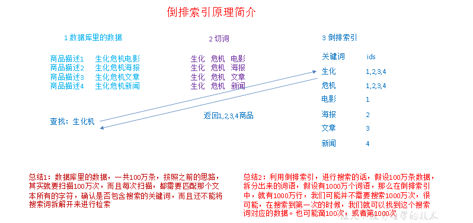
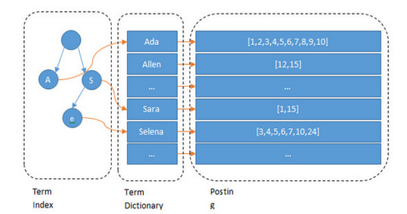
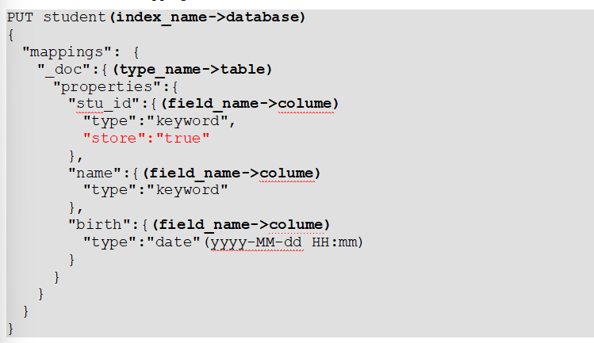
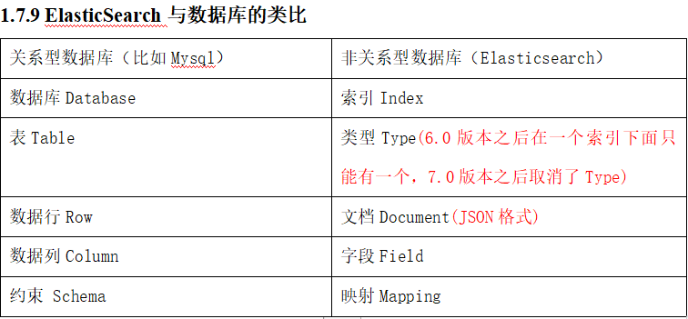
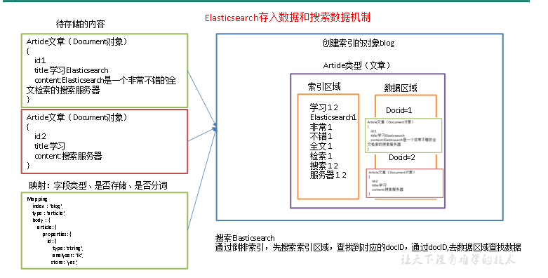

# 概述

  

数据库实现搜索

全文索引([全文检索](https://baike.baidu.com/item/%E5%85%A8%E6%96%87%E6%A3%80%E7%B4%A2/8028630)是指计算机索引程序通过扫描文章中的每一个词，对每一个词建立一个索引，指明该词在文章中出现的次数和位置，当用户查询时，检索程序就根据事先建立的索引进行查找，并将查找的结果反馈给用户的检索方式。这个过程类似于通过字典中的检索字表查字的过程。全文搜索搜索引擎数据库中的数据。)

倒排索引()

lucene，就是一个jar包，里面包含了封装好的各种建立倒排索引，以及进行搜索的代码，包括各种算法。

Lucene 为倒排索引(Term Dictionary)部分又增加一层Term Index结构，用于快速定位，而这Term Index是缓存在内存中的，但MySQL的B+tree不在内存中，所以整体来看ES速度更快，但同时也更消耗资源（内存、磁盘）

  

#### elasticsearch概述

Elasticsearch是一个实时分布式搜索和分析引擎。它用于全文搜索、结构化搜索、数据分析

Elasticsearch，基于Lucene，隐藏复杂性，提供简单易用的RestfulAPI接口、JavaAPI接口（还有其他语言的API接口）。

全文检索(将非结构化数据中的一部分信息提取出来,重新组织,使其变得有一定结构,然后对此有一定结构的数据进行搜索,从而达到搜索相对较快的目的)

结构化检索:

数据分析:

  

#### ElasticSearch的特点

天然分片,天然集群

近实时 | Cluster集群 | Node节点 (默认节点会去加入一个名称为“elasticsearch”的集群，如果直接启动一堆节点，那么它们会自动组成一个elasticsearch集群，当然一个节点也可以组成一个elasticsearch集群。) | Index索引-数据库 (一个index包含很多document，一个index就代表了一类类似的或者相同的document) | Type(类型-表) 6.0版本之前每个索引里都可以有多个type；

6.0版本之后到7.0版本之前每个索引里面只能有一个Type，一般使用_doc代替了。

  

| document (文档-行) 文档是ES中的最小数据单元 ,通常用JSON数据结构表示,每个index下的type中，都可以去存储多个document。 | field(字段-列) Field是Elasticsearch的最小单位。一个document里面有多个field，每个field就是一个数据字段。| Mapping(映射-约束) 数据如何存放到索引对象上，需要有一个映射配置，包括：数据类型、是否存储、是否分词等。Mapping用来定义Document中每个字段的类型，即所使用的分词器、是否索引等属性

#### 关系型数据库与非关系型数据库对比

  

  

1）索引对象（blog）：存储数据的表结构，任何搜索数据，存放在索引对象上。

2）映射（mapping）：数据如何存放到索引对象上，需要有一个映射配置， 包括：数据类型、是否存储、是否分词等。

3）文档（document）：一条数据记录，存在索引对象上。

4）文档类型（type）：一个索引对象，存放多种类型数据，数据用文档类型进行标识。

  

####   

  

# ElasticSearch的安装

#### ElasticSearch的具体操作

开启后访问网址为http://hadoop102:9200

查看集群节点：浏览器中输入hadoop102:9200/_cat/nodes(?v)

  

# Kibana

浏览器访问hadoop102:5601

  

# ElasticSearch使用

#### Elasticsearch语法

字符串型：text(分词)、keyword(不分词)

数值型：long、integer、short、byte、double、float、half_float、scaled_float

日期类型：date

布尔类型：boolean

二进制类型：binary

范围类型：integer_range、float_range、long_range、double_range、date_range

  

复杂数据类型

数组类型：array

对象类型：object

嵌套类型：nested object

地理位置数据类型:geo_point geo_shape

专用类型:ip,completion,token_count,hash值,multi-fields

  

{PUT stu （stu类似于MySQL中的数据库名）

{

"mappings": { （"mappings"可以理解为建表语句create table关键字）

"_doc":{ （"_doc"相当于MySQL中表名）

"properties":{ （"properties"相当于建表语句中要指定字段及字段类型的关键字）"id":{ （" id "相当于具体某个字段）

"type":"keyword"（"type"相当于要指定字段类型的关键字，"keyword "相当于字段的具体类型）

}语法命令帮助理解

  

#### IK分词器

词器主要应用在中文上，在ES中字符串类型有keyword和text两种。keyword默认不进行分词，而text是将每一个汉字拆开称为独立的词

  

keyword类型不支持分词  
GET _analyze

{

"keyword":"我是程序员" "text":"\*\*\*\*\*\*"

}

  

IK分词器测试:ik_smart (最少切分) ik_max_word (最细粒度划分)

  

2）最细切分ik_max_word

GET _analyze

{

"analyzer": "ik_max_word", "analyzer": "ik_smart",

"text":"\*\*\*\*\*"

}

  

  

#### Kibana

更便捷化使用elasticsearch

默认节点为5601

GET _cat/nodes 节点信息

GET stu/_search 全文档检索 \# 协议方法 索引/类型/_search

往相同索引中相同类型中相同id中插入不同数据会把之前老的数据替换调，只保留一份最新的，因此具有幂等性，可以用做去重。

  

字段全值匹配检索:

GET 库名/_search

{

"query": {

"bool": {

"filter": {

"term": {

"列名": "value"

}

}

}

}

}

字段分词匹配检索:

GET 库名/_search

{

"query": {

"match": {

"列名": "value"

}

}

}

全值匹配与分词匹配结合使用:

GET index/_search

{

"query": {

"bool": {

"filter": {

"term": {

"列名": "value"

}

}

, "must": [

{

"match": {

"列名": "value"

}

}

]

}

}

}

字段模糊匹配查询

GET index/_search

{

"query": {

"fuzzy": {

"列名": "value"

}

}

}

聚合检索

1,单聚合检索

GET index/_search

{

"aggs": {

"groupByClass": {

"terms": {

"field": "class_id",

"size": 10

}

}

}

}

2,多聚合检索

GET index/_search

{

"aggs": {

"groupByClass": {

"terms": {

"field": "class_id",

"size": 10

}

},

"groupByAge":{

"max": {

"field": "age"

}

}

}

}

3,聚合嵌套检索

GET student/_search

{

"aggs": {

"groupByClass": {

"terms": {

"field": "class_id",

"size": 10

},

"aggs": {

"maxAge": {

"max": {

"field": "age"

}

}

}

}

}

}

4,分页检索

GET index/_search

{

"from": 0, (从第几条开始)

"size": 1 (显示几条)

}

  

#### 索引别名 _aliases

索引别名就像一个快捷方式或软连接，可以指向一个或多个索引，也可以给任何一个需要索引名的API来使用。别名带给我们极大的灵活性，允许我们做下面这些：

1）给多个索引分组 (例如， last_three_months)

2）给索引的一个子集创建视图

3）在运行的集群中可以无缝的从一个索引切换到另一个索引

  

1)创建索引的时候直接声明

PUT movie_chn_2020

{

 "aliases": {

"movie_chn_2020-query": {}

},

2)为已经存在的添加别名

post _\*\*\*\*

{

"actions": [

{

"add": {

"index": "\*\*\*\*\*",

"alias": "\*\*\*\*\*\*"

}

}

]

}

3)也可以通过加过滤条件缩小查询范围，建立一个子集视图

POST _aliases

{

"actions": [

{

"add": {

"index": "\*\*\*\*\*",

"alias": "\*\*\*",

"filter": {

"term": {

"sex": "male"

}

}

}

}

]

}

查询别名 get \*\*\*\*/_search

删除别名

POST \*\*\*\*\*\*

{

"actions": [

{

"remove": {

"index": "test1",

"alias": "alias1"

}

}

]

}

6,为某个别名进行无缝切换

POST _aliases

{

"actions": [

{

"remove": {

"index": "test1",

"alias": "aliases1"

}

},

{

"add":{

"index": "test2",

"alias": "aliases1"

}

}

]

}

查询别名列表

get _cat/aliases?v

  

如果通过别名添加数据的时候，别名对应多个索引，那么会写到哪个索引中呀

1.这个别名对应多个索引的时候需要指定写索引，如果只对应一个索引，则不需要指定写索引，因此就写到对应的那个索引中

2.如果一个别名对应多个索引的情况下，只能针对一个索引的别名指定写索引

#总结，哪个索引的别名有写索引就写到哪个索引中

#### 索引模板

创建索引的模具，其中可以定义一系列规则来帮助我们构建符合特定业务需求的索引的mappings和 settings，通过使用 Index Template 可以让我们的索引具备可预知的一致性。

  

分割索引(结构变化灵活,查询范围优化):

PUT _template/template_movie2020

{

"index_patterns": ["movie_test\*"],

"aliases" : {

"{index}-query": {},

"movie_test-query":{}

},

"mappings": {

"_doc": {

"properties": {

"id": {

"type": "keyword"

},

"movie_name": {

"type": "text",

"analyzer": "ik_smart"

}

}

}

}

}

其中"index_patterns": ["movie_test\*"], 的含义就是凡是往movie_test开头的索引写入数据时，如果索引不存在，那么es会根据此模板自动建立索引。

  

查看已有的模板索引:get _cat/templates

查看某个索引详情:get _templates/templates_movies\*

删除某个模板: DELETE _template/\*\*\*\*

  

API操作

  

#### 写数据

单条数据写入,批量数据写入

#### 读数据

以查询语句为JSON串的方式查询数据

以查询语句为代码的方式查询数据