# Hbase概述

###### 优点

分布式，列存,可扩展,海量数据，KV类型数据库，尤其适合以便宜机器存储PB级别数据，

建立在HDFS上，解决了hdfs的不能频繁更新的场景

###### 缺点

不支持条件查询，只能按照rowkey查询，所以特别不适合做数据分析

不支持主从切换

没有事务，

  

  

特色:ROW KEY 列族

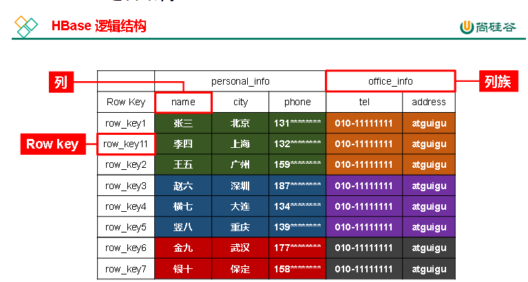

  

Hbase的删除为逻辑删除,实际为改变type的类型,使用StoreFile Compaction 来进行删除,将minor Compaction 合并为Major Comaption来删除(可手动flush命令来刷写)

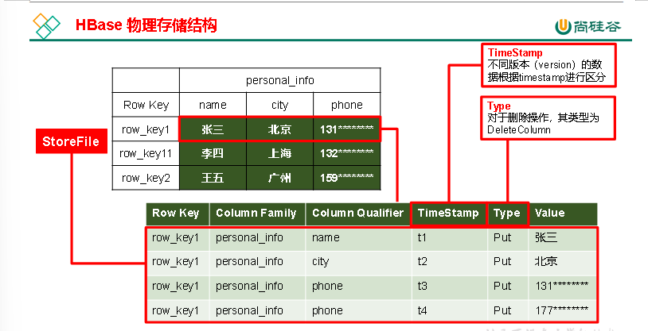

  

region:横着切(依据rowkey) store依据列族(竖着切)

  

NameSpace:命名空间，类似于关系型数据库的database概念，每个命名空间下有多个表。HBase两个自带的命名空间，分别是hbase和default，hbase中存放的是HBase内置的表，default表是用户默认使用的命名空间。

Table:HBase定义表时只需要声明列族即可，不需要声明具体的列。这意味着，往HBase写入数据时，字段可以动态、按需指定。因此，和关系型数据库相比，HBase能够轻松应对字段变更的场景。

ROW:HBase表中的每行数据都由一个**RowKey**和多个**Column**（列）组成，数据是按照RowKey的字典顺序存储的，并且查询数据时只能根据RowKey进行检索，所以RowKey的设计十分重要。

COLUMN:HBase中的每个列都由Column Family(列族)和Column Qualifier（列限定符）进行限定，例如info：name，info：age。建表时，只需指明列族，而列限定符无需预先定义。

**Time Stamp:**用于标识数据的不同版本（version），每条数据写入时，系统会自动为其加上该字段，其值为写入HBase的时间。

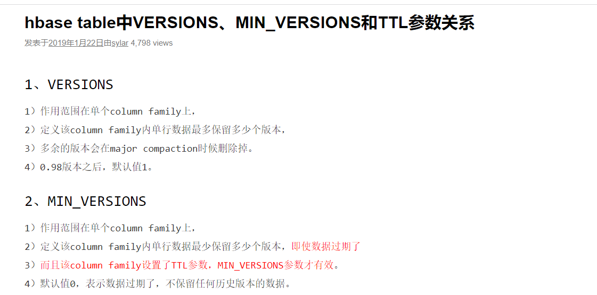

**Cell** 由{rowkey, column Family：column Qualifier, time Stamp} 唯一确定的单元。cell中的数据全部是字节码形式存贮。

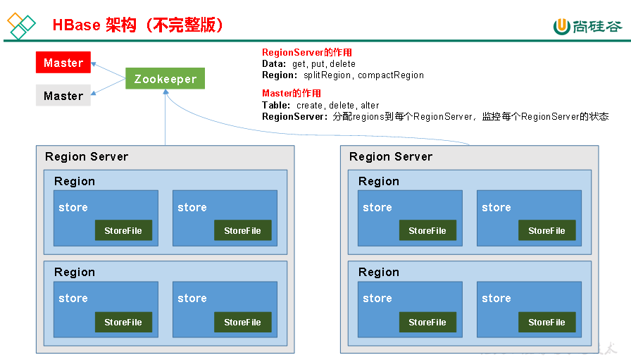

  

**Region Server**

Region Server为 Region的管理者，其实现类为HRegionServer，主要作用如下:

对于数据的操作：get, put, delete；

对于Region的操作：splitRegion、compactRegion。

  

**Master**

Master是所有Region Server的管理者，其实现类为HMaster，主要作用如下：

对于表的操作：create, delete, alter

对于RegionServer的操作：分配regions到每个RegionServer，监控每个RegionServer的状态，负载均衡和故障转移。

  

**Zookeeper**

HBase通过Zookeeper来做master的高可用、RegionServer的监控、元数据的入口以及集群配置的维护等工作。

  

**HDFS**

HDFS为Hbase提供最终的底层数据存储服务，同时为HBase提供高容错的支持

  

bin/start-hbase.sh bin/stop-hbase.sh

  

# HBase搭建

高可用

在HBase中HMaster负责监控HRegionServer的生命周期，均衡RegionServer的负载，如果HMaster挂掉了，那么整个HBase集群将陷入不健康的状态，并且此时的工作状态并不会维持太久。所以HBase支持对HMaster的高可用配置.

  

#### Hbase shell的数据操作语法

create 'TABLE','LIEZHU'

PUT 'TABLE','ROW_KEY','列族:列名','列的value'

scan 'TABLE'

scan 'Table',{STARTROW=>'ROW_KEY',STOPROW=>'ROW_KEY'}

scan 'Tablescribe 'table'

put 'TABLE','ROW_KEY','列族:列名','value'

get 'TABLE','ROW_KEY'

DELETE 'TABLE','ROW_KEY','列族:列名'

deleteall 'table','row_key'

truncate 'table' 提示：清空表的操作顺序为先disable，然后再truncate。

drop 'table' 如果直接drop表，会报错：ERROR: Table student is enabled. Disable it first.

(首先将表的状态改成disable状态,再接着drop表)

alter 'table',{NAME=>'列族',VERSIONS=>自己设置}

  

# Hbase进阶

#### 架构

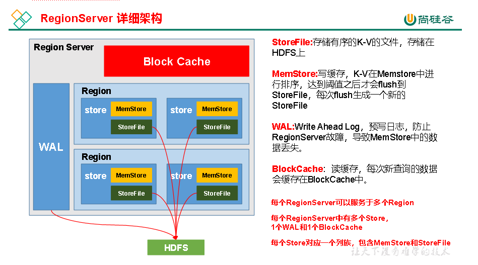

**StoreFile**

保存实际数据的物理文件，StoreFile以Hfile的形式存储在HDFS上。每个Store会有一个或多个StoreFile（HFile），数据在每个StoreFile中都是有序的。

**MemStore**

写缓存，由于HFile中的数据要求是有序的，所以数据是先存储在MemStore中，排好序后，等到达刷写时机才会刷写到HFile，每次刷写都会形成一个新的HFile。

**WAL**

由于数据要经MemStore排序后才能刷写到HFile，但把数据保存在内存中会有很高的概率导致数据丢失，为了解决这个问题，数据会先写在一个叫做Write-Ahead logfile的文件中，然后再写入MemStore中。所以在系统出现故障的时候，数据可以通过这个日志文件重建。

**BlockCache**

读缓存，每次查询出的数据会缓存在BlockCache中，方便下次查询。

  

#### 写流程

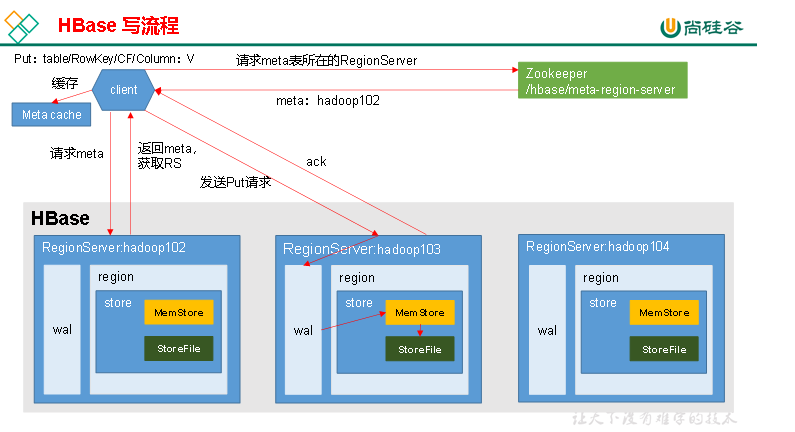

写流程：

1）Client先访问zookeeper，获取hbase:meta表位于哪个Region Server。

2）访问对应的Region Server，获取hbase:meta表，根据写请求的namespace:table/rowkey，查询出目标数据位于哪个Region Server中的哪个Region中。并将该table的region信息以及meta表的位置信息缓存在客户端的meta cache，方便下次访问。

3）与目标Region Server进行通讯；

4）将数据顺序写入（追加）到WAL；

5）将数据写入对应的MemStore，数据会在MemStore进行排序；

6）向客户端发送ack；

7）等达到MemStore的刷写时机后，将数据刷写到HFile。

  

#### MemStore Flush刷写

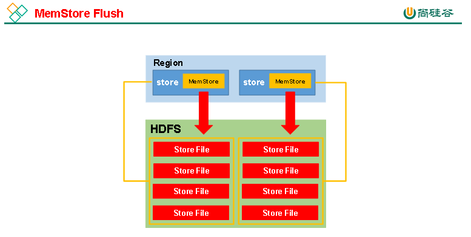

**MemStore** **刷写时机：**

1.当某个memstroe的大小达到了**hbase.hregion.memstore.flush.size** **（默认值** **128M** **）**，其所在region的所有memstore 都会刷写。

当memstore的大小达到了

**hbase.hregion.memstore.flush.size** **（默认值** **128M** **）**

**\*** **hbase.hregion.memstore.block.multiplier** **（默认值** **4** **）**

时，会阻止继续往该memstore写数据。

2.当region server中memstore的总大小达到

**java** **_** **heapsize**

**\*hbase.regionserver.global.memstore.size** **（默认值** **0** **.4** **）**

**\** ***hbase.regionserver.global.memstore.size.lower.limit** **（默认值** **0.95** **）**，

region会按照其所有memstore的大小顺序（由大到小）依次进行刷写。直到region server中所有memstore的总大小减小到上述值以下。

当region server中memstore的总大小达到

**java** **_** **heapsize**

**\*hbase.regionserver.global.memstore.size** **（默认值** **0** **.4** **）**

时，会阻止继续往所有的memstore写数据。

3. 到达自动刷写的时间，也会触发memstore flush。自动刷新的时间间隔由该属性进行配置**hbase.regionserver.optionalcacheflushinterval** **（默认** **1** **小时）**。

4.当WAL文件的数量超过**hbase.regionserver.max.logs**，region会按照时间顺序依次进行刷写，直到WAL文件数量减小到**hbase.regionserver.max.log**以下（该属性名已经废弃，现无需手动设置，最大值为32）。

  

#### 读流程

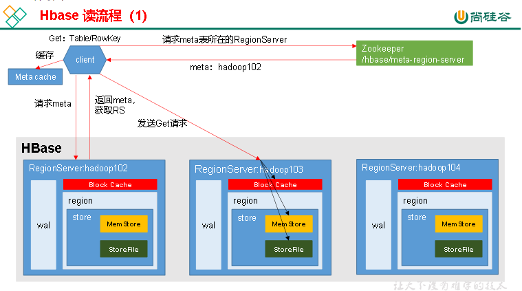

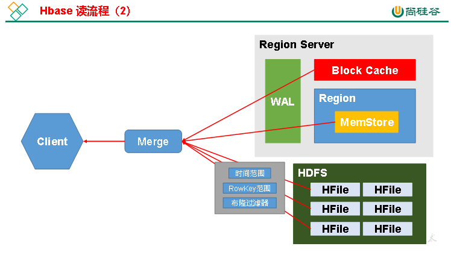

** **  

1）Client先访问zookeeper，获取hbase:meta表位于哪个Region Server。

2）访问对应的Region Server，获取hbase:meta表，根据读请求的namespace:table/rowkey，查询出目标数据位于哪个Region Server中的哪个Region中。并将该table的region信息以及meta表的位置信息缓存在客户端的meta cache，方便下次访问。

3）与目标Region Server进行通讯；

4）分别在MemStore和Store File（HFile）中查询目标数据，并将查到的所有数据进行合并。此处所有数据是指同一条数据的不同版本（time stamp）或者不同的类型（Put/Delete）。

5）将查询到的新的数据块（Block，HFile数据存储单元，默认大小为64KB）缓存到Block Cache。

6）将合并后的最终结果返回给客户端。

  

#### StoreFile Compaction

由于memstore每次刷写都会生成一个新的HFile，且同一个字段的不同版本（timestamp）和不同类型（Put/Delete）有可能会分布在不同的HFile中，因此查询时需要遍历所有的HFile。为了减少HFile的个数，以及清理掉过期和删除的数据，会进行StoreFile Compaction。

Compaction分为两种，分别是Minor Compaction和Major Compaction。Minor Compaction会将临近的若干个较小的HFile合并成一个较大的HFile，并清理掉部分过期和删除的数据。Major Compaction会将一个Store下的所有的HFile合并成一个大HFile，并且**会**清理掉所有过期和删除的数据。

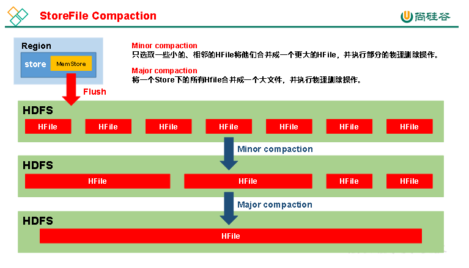

#### Region Split

默认情况下，每个Table起初只有一个Region，随着数据的不断写入，Region会自动进行拆分。刚拆分时，两个子Region都位于当前的Region Server，但处于负载均衡的考虑，HMaster有可能会将某个Region转移给其他的Region Server。

Region Split时机：

1.当1个region中的某个Store下所有StoreFile的总大小超过hbase.hregion.max.filesize （10G），该Region就会进行拆分（0.94版本之前）。

2.当1个region中的某个Store下所有StoreFile的总大小超过Min(initialSize\*R^3 ,hbase.hregion.max.filesize")，该Region就会进行拆分。其中initialSize的默认值为2\*hbase.hregion.memstore.flush.size，R为当前Region Server中属于该Table的Region个数（0.94版本之后）。

具体的切分策略为：

第一次split：1^3 \* 256 = 256MB

第二次split：2^3 \* 256 = 2048MB

第三次split：3^3 \* 256 = 6912MB

第四次split：4^3 \* 256 = 16384MB > 10GB，因此取较小的值10GB

后面每次split的size都是10GB了。

3.Hbase 2.0引入了新的split策略：如果当前RegionServer上该表只有一个Region，按照2 \* hbase.hregion.memstore.flush.size分裂，否则按照hbase.hregion.max.filesize(10G)分裂。

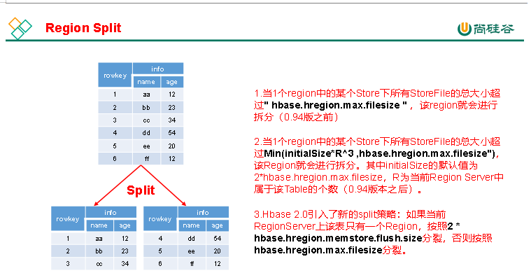

  

# HbaseAPI

  

单线程使用

1,导入依赖 2,获取配置类(Hbaseconfiguration.create()) 3,给配置类添加配置set() 4,获取连接ConnectionFactory.createConnection 5,完成需求 6,关闭连接

  

多线程单例使用

1,创建静态类 2 创建配置对象 Configuration 3 添加配置参数set 4,创建hbase的连接connectionFactory.

  

//完成增删改查

1,插入数据 依据插入语法编写参数 获取table的连接connection.gettable(Tablename.valueof(namespace,tablename)), 2 创建put对象(Bytes.tobytes转换rowkey) 3 添加put属性 put.addcolumn(hbase的特性即操作都是添加)

2,查询数据

1,编写查询的方法 2,获取connection.gettable(TableName.valueOf(nameSpace, tableName)) 3,获取get对象 3,添加get属性 4,get数据

3,扫描数据(重点书list)

1,创建list<>暂存 2,获取table 3,创建scan对象 withstartRow withstoprow 4扫描数据 5 获取结果

4,删除数据

1,编写delete方法 2 ,获取table连接 connection.gettable(tablename.valueof(namesapce,tablename))

3,删除信息 3.1删除信息 delete.addcolumn() 删除单个版本 删除所有版本(方法体不一样)

  

# Hbase的使用设计

#### 预分区

每一个region维护着startRow与endRowKey，如果加入的数据符合某个region维护的rowKey范围，则该数据交给这个region维护。那么依照这个原则，我们可以将数据所要投放的分区提前大致的规划好，以提高HBase性能。

#### Rowkey设计

一条数据的唯一标识就是rowkey,那么这条数据就存储在哪个分区,因此借助设计rowkey来帮助我们让数据均匀的分配在region中,一定程度上防止了数据倾斜.

接下来我们就谈一谈rowkey常用的设计方案。

**1.生成随机数、hash、散列值**

**2.字符串反转**

**3.字符串拼接**

#### 内存优化

堆内存适度即可,，因为GC过程持续太久会导致RegionServer处于长期不可用状态，一般16~36G内存就可以了，如果因为框架占用内存过高导致系统内存不足，框架一样会被系统服务拖死。

#### 基础优化

zookeeper会话超时时间

设置RPC监听数量

手动控制Major Compaction

优化HStore文件大小

优化Hbase客户端优化

指定sacn.next扫描hbase所获取的行数

BlockCache占用RegionServer堆内存的比例

MemStore占用RegionServer堆内存的比例

  

# 整合Phoenix

理解为hbase的开源sql皮肤,使用标准的JDBC API代替Hbase的客户端API来创建表,插入数据和查询Hbase数据

优点:使用简单,能直接写SQL

缺点:效率没有自己设计的rowkey在使用API高,性能较差

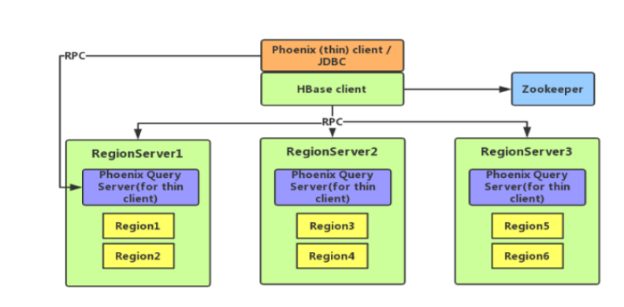

  

在phoenix中，表名等会自动转换为大写，若要小写，使用双引号，如"us_population"。

  

二级索引

  

#### 全局索引

Global Index是默认的索引格式，创建全局索引时，会在HBase中建立一张新表。也就是说索引数据和数据表是存放在不同的表中的，因此全局索引适用于多读少写的业务场景。

写数据的时候会消耗大量开销，因为索引表也要更新，而索引表是分布在不同的数据节点上的，跨节点的数据传输带来了较大的性能消耗。

在读数据的时候Phoenix会选择索引表来降低查询消耗的时间。

  

如果想查询的字段不是索引字段的话索引表不会被使用，也就是说不会带来查询速度的提升。

若想解决上述问题，可采用如下方案：

1）使用包含索引

2）使用本地索引

  

#### 包含索引

**创建携带其他字段的全局索引**

** **  

** **  

#### 本地索引

Local Index适用于写操作频繁的场景。

索引数据和数据表的数据是存放在同一张表中（且是同一个Region），避免了在写操作的时候往不同服务器的索引表中写索引带来的额外开销。

  

  

  

  

  

  

  

  

  

