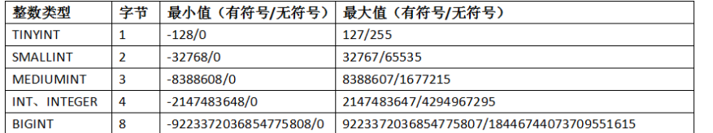
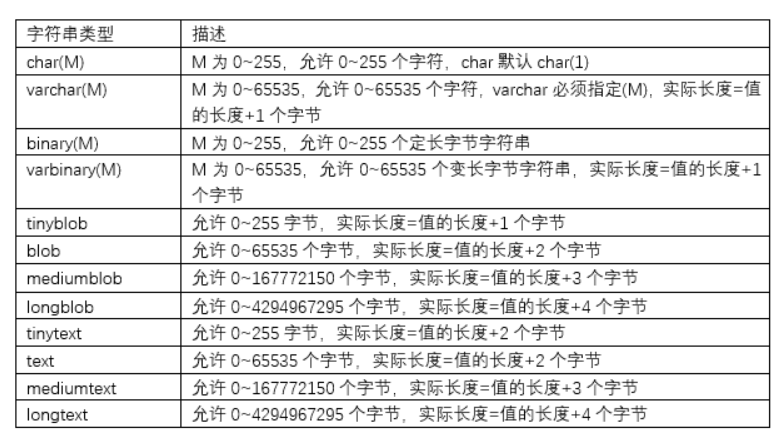
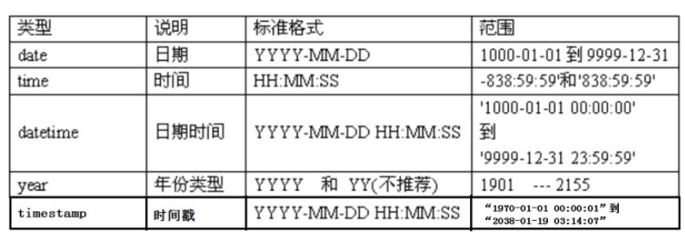

数据（Data）是指对客观事物进行描述并可以鉴别的符号，这些符号是可识别的、抽象的。它不仅仅指狭义上的数字，而是有多种表现形式：字母、文字、文本、图形、音频、视频等。现在计算机存储和处理的数据范围十分广泛，而描述这些数据的符号也变得越来越复杂。

​  

数据库（Database，DB）指的是以一定格式存放、能够实现多个用户共享、与应用程序彼此独立的数据集合。 为什么要用数据库？因为应用程序产生的数据是在内存中的，如果程序退出或者是断电了，则数据就会消失。使用数据库是为了能够永久保存数据。当然这里指的是非内存数据库。用普通文件存储行不行？把数据写入到硬盘上的文件中，当然可以实现持久化的目标，但是不利于后期的检索和管理等。

​  

数据库管理系统（Database Management System，DBMS）是用来定义和管理数据的软件。如何科学的组织和存储数据，如何高效的获取和维护数据，如何保证数据的安全性和完整性，这些都需要靠数据库管理系统完成。目前，比较流行的数据库管理系统有：Oracle、MySQL、SQL Server、DB2等。

​  

数据库管理员（Database Administrator，DBA）是指对数据库管理系统进行操作的人员，其主要负责数据库的运营和维护。

​  

根据数据的组织结构不同，主要分为网状数据库、层次数据库、关系型数据库和非关系型数据库四种。目前最常见的数据库模型主要是：关系型数据库和非关系型数据库。

​  

关系型数据库模型是将复杂的数据结构用较为简单的二元关系（二维表，类似于Excel工作表 ）来表示，在该类型数据库中，对数据的操作基本上都建立在一个或多个表格上，我们可以采用结构化查询语言（SQL）对数据库进行操作。

​  

关系型数据库是目前主流的数据库技术，其中具有代表性的数据库管理系统有：Oracle、DB2、SQL Server、MySQL等。

​  

NOSQL（Not Only SQL）泛指非关系型数据库。关系型数据库在超大规模和高并发的web2.0纯动态网站已经显得力不从心，暴露了很多难以克服的问题。NOSQL数据库的产生就是为了解决大规模数据集合多重数据种类带来的挑战，尤其是大数据应用难题。

​  

**注意**：NoSQL数据库虽然有很多的优点，但有其适用场景，并无法全面替代SQL数据库，关系型数据库是目前主流的数据库技术。比如在商城项目中，商品、用户、订单信息要保存在SQL数据库中，但是实现秒杀的功能可以通过NoSQL数据库来实现，且最终秒杀后的订单信息还是要保存在SQL数据库中

​  

Oracle数据库具有很好的开放性，能在所有的主流平台上运行，并且性能高、安全性高、风险低；但是其对硬件的要求很高、管理维护和操作比较复杂而且价格昂贵，所以一般用在满足对银行、金融、保险等行业大型数据库的需求上。

​  

DB2是IBM公司著名的关系型数据库产品。DB2无论稳定性，安全性，恢复性等等都无可挑剔，而且从小规模到大规模的应用都可以使用，但是用起来非常繁琐，比较适合大型的分布式应用系统

​  

SQL Server只能在Windows系统下运行，毫无开放性可言。

​  

MySQL是一种开放源代码的轻量级关系型数据库，同时它也是一个支持多线程高并发多用户的关系型数据库管理系统。MySQL数据库使用最常用的结构化查询语言（SQL）对数据库进行管理。由于MySQL是开放源代码的，因此任何人都可以在General Public License的许可下下载并根据个人需要对其缺陷进行修改。

  

  

SQL（Structured Query Language）是结构化查询语言的简称，它是一种数据库查询和程序设计语言，同时也是目前使用最广泛的关系型数据库操作语言,使用SQL语言来实现数据的存取、查询、更新等功能。SQL是一种非过程化语言，只需提出“做什么”，而不需要指明“怎么做”。具有集数据查询、数据操纵、数据定义和数据控制功能于一体，类似自然语言、简单易用以及非过程化等特点，得到了快速的发展

​  

SQL语言分为五个部分：

□ 数据查询语言（Data Query Language，DQL）：DQL主要用于数据的查询，其基本结构是使用SELECT子句，FROM子句和WHERE子句的组合来查询一条或多条数据。 可以进行单表查询、还是进行多表连接查询、子查询等。

1) SELECT：查询数据

□ 数据操作语言（Data Manipulation Language，DML）：DML主要用于对数据库中的数据进行增加、修改和删除的操作，主要包括：

1) INSERT：增加数据

2) UPDATE：修改数据

3) DELETE：删除数据

□ 数据定义语言（Data Definition Language，DDL）：DDL主要用针对是数据库对象（数据库、表、索引、视图、触发器、存储过程、函数）进行创建、修改和删除操作。其主要包括：

1) CREATE：创建数据库对象

2) ALTER：修改数据库对象

3) DROP：删除数据库对象

□ 数据控制语言（Data Control Language，DCL）：DCL用来授予或回收访问数据库的权限，其主要包括：

1) GRANT：授予用户某种权限

2) REVOKE：回收授予的某种权限

□ 事务控制语言（Transaction Control Language，TCL）：TCL用于数据库的事务管理。其主要包括：

1) START TRANSACTION：开启事务

2) COMMIT：提交事务

3) ROLLBACK：回滚事务

4) SET TRANSACTION：设置事务的属性

​  

-   数据操纵语言（insert、update、delete）针对表中的数据
-   数据定义语言（create、alter、drop）针对数据库对象，比如数据库database、表table、索引index、视图view、存储过程procedure、触发器trigger

​  

​  

## MySQL数据类型

-   整型系列：xxxInt

int(M)，必须和zerofill一起使用才有意义，并且默认添加unsigned

unsigned 无符号数，没有负数，最小为0

对于整数类型，MySQL还支持在类型名称后面加小括号(M)，而小括号中的M表示显示宽度，M的取值范围是(0, 255)。int(M)这个M在字段的属性中指定了unsigned（无符号）和zerofill（零填充）的情况下才有意义。表示当整数值不够M位时，用0填充。如果整数值超过M位但是没有超过当前数据类型的范围时，就按照实际位数存储。当M宽度超过当前数据类型可存储数值范围的最大宽度时，也是以实际存储范围为准.从MySQL 8.0.17开始，整数数据类型不推荐使用显示宽度属性，默认显示int。

  

-   浮点型系列：float,double（或real)

double(M,D)：表示最长为M位，其中小数点后D位

例如：double(5,2)表示的数据范围[-999.99,999.99]，如果超过这个范围会报错。

浮点型FLOAT(M，D) 和DOUBLE(M，D)是非标准用法，如果考虑到数据库迁移，则最好不要使用，而且从MySQL 8.0.17开始，FLOAT(M，D) 和DOUBLE(M，D)用法在官方文档中已经明确不推荐使用，将来可能被移除。另外，关于浮点型FLOAT和DOUBLE的UNSIGNED也不推荐使用了，将来也可能被移除。FLOAT和DOUBLE类型在不指定（M，D）时，默认会按照实际的精度来显示。DECIMAL类型在不指定（M，D）时，默认为（10，0），即只保留整数部分。例如，定义DECIMAL（5,2）的类型，表示该列取值范围是-999.99~999.99。如果用户插入数据的小数部分位数超过D位，MySQL会四舍五入处理，但是如果用户插入数据的整数部分位数超过“M-D”位，则会报“Out of range”的错误

​  

-   定点型系列：decimal（底层实际上是使用字符串进行存储），精确存储，且存储范围大于double。存取货币值可以使用该类型

decimal(M,D)：表示最长为M位，其中小数点后D位

DECIMAL实际是以字符串形式存放的，在对精度要求比较高的时候（如货币、科学数据等）使用DECIMAL类型会比较好。浮点数相对于定点数的优点是在长度一定的情况下，浮点数能够表示更大的数据范围，它的缺点是会引起精度问题。

​  

-   位类型：bit

字节范围是：1-8，值范围是：bit(1)~bit(64)，默认bit(1)

用来存储二进制数。插入bit类型字段时，使用bit()函数转为二进制值再插入，因为二进制码是“01”。读取时直接使用select命令将不会看到结果，可以使用bit()或hex()函数进行读取。

对于位类型字段，之前版本直接使用SELECT语句将不会看到结果，而在MySQL8版本中默认以“0X”开头的十六进制形式显示，可以通过BIN()函数显示为二进制格式。

​  

​  

#### 2、字符串类型

-   字符串类型char,varchar(M)，char如果没有指定宽度，默认为1个字符；varchar(M)，必须指定宽度
-   binary和varbinary类似于char和varchar，不同的是它们包含二进制字符串，不支持模糊查询之类的。
-   text 存储字符串，比如简历，但是存储长度远超varchar
-   blob 存储二进制数据，比如图片、视频，但是存储长度远超varbinary一般在保存少量字符串的时候，我们会选择char和varchar；而在保存较大文本时，通常会选择使用text或blob系列。blob和text值会引起一些性能问题，特别是在执行了大量的删除操作时，会在数据表中留下很大的“空洞”，为了提高性能，建议定期时候用optimize table功能对这类表进行碎片整理。可以使用合成的(Synthetic)索引来提高大文本字段的查询性能，如果需要对大文本字段进行模糊查询，MySql提供了前缀索引。但是仍然要在不必要的时候避免检索大型的blob或text值。
-   enum枚举类型，它的值范围需要在创建表时通过枚举方式显式指定，对于1~255个成员的枚举需要1个字节存储；对于255\`65535个成员需要2个字节存储。例如：gender enum('男','女')。如果插入枚举值以外的值，会按第一个值处理。一次只能从枚举值中选择一个。
-   set集合类型，可以包含0~64个成员。一次可以从集合中选择多个成员。如果选择了1-8个成员的集合，占1个字节，依次占2个，3个。。8个字节。例如：hoppy set('吃饭','睡觉','玩游戏','旅游')，选择时'吃饭,睡觉'或'睡觉,玩游戏,旅游'

​  

#### 日期时间类型

日期时间类型：year, date, datetime, timestamp

timestamp和datetime的区别：

-   timestamp范围比较小。如上图所示，范围是"1970-01-01 00:00:01"--"2038-01-19 03:14:07"
-   timestamp和时区有关。例如，在东八区插入的TIMESTEMP数据为2017-07-11 16:43:25，在东七区显示时，时间部分就变成了15:43:25，在东九区显示时，时间部分就变成了17:43:25。

-   show variables like 'time\_zone';
-   set time\_zone = '+9:00';

-   如果需要经常插入或更新日期时间为系统日期时间，则通常使用TIMESTAMP类型，格式为“YYYY-MM-DD HH:MM:SS”，例如“2022-02-04 10:08:08”；

  

## MySQL运算符

加：+ 在MySQL +就是求和，没有字符串拼接,可以使用concat函数

减：-

乘：\*

除：/ div（只保留整数部分）

模：% mod

mysql中没有 +=等运算符

大于：>

小于：<

大于等于：>=

小于等于：<=

等于：= 不能用于null判断(Java中的等于是==，赋值是=)

不等于：!= 或 <>

安全等于：<=> 可以用于null值判断

逻辑与：&& 或 and

逻辑或：|| 或 or

逻辑非：! 或 not

逻辑异或：^ 或 xor

区间范围：between x and y

not between x and y

集合范围：in (x,x,x)

not in(x,x,x)

模糊查询

like 'xxx'

如果想要表示0~n个字符，用%

如果想要表示确定的1个字符，用\_

正则查询

regexp '正则'