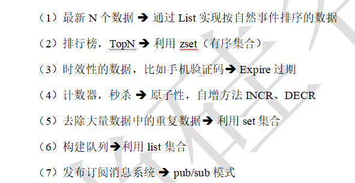
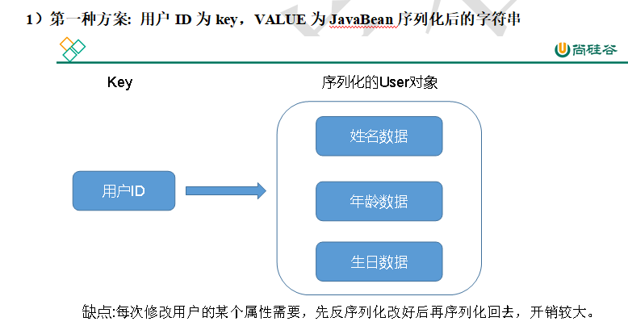
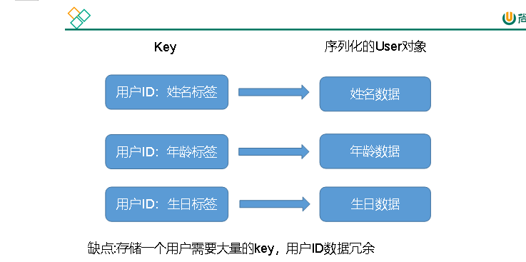
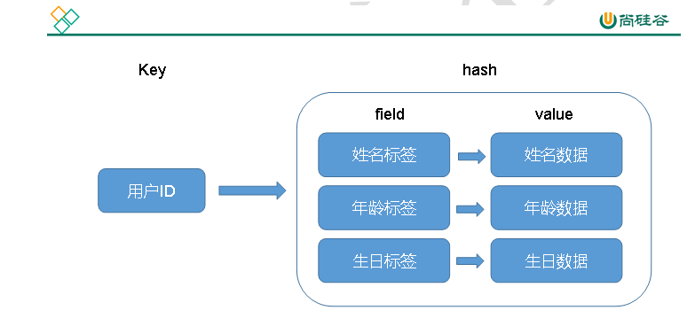

# NOSQL数据库简介

特点:not only SQL 非关系类型的数据库,为某一领域的特定场景而设计,远超SQL的性能,一般适用于海量数据的读写,数据的高可拓展性,数据高并发的写入

但,不支持事务支持,（1）不遵循SQL标准（2）不支持ACID

（2）基于SQL的结构化查询存储，处理复杂的关系，需要即席查询。

  

#### NoSql数据库的代表:Redis,Mongodb,hbase

**2****）****Redis**

（1）几乎覆盖了Memcached的绝大部分功能。

（2）数据都在内存中，支持持久化，主要用作备份恢复。

（3）支持丰富的数据类型，例如 string 、list 、set、zset、hash等。

（4）一般是作为缓存数据库辅助持久化的数据库

**M****ongoDB**

（1）高性能、开源、模式自由的文档型数据库。

（2）数据都在内存中，如果内存不足，把不常用的数据保存到硬盘。

（3）虽然是key-value模式，但是对value（尤其是json）提供了丰富的查询功能。

（4）支持二进制数据及大型对象。

（5）可以根据数据的特点替代RDBMS（关系数据库管理系统），成为独立的数据库。或者配合RDBMS，存储特定的数据。

**H****Base**

（1）HBase是Hadoop项目的数据库，主要用于对大量数据进行随机、实时的读写操作。

（2）HBase能支持到数十亿行× 百万列的数据表。

**N****eo4j**

（1）Neo4j是基于图结构的数据库，一般用于构建社交网络、交通网络、地图等。

# Redis简介

（1）Redis官方网站 [http://Redis.io](http://Redis.io)

（2）Redis中文官方网站 [http://www.Redis.net.cn](http://www.Redis.net.cn)

redis是以K-V类型存储的,但是其的value类型丰富,支持String,Zset(sorted set),List,Set,Hash等

更新的数据周期性写入磁盘,或者将修改的操作写入追加的记录文件

支持高可用与集群模式

​  

Zset--------适用于排行榜,TopN之类的有序集合

List----------实现自然事件排序的数据

  

#### Redis常使用的场景:

配合关系型数据库做高速缓存

(1)高频词,降低数据库的IO (2)旁路缓存模式 Cache Aside Pattern

大数据场景

(1)缓存数据 (2)临时数据 (3)计算结果

# Redis安装

​  

redis默认十六个库,每个库对应一个下标,从0开始

  

# Redis五大数据类型

​  

#### String

Value类型最基本的类型,适合保存单值类型,是String,二进制,可以存储一切数据,Value最大支持512m

​  

#### List

单键多值,Redis List的底层是一个双向链表,顺序排序,对两端的操作处理性能高

#### Set

无序不重复,且提供了一个成员是否在Set集合内的接口,底层是一个以Value为Null的hash表,添加,删除,查找的复杂度都是O(1)

#### Zset

是一个没有重复元素的字符串集合。不同之处是有序集合的每个成员都关联了一个评分（score），这个评分（score）被用来按照从最低分到最高分的方式排序集合中的成员。集合的成员是唯一的，但是评分可以是重复了。

因为元素是有序的，所以你也可以很快的根据评分（score）或者次序（position）来获取一个范围的元素。访问有序集合的中间元素也是非常快的，因此你能够使用有序集合作为一个没有重复成员的智能列表。

#### Hash

键值对集合,hash值是由多个field和Value的映射表,类似于Map中的Map<String,Object>

#### 分析一个问题: 现有一个User 对象，在Redis中如何存?

**第二种方案: 用户ID+属性名作为key, 属性值作为Value**

  

**第三种方案: 通过key（用户ID） + field（属性标签）就可以操作对应属性数据了，既不需要重复存储数据，也不会带来序列化和并发修改控制的问题**

# Jedis

是Redis的客户端,提供Java方法来操作Redis

# Redis持久化

  

#### Rdb(Redis Database)

在指定的时间间隔内将内存中的数据集快照写入磁盘，也就是行话讲的Snapshot快照，它恢复时是将快照文件直接读到内存里。

单独开一个线程来将数据持久化写入磁盘,在这时候主线程停止IO操作,在指定的时间间隔内将内存中的数据集快照写入磁盘，也就是行话讲的Snapshot快照，它恢复时是将快照文件直接读到内存里。

RDB的缺点是最后一次持久化后的数据可能丢失。

​  

​  

节省磁盘空间，恢复速度快。

虽然Redis在fork时使用了写时拷贝技术，但是如果数据庞大时还是比较消耗性能。在备份周期在一定间隔时间做一次备份，所以如果Redis意外down掉的话，就会丢失最后一次快照后的所有修改。

#### AOF(append only File)

  

以日志的形式记录文件的操作(除了读之外),只许追加文件但不可以改写文件，Redis启动之初会读取该文件重新构建数据，换言之，Redis重启的话就根据日志文件的内容将写指令从前到后执行一次以完成数据的恢复工作

​  

AOF采用文件追加方式，文件会越来越大为避免出现此种情况，新增了重写机制，当AOF文件的大小超过所设定的阈值时，Redis就会启动AOF文件的重写，只保留可以恢复数据的最小指令集。可以使用命令bgrewriteaof手动开始重写。

重写虽然可以节约大量磁盘空间，减少恢复时间。但是每次重写还是有一定的负担的，因此设定Redis要满足一定条件才会进行重写。

系统载入时或者上次重写完毕时，Redis会记录此时AOF大小，设为base\_size，如果Redis的AOF当前大小>= base\_size + base\_size\*100% （默认）且当前大小>=64mb（默认）的情况下，Redis会对AOF进行重写。

  

  

1）备份机制更稳健，丢失数据概率更低。

（2）可读的日志文本，通过操作AOF文件，可以处理误操作。

​  

（1）比起RDB占用更多的磁盘空间。

（2）恢复备份速度要慢。

（3）每次写都同步的话，有一定的性能压力。

（4）存在个别bug，造成恢复不了。

​  

​  

​  

​  

AOF的优先级大于RDB，如果同时开启了AOF和RDB，Redis服务启动时恢复数据以AOF为准。

​  

（1）官方推荐两个都启用。

（2）如果对数据不敏感，可以选单独用RDB。

（3）不建议单独用 AOF，因为可能会出现Bug。

（4）如果只是做纯内存缓存，可以都不用。