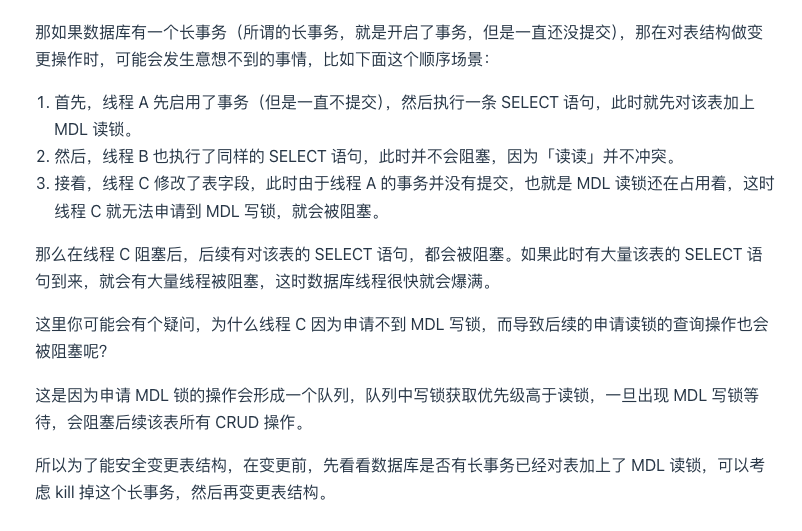
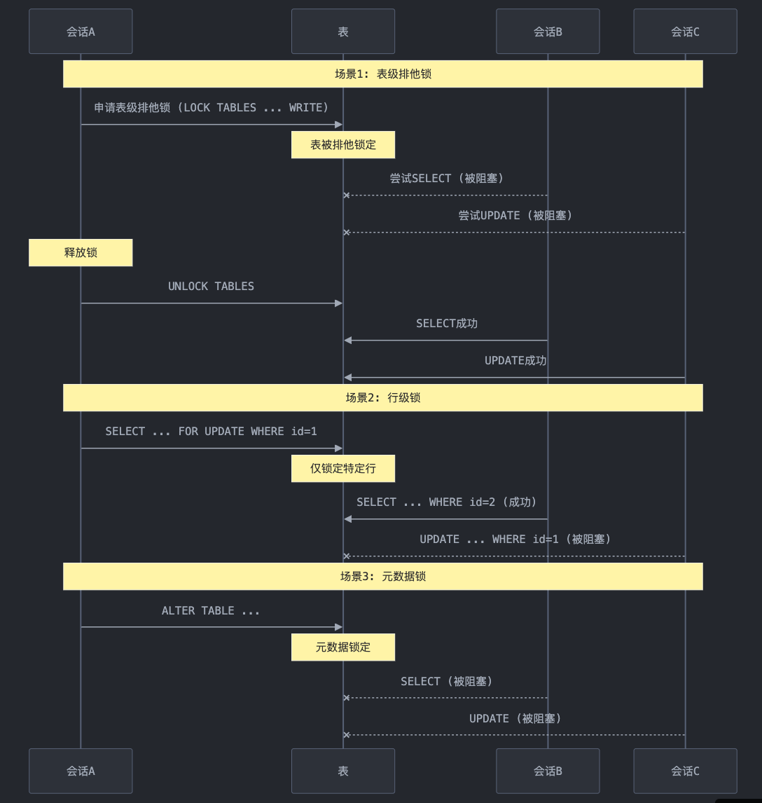

##### 事务

innnodb支持实现事务

###### 概述

数据库会将单条sql做隐形事务处理，想要多条sql为事务需要手动开启提交回滚等。

-   持久性是通过 redo log （重做日志）来保证的。
-   原子性是通过 undo log（回滚日志） 来保证的。
-   隔离性是通过 MVCC（多版本并发控制） 或锁机制来保证的。
-   一致性则是通过持久性+原子性+隔离性来保证。

###### 并发事务的异常情况

在事务并发的时候出现的事务丢失的场景

-   回滚丢失，某事务回滚导致其余事务更新丢失
-   提交丢失，事务并发执行的时候，存在事务被覆盖了

在并发访问数据库的时候，可能会出现

1.  脏读（Dirty Read），读取未提交数据。A 事务读取 B 事务尚未提交的数据，此时如果 B 事务发生错误并执行回滚操作，那么 A 事务读取到的数据就是脏数据。
2.  不可重复读（Non-repeatable Read） 前后多次读取，数据内容不一致。A 事务在 B 事务开始前读和 B 事务结束后读的数据不一样，因为数据被事务 B 给修改了。
3.  幻读（Phantom Read）一个行出现在查询结果集中，但不在较早查询的结果集中。事务 A 在读取某个范围内的记录时，事务 B 在该范围内插入了新记录，事务 A 再次读取该范围内的记录时，会产生幻行。可以通过间隙锁不允许范围内插入数据来实现

###### 悲观锁和乐观锁

-   悲观锁在访问数据时会立即加锁，假设其他事务会频繁修改数据，适用于高并发、冲突较多的场景
-   乐观锁不在数据读取时加锁，而是在事务准备提交时 更新时检查数据的版本号是否与刚生成事务的时候一致，以是否被其他事务修改，如果被修改则回滚事务

###### 事务的隔离级别

-   读未提交，可以读取到未提交的事务执行的操作
-   读已提交，可以读取到本次会话查询的时已经提交的事务，每次查询的时候生成一个新的事务id
-   可重复读，不会出现两次查询出现了不一样的值的情况，本质是保存了会话第一次查询的时候的readview序号，后续查询的时候重用这个序号，不受后续更新的影响
-   串行化，每个事务都只能串行化执行，性能下降

上述的隔离级别都不能做到避免幻度

###### 隔离级别的实现机制

-   使用mvcc（Multi-Version Concurrency Control）多版本并发控制，以乐观锁为理论基础。通过对数据行的多个版本管理来实现数据库的并发控制，通过比较版本号决定数据是否显示出来
-   实现mvcc 需要使用到 版本链和read view
-   innodb给聚集索引后面会生成两个字段，一个是本次更新的事务id，一个回滚指针 存储本次更新前的最新数据的地址，这就是版本链，是一个链表的结构，递增，头也就是最新的数据
-   通过read view 相当于一个数据快照，通过对比该事务生成read view事的 事务id编号，与其它事务提交的id 编号 对比 ，判断其它事务的提交时间与 当前生产的read view 的时间对比，来决定是否读取该事务提交的数据

  

##### 索引

###### 概述

底层是b+树，存储了特定列的值以及指向包含这些值的数据行的指针，导入数据的时候会更新索引，支持选择索引的具体类型，tree，hash ，选择的创建索引的具体算法

-   聚集索引，自动为主键字段创建一个索引，一个表中只能有一个
-   二级索引｜辅助索引 通过主动创建语法创建的索引，执行的时候先通过二级索引找到主键，然后通过主键获取数据，遍历两次二叉树
-   前缀索引 当指定的索引列的长度过长例如 text会使用前n个字符来创建索引

###### 聚集与非聚集索引

-   聚集将索引和数据存放在一个文件中，数据按序存放，对于范围查询处理迅速，顺序插入的时候处理很快，但是乱序就不行，非聚集将索引和存放数据的地址 存储在一起，所以每次查询需要执行两次io，但是由于乱序存储，插入数据处理快
-   innodb使用聚集，myisam使用非聚集
-   innodb会直接将主键变成聚集索引，没有主键的时候，生成一列为rowid，作为聚集索引

###### 联合索引和覆盖索引

-   通过指定多列来创建联合索引，最多支持16列
-   联合索引匹配的时候，

-   最左匹配原则，设定 （a,b）为联合索引，单独查询a 联合索引生效，但是单独查询b 联合索引不生效，生成b+树的时候，按照a来排序，a相同才是b排序，因此b全局无序，无法发挥索引的特性
-   所以设计联合索引的时候要求 数据区分度高的在前，方便过滤匹配
-   实际执行sql的时候，优化器会将where过滤的条件顺序置换成与联合索引中的顺序一样，但是当遇到范围查询的时候(不等值，between，like 不包括in)，最左匹配会停止匹配

-   当制作索引的字段也就是本次查询需要的字段时，就是覆盖索引

###### 索引失效的场景

-   常见的索引有，联合，主键，单列，唯一，全文，空间索引等
-   使用了函数或者表达式，字段涉及隐式类型转化，使用了or条件中的字段存在没有索引的情况，通配符like的使用，索引字段参加计算，某些版本使用了特殊的操作符null，is not null，<>,等情况
-   数据分布不均，或者查询范围等导致执行器直接扫描全表
-   查询字段超出索引覆盖范围，导致回表查询，比如说where中的a是覆盖索引，查询中的字段涉及了c
-   在使用explain的时候，如果出现了 using profile，表示排序的时候使用了外部排序，不是通过索引，可以考虑将排序键引入索引

##### 约束

为了保证 实体完整性，域完整性，引用完整性，自定义完整性

-   主键约束
-   唯一约束
-   外键约束
-   检查约束，使用check定义条件，可以设置异常时是否强制执行
-   默认值约束
-   非空约束

##### 锁

MySQL 加锁时，先生成锁结构，然后设置锁的状态，如果锁状态是等待状态，并不是意味着事务成功获取到了锁，只有当锁状态为正常状态时，才代表事务成功获取到了锁

###### 全局锁

常见的场景是，在全库备份的时候，防止更新行为导致数据不一样，此时数据库只读，不接受任何修改操作

###### 表级别

需要引擎支持，常见的myisam，innodb都支持，表级别又可以细分为

-   表锁

-   read级别，可以读取数据不能写入，不使用该锁也能读取数据，这里存在一个暂时放置的点，使用loacal修饰的read，LOCAL 修饰符允许其他会话在持有锁时执行无冲突的INSERT语句(并发插入)。但是，如果要在持有锁的同时使用服务器外部的进程操作数据库，则不能使用READ LOCAL。对于 InnoDB 表，READ LOCAL 和 READ 是一样的。
-   write级别，使用时，其余会话无法请求该表的锁，无法访问该表

一个会话申请锁后，仅能访问本次会话中申请到锁的表，会话结束后释放锁，申请新锁会释放旧锁，事务结束后释放锁，表锁慎用，范围太大，影响性能

-   元数据锁

-   用于保护数据库的元数据，如表结构、索引、权限等。这些锁用于协调对数据库对象的修改，以确保在进行元数据修改操作时不会干扰其他并发操作，同时保持数据库的一致性和完整性。在操作数据库的时候，会被自动添加上，事务提交后释放
-   当有线程在执行 SELECT 语句（ 加 MDL 读锁）的期间，如果有其他线程要更改该表的结构（ 申请 MDL 写锁），那么将会被阻塞，直到执行完 SELECT 语句（ 释放 MDL 读锁）。反之，当有线程对表结构进行变更（ 加 MDL 写锁）的期间，如果有其他线程执行了 CRUD 操作（ 申请 MDL 读锁），那么就会被阻塞，直到表结构变更完成（ 释放 MDL 写锁）
-   因为事务期间一直使用锁，如果某个长事务一直占用锁，后续线程中申请了与当前长事务使用的锁冲突的锁，将导致该线程请求阻塞，如果申请的这个锁优先级还高于后续等待执行的线程，将直接导致后续请求阻塞。解决方案是，先将长事务kill掉



-   意向锁

-   帮助实现多粒度锁同时存在，主要作用是通知其他会话某个表上是否已经存在更细粒度的锁（如行级锁或页级锁）

-   意向共享锁 (IS) 表示事务打算在表的各个行上设置共享锁。
-   意向排他锁 (IX) 表示事务打算对表的各个行上设置排它锁。

-   使用的时候，先会在表粒度使用意向xx锁，然后对具体的行使用 xx锁，这样别的会话申请锁的时候就知道该表已经有锁的存在了

-   自增锁

-   auto increment，不是一个独立的锁，与自增键关联使用，保证多个插入语句能分配到唯一的自增列值，锁不是在一个事务提交后才释放，而是在执行完插入语句后就会立即释放。一个事务在持有 AUTO-INC 锁的过程中，其他事务如果要向该表插入数据都会被阻塞，从而保证插入数据时，被 AUTO_INCREMENT 修饰的字段的值是连续递增的。会影响插入性能，因为另一个事务中的插入会被阻塞。
-   提供了个 innodb_autoinc_lock_mode 的系统变量，于控制自增列的锁定模式

-   0 传统模式 会锁定整张表，同时只能执行一条 INSERT 语句，以确保自增列的唯一性
-   1 连续模式 如果能够提前确定插入的数据量，使用较为轻量级的 mutex 锁，不能提前确认数据量，则还是会去获取自增锁
-   2 交叉模式 使用较为轻量的 mutex 锁，代价是多条insert并发执行后自增值不连续，因为 AUTO_INCREMENT 值分配会在多个 INSERT 语句间来回交叉执行

在主从节点数据同步的时候，如果binlog是satatemnt，且使用的模式为2，由于并发执行，导致主从的自增键的值对不上的问题，mysql8，将binlog改成了row

###### 页级别

页级锁的特点是锁定粒度介于表级锁与行级锁之间，所以获取锁需要的资源开销，该引擎已在 MySQL 5.5 被正式弃用

###### 行级别

innodb支持，myisam不支持，可分为四类

-   Record Lock，记录锁，也就是仅仅把一条记录锁上

-   s锁，共享锁，其他事务可以继续加s锁，但是不能加x锁
-   x锁，排他锁，其他事务不能加s，x

-   Gap Lock，间隙锁，锁定一个范围，但是不包含记录本身，左开右开

-   对于键值在条件范围内但并不存在的记录叫做间隙
-   为了解决可重复读的幻读场景，对于多线程造成的各种场景，幻读，不可重复读等不清楚
-   当范围条件不是等值的时候，会对符合范围的数据索引项加锁

-   Next-Key Lock 临键锁：Record Lock + Gap Lock 的组合，锁定一个范围，并且锁定记录本身

-   左开右闭
-   仅对非唯一索引列生效，当作用于唯一索引列的时候，会降级成为记录锁

-   插入意向锁，间隙锁，由 INSERT 操作在插入之前设置，表示想要插入，但是位于等待

-   在插入一条记录的时候，需要判断插入位置是否已被其他事务加了间隙锁，如果存在会导致插入操作阻塞，等待释放期间生成一个 插入意向锁，
-   插入到相同索引间隙中的多个事务如果插入位置不同，则不需要彼此等待插入意向锁，其粒度更小，对性能影响更小

  

###### 锁的优化

-   使用更细粒度的锁
-   全表更新时改成分批更新，减少范围，控制事务大小
-   一定需要修改表结构时，低峰执行，在线ddl，分批处理

  



  

  

##### Binlog

###### statement

-   仅记录对数据修改的sql，减少了数据量

###### row

-   仅记录修改的行，记录所有数据的变动，会冗余，例如修改一个表结构，所有的数据都会被记录

###### mixed

-   混合使用，例如表结构修改使用statement，其余使用row，

##### 存储程序

###### 存储过程

本质就是封装好的sql，里面可以包含游标，触发器，存储函数等，在传统工业和复杂报表分析中使用比较多，但是在需求变化较快的场景下倾向于将业务逻辑凡在应用层。

通过CREATE PROCEDURE 创建，begin end指定sql语句，指定输入参数，返回值，通过call调用，由于冲突每次使用前需要指定语句分割符，与方法类似。

###### 存储函数

与存储过程不同在于，会返回一个计算结果，存储过程可以不返回，创建语法为 CREATE FUNCTION，通过select的方式调用，类似于自定义函数

###### 触发器

通过create trigger的方式创建，支持 增删改 级别的事件触发，支持 选择触发的时机为发生前还是后，支持行级语句级触发，会影响数据导入的速度

###### 事件

create event创建，相当于一个定时任务，支持指定执行的频率，也被称为时间调度器，可以用于定时插入数据，清除日志等，由事件调度器管理。

###### 视图

这里的视图类似于一个定义好的sql语句，create view来创建

###### 游标

cursor，可以在存储过程中使用，本质一个对结果集的处理对象，只能逐行向前处理，使用的时候先 申明declare 然后打开 然后遍历数据编写处理逻辑，然后关闭，通过fetch读取每次处理的数据。

```sql
CREATE PROCEDURE curdemo()
BEGIN
  DECLARE done INT DEFAULT FALSE;
  DECLARE a CHAR(16);
  DECLARE b, c INT;
  DECLARE cur1 CURSOR FOR SELECT id,data FROM test.t1;
  DECLARE cur2 CURSOR FOR SELECT i FROM test.t2;
  DECLARE CONTINUE HANDLER FOR NOT FOUND SET done = TRUE;

  OPEN cur1;
  OPEN cur2;

  read_loop: LOOP
    FETCH cur1 INTO a, b;
    FETCH cur2 INTO c;
    IF done THEN
      LEAVE read_loop;
    END IF;
    IF b < c THEN
      INSERT INTO test.t3 VALUES (a,b);
    ELSE
      INSERT INTO test.t3 VALUES (a,c);
    END IF;
  END LOOP;

  CLOSE cur1;
  CLOSE cur2;
END;
```