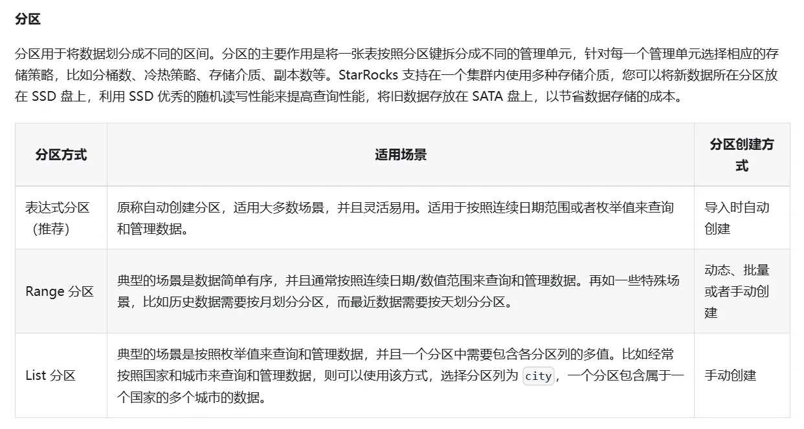

## 基本概念

-   starrocks是列存数据库，mpp执行框架，Massively Parallel Processing，但是也支持行存 行存适合查询大量字段的,部分列更新，列存适合涉及字段少的，聚合计算等
-   架构设计可以分为存算一体 存算分离，fe，be｜cn 。fe负责管理表的元数据，客户端的链接，任务的调度等，be可进一步分为exection engine ，storage engine 在存算一体框架中负责存储数据，计算数据，cn在存算分离框架中，实际的数据由外部存储(也就是数据糊的概念)，cn仅负责数据计算任务和缓存热数据，为了加速读取外部数据，设计了缓存的体系，cn就是缓存的一环。
-   当按照存算分离的方式部署的时候，连接外部数据首先需要创建相应的数据目录catalog，确定数据存储的配置，创建存储卷，然后创建对应的外部表，
-   实际执行查询的时候，一个查询在逻辑上切分为多个逻辑执行单元，由一个或者多个物理执行单元来具体实现
-   使用explain解析实际查询的时候，从下向上看，也就是执行的实际流程，最开始的查询，到后面的聚合，相当于 query profile
-   向数据库中分批写入数据，每次都是一个事务，遵守ACID原则
-   CATA，用于实时同步上游的表结构，其实是 create table as select的缩写
-   既席查询，其实就是用户自己定义查询的条件，非写死，写死的叫做固化查询，前者需要快速返回结果，hive不擅长这种模式
-   导入数据常见的方式，batch，streaming
-   StarRocks是分布式数据库，底层表数据存储是sharding的。A的数据分布在多台机器上，每次查询多台机器返回的顺序可能不同，就会导致每次B顺序不一致
-   SQL 语句在 StarRocks 中的生命周期可以分为查询解析（Query Parsing）、规划（Query Plan）、执行（Query Execution）三个阶段
-   starrocks支持 http sql 也就是sql包含在http中，请求返回 json object

  

###### 表设计

-   表的元数据管理catalogs，也就是数据目录，starrocks中对于数据的存储位置可以分为内外数据的catalogs，单表支持的数据量在TB级别
-   在表中的数据存储的时候，涉及分区 分区是逻辑上分开，查询的时候方便范围，支持 range，list分区等，实际存储的时候每个数据都是一个bucket分桶存储，distributed by，建议高频使用的列参与

-   分桶存储的方式
-   Round-Robin：以轮询的方式把数据逐个放置在相邻节点上。
-   Range：按区间进行数据分布。如上图所示，区间 [1-3]、[4-6] 分别对应不同的范围 (Range)。
-   List：直接基于离散的各个取值做数据分布，性别、省份等数据就满足这种离散的特性。每个离散值会映射到一个节点上，多个不同的取值可能也会映射到相同节点上。
-   Hash：通过哈希函数把数据映射到不同节点上。

-   
-   建表的时候支持指定排序键，最好是查询时常用的过滤列，用于加速查询
-   创建表的时候索引 支持手动指定，同时会有默认生成索引
-   创建临时表，
-   删除表后24小时内支持通过restore的方式恢复，同时backup可以快速备份表
-   索引的字段设计太多会影响插入的顺序，因为是同步写入索引
-   底层存储：table--tablet--rowset--segment

###### 表类型

-   主键表，指定主键，更新行为，部分数据更新
-   明细表不支持修改历史数据，常见于存储日志数据
-   聚合表，相当于分组聚合函数，数据在导入的时候，数据合并的时候，查询的时候 会完成聚合行为
-   更新表 本质上 replace ，每次插入的数据会有一个version查询的时候使用最新的，unique key

###### 数据操作

-   update： delete + insert
-   insert into 批量写入 导致写一条和多条 在耗时上可以忽略不计
-   导入数据的方式有 broker\_load,pipe,routine\_load，stream Load

-   pipe方式导入,是unix较早的一批用于进程间通信的机制
-   stream Load 是一种基于 HTTP PUT 的同步导入方式。提交导入作业以后，StarRocks 会同步地执行导入作业，并返回导入作业的结果信息。您可以通过返回的结果信息来判断导入作业是否成功。

-   routine load任务做到 exactly one 也是依靠事务实现，保存了offset
-   BE（或 CN）上内存块的大小阈值，默认阈值为 100 MB。导入的数据在 BE（或 CN）上会先写入一个内存块，当内存块的大小达到这个阈值以后才会写回磁盘。如果阈值过小，可能会导致 BE（或 CN）上存在大量的小文件，影响查询的性能，这时候可以适当提高这个阈值来减少文件数量。如果阈值过大，可能会导致远程过程调用（Remote Procedure Call，简称 RPC）超时，这时候可以适当地调整该参数的取值
-   数据的导出 支持通过 export 导出到文件中，通过 flink导出
-   导入数据，从缓冲区接受，入内存或者直接写磁盘，中间数据合并

###### 特殊数据类型

-   bitmap类型，通过二进制，位运算，可用于加速查询，索引效果比较好，能够过滤掉一部分 Page，读取数据的时间明显减少
-   hill数据类型，一种用于统计数据集中唯一值个数的高效近似算法，所需的存储空间是1280比特，但是会有一定的误差度

​  

###### 索引

-   默认自动生成索引

-   前缀索引 ，写入数据时按照指定的排序键排序，每写入 1024 行数据构成一个逻辑数据块（Data Block），在前缀索引表中存储一个索引项，内容为该逻辑数据块中第一行数据的排序列组成的前缀
-   Ordinal 索引 记录 Data Page 的起始行号

-   支持的手动指定的索引

-   bitmap 适用于高基数列及组合查询，过滤效果较好
-   bloomfilter适用于基数较高的列，但是会有误判的情况
-   全文倒排索引 N-Gram bloom filter，一种特殊的 Bloom filter 索引，通常用于加速 `LIKE` 查询

###### 视图

-   视图和表, 物化视图(同步,异步),视图本质是一个sql语句,,物化视图是将数据存储, 同步异步物化是指加载数据的时效
-   同步物化视图, 目前仅能基于一张表, 做一些简单的聚合函数的视图,当基表的数据导入的时候,会被同步更新到视图中,会影响数据导入的效率,目前仅支持内表, 当执行sql的时候,系统判断结果值是否能从视图直接读取,这就是**查询改写,命中视图**
-   异步物理视图和星型模型，使用视图代替大宽表

###### 参数配置

-   参数配置分为，动态静态，静态需要重启服务后生效
-   starrocks中自定义变量，set @variable
-   部分参数需要改写，例如group\_concat的返回的字符的长度

  

###### 函数

-   常见的函数：

开窗，cume\_dist，lag，lead，preceding，following

count\_if，group\_concat，类似于array\_agg

特色函数计算留存，输出boolean类型的数组，retention函数

window\_funnel通过指定窗口的大小，时间粒度，执行模式，行为动作判断符合要求的数据，类似于flink中的匹配行为模式

array\_join拼接数组的元素，array\_sum

unnnest函数，列转行，与later view join使用，默认忽视 单列值为 null 或者空的情况，但是可以通过外连接留下

lambda ->

concat\_ws 使用 r作为参数，跳过null的异常值

left返回从左开始指定长度的字符

locate函数，返回指定的字符在给定数据中的索引

split\_part 按照指定分隔符拆开

substring， substring\_index

precentile

支持lamdba的语法

## 优化

##### 查询优化

1.  CBO优化,本质是 在 sql转化为 逻辑计划 再到物理计划时,通过统计数据库中的数据分布情况, 估算出每个算子的 执行代价(CPU,IO,网络传输,内存等) 找到执行代价最低的物理查询计划, 需要采集数据分布情况,默认是自动采集,支持手动配置,自定义
2.  物化视图，同步或者异步，执行查询的时候，判断是不是可以直接使用物化视图存储的数据，这一步称为查询该改写，异步比同步有更多的功能，例如多表聚合，定时调度
3.  加载数据到缓存中（支持预加载），冷热数据存储，data cache 以blcok为单位加载，这里的场景是 存算分离的时候，加载数据到计算节点上，提升访问速度，除了这里使用了缓存，还有query cache，相当于将聚合查询后的结果缓存到内存中，在下次类似的访问的时候，直接从缓存中加载就行了
4.  使用bitmap实现去重，将数据转化使用0，1标记的数组

-   节省存储空间：通过用 Bitmap 的一个 Bit 位表示对应下标是否存在，能节省大量存储空间。例如，对 INT32 类型的数据去重，如使用普通的 bitmap，其所需的存储空间只占 COUNT(DISTINCT expr) 的 1/32。StarRocks 采用一种设计的十分精巧的 bitmap，叫做 Roaring Bitmap，相较 Bitmap 会进一步减少内存占用。
-   加速计算：Bitmap 去重使用的是位运算，所以计算速度相较 COUNT(DISTINCT expr) 更快，而且 bitmap 去重在 StarRocks MPP 执行引擎中还可以并行加速处理，提高计算速度。

-   使用hll实现近似去重

5.  colocate join 本质是将多张表分到同一个group 中 ，这个group下的表 的副本，分桶键，桶的存放位置 保持一致 避免数据计算的出现数据跨节点带来的io消耗
6.  执行sql的时候将函数替换为更高效的数据结构去计算,例如将 去重的函数变成 使用bitmap计算的方式
7.  表裁剪，在关联的时候仅采集需要的字段，会被关联的键和数据（需要等值关联）
8.  采用默认的 BROADCAST 方式进行执行，也就是小表向大表广播的方式进行。如果两个 Join 的表都是大表，建议采用 SHUFFLE 的方式进行

##### 存储优化

1.  对于json数据的存储，由于会出现同样的key重复的场景，可以开启 flat\_json 配置，相当于减少了公共数据的占用，但是会影响导入时处理的速度，因为需要提取公共的相同的key

​  

##### 场景优化

-   在去重的列为string类型的时候，计算的速度受到影响，可以设计一张 与string 类型 对应的字典表，value为int类型，这样实际计算的时候可以使用int类型，也可以再优化 将int转化为bitmap， 提供了dict\_mapping() 在插入的时候生成相应的value