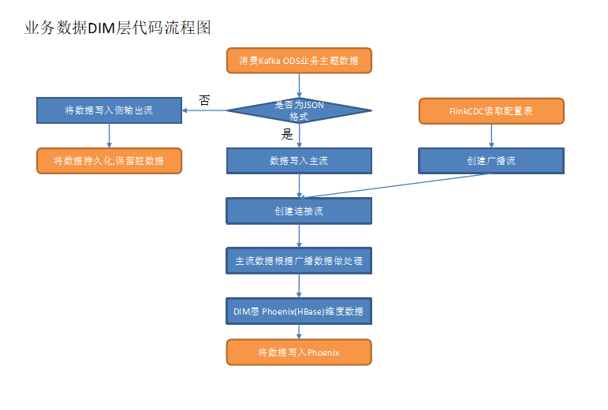
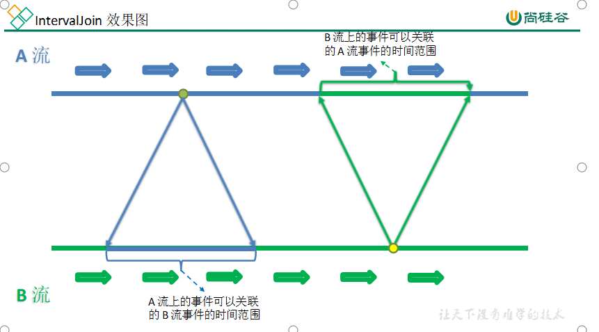
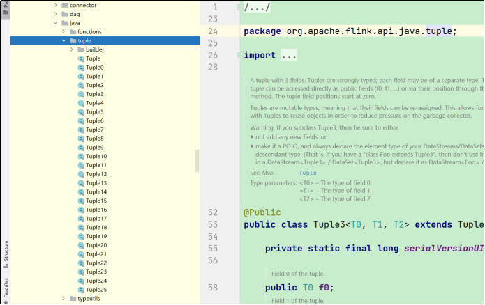
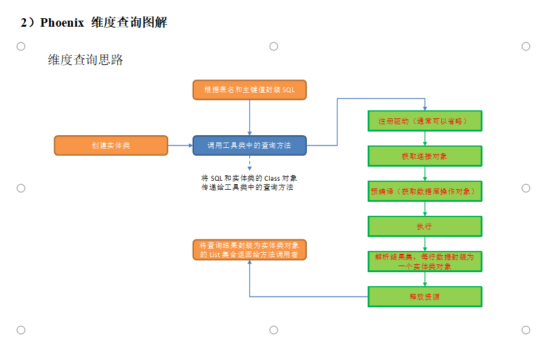
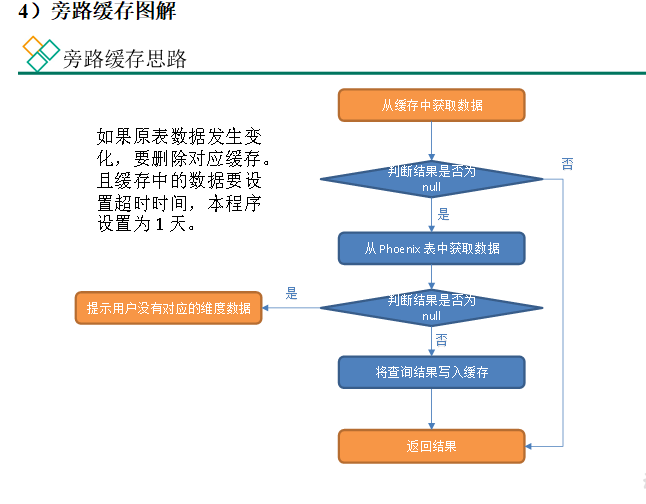
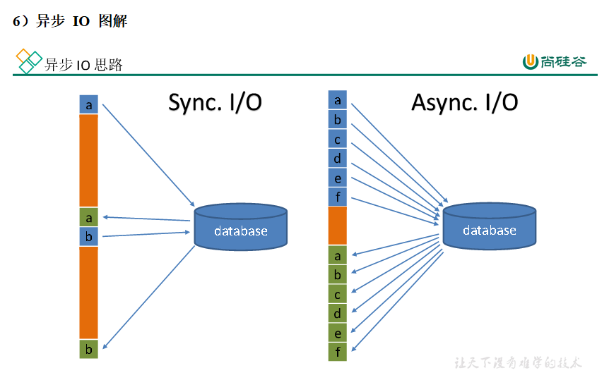

> [!note] 迁移说明(2026-09-09)
> 自 20-项目与工作/项目经验 迁入学习区:经全文核验,本篇为实时数仓课程知识笔记(尚硅谷教程向),非公司项目复盘,故整篇归位 10 区数据库建设。图片 assets 已随迁。

## 实时数仓的建模考虑

在电商离线数仓中，普通维度表是通过主维表和相关维表做关联查询生成的。与之对应的业务数表数据是通过每日一次全量同步导入到HDFS 的，只须每日做一次全量数据的关联查询即可。而实时数仓中，系统上线后我们采集的是所有表的变化数据，这样就会导致一旦主维表或相关维表中的某张表数据发生了变化，就需要和其它表的历史数据做关联。

此时我们会面临一个问题：如何获取历史数据？

对于这个问题，一种思路是在某张与维度表相关的业务表数据发生变化时，执行一次maxwell-bootstrap 命令，将相关业务表的数据导入Kafka。但是这样做又会面临三个问题：a）Kafka 中存储冗余数据；b）maxwell-bootstrap 命令交给谁去执行？必然会面临谁去调度的问题；c）实时数仓中的数据是以流的形式存在的，如果不同流中数据进入程序的机器时间差异过大就会出现join 不上的情况。如何保证导入的历史数据和变化数据可以关联上？势必要尽可能及时地执行历史数据导入命令且在Flink 程序中设置足够的延迟。而前者难以保证，后者又会影响整个实时数仓的时效性。

基于上述分析，对业务表做join 形成维度表的方式并不适用于实时数仓。

因此，在实时数仓中，我们不再对业务数据库中的维度表进行合并，仅对一些不需要的字段进行过滤，然后将维度数据写入HBase 的维度表中，业务数据库的维度表和HBase 的维度表是一一对应的。

写入维度数据使用HBase 的Phoenix 客户端提供的upsert 语法，实现幂等写入。当维度数据发生变化时，程序会用变化后的新数据覆盖Phoenix 维表中相同主键的旧数据。从而保证Phoenix 表中保存的是一份全量最新的维度数据。

这样做会产生一个问题：实时数仓没有保存历史维度数据，与数仓特征（保存历史数据）相悖。那么，维度表可以按照上述思路设计吗？

首先，我们要明确：数仓之所以要保存历史数据，是为了运用历史数据做一些相关指标的计算，而实时数仓本就是对最新的业务数据做分析计算，不涉及历史数据，因此无须保存历史数据。

此外，生产环境中实时数仓的上线通常不会早于离线数仓，如果有涉及到历史数据的指标，在离线数仓中计算即可。因此，实时数仓中只需要保留一份最新的维度数据，上述方案是切实可行的。

特别地，对于字典表，我们至多只会用到dic_code，dic_name 和 parent_code 三个字段，建立单独的维度表意义不大，选择将维度字段退化到事实表中。

  

  

## DIM层

本层的任务是将业务数据直接写入到不同的HBase 表中。那么如何让程序知道流中的哪些数据是维度数据？维度数据又应该写到HBase 的哪些表中？为了解决这个问题，我们选择在MySQL 中构建一张配置表，通过Flink CDC 将配置表信息读取到程序中。

####   

#### 配置表设计

**1** **）字段解析**

我们将为配置表设计五个字段.

- source_table：作为数据源的业务数据表名

- sink_table：作为数据目的地的Phoenix 表名

- sink_columns：Phoenix 表字段

- sink_pk：Phoenix 表主键

- sink_extend：Phoenix 建表扩展，即建表时一些额外的配置语句

将source_table 作为配置表的主键，可以通过它获取唯一的目标表名、字段、主键和建表扩展，从而得到完整的Phoenix 建表语句。

  

#### 动态拆分维度表的功能|动态配置的方案

由于Maxwell是把全部数据统一写入一个Topic中, 这样显然不利于日后的数据处理。所以需要把各个维度表拆开处理。

在实时计算中一般把维度数据写入存储容器，一般是方便通过主键查询的数据库比如HBase，Redis，MySQL等。

这样的配置不适合写在配置文件中，因为这样的话，业务端随着需求变化每增加一张维度表表，就要修改配置重启计算程序。所以这里需要一种动态配置方案，把这种配置长期保存起来，一旦配置有变化，实时计算可以自动感知。这种可以有三个方案实现：

一种是用Zookeeper存储，通过Watch感知数据变化；

另一种是用MySQL数据库存储，周期性的同步；

再一种是用MySQL数据库存储，使用广播流。

这里选择第三种方案，主要是MySQL对于配置数据初始化和维护管理，使用FlinkCDC读取配置信息表，将配置流作为广播流与主流进行连接。

  

  

## DWD层

#### Flink状态编程的TTL

ttl（time-to-live）即存活时间。表之间做普通关联时，底层会将两张表的数据维护到状态中，默认情况下状态永远不会清空，这样会对内存造成极大的压力。表状态的 ttl 是Idle（空闲，即状态未被更新）状态被保留的最短时间，假设 ttl 为10s，若状态中的数据在 10s 内未被更新，则未来的某个时间会被清除（故而ttl 是最短存活时间）。ttl 默认值为0，表示永远不会清空状态。

#### Flink的CET

（1）Flink CEP

跳出行为需要考虑会话中的两条页面日志数据（第一条为首页日志且超时时间内没有接收到第二条，或两条紧邻的首页日志到来可以判定第一条为跳出数据），要筛选的是组合事件，用filter 无法实现这样的功能，由此引出Flink CEP。

Flink CEP（Complex Event Processing 复杂事件处理）是在Flink上层实现的复杂事件处理库，可以在无界流中检测出特定的事件模型。用户定义复杂规则（Pattern），将其应用到流上，即可从流中提取满足 Pattern 的一个或多个简单事件构成的复杂事件。

（2）Flink CEP 定义的规则之间的连续策略

- 严格连续: 期望所有匹配的事件严格的一个接一个出现，中间没有任何不匹配的事件。对应方法为 next()；

- 松散连续: 忽略匹配的事件之间的不匹配的事件。对应方法为followedBy()；

- 不确定的松散连续: 更进一步的松散连续，允许忽略掉一些匹配事件的附加匹配。对应方法为followedByAny()。

  

#### FlinkSQL与外部的关联

JDBC SQL Connector

**）知识储备**

（1）JDBC SQL Connector

JDBC 连接器可以让Flink 程序从拥有JDBC 驱动的任意关系型数据库中读取数据或将数据写入数据库。

如果在Flink SQL 表的DDL 语句中定义了主键，则会以upsert 模式将流中数据写入数据库，此时流中可以存在UPDATE/DElETE（更新/删除）类型的数据。否则，会以 append 模式将数据写出到数据库，此时流中只能有INSERT（插入）类型的数据。

DDL 用法实例如下。

CREATE TABLE MyUserTable (

id BIGINT,

name STRING,

age INT,

status BOOLEAN,

PRIMARY KEY (id) NOT ENFORCED

) WITH (

'connector' = 'jdbc',

'url' = 'jdbc:mysql://localhost:3306/mydatabase',

'table-name' = 'users'

);

（2）Lookup Cache

JDBC 连接器可以作为时态表关联中的查询数据源（又称维表）。目前，仅支持同步查询模式。

默认情况下，查询缓存（Lookup Cache）未被启用，需要设置 lookup.cache.max-rows 和lookup.cache.ttl 参数来启用此功能。

Lookup 缓存是用来提升有JDBC 连接器参与的时态关联性能的。默认情况下，缓存未启用，所有的请求会被发送到外部数据库。当缓存启用时，每个进程（即TaskManager）维护一份缓存。收到请求时，Flink 会先查询缓存，如果缓存未命中才会向外部数据库发送请求，并用查询结果更新缓存。如果缓存中的记录条数达到了lookup.cache.max-rows 规定的最大行数时将清除存活时间最久的记录。如果缓存中的记录存活时间超过了lookup.cache.ttl 规定的最大存活时间，同样会被清除。

缓存中的记录未必是最新的，可以将lookup.cache.ttl 设置为一个更小的值来获得时效性更好的数据，但这样做会增加发送到数据库的请求数量。所以需要在吞吐量和正确性之间寻求平衡。

（3）Lookup Join

Lookup Join 通常在Flink SQL 表和外部系

统查询结果关联时使用。这种关联要求一张表（主表）有处理时间字段，而另一张表（维表）由Lookup 连接器生成。

Lookup Join 做的是维度关联，而维度数据是有时效性的，那么我们就需要一个时间字段来对数据的版本进行标识。因此，Flink 要求我们提供处理时间用作版本字段。

此处选择调用PROCTIME() 函数获取系统时间，将其作为处理时间字段。该函数调用示例如下

tableEnv.sqlQuery("select PROCTIME() proc_time")

.execute()

.print();

// 结果

+----+-------------------------+

| op | proc_time |

+----+-------------------------+

| +I | 2022-04-09 15:45:50.752 |

+----+-------------------------+

1 row in set

（4）JDBC SQL Connector 参数解读

- connector：连接器类型，此处为jdbc

- url：数据库url

- table-name：数据库中表名

- lookup.cache.max-rows：lookup 缓存中的最大记录条数

- lookup.cache.ttl：lookup 缓存中每条记录的最大存活时间

- username：访问数据库的用户名

- password：访问数据库的密码

- driver：数据库驱动，注意：通常注册驱动可以省略，但是自动获取的驱动是com.mysql.jdbc.Driver，Flink CDC 2.1.0 要求mysql 驱动版本必须为8 及以上，在mysql-connector -8.x 中该驱动已过时，新的驱动为com.mysql.cj.jdbc.Driver。省略该参数控制台打印的警告如下

Loading class \`com.mysql.jdbc.Driver'. This is deprecated. The new driver class is \`com.mysql.cj.jdbc.Driver'. The driver is automatically registered via the SPI and manual loading of the driver class is generally unnecessary.

（5）Kafka Connector

本节需要从Kafka 读取数据封装为Flink SQL 表，并将Flink SQL 表的数据写入Kafka，而整个过程的数据操作类型均为 INSERT，使用 Kafka Connector 即可。

Kafka Connector 参数如下

- connector：指定使用的连接器，对于 Kafka，只用 'kafka'。

- topic：主题。

- properties.bootstrap.servers：以逗号分隔的Kafka broker 列表。注意：可以通过properties.\* 的方式指定配置项，\*的位置用 Kafka 官方规定的配置项的key 替代。并不是所有的配置都可以通过这种方式配置，因为Flink 可能会将它们覆盖，如：'key.deserializer' 和'value.deserializer'。

- properties.group.id：消费者组ID。

- format：指定Kafka 消息中value 部分的序列化的反序列化方式，'format' 和'value.format' 二者必有其一。

- scan.startup.mode：Kafka 消费者启动模式，有四种取值。

- 'earliest-offset'：从偏移量最早的位置开始读取数据。

- 'latest-offset'：从偏移量最新的位置开始读取数据。

- 'group-offsets'：从Zookeeper/Kafka broker 中维护的消费者组偏移量开始读取数据。

- 'timestamp'：从用户为每个分区提供的时间戳开始读取数据。

- 'specific-offsets'：从用户为每个分区提供的偏移量开始读取数据。

默认值为group-offsets。要注意：latest-offset 与Kafka 官方提供的配置项latest 不同，Flink 会将偏移量置为最新位置，覆盖掉Zookeeper 或Kafka 中维护的偏移量。与官方提供的latest 相对应的是此处的group-offsets。

  

#### 多表关联

**1** **）知识储备**

（1）left join 实现过程

假设A 表作为主表与B 表做等值左外联。当 A 表数据进入算子，而B 表数据未至时会先生成一条B 表字段均为null 的关联数据ab1，其标记为+I。其后，B 表数据到来，会先将之前的数据撤回，即生成一条与ab1 内容相同，但标记为-D 的数据，再生成一条关联后的数据，标记为+I。这样生成的动态表对应的流称之为回撤流。

（2）Kafka SQL Connector

Kafka SQL Connector 分为Kafka SQL Connector 和 Upsert Kafka SQL Connector

① 功能

Upsert Kafka Connector支持以 upsert 方式从 Kafka topic 中读写数据

Kafka Connector支持从 Kafka topic 中读写数据

② 区别

a）建表语句的主键

i）Kafka Connector 要求表不能有主键，如果设置了主键，报错信息如下

Caused by: org.apache.flink.table.api.ValidationException: The Kafka table 'default_catalog.default_database.normal_sink_topic' with 'json' format doesn't support defining PRIMARY KEY constraint on the table, because it can't guarantee the semantic of primary key.

ii）而 Upsert Kafka Connector 要求表必须有主键，如果没有设置主键，报错信息如下

Caused by: org.apache.flink.table.api.ValidationException: 'upsert-kafka' tables require to define a PRIMARY KEY constraint. The PRIMARY KEY specifies which columns should be read from or write to the Kafka message key. The PRIMARY KEY also defines records in the 'upsert-kafka' table should update or delete on which keys.

iii）语法： primary key(id) not enforced

注意：not enforced 表示不对来往数据做约束校验，Flink 并不是数据的主人，因此只支持 not enforced 模式

如果没有not enforced，报错信息如下

Exception in thread "main" org.apache.flink.table.api.ValidationException: Flink doesn't support ENFORCED mode for PRIMARY KEY constaint. ENFORCED/NOT ENFORCED controls if the constraint checks are performed on the incoming/outgoing data. Flink does not own the data therefore the only supported mode is the NOT ENFORCED mode

b）对表中数据操作类型的要求

i）Kafka Connector 不能消费带有 Upsert/Delete 操作类型数据的表，如 left join 生成的动态表。如果对这类表进行消费，报错信息如下

Exception in thread "main" org.apache.flink.table.api.TableException: Table sink 'default_catalog.default_database.normal_sink_topic' doesn't support consuming update and delete changes which is produced by node TableSourceScan(table=[\[default_catalog, default_database, Unregistered_DataStream_Source_9]\], fields=[l_id, tag_left, tag_right])

ii）Upsert Kafka Connector 将 INSERT/UPDATE_AFTER 数据作为正常的 Kafka 消息写入，并将 DELETE 数据以 value 为空的 Kafka 消息写入（表示对应 key 的消息被删除）。Flink 将根据主键列的值对数据进行分区，因此同一主键的更新/删除消息将落在同一分区，从而保证同一主键的消息有序。

③ left join 结合Upsert Kafka Connector 使用范例

说明：Kafka 并行度为4

a）表结构

left表

id tag

A left

B left

C left

  

right 表

id tag

A right

B right

C right

b）查询语句

select

l.id l_id,

l.tag l_tag,

r.tag r_tag

from left l

left join right r

on l.id = r.id

c）关联结果写入到 Upsert Kafka 表，消费 Kafka 对应主题数据结果展示

{"l_id":"A","tag_left":"left","tag_right":null}

null

{"l_id":"A","tag_left":"left","tag_right":"right"}

{"l_id":"C","tag_left":"left","tag_right":null}

null

{"l_id":"C","tag_left":"left","tag_right":"right"}

{"l_id":"B","tag_left":"left","tag_right":null}

null

{"l_id":"B","tag_left":"left","tag_right":"right"}

④ 参数解读

本节需要用到Kafka 连接器的明细表数据来源于topic_db 主题，于Kafka 而言，该主题的数据的操作类型均为INSERT，所以读取数据使用 Kafka Connector 即可。而由于left join 的存在，流中存在修改数据，所以写出数据使用Upsert Kafka Connector。

Upsert Kafka Connector 参数

- connector：指定使用的连接器，对于 Upsert Kafka，使用 'upsert-kafka'

- topic：主题

- properties.bootstrap.servers：以逗号分隔的 Kafka broker 列表

- key.format：key 的序列化和反序列化格式

- value.format：value 的序列化和反序列化格式

（3）Flink中的处理时间函数

FlinkSQL 提供了几个可以获取当前时间戳的函数

- localtimestamp：返回本地时区的当前时间戳，返回类型为TIMESTAMP(3)。在流处理模式下会对每条记录计算一次时间。而在批处理模式下，仅在查询开始时计算一次时间，所有数据使用相同的时间。

- current_timestamp：返回本地时区的当前时间戳，返回类型为TIMESTAMP_LTZ(3)。在流处理模式下会对每条记录计算一次时间。而在批处理模式下，仅在查询开始时计算一次时间，所有数据使用相同的时间。

- now()：与current_timestamp 相同。

- current_row_timestamp()：返回本地时区的当前时间戳，返回类型为TIMESTAMP_LTZ(3)。无论在流处理模式还是批处理模式下，都会对每行数据计算一次时间。

函数测试。查询语句如下。

tableEnv.sqlQuery("select localtimestamp," +

"current_timestamp," +

"now()," +

"current_row_timestamp()")

.execute()

.print();

查询结果如下。

+----+-------------------------+-------------------------+-------------------------+-------------------------+

| op | localtimestamp | current_timestamp | EXPR$2 | EXPR$3 |

+----+-------------------------+-------------------------+-------------------------+-------------------------+

| +I | 2022-04-13 20:42:28.529 | 2022-04-13 20:42:28.529 | 2022-04-13 20:42:28.529 | 2022-04-13 20:42:28.529 |

+----+-------------------------+-------------------------+-------------------------+-------------------------+

1 row in set

动态表属于流处理模式，所以四种函数任选其一即可。此处选择current_row_timestamp()。

  

  

  

  

## DWS层

  

#### 分词器|将数据写出到clickhouse

**分词处理**

分词处理分为八个步骤，如下。

（1）创建分词工具类

定义分词方法，借助IK 分词器提供的工具将输入的关键词拆分成多个词，返回一个List 集合。

（2）创建自定义函数类

继承Flink 的TableFunction 类，调用分词工具类的分词方法，实现分词逻辑。

（3）注册函数

（4）从 Kafka 页面浏览明细主题读取数据并设置水位线

（5）过滤搜索行为

满足以下三个条件的即为搜索行为数据：

① page 字段下item 字段不为null；

② page 字段下last_page_id 为search；

③ page 字段下item_type 为keyword。

（6）分词

（7）分组、开窗、聚合计算

按照拆分后的关键词分组。统计每个词的出现频次，补充窗口起始时间、结束时间和关键词来源（source）字段。调用unix_timestamp() 函数获取以秒为单位的当前系统时间戳，转为毫秒（\*1000），作为ClickHouse 表的版本字段，用于数据去重。

（8）将动态表转换为流

**2** **）将数据写入** **ClickHouse**

（1）建表

要将数据写入ClickHouse，先要建表。首先要明确使用的表引擎。为了保证数据不重复，可以使用ReplacingMergeTree（替换合并树） 或者ReplicatedMergeTree（副本合并树），二者均可去重，区别如下。

① 副本通过对比插入的“数据块”（同一批次写入的数据）实现去重，如果插入的两批数据相似度达到 ClickHouse 的判断标准后插入的数据会被舍弃。副本的初衷是防止数据丢失，而非去重，如果重复数据夹杂在不同的数据块中并不能实现去重效果。假设向ClickHouse 写入数据时 5 条一批，第一批次 ABCDE 第二批 FAGHI，只要没有达到 ClickHouse 对数据块重复的判断标准，重复的A 依然会被写入。

② ReplacingMergeTree 在建表时需要定义版本字段，它会对比排序字段（在 ClickHouse 中排序字段可以唯一标识一行数据）相同数据的版本字段，如果设置了该字段，且多条数据的该字段值不同，则保留版本字段值最大的数据，如果没有设置该字段或者多条数据该字段的值相同，则按插入顺序保留最后一条。数据的去重只会在数据合并期间进行。合并操作会在后台一个不确定的时间执行，无法预先做出计划。因此无法保证每时每刻数据不会重复。可以执行optimize table xxx final 手动对分区进行合并。

此处选择ReplacingMergeTree，主要考虑到虽然去重有延迟，但在必要时可以通过optimize 去重。但这个命令会引发大量读写操作，对ClickHouse 而言是非常重的，极其影响性能。生产环境不可能在每次查询前都做一次合并操作，不可过多依赖optimize 去重。

（2）写出方式

调用Flink提供的JDBCSink.\<T>sink(String sql,JdbcStatementBuilder\<T> statementBuilder, JdbcExecutionOptions executionOptions, JdbcConnectionOptions connectionOptions) 方法创建JDBC sink，返回 SinkFunction 类型的对象，将其作为流调用addSink() 方法的参数，即可将数据以JDBC 方式写入数据库。这种方式只能写入数据库中的一张表。参数解读如下

- sql：任意的 DML 语句。

- statementBuilder：构造者类JDBCStatementBuilder 对象，用于为数据库操作对象（PreparedStatement 对象）中的占位符传参。核心方法accept(PreparedStatement preparedStatement, T obj)，参数解读如下。

- preparedStatement：数据库操作对象。

- obj：流中数据对象。要给占位符传参，就必须将SQL 中的占位符和流中数据对应起来。然而，不同SQL 语句的占位符数量可能不同，不可能设置一个统一的数值指定占位符个数，然后简单地通过固定次数的循环完成传参。那么，如何在程序中将占位符和流中数据对应起来？可以这样做，用传入方法的流中数据对象（obj）获取类的 Class 对象，然后通过反射的方式获取所有属性的Field 对象，再调用field 对象的setObject() 方法将流中数据传递给SQL 中的占位符，完成传参。

- T：泛型，指定流中数据类型。

- executionOptions：SQL DML 语句是按照批次执行的，该参数用于设置执行参数，API 如下。

- withBatchIntervalMs(long intervalMs) 设置批处理时间间隔，单位毫秒。默认值为0，表示不会基于时间对批处理进行控制。

- withBatchSize(int size) 设置批次大小（数据的条数），默认为5000 条。

- withMaxRetries(int maxRetries) 设置最大重试次数，默认为3 次。

- 批处理触发条件（满足其一即可）：

- 距离上次数据插入经过了withBatchIntervalMs 设置的时间间隔

- 数据量达到批大小

- Flink 检查点启动时

- connectionOptions：设置数据库连接参数

- withUrl：数据库 URL

- withDriverName：数据库驱动名称

- withUsername：连接数据库的用户名

- withPassword：连接数据库的密码

（3）TransientSink

在实体类中某些字段是为了辅助指标计算而设置的，并不会写入到数据库。那么，如何告诉程序哪些字段不需要写入数据库呢？Java 的反射提供了解决思路。类的属性对象Field 可以调用getAnnotation(Class annotationClass) 方法获取写在类中属性定义语句上方的注解中的信息，若注解存在则返回值不为null。

定义一个可以写在属性上的注解，对于不需要写入数据库的属性，在实体类中属性定义语句上方添加该注解。为数据库操作对象传参时判断注解是否存在，是则跳过属性，即可实现对属性的排除。

#### 元注解

  

  

#### 多流合并的前置场景

三个主题读取的数据会在程序中被封装为三条流。处理后的数据要写入ClickHouse 的同一张表，那么三条流的数据结构必须完全一致，这个问题很好解决，只要定义与表结构对应的实体类，然后将流中数据结构转换为实体类即可。除此之外，还有个问题需要考虑，三条流是否需要合并？ClickHouse 表的字段将按照窗口+ 表中所有维度做order by，排序键是 ClickHouse 中的唯一键。如果三条流分别将数据写出到ClickHouse，则对于唯一键相同的数据，不考虑重复写入的情况下会存在三条需要保留的数据（度量数据分别存在于三条数据中）。我们使用了 ReplacingMergeTree，在分区合并时会按照排序键去重，排序字段相同的数据仅保留一条，将造成数据丢失。显然，这种方案是不可行的。此处将三条流合并为一条，对于每一排序键只生成一条数据。

#### 多条流的合并

常见的多流合并算子及应用场景如下。

- union()：用于两条及多条流之间的合并，对流的数量没有限制，但是要求所有流中的数据结构完全一致。

- connect()：用于两条流的合并，其后紧邻的process 算子中可以使用的CoProcessFunction 是双流处理最底层的API，可以通过键控状态和定时器的运用实现join、广播join、段join等各种关联。connect() 只能对两条流做关联，且对两条流的数据结构没有要求。

- intervalJoin：段 join，两条流的每一条数据都可以与另一条流某个时间范围内的数据做关联。底层实现原理：以 A.intervalJoin(B) 为例，A 流中的数据进入算子后，会被保存到键控状态中，同时注册一个定时器，定时器触发时清空A 流状态中的数据。在定时器触发之前，B 流中的每一条数据都可以与状态中保存的A 流数据关联。同理，B 流中也维护了状态定时器。由此实现了段 join。假定A流中的定时器存在时长为3s，B流中的定时器存在时长为5s，A 流中某条数据抵达时间为tA，可与tA – 5s ~ tA + 3s 时间范围内抵达的B 流数据关联；B 流中某条数据抵达时间为tB，可与tB – 3s ~ tB + 5s 时间范围内抵达的A 流数据关联。

- join()：该算子的功能可以被其它算子替代，目前基本不用。

connect()、intervalJoin()、join() 都是双流合并算子，本节对三条流进行合并，且流中数据结构一致，选择union() 更为合理。

  

#### 跳出判断的时间与窗口延缓关闭时间的关系

跳出行为判定的超时时间为10s，假设某条日志属于跳出数据，如果它对应的事件时间为 15s，要判定是否跳出需要在水位线达到25s 时才能做到，若窗口大小为 10s，这条数据应进入10~20s 窗口，但是拿到这条数据时水位线已达到25s，所属窗口已被销毁。这样就导致跳出会话数永远为 0，显然是有问题的。要避免这种情况，必须设置窗口延迟关闭，延迟关闭时间大于等于跳出判定的超时时间才能保证跳出数据不会被漏掉。但是这样会严重影响时效性，如果企业要求延迟时间设置为半小时，那么窗口就要延迟半小时关闭。要统计跳出行为相关的指标，就必须接受它对时效性带来的负面影响。

#### PhoenixUtil 查询方法思路

维度表保存在Hbase，首先要在 PhoenixUtil 工具类中补充查询方法。

要通过已知的主键、表名从HBase 中获取相关维度字段的值。根据已知信息，我们可以拼接查询语句，通过参数传递给查询方法，在方法内部执行注册驱动、获取连接对象、预编译（获取数据库操作对象）、执行、解析结果集、关闭资源六个步骤即可取出数据。

查询结果必然要通过返回值的方式将数据传递给调用者。那么，返回值应该是什么类型？查询结果可能有多条，所以返回值应该是一个集合。确定了这一点，接下来要考虑集合元素用什么类型？查询结果可能有多个字段，此处提出两种方案：元组或实体类。下文将对两种方案的实现方式进行分析。

  

（1）元组

如果用元组封装每一行的查询结果，可以有两种策略。a）把元组的元素个数传递给方法，然后通过 switch … case … 针对不同的元素个数调用对应的元组API 对查询结果进行封装；b）把元组的 Class 对象传给方法，通过反射的方式将查询结果赋值给元组对象。a 的问题是需要编写大量的重复代码，对于每一个分支都要写一遍相同的处理逻辑；b 的问题是丢失了元组元素的类型信息

  

b 方案实现示例如下

public class TupleTest {

public static void main(String[] args) throws InstantiationException, IllegalAccessException {

Class\<Tuple3> tuple3Class = Tuple3.class;

Tuple3 tuple3 = tuple3Class.newInstance();

Field[] declaredFields = tuple3Class.getDeclaredFields();

for (int i = 1; i < declaredFields.length; i++) {

Field declaredField = declaredFields[i];

declaredField.setAccessible(true);

declaredField.set(tuple3, (char)('a' + i));

}

System.out.println(tuple3);

}

}

  

由于没有元组元素的类型信息，所以只能调用 Field 对象的set 方法赋值，导致元组元素类型均为Object，如此一来可能会为下游数据处理带来不便。

此外，Flink 提供的元组最大元素个数为25，当查询结果字段过多时会出问题。

  

  

（2）实体类

将实体类的Class 对象通过参数传递到方法内，通过反射将查询结果赋值给实体类对象。

基于以上分析，此处选择自定义实体类作为集合元素，查询结果的每一行对应一个实体类对象，将所有对象封装到List 集合中，返回给方法调用者。

  

  

#### 旁路缓存优化

外部数据源的查询常常是流式计算的性能瓶颈。以本程序为例，每次查询都要连接Hbase，数据传输需要做序列化、反序列化，还有网络传输，严重影响时效性。可以通过旁路缓存对查询进行优化。

旁路缓存模式是一种非常常见的按需分配缓存模式。所有请求优先访问缓存，若缓存命中，直接获得数据返回给请求者。如果未命中则查询数据库，获取结果后，将其返回并写入缓存以备后续请求使用。

（1）旁路缓存策略应注意两点

a）缓存要设过期时间，不然冷数据会常驻缓存，浪费资源。

b）要考虑维度数据是否会发生变化，如果发生变化要主动清除缓存。

（2）缓存的选型

一般两种：堆缓存或者独立缓存服务（memcache，redis）

堆缓存，性能更好，效率更高，因为数据访问路径更短。但是难于管理，其它进程无法维护缓存中的数据。

独立缓存服务（redis,memcache），会有创建连接、网络IO等消耗，较堆缓存略差，但性能尚可。独立缓存服务便于维护和扩展，对于数据会发生变化且数据量很大的场景更加适用，此处选择独立缓存服务，将 redis 作为缓存介质。

（3）实现步骤

从缓存中获取数据。

① 如果查询结果不为 null，则返回结果。

② 如果缓存中获取的结果为 null，则从 Phoenix 表中查询数据。

a）如果结果非空则将数据写入缓存后返回结果。

b）否则提示用户：没有对应的维度数据

注意：缓存中的数据要设置超时时间，本程序设置为1 天。此外，如果原表数据发生变化，要删除对应缓存。为了实现此功能，需要对维度分流程序做如下修改：

i）在 MyBroadcastFunction的processElement 方法内将操作类型字段添加到JSON 对象中。

ii）在 DimUtil 工具类中添加deleteCached 方法，用于删除变更数据的缓存信息。

iii）在 MyPhoenixSink 的invoke 方法中补充对于操作类型的判断，如果操作类型为update 则清除缓存。

  

/\*\*

\* **查询维度数据优化：旁路缓存**

\* 先从Redis中查询维度数据，如果查询到了，那么直接返回；如果在Redis中没有查询到维度数据，

\* 那么发送请求，到phoenix表中将维度数据查询处理，并将查询出来的维度数据放到Redis中缓存起来

\* Redis:\<K,V>

  

  

#### 异步IO

在Flink 流处理过程中，经常需要和外部系统进行交互，如通过维度表补全事实表中的维度字段。

默认情况下，在Flink 算子中，单个并行子任务只能以同步方式与外部系统交互：将请求发送到外部存储，IO阻塞，等待请求返回，然后继续发送下一个请求。这种方式将大量时间耗费在了等待结果上。

为了提高处理效率，可以有两种思路。

（1）增加算子的并行度，但需要耗费更多的资源。

（2）异步 IO。

Flink 在1.2中引入了Async I/O，将IO操作异步化。在异步模式下，单个并行子任务可以连续发送多个请求，按照返回的先后顺序对请求进行处理，发送请求后不需要阻塞式等待，省去了大量的等待时间，大幅提高了流处理效率。

Async I/O 是阿里巴巴贡献给社区的特性，呼声很高，可用于解决与外部系统交互时网络延迟成为系统瓶颈的问题。

异步查询实际上是把维表的查询操作托管给单独的线程池完成，这样不会因为某一个查询造成阻塞，因此单个并行子任务可以连续发送多个请求，从而提高并发效率。对于涉及网络IO的操作，可以显著减少因为请求等待带来的性能损耗。

**模板方法设计模式**

（1）定义

在父类中定义完成某一个功能的核心算法骨架，具体的实现可以延迟到子类中完成。模板方法类一定是抽象类，里面有一套具体的实现流程（可以是抽象方法也可以是普通方法）。这些方法可能由上层模板继承而来。

（2）优点

在不改变父类核心算法骨架的前提下，每一个子类都可以有不同的实现。我们只需要关注具体方法的实现逻辑而不必在实现流程上分心。

本程序中定义了模板类DimAsyncFunction，在其中定义了维度关联的具体流程

a）根据流中对象获取维度主键。

b）根据维度主键获取维度对象。

c）用上一步的查询结果补全流中对象的维度信息。

  

  

#### 8）去重思路分析

我们在DWD 层提到，订单明细表数据生成过程中会形成回撤流。left join 生成的数据集中，相同唯一键的数据可能会有多条。上文已有讲解，不再赘述。回撤数据在Kafka 中以null 值的形式存在，只需要简单判断即可过滤。我们需要考虑的是如何对其余数据去重。

对回撤流数据生成过程进行分析，可以发现，字段内容完整数据的生成一定晚于不完整数据的生成，要确保统计结果的正确性，我们应保留字段内容最全的数据，基于以上论述，内容最全的数据生成时间最晚。要想通过时间筛选这部分数据，首先要获取数据生成时间。上文已经对FlinkSQL中几个获取当前时间戳的函数进行了讲解，此处不再赘述。获取时间之后要考虑如何比较时间，保留时间最大的数据，由此引出时间比较工具类。

（1）时间比较工具类

动态表中获取的数据生成时间精确到毫秒，前文提供的日期格式化工具类无法实现此类日期字符串向时间戳的转化，也就不能通过直接转化为时间戳的方式比较两条数据的生成时间。因此，单独封装工具类用于比较TIME_STAMP(3) 类型的时间。比较逻辑是将时间拆分成两部分：小数点之前和小数点之后的。小数点之前的日期格式为yyyy-MM-dd HH:mm:ss，这部分可以直接转化为时间戳比较，如果这部分时间相同，再比较小数点后面的部分，将小数点后面的部分转换为整型比较，从而实现TIME_STAMP(3) 类型时间的比较。

（2）去重思路

获取了数据生成时间，接下来要考虑的问题就是如何获取生成时间最晚的数据。此处提供两种思路。

① 按照唯一键分组，开窗，在窗口闭合前比较窗口中所有数据的时间，将生成时间最晚的数据发送到下游，其它数据舍弃。

② 按照唯一键分组，对于每一个唯一键，维护状态和定时器，当状态中数据为 null 时注册定时器，把数据维护到状态中。此后每来一条数据都比较它与状态中数据的生成时间，状态中只保留生成最晚的数据。如果两条数据生成时间相同（系统时间精度不足），则保留后进入算子的数据。因为我们的 Flink 程序并行度和Kafka 分区数相同，可以保证数据有序，后来的数据就是最新的数据。

两种方案都可行，此处选择方案二。

本节数据来源于Kafka dwd_trade_order_detail 主题，后者的数据来源于Kafka dwd_trade_order_pre_process 主题，dwd_trade_order_pre_process 数据生成过程中使用了left join，因此包含 null 数据和重复数据。订单明细表读取数据使用的Kafka Connector 会过滤掉 null 数据，程序内只做了过滤没有去重，因此该表不存在 null 数据，但对于相同唯一键order_detail_id 存在重复数据。综上，订单明细表存在唯一键order_detail_id 相同的数据，但不存在null 数据，因此仅须去重。

  

## **常见问题总结**

**1** **）水位线始终为负无穷（实际上是个极小值）**

本项目要求Kafka 并行度为4，如果没有修改Kafka 的配置文件，则默认并行度为1。而程序并行度为 4，一个分区至多只能被一个消费者消费，这样一来，只有一个并行度可以消费到数据。没有数据的并行度水位线始终为极小值，上游多个并行度的数据进入下游的一个并行度时，下游的水位线取决于上游多个并行度的最小值，程序中存在shuffle 时，就会出现下游某个并行度的水位线无法升高，始终为极小值的情况，从而导致窗口无法闭合。

**2** **）没有聚合结果**

（1）DWS 层的数据来源于DWD 层。如果为了测试方便，将Kafka Connector 的启动模式修改为 earliest-offset，则会将 topic_db 的所有数据读取到程序中。在模拟数据配置文件中指定的业务日期不变的前提下，生成数据的水位线高低只与执行jar 包的系统时间有关（数据生成时间的HH:mm:ss 部分与系统时间相同）。若首次执行jar 包在当日22:00，之后执行都在22:00 之前，则第一批数据会将水位线推至22:00 对应的值，导致之前的窗口全部销毁，此时前面的数据进入程序，无法进入对应窗口，会被舍弃。而同批数据的生成时间极其相近，抵达较晚的数据无法使前面数据的窗口闭合，又没有其它批次的数据推高水位线，所以这批数据也没有结果输出。因而，看不到任何结果。

（2）如果没有消费分区历史数据，生成一批数据之后没有看到结果，可能是由于同批次数据生成时间极其相近，全部进入了同一个窗口。此时再生成一批数据，推高水位线使当前批次数据所属窗口闭合，即可看到结果。

**3** **）关于** **Kafka** **分区的删除和重新消费**

Kafka 主题分区数只能增大，不能减小。分区数增大后，不会发生数据迁移，新的分区为空。

Kafka 主题的分区数发生变化时，重启程序才会消费到新的分区。因为只有在启动时才会为消费者分配分区，运行过程中分区分配

  

