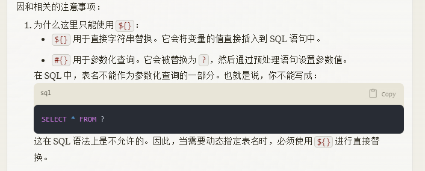
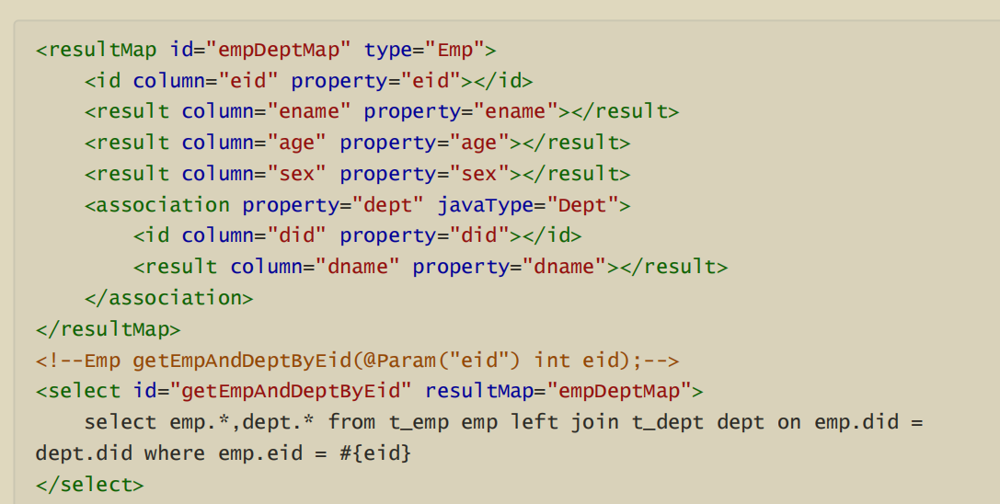
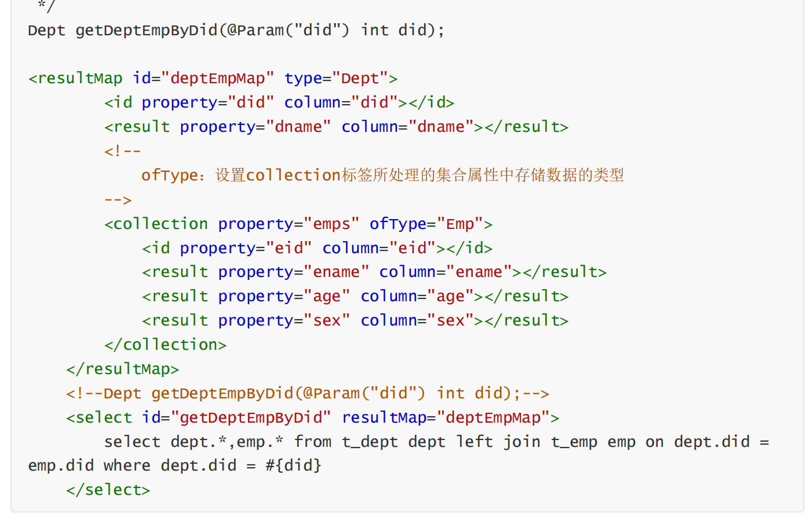
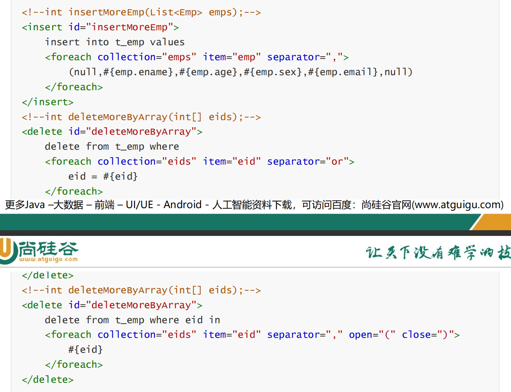

经验之谈

-   在使用mybatis的时候，默认是全量查询，数据被加载到内存中，可能会导致OOM，可选的方式有三种

-   使用深度分页，减少数据量，但是本质是查询全表后 limit，速度受到影响
-   使用mybatis中的流式查询，相当于push，服务端向客户端的缓冲区推送
-   使用mysql中的游标，客户端自己取相当于pull，类似于fetchSize

​  

  

  

mybatis是ibatis的升级，本质是定义了一个借口类，规范了方法对应sqlk的id，命名空间，使用代理技术返回具体的代理类，将 类全限定符+方法名 拼接 然后交给交给ibatis执行，去执行

mybatis的xml中定义具体的sql

matis的配置文件中定义 pojo的位置，和xml的位置，一个pojo

​  

对应一个xml

​  

#{ } 本质是占位符，但是不能使用在 传递 表名，列名，关键字的场景下。

${}

​  

resultType 按照规则自动映射

resultMap自定义映射规则 ，可以根据配置 开启不同级别的映射，但是id得一致写，包括外部对象的id，需要指明。

​  

返回list集合的时候，处理输出的类型，写范型即可，String就行了

​  

​  

set标签要求至少满足一个条件，作用于 update语句中

​  

​  

​  

foreach 在update的时候 将每次的update 遍历生成语句，注意要修改数据库连接信息 同意执行多语句

  

pojo和xml 路径要一致

​  

插件类似拦截器，在提交sql后拦截

​  

mybatis 配置文件中的配置顺序要注意

​  

orm思维

​  

mybatis也使用了代理的技术，执行sql的也是mybatis从mapper接口中实现的代理对象

### 特性

-   mybatis是轻量级框架,将接口,pojo的映射成数据库中的数据
-   默认的配置文件的名称是 mtbatis-config.xml,设置数据库的连接信息,引入映射文件

-   映射文件的规则, 一张表对应一个对象,对应一个映射文件, 文件名称为 对象名称+Mapper.xml
-   配置文件中的命名空间就是对象的全类名, 配置文件中的SQL的ID要和接口的中的方法名保持一致

-   mybatis创建与数据库的连接, 需要的步骤 sqlSession(会话),sqlSessionFactory(产生会话的工厂)

### 核心配置文件中可选的参数

-   导入properties的配置文件,properties ,获取数据库的连接信息
-   mapUnderscoreToCamelCase,下划线自动转化驼峰
-   延迟加载的配置参数 lazyLoadingEnabled，作用是 某个对象涉及到的其余对象值 是使用的时候加载，还是本对象使用的时候就加载， 与之相对的属性还有aggressiveLazyLoading，作用时任何调用都会加载涉及对象的全部属性
-   typeAliases 标签, alias 给类起别名, 如果不指定 ,即指定涉及范围内的类都使用默认别名 (对象名称忽视大小写) mybatis中对于常量类型设置了默认值 java.lang.Integer-->int|integer, int-->\_int|\_integer,Map-->map,List-->list
-   environments 设置多个数据库的连接信息, 也可以指定默认的数据库
-   transactionManager 设置事务的管理方式 支持 JDBC (手动处理), MANAGED(托管)
-   dataSource type 用于设置数据库连接池的使用方式

-   POOLED 缓存已经创建好的连接,放入连接池中,下次从这里捞取,
-   UNPOOLED 不使用数据库连接池, 每次使用都重新创建
-   JNDI 调用上下文中的数据源

-   mapper 引入映射文件

### 映射文件

-   映射文件中的增删改查方法,都会有返回的值, 有些返回的是操作的数据条数,有些返回的是查询出来的数据,查询多条数据的时候,得是集合
-   获取参数的方式 有

-   ${} （注入风险，本质是字符串拼接到SQL中 ，当变量为 string,datetime等类型需要手动添加引号),
-   #{} （本质是占位符，适用于单个参数，实际是按照索引生效）， 相关参数 被替换为 `?`，然后通过预处理语句设置参数值

-   模糊查询的时候，直接使用#{}会导致，占位符在字符串中 无法解析出传参，

-   解决的方法 1，${} 解析参数, 2，继续使用 #{}拼接字符串的方式实现

-   当使用动态表的时候,也就是将表名称作为变量传入 ,使用#{} , SQL中不支持这样的语法

-   

-   mapper方法的传参 的类型

-   mapper的参数为实体类的时候，直接通过属性名称访问
-   当mapper方法 传递多个参数来的的时候 mybatis 会主动将参数放在一个map集合中(也可以手动为主一个map集合将变量放入其中)，key为 args或者 param 可以通过访问keyd的方式读取值
-   还可以在mapper方法中使用 @param 指定传参的名称, 在 xml中直接使用 名称为 key 获取值 ,或者 使使用 param 的索引号 按序获取

-   插入数据的时候,如果表设置了自增主键,想要使用自增管理插入的数据某个值, 涉及的参数有 useGeneratedKeys,keyProperty

> <!--int insertUser(User user);-->
> 
> <insert id\="insertUser" useGeneratedKeys\="true" keyProperty\="id"\>
> 
> insert into t\_user values(null,#{username},#{password},#{age},#{sex})
> 
> </insert>

### mapper方法返回的数据类型

-   常见的返回的数据类型

-   实体类对象
-   将实体类对象以map方式返回
-   将实体类对象 按照 map方式返回 ,但是按照数据中的一个值 为key ,使用注释 @MapKey
-   多个实体类对象 返回一个 list ,map集合

### ResultMap | ResultType

-   返回的数据 解析的方式 有两种，

-   resultmap（手动指定，支持多对一，一对多）
-   手动指定的场景

> <!--
> 
> resultMap：设置自定义映射
> 
> 属性：
> 
> id：表示自定义映射的唯一标识
> 
> type：查询的数据要映射的实体类的类型
> 
> 子标签：
> 
> id：设置主键的映射关系
> 
> result：设置普通字段的映射关系
> 
> association：设置多对一的映射关系
> 
> collection：设置一对多的映射关系
> 
> 属性：
> 
> property：设置映射关系中实体类中的属性名
> 
> column：设置映射关系中表中的字段名
> 
> \-->
> 
> <resultMap id\="userMap" type\="User"\>
> 
> <id property\="id" column\="id"\></id>
> 
> <result property\="userName" column\="user\_name"\></result>
> 
> <result property\="password" column\="password"\></result>
> 
> <result property\="age" column\="age"\></result>
> 
> <result property\="sex" column\="sex"\></result>
> 
> </resultMap>
> 
> <!--List<User> testMohu(@Param("mohu") String mohu);-->
> 
> <select id\="testMohu" resultMap\="userMap"\>
> 
> <!--select \* from t\_user where username like '%${mohu}%'-->
> 
> select id,user\_name,password,age,sex from t\_user where user\_name like
> 
> concat('%',#{mohu},'%')
> 
> </select>

-   resultmap处理 多对一 的场景，常见的是 对象中的属性是引入的别的对象的属性的情况下

-   通过级联的方式 还是先使用resultMap指定映射的对象, 其中的property标签通过 指定 对象名.属性 的方式确定外部数据的来源
-   通过 association 的方式 确定数据来源
-   
-   分步查询, 相当于 join on 查询多个表

-   处理一对多的数据， 常见的情况是某个对象下 有关联的其余的多个对象

-   使用的标签是 collection + offtYpe 来定于引入的多个其余对象 ，然后在sql中使用连接查询的方式 （这里对应引入外部对象还可以添加一个属性为 fetchType,作用是 延迟 lazy｜立刻 eager加载）
-   通过分布查询的方式 ，操作的步骤和 多对一一样
-   ​  
    

-   resulttype（返回的属性的名称一一对应，自动解析）

### 动态SQL

-   动态sql，根据查询条件的不同，动态改变sql语句，提供标签，

-   if 与test 结合使用 ，条件为true的时候继续执行标签中的内容
-   where（动态处理or，and 条件语句，只能写在查询的条件前面） 一般和if联合使用，及 where内的if条件满足的时候 where才会生效
-   trim标签（支持 前后添加，去掉 指定内容）

-   choose when otherwose 相当于 switch case default
-   foreach标签，当获取的返回值是多个数据的时候，使用这样的标签去遍历

collection：设置要循环的数组或集合

item：表示集合或数组中的每一个数据

separator：设置循环体之间的分隔符

open：设置foreach标签中的内容的开始符

close：设置foreach标签中的内容的结束符

-   
-   sql 标签，相当于一个写定了的sql语句，然后便捷引用

> <sql id\="empColumns"\>
> 
> eid,ename,age,sex,did
> 
> </sql>
> 
> select <include refid\="empColumns"\></include> from t\_emp

-   resultmap处理 多对一 的场景，对象中的属性是引入的别的对象的属性（出现这种情况是不是因为外间的原因），1，通过级联的方式 2，通过association （javatype）的方式 3，分步查询（可以开启延迟加载（根据需要的信息 执行相关的流程）），相当于按照一个join on 查询多个表

  

  

  

-   在批量删除数据的时候，使用#{} 实际的效果是传参 外有 ‘’ 所有的参数值为一个字符串，导致删除失败之，只能使用${}，动态获取表名的时候也因为拼接的字符串导致只能使用 ${}

### mybatis的缓存机制

-   一级缓存（默认开启，sqlsession级别）

-   四种失效的情况 1，sqlsession变化，2，同一个sqlsession但是条件变化 3，该sqlsession做了删改增操作 4手动清除缓存

-   二级缓存（可以引入外部的框架替换），sqlsessionfactory级别（开启需要实现四个步骤），关闭sqlsession的时候存贮数据，任意增删改 也会导致失效，可配置回收策略，刷新时间，读写权限策略
-   先查询二级缓存，再一，sqlsession关闭后，数据写入二级缓存

### mybatis中的逆向工程

-   逆向工程（从表，框架更具表生成实体类和方法），（填写逆向配置文件，执行后）生成bean，生成sql映射文件，生成mapper接口

-   支持两种 mybatis3simple. mybatis3(支持更强的功能，主要是对于字段值 为null时候提供 忽视 和 非忽视两种 )

  

-   分页功能，index，pagesize，协助获取分页的相关信息，pagehelper，pageinfo 会显示更多型信息(分页这里看的很潦草，基本跳过处理了)