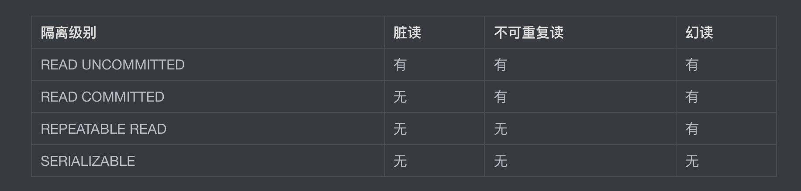
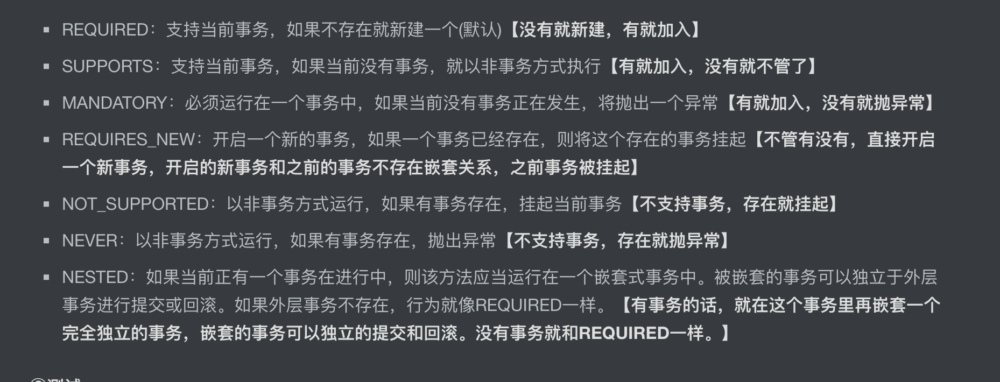

### IOC

  

spring容器分类 ，接口BeanFactory，ApplicationContext

ApplicationContext实现类中常用的 AnnotationConfigApplicationContext ClassPathXmlApplicationContex WebApplicationContext

容器的动作，ioc，DI

开发的流程，配置文件，创建ioc容器，获取bean(组件)

  

使用注解完成加载bean，首先类上添加注解，然后告诉spring容器，哪些包下有注解，使用注释加载的Di的时候 这里的bean的id默认为被修饰的类的首字母小写

  

1.  spring framework 是spring的底层基础，spring的基础实现由ioc（inverse of control）,AOP(aspect oriented programing)来实现
2.  springframework中常见的功能，core container，aop，TX，springMVC
3.  ioc主要用于管理bean的生命周期(对象创建，属性的赋值)，相当于一个容器，用来存放bean对象，通过map集合的方式，Map\<String,BeanDefinition> ，key默认就是类名的首字母小写，BeanDefinition是用来存储类的元数据信息

1.  实现容器的方式 ，beanfactory，applicationcontext(开发者使用)
2.  AOP主要用于拓展业务涉及的公共方法

4.  以spring为基础，衍生出各种框架，如 spring-web，spring-jdbc，spring-test，spring-message等
5.  通过spring完成资源的自动创建，有两种方式 ，

1.  一种是配置xml文件，
2.  一种是注释的方式，默认 是反射的方式通过无参数构造的创建实例

6.  通过DI（dependency injection）（创建对象的过程中，将对象的属性通过配置注入）依赖注入的方式来实现 IOC，常见通过 set或者构造 注入
7.  获取bean的方式有 ：

1.  通过id(创建bean的时候指定)
2.  通过class类型（该方法需要class只有一个bean实现）
3.  通过id和class类型。 实现接口的类也是instane of 接口的，class也是接口的

8.  配置文件中给实例赋值的时候，支持使用property（set方法），constructor-arg（参数构造器，可以拓展index，name指定赋值的具体参数）的方式实现注入值
9.  使用xml赋值的时候注意处理特殊值，null，表达式等
10.  当出现了bean的创建需要依赖另一个bean的时候，通过xml的方式 ，可以通过

1.  ref引入需要的bean ，引入之后可以通过级联属性的方式将被引入的bean赋值
2.  创建的bean内部再创建一个bean

11.  注意创建bean的时候 对bean中引用的 集合类型的bean，变量赋值，array，list，set，map entry，同时注意需要引入的命名空间
12.  当出现引入外部数据源的时候，需要下在spring中引入context，然后引入连接的配置文件 ，然后创建连接数据源的bean
13.  spring中通过 scope指定bean的作用范围，

1.  可以管理实例的个数（单数时初始化ioc容器创建，多数时获取bean的时候再创建）

1.  ioc中默认是创始话之前实现所有的beans的加载，除非 指定了@ Lazy（可以针对单独或所有的bean），或者 多例模式

2.  web中数据的有效范围（请求，会话）

14.  ioc容器实现bean管理的全流程

1.  创建bean，无参
2.  注入bean的属性
3.  后置处理器，可以实现beanpostprocessor接口，在ioc容器中配置后对所有的bean生效
4.  实现bean的初始化
5.  后置处理器
6.  bean对象就绪
7.  bean对象销毁
8.  关闭ioc容器

15.  可通过factorybean的方式getobject方法获取bean，这是整合第三方框架的常用方式，相应的bean 需要实现factorybean接口
16.  自动装配的概念，对于创建的bean中使用到的其余的bean，实现自动赋值，对应上面的ref，

1.  通过bytype的方式，默认值为null，如存在多个符合类型的bean会返回异常
2.  通过byname的方式，默认是被使用到的属性名称作为classid去寻找相应的bean，注意接口和实现类都是一个class，所以需要指定不同的id

17.  通过annotation的方式实现对于bean的管理，和xml配置文件同样的作用，实现的过程为

1.  引入对于注解的依赖
2.  开启组件扫描（支持按照类型，注解 排除/仅扫描 特定的包）
3.  通过注释定义依赖
4.  依赖注入

18.  类上常用的注解有 @Component （仅表示是一个bean容器），@Repository，@Servic，@Controller,功能完全一样，最好按照不同的业务层使用不同的注解
19.  管理注解的 使用范围的时候 通过 @Target 实现，使用范围的时候 @Retention 管理是编译，还是运行时
20.  @Autowired支持形参，构造器，方法，属性，注解上生效，默认使用bytype，自行导入相关的依赖，相当于实现了set，构造器的功能，也还是自动装填的角色，当bean中只有一个构造方法且是有参构造的时候，可以省略@Autowired， 可以通过 @Qualifier("") 的方式，在多个同class的时候指定具体的bean，此时就是byname
21.  jdk中的@Resource 功能类似于@Autowired，默认是byname，是按照属性的名称查找class的id，找不到时再使用bytype
22.  通过配置类的方式实现全注解开发，替换xml，@Configuration，@ComponentScan，  
     ApplicationContext context = new AnnotationConfigApplicationContext(Spring6Config.class);

### AOP

  

aop相当于python中的修饰器，承担一个代理，处理非核心的功能

  

  

1.  面向切面，通过预编译，运行期动态代理的方式来实现1
2.  本质功能是代理，将非核心的代码解藕，拦截请求和返回值
3.  静态代理（相当于写死了代码）和动态代理（按照每次请求的不同生成不同的代理对象）
4.  动态代理对象ProxyFactory，涉及的参数 classLoader，interfaces，invocationHandler，invoke方法
5.  横切关注点，分散在每个各个模块中解决同一样的问题，如用户验证

1.  每一个横切关注点上要做的事情都需要写一个方法来实现，这样的方法就叫通知方法。

1.  按照方法的生效条件，分为：前置@Before，返回AfterReturning，异常@AfterThrowing，后置@After，环绕（try,catch,finally结构实现）@Around通知，当环绕通知和比的通知同时配置时，先进入环绕通知的前置，然后执行其余通知，5.3版本之前，返回/异常通知在后置通知的后面
2.  通知方法中可以设置切入点表达式，获取返回值的 returning，异常的throwing ，

2.  切面类中管理通知方法，代理请求（@Aspect）
3.  连接点（spring中可以使用通知方法的地点），切入点（定位连接点的方法）

6.  aop的代理模式，使用了aspectj（需要开启）的weaver，动态生成代理对象，并织入切面逻辑，aspectj本质是静态代理，但是会将代理逻辑植入目标类编译后生成字节码文件来实现动态效果
7.  动态代理有JDK动态代理和cglib动态代理，前者需要目标类有实现的父接口，实现代理对象实现这个父接口，后者是目标类没有父接口，代理对象继承目标类
8.  在切面类中定义通知方法的时候需要指定该方法的生效的类，通过execution()表达式来匹配

1.  切入点表达式的完整结构为 权限修饰符 返回值 目标的全类名 被代理的方法的名称 被代理的方法的参数列表，支持 \*，.. 来统配表示，后者表示任意深度，权限修饰符和返回值为一体，要么都要，要么都不要
2.  @Pointcut的方式定义切入点表达式来实现重用
3.  连接点 joinpoint 的 process 可以控制执行的放行

9.  当一个目标存在多个切面的时候，可以通过order 指定切面的执行顺序，优先级高的切面在外面

### junit整合spring

1.  通过beans.xml中引入注释的方式自动创建spring容器，@SpringJUnitConfig，@ExtendWith和@ContextConfiguration

### spring中的事务

spring-tx 负责声明式事务的基本规范 spring-jdbc 符合数据源和事务管理器的实现类. spring-orm 持久层框架的事务管理器实现类，针对不同数据源实现的不同的持久层的插拔式组件

  

1.  spring中引入数据源导入的依赖，1，管理数据源连接池 2，数据源的驱动 3，spring-jdbc

1.  实现bean时 导入外部属性文件，配置数据源，配置JdbcTemplate持久化

2.  事务 1，原子性 2，一致性 3，隔离性（并发事务中，只能看到某个事务修改前后的状态，不能看到中间状态） 4，持久性
3.  编程式事务，自己写， 声明式事务，框架托管
4.  @transtional 事务的注释 ，一般在service层，修饰类的时候对该类的所有方法生效，也可以修饰具体的方法

1.  支持具体的操作类型，连接参数等，例如 @Transactional(readOnly = true)
2.  支持管理异常回滚策略，出现了特定的类型，回滚或是不回滚，通过 指定class类型的对象，string类型的全类名来 配置 ;例如 @Transactional(noRollbackFor = ArithmeticException.class)
3.  隔离并发执行的各个事务的级别 被称为隔离级别，通过 isolation设置值 ，隔离级别高低和一致性成正比，和并发性能成反比。例如@Transactional(isolation = Isolation.SERIALIZABLE)

1.  READ UNCOMMITTED 可以读取到没有提交的修改数据
2.  READ COMMITTED、 只能读取到已经提交的修改后数据
3.  REPEATABLE READ 相当于字段级别的锁，可以多次从一个字段中读取到相同的值
4.  SERIALIZABLE 相当于表级别的锁，避免一切并发带来的问题，但是性能很差
5.  

5.  当多个连续调用的方法中，都涉及了事务，那么需要管理事务的传递，存在下面的七种行为，

1.  不同事务管理级别将导致回滚的时候涉及的操作不一样

6.  对于声明事务的全注解管理

  

### spring中的resource

1.  加强了对low-level的访问能力，例如 类路径或相对于 ServletContext 获取的资源
2.  resource是spring中资源访问策略的抽象，提供了多种实现类实现具体的资源访问，例如：UrlResource、ClassPathResource、FileSystemResource、ServletContextResource、InputStreamResource、ByteArrayResource
3.  ApplicationContext实现了resourceloader，获取一个resource实例，改仅有一个方法就是getResource，resourceloader来负责对不同的资源实现具体的实现类
4.  将resouce资源作为属性实现依赖注入，解决bean实例需要访问资源的情况
5.  ApplicationContext通过 指定实现类/指定前缀 来确定访问策略
6.  ApplicationContext支持使用通配符的方式一次加载多个文件

  

### Spring中的国际化

1.  internationalization ，i18n，java自身java.util.Locale用于指定当前用户所属的语言环境等信息，sping中通过配置文件（**国际化文件命名格式：基本名称 _ 语言 _ 国家.properties**）中设定的language，country来实现
2.  spring中的国际化通过实现messagesource接口，常见的实现类，**ResourceBundleMessageSource**

  

### 通过validation实现数据校验

1.  实现校验的方式有

1.  实现**org.springframework.validation.Validator**接口，然后调用这个类，Spring Validation其实就是对Hibernate Validator进一步的封装
2.  通过bean validation的注释实现，spring中的默认实现类 localvalidatorfactorybean，实现了两个接口，通过注解定义校验规则，然后使用validate方法校验类是否合规
3.  基于方法实现校验
4.  自定义校验

### Spring和编译

1.  JIT Just-in-time,动态(即时)编译，边运行边编译 和 AOT Ahead Of Time，指运行前编译，预先编译
2.  GraalVM一种高性能 JDK，高级优化编译器，旨在加速用 Java 和其他 JVM 语言编写的应用程序的执行，AOT 本机图像编译提前将 Java 应用程序编译为本机二进制文件，立即启动，无需预热即可实现最高性能
3.  GraalVM Native Image，直接摒弃JVM，和C/C++一样通过编译器直接将代码编译成机器代码，然后运行