###### 2025补充

-   flink做到不丢失一条数据，首先需要checkpoint存储本次消费的进度，以支持失败后重新消费，上游需要支持数据持久化，例如kafka，反面如http，依靠tcp中的缓冲区，当flink不是意外挂掉的时候，协议的特性导致能缓存点数据等待连接后重新发送 等，下游需要支持数据幂等性，如mysql中的主键
-   flink中的并行度和多线程不是一个东西，前者相当于一个类的多个实例，一个并行度需要一个slot，slot由taskmanger管理，作业由jobmanager提交，在支持 slot复用的情况下，一个工作流需要的slot的个数就是最大的并行度
-   flink中的水印支持 周期的生成，也支持每来一条数据生成一次，
-   当出现多个并行算子的时候，数据发送的规则有 轮询，广播，按照key分区(keyby的场景下)
-   当使用keyby的时候，就是将数据分区的时候，会根据子任务的数量来，有多个subtask就是物理的分区，设计到数据传输，只有一个就是逻辑分区
-   实现checkpoint的原理之一是barrier，其使用的方式有对齐和非对齐两种，对齐是同一数据流的不同分区或并行任务的处理速度不一的时候 等待多个分区同时完成本次barrier，其中速度快的流会阻塞处理进来的数据，直到全局的barrier的形成，(会导致状态的增大)，非对齐是不阻塞，每个分区的完成barrier的动作不必一致，坏处是出现异常的时候有部分数据被重复消费，因缓存未处理的数据导致状态增大，这个行为是算子级别的

​  

​  

## 概述

Apache Flink是为分布式、高性能、随时可用以及准确的流处理应用程序打造的开源的有状态的流处理框架,Apache Flink是一个框架和分布式处理引擎，用于对无界和有界数据流进行有状态计算。Flink被设计在所有常见的集群环境中运行，以内存执行速度和任意规模来执行计算。

​  

事件驱动型:事件驱动型应用是一类具有状态的应用，它从一个或多个事件流提取数据，并根据到来的事件触发计算、状态更新或其他外部动作。比较典型的就是以kafka为代表的消息队列几乎都是事件驱动型应用。(Flink的计算也是事件驱动型)

​  

批处理的特点是有界、大量，非常适合需要访问全套记录才能完成的计算工作，一般用于离线统计。

流处理的特点是无界、实时, 无需针对整个数据集执行操作，而是对通过系统传输的每个数据项执行操作，一般用于实时统计。

在flink的世界观中，一切都是由流组成的，离线数据是有界限的流，实时数据是一个没有界限的流，这就是所谓的有界流和无界流。

​  

处理无界数据通常要求以特定顺序（例如事件发生的顺序）获取event，以便能够推断结果完整性。

处理有界流不需要有序获取，因为可以始终对有界数据集进行排序，**有界流的处理也称为批处理**。

​  

​  

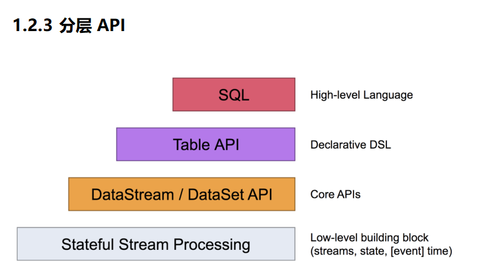

  

Spark和Flink的主要差别就在于**计算模型不同**。Spark采用了微批处理模型，而Flink采用了基于操作符的连续流模型。

​  

使用客户端开发flink,三段project 有界流,无界流,批处理

  

#### flink模式

local-cluster模式(本地模式)

standalone模式(独立集群模式) 独立部署（Standalone）模式由Flink自身提供计算资源，无需其他框架提供资源，这种方式降低了和其他第三方资源框架的耦合性，独立性非常强,Flink主要是计算框架，而不是资源调度框架,和其他专业的资源调度框架集成更靠谱

standalone高可用,一个主jobManager多个备用JobManager以防单点故障

#### Yarn模式:在强大的Yarn环境中Flink是如何使用的

把Flink应用提交给Yarn的ResourceManager, Yarn的ResourceManager会申请容器从Yarn的NodeManager上面. Flink会创建JobManager和TaskManager在这些容器上.Flink会根据运行在JobManger上的job的需要的slot的数量**动态的分配**TaskManager资源

​  

Flink提供了yarn上运行的3模式，分别为**Session-Cluster，Application Mode**和**Per-Job-Cluster**模式

​  

Session-Cluster模式

Session-Cluster模式需要先启动Flink集群，向Yarn申请资源。以后提交任务都向这里提交。这个Flink集群会常驻在yarn集群中，除非手动停止。

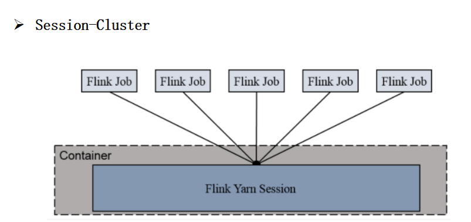

在向Flink集群提交Job的时候, 如果资源被用完了,则新的Job不能正常提交.

缺点: 如果提交的作业中有长时间执行的大作业, 占用了该Flink集群的所有资源, 则后续无法提交新的job.

所以, Session-Cluster适合那些需要频繁提交的多个小Job, 并且执行时间都不长的Job.

  

**Per-Job-Cluster**

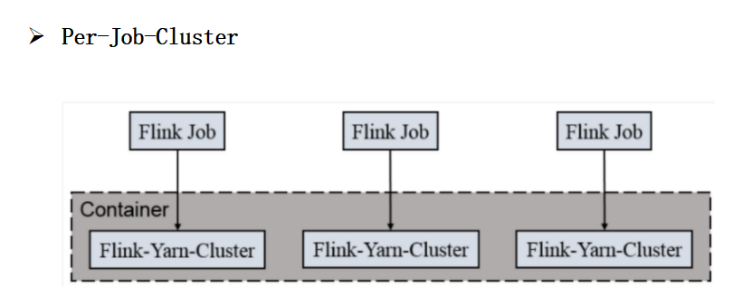

一个Job会对应一个Flink集群，每提交一个作业会根据自身的情况，都会单独向yarn申请资源，直到作业执行完成，一个作业的失败与否并不会影响下一个作业的正常提交和运行。独享Dispatcher和ResourceManager，按需接受资源申请；**适合规模大长时间运行的作业。**

**每次提交都会创建一个新的flink集群，任务之间互相独立，互不影响，方便管理。任务执行完成之后创建的集群也会消失。**

**​**  

Application Mode

Application Mode会在Yarn上启动集群, 应用jar包的main函数(用户类的main函数)将会在JobManager上执行. 只要应用程序执行结束, Flink集群会马上被关闭. 也可以手动停止集群.

与Per-Job-Cluster的区别：就是Application Mode下, **用户的****main函数式在集群中执行的，并且当一个application中有多个job的话，per-job模式则是一个job对应一个yarn中的application，而Application** **Mode则这个application中对应多个job。**

​  

yarn的高可用

Yarn模式的高可用和Standalone模式的高可用原理不一样。

Standalone模式中, 同时启动多个Jobmanager, 一个为leader其他为standby的, 当leader挂了, 其他的才会有一个成为leader。

yarn的高可用是同时只启动一个Jobmanager, 当这个Jobmanager挂了之后, yarn会再次启动一个, 其实是利用的yarn的重试次数来实现的高可用。

​  

容器化部署  
未讲述(k8s)

​  

​  

### Flink运行架构

  

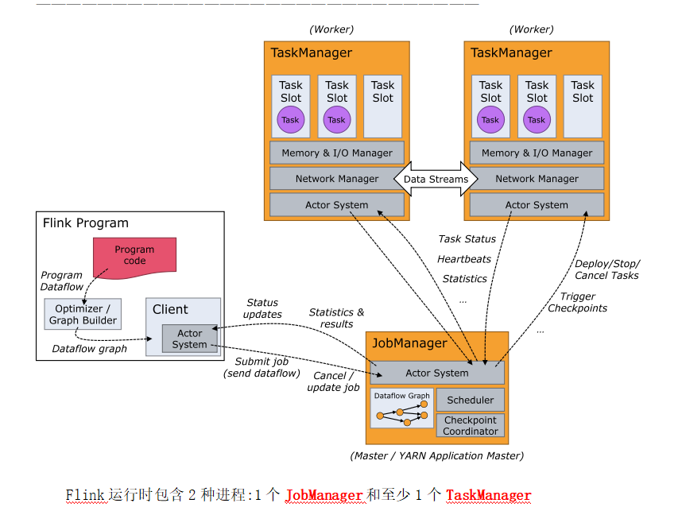

  

客户端连接:用于准备和发送dataflow到JobManager. 然后客户端可以断开与JobManager的连接(detached mode), 也可以继续保持与JobManager的连接(attached mode)

​  

Jobmanager:控制一个应用程序执行的主进程，也就是说，每个应用程序都会被一个不同的JobManager所控制执行。JobManager会先接收到要执行的应用程序，这个应用程序会包括：作业图（JobGraph）、逻辑数据流图（logical dataflow graph）和打包了所有的类、库和其它资源的JAR包。JobManager会把JobGraph转换成一个物理层面的数据流图，这个图被叫做“执行图”（ExecutionGraph），包含了所有**可以并发执行的任务**。JobManager会向资源管理器（ResourceManager）请求执行任务必要的资源，也就是任务管理器（TaskManager）上的插槽（slot）。一旦它获取到了足够的资源，就会将执行图分发到真正运行它们的TaskManager上。

在运行过程中，JobManager会负责所有需要中央协调的操作，比如说检查点（checkpoints）的协调。

**这个进程包含3个不同的组件 ,JobManager主要作用：1. 接受客户端请求。2. 划分任务。3,申请资源。**

**​**  

ResourceManager:

负责资源的管理，在整个 Flink 集群中只有一个 ResourceManager. 注意这个ResourceManager不是Yarn中的ResourceManager, 是Flink中内置的, 只是赶巧重名了而已.负责管理任务管理器（TaskManager）的插槽（slot），TaskManger插槽是Flink中定义的处理资源单元。当JobManager申请插槽资源时，ResourceManager会将有空闲插槽的TaskManager分配给JobManager。如果ResourceManager没有足够的插槽来满足JobManager的请求，它还可以向资源提供平台发起会话，以提供启动TaskManager进程的容器。另外，ResourceManager还负责终止空闲的TaskManager，释放计算资源。

​  

Dispatcher:

负责接收用户提供的作业，并且负责为这个新提交的作业启动一个新的JobMaster 组件. Dispatcher也会启动一个Web UI，用来方便地展示和监控作业执行的信息。Dispatcher在架构中可能并不是必需的，这取决于应用提交运行的方式。

​  

JobMaster

负责管理**单个**JobGraph的执行.多个Job可以同时运行在一个Flink集群中, 每个Job都有一个自己的JobMaster.

​  

TaskManager

Flink中的**工作进程**。通常在Flink中会有多个TaskManager运行，每一个TaskManager都包含了一定数量的插槽（slots）。插槽的数量限制了TaskManager能够执行的任务数量。启动之后，TaskManager会向资源管理器注册它的插槽；收到资源管理器的指令后，TaskManager就会将一个或者多个插槽提供给JobManager调用。JobManager就可以向插槽分配任务（tasks）来执行了。

在执行过程中，一个TaskManager可以跟其它运行同一应用程序的TaskManager交换数据。

​  

**总结：1.工作进程，任务都在TaskManager上运行 2.TaskManager中有资源（Slot）**

**3.需要向JobManager进行交互从而进行资源的注册和使用 4.多个TaskManager可以交换数据**

**​**  

**​**  

**Taskamanager和TaskSlot**

**​**  

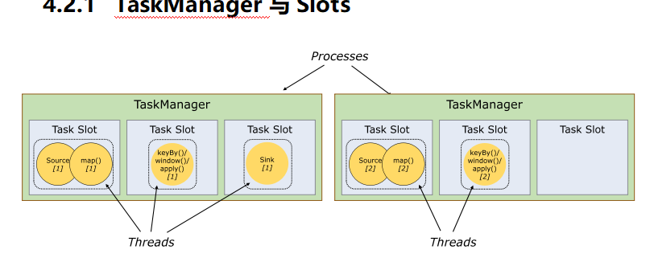

  

Flink中每一个worker(TaskManager)都是一个JVM进程，它可能会在独立的线程上执行一个Task。为了控制一个worker能接收多少个task，worker通过**Task Slot**来进行控制（一个worker至少有一个Task Slot）。

每个task slot表示TaskManager拥有资源的一个固定大小的子集。假如一个TaskManager有三个slot，那么它会将其管理的内存均分成三份给各个slot。资源slot化意味着一个task将不需要跟来自其他job的task竞争被管理的内存，取而代之的是它将拥有一定数量的内存储备。需要注意的是，这里**不会涉及到CPU**的隔离，slot目前仅仅用来隔离task的受管理的内存。

​  

总结：1.slot是可以共享的（Job内部），外部共享只有一种情况（Session）。

2.slot会均分内存资源，进而达到内存隔离，相互之间不会占用内存。但cpu资源不会隔离，可以共享cpu资源。

​  

Parallelism

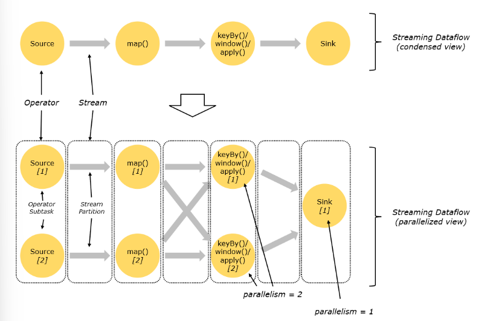

**一个特定算子的子任务（subtask）的个数被称之为这个算子的并行度（parallelism）**，一般情况下，**一个流程序的并行度**，可以认为就**是其所有算子中最大的并行度**。一个程序中，不同的算子可能具有不同的并行度，**如果是yarn模式会动态申请资源**slot个数小于并行度那么程序将会卡死一直处于create状态，等待足够资源，才运行**，如果是standalone模式，不会动态申请资源**，slot个数小于并行度那么程序将会直接失败。

​  

**并行度优先级：**

**算子指定>env全局指定>提交参数>配置文件**

​  

Task与SubTask

不同算子的子任务（SubTask）经过一定的优化，串在一起，形成一个新的SubTask对TaskManager来讲，就是一个Task。

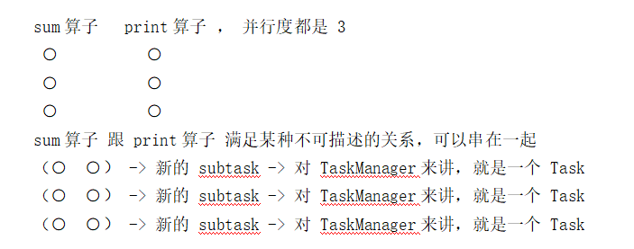

相同并行度的one to one操作，Flink将这样相连的算子链接在一起形成一个task，原来的算子成为里面的一部分。 每个task被一个线程执行.

  

  

Operator Chains（任务链）

Stream在算子之间传输数据的形式可以是one-to-one(forwarding)的模式也可以是redistributing的模式，具体是哪一种形式，取决于算子的种类。

​  

**Ø** **One-to-one**：

stream(比如在source和flatmap operator之间)维护着分区以及元素的顺序。那意味着flatmap 算子的子任务看到的元素的个数以及顺序跟source 算子的子任务生产的元素的个数、顺序相同，map、fliter、flatMap等算子都是one-to-one的对应关系。

**Ø** **Redistributing**：

stream(map()跟keyBy/window之间或者keyBy/window跟sink之间)的分区会发生改变。每一个算子的子任务依据所选择的transformation发送数据到不同的目标任务。例如，keyBy()基于hashCode重分区、broadcast和rebalance会随机重新分区，这些算子都会引起redistribute过程，而redistribute过程就类似于Spark中的shuffle过程。

​  

将算子链接成task是非常有效的优化：它能减少线程之间的切换和基于缓存区的数据交换，在减少时延的同时提升吞吐量。链接的行为可以在编程API中进行指定。\* 算子.startNewChain() =>与前面都断开  
* 算子.disableChaining() => 与前后都断开  
* env.disableOperatorChaining() => 全局都不串

断开操作链的好处在于减少某个slot的压力。

​  

**共享组**：

.slotSharingGroup("group1")

设置共享组后，slot的使用个数并不仅仅是与程序中最大算子的并行度有关了，当算子设置共享组后会使用额外的slot来执行，默认只有一个共享组，因此在默认只有一个共享组的情况下，slot的个数等于程序中最大算子的并行度。

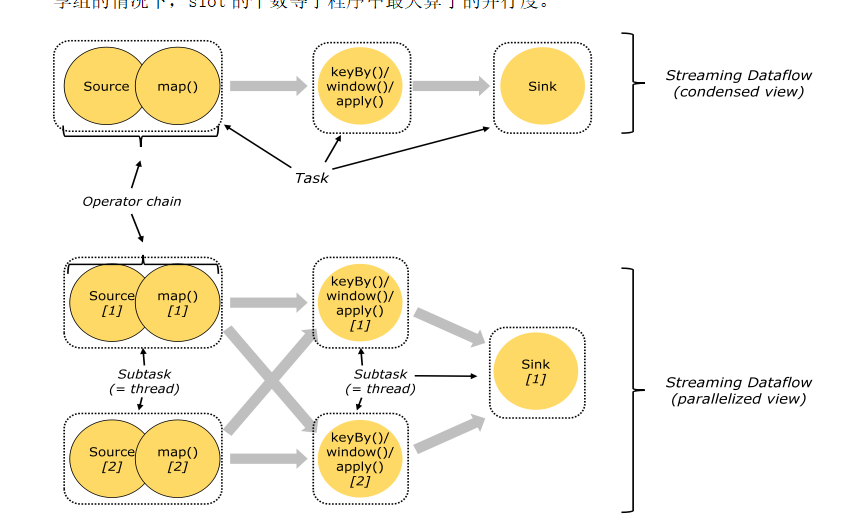

任务链以及共享组：

任务链的好处，避免数据跨节点传输，减少线程间的切换。

断开任务链的好处，减少某个slot的压力。

默认情况下所有算子都是同一个共享组，任务所需要的slot数量：最大算子的并行度。

当使用共享组时，任务所需要的slot数量：每个共享组中最大并行度的和。

​  

ExecutionGraph(执行图)

由Flink程序直接映射成的数据流图是StreamGraph，也被称为**逻辑流图**，因为它们表示的是计算逻辑的高级视图。为了执行一个流处理程序，Flink需要将逻辑流图转换为物理数据流图（也叫执行图），详细说明程序的执行方式。

Flink 中的执行图可以分成四层：**StreamGraph -> JobGraph -> ExecutionGraph -> Physical Graph**。

**Ø** **StreamGraph：**

是根据用户通过 Stream API 编写的代码生成的最初的图。用来表示**程序的拓扑结构**。

**Ø** **JobGraph**：

StreamGraph经过优化后生成了 JobGraph，是提交给 JobManager 的数据结构。主要的优化为: 将多个符合条件的节点 chain 在一起作为一个节点，这样可以减少数据在节点之间流动所需要的序列化/反序列化/传输消耗。

**Ø** **ExecutionGraph**：

JobManager 根据 JobGraph 生成ExecutionGraph。ExecutionGraph是JobGraph的并行化版本，是调度层最核心的数据结构。

**Ø** **Physical Graph****：**

JobManager 根据 ExecutionGraph 对 Job 进行调度后，在各个TaskManager 上部署 Task 后形成的“图”，并不是一个具体的数据结构

​  

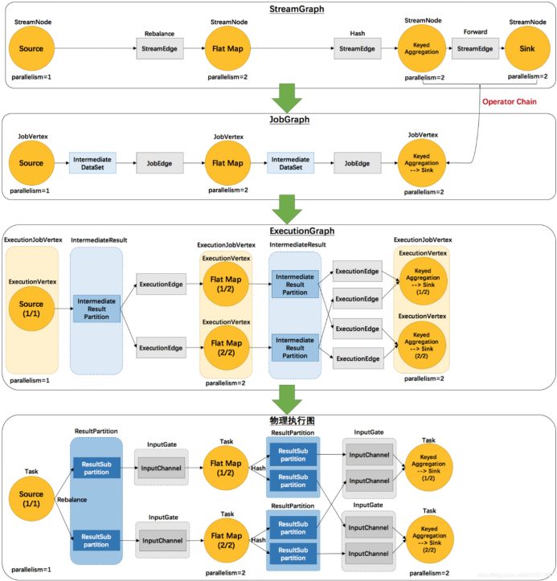

  

#### 提交的流程

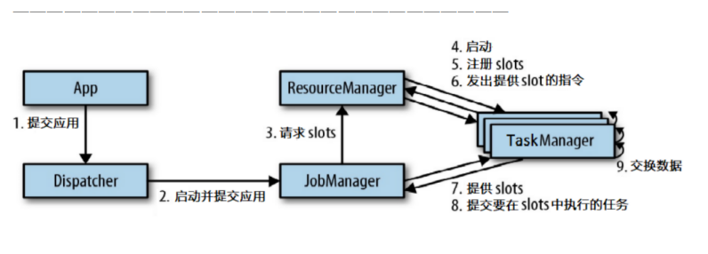

  

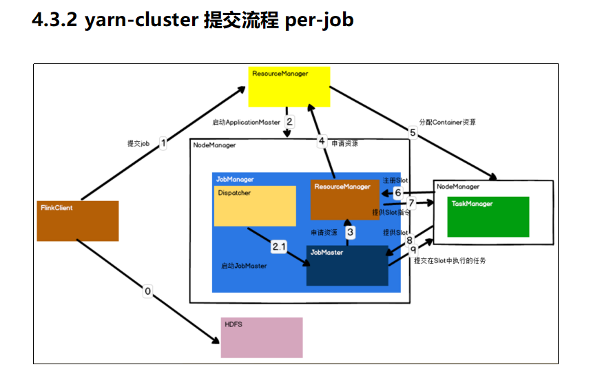

​  

0．Flink任务提交后，Client向HDFS上传Flink的Jar包和配置

1．向Yarn ResourceManager提交任务，ResourceManager分配Container资源

2．通知对应的NodeManager启动ApplicationMaster，ApplicationMaster启动后加载Flink的Jar包和配置构建环境，然后启动JobManager（Dispatcher）

2.1．Dispatcher启动JobMaster

3．JobMaster向ResourceManager（Flink）申请资源

4．ResourceManager（Flink）向ResourceManager（Yarn）申请资源启动TaskManager

5．ResourceManager分配Container资源后，由ApplicationMaster通知资源所在节点的NodeManager启动TaskManager

6．TaskManager注册Slot

7．发出提供Slot命令

8．TaskManager向JobMaster提供Slot

9．JobMaster提交要在Slot中执行的任务

​  
