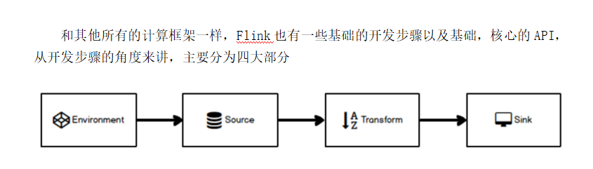
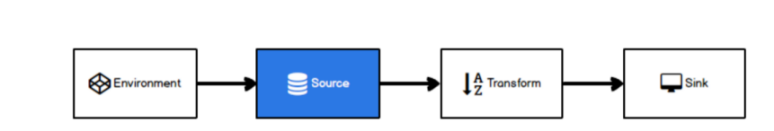
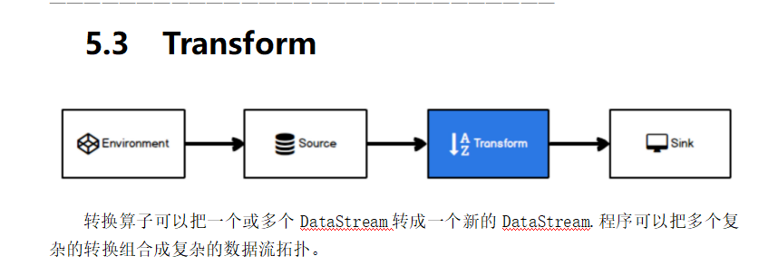

## Flink流处理核心编程

Flink Job在提交执行计算时，需要首先建立和Flink框架之间的联系，也就指的是当前的flink运行环境，只有获取了环境信息，才能将task调度到不同的taskManager执行。而这个环境对象的获取方式相对比较简单

  

### Environment

  

// 批处理环境

ExecutionEnvironment benv = ExecutionEnvironment.getExecutionEnvironment();

// 流式数据处理环境

StreamExecutionEnvironment env = StreamExecutionEnvironment.getExecutionEnvironment();

  

### Source

  

Flink框架可以从不同的来源获取数据，将数据提交给框架进行处理, 我们将获取数据的来源称之为数据源(Source)。

  

WaterSensor水位传感器:用于接收水位数据

source类型:java集合,文件,socket,kafka,自定义source

自定义SourceFunction：  
1. 实现SourceFunction相关接口  
2. 重写两个方法：  
run(): 主要逻辑  
cancel(): 停止逻辑  
如果希望Source可以指定并行度，那么就实现ParallelSourceFunction 这个接口

  

  

### Transform

转化算子:

  

1 ,map: 将数据流中的数据进行转换, 形成新的数据流，消费一个元素并产出一个元素

参数 : lambda表达式或**MapFunction**实现类 返回 : DataStream → DataStream

  

**所有Flink函数**类都有其Rich版本。它与常规函数的不同在于，可以获取运行环境的上下文，并拥有一些生命周期方法，所以可以实现更复杂的功能。也有意味着提供了更多的，更丰富的功能。例如：**RichMapFunction**

  

1. 默认生命周期方法, 初始化方法open(), 在每个并行度上只会被调用一次, 而且先被调用

2. 默认生命周期方法, 最后一个方法close(), 做一些清理工作, 在每个并行度上只调用一次, 而且是最后被调用，但读文件时在每个并行度上调用两次。

3. 运行时上下文getRuntimeContext()方法提供了函数的RuntimeContext的一些信息，例如函数执行的并行度，任务的名字，以及state状态. 开发人员在需要的时候自行调用获取运行时上下文对象.

  

2,flatmap(消费一个元素并产生零个或多个元素)

FlatMapFunction实现类 DataStream → DataStream

  

3,Filter (根据指定的规则将满足条件（true）的数据保留，不满足条件(false)的数据丢弃)

FlatMapFunction实现类 DataStream → DataStream

  

4,KeyBy (把流中的数据分到不同的分区中.具有**相同key的元素**会分到同一个分区中.一个分区中可以有多重不同的key. 在内部是使用的**hash分区**来实现的.)

  

分组：是一个逻辑上的划分，按照key进行区分，经过 keyby，同一个分组的数据肯定会进入同一个分区

分区：下游算子的一个并行实例（等价于一个slot），同一个分区内，可能有多个分组

  

Key选择器函数: interface KeySelector\<IN, KEY> DataStream → KeyedStream

5,shuffle 把流中的元素随机打乱. 对同一个组数据, 每次只需得到的结果都不同.

DataStream → DataStream

  

6,connect

在某些情况下，我们需要将两个不同来源的数据流进行连接，实现数据匹配，Flink中的connect算子可以连接两个保持他们类型的数据流，两个数据流被connect之后，只是被放在了一个同一个流中，内部依然保持各自的数据和形式不发生任何变化，两个流相互独立。

DataStream[A], DataStream[B] -> ConnectedStreams[A,B]

**注意** **:**

1. 两个流中存储的数据类型可以不同

2. 只是机械的合并在一起, 内部仍然是分离的2个流

3. 只能2个流进行connect, 不能有第3个参与

  

7,Union

对**两个或者两个以上**的DataStream进行union操作，产生一个包含所有DataStream元素的新DataStream

**connect** **与** **union** **区别：**

1. union之前两个流的类型必须是一样，connect可以不一样

2. connect只能操作两个流，union可以操作多个。

  

简单滚动聚合算子:sum, min,max.minBy,maxBy

KeyedStream的每一个支流做聚合。执行完成后，会将聚合的结果合成一个流返回，所以结果都是DataStream

KeyedStream -> SingleOutputStreamOperator

**参数**

如果流中存储的是POJO或者scala的样例类, 参数使用字段名

如果流中存储的是元组, 参数就是位置(基于0...)

  

**注意** **:**

滚动聚合算子： 来一条，聚合一条

1、聚合算子在 keyby之后调用，因为这些算子都是属于 KeyedStream里的

2、聚合算子，作用范围，都是分组内。 也就是说，不同分组，要分开算。

3、max、maxBy的区别：

max：取指定字段的当前的最大值，如果有多个字段，其他非比较字段，以第一条为准

maxBy：取指定字段的当前的最大值，如果有多个字段，其他字段以最大值那条数据为准；

如果出现两条数据都是最大值，由第二个参数决定： true => 其他字段取 比较早的值； false => 其他字段，取最新的值

  

8,reduce

一个分组数据流的聚合操作，合并当前的元素和上次聚合的结果，产生一个新的值，返回的流中包含每一次聚合的结果，而不是只返回最后一次聚合的最终结果。

为什么还要把中间值也保存下来? 考虑流式数据的特点: 没有终点, 也就没有最终的概念了. 任何一个中间的聚合结果都是值!

interface ReduceFunction\<T> KeyedStream -> SingleOutputStreamOperator

  

1,一个分组的第一条数据来的时候，不会进入reduce方法。

2、 输入和输出的数据类型，一定要一样。

  

9,Process

process算子在Flink算是一个比较底层的算子,很多类型的流上都可以调用,可以从流中获取更多的信息(不仅仅数据本身)

  

#### 对流重新分区的几个算子

  

**Ø** **KeyBy**

先按照key分组, 按照key的双重hash来选择后面的分区

  

**Ø** **shuffle**

对流中的元素**随机**分区

**Ø** **re** **blance**

对流中的元素平均分布到每个区.当处理倾斜数据的时候, 进行性能优化

**Ø** **rescale**

同rebalance一样, 也是平均循环的分布数据。但是要比rebalance更高效, 因为rescale不需要通过网络, 完全走的"管道"

  

### sink

Sink有下沉的意思，在Flink中所谓的Sink其实可以表示为将数据存储起来的意思，也可以将范围扩大，表示将处理完的数据发送到指定的存储系统的输出操作

  

之前我们一直在使用的print方法其实就是一种Sink, Flink内置了一些Sink, 除此之外的Sink需要用户自定义!

  

kafaksink,redisSink ,ElasticSearchSink 自定义Sink,JDBCSink

  

#### 执行模式选择:

流式API的传统执行模式我们称之为**STREAMING** 执行模式, 这种模式一般用于无界流, 需要持续的在线处理。

1.12.0新增了一个**BATCH**执行模式, 这种执行模式在执行方式上类似于MapReduce框架. 这种执行模式一般用于有界数据,目的为了更像流批一体。

默认是使用的**STREAMING** 执行模式。

**BATCH**执行模式**仅仅用于有界数据**, 而**STREAMING** 执行模式可以用在有界数据和无界数据.

一个公用的规则就是: 当你处理的数据是有界的就应该使用**BATCH**执行模式, 因为它**更加高效**. 当你的数据是无界的, 则必须使用**STREAMING** 执行模式, 因为只有这种模式才能处理持续的数据流.

  

  

## 第六章 :Flink流处理核心编程实战

  

通过第三方支付平台的交易数据来做一个实时对账。**需求: 来自两条流的订单交易匹配**

**注意** **2** **：**

1、一般 使用 Connect连接两条流，做一些条件匹配的时候， 在多并行度条件下，要根据连接条件keyby

2、先分别keyby，再connect 跟 先connect，再keyby ，效果一样

  

