### Flink状态编程

有状态的计算是流处理框架要实现的重要功能，因为稍复杂的流处理场景都需要记录状态，然后在新流入数据的基础上不断更新状态。SparkStreaming在状态管理这块做的不好, 很多时候需要借助于外部存储(例如Redis)来手动管理状态, 增加了编程的难度。

Flink的状态管理是它的优势之一。

在流式计算中有些操作一次处理一个独立的事件(比如解析一个事件), 有些操作却需要记住多个事件的信息(比如窗口操作)。

那些需要记住多个事件信息的操作就是**有状态**的。

流式计算分为**无状态计算和有状态计算**两种情况。

​  

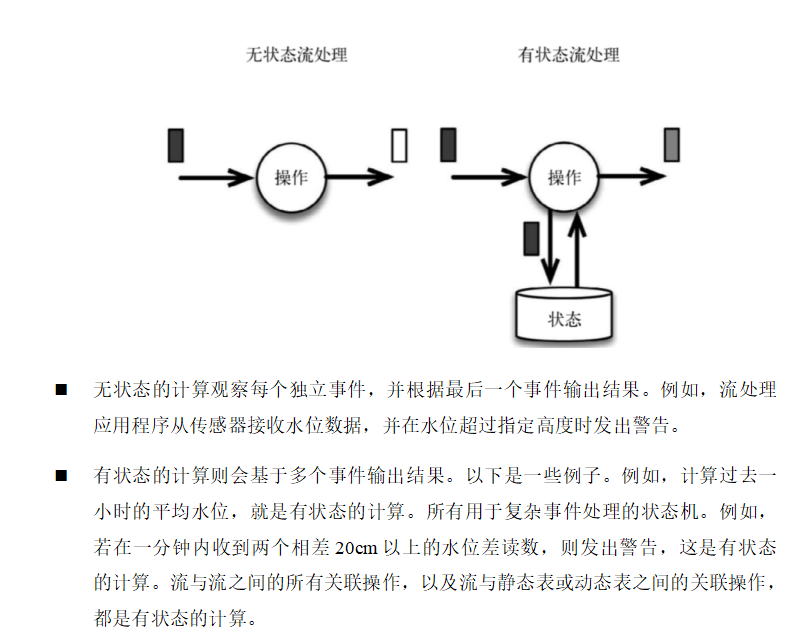

  

在以下场景会使用到流处理状态的功能: 去重,检测,聚合,在线机器学习模型

​  

#### Flink包括两种基本类型的状态

Managed State 和 Raw State

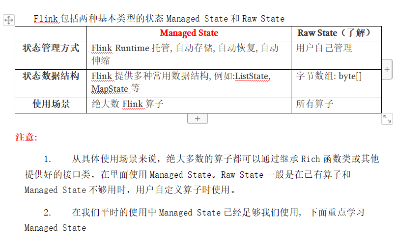

#### Managed State的分类

  

对Managed State继续细分，它又有两种类型

a) Keyed State(键控状态)。

b)Operator State(算子状态)

​  

​  

区别:​

|  | **Operator**** ****State** | **Keyed**** ****State** |
| --- | --- | --- |
| **适用用算子类型** | 可用于所有算子: 常用于source, 例如FlinkKafkaConsumer | 只适用于KeyedStream上的算子 |
| **状态分配** | 一个算子的子任务对应一个状态 | 一个Key对应一个State: 一个算子会处理多个Key, 则访问相应的多个State |
| **创建和访问方式** | 实现CheckpointedFunction或ListCheckpointed(已经过时)接口 | 重写RichFunction, 通过里面的RuntimeContext访问 |
| **横向扩展** | 并行度改变时有多种重新分配方式可选: 均匀分配和合并后每个得到全量 | 并发改变, State随着Key在实例间迁移 |
| **支持的数据结构** | ListState和BroadCastState | ValueState, ListState,MapState ReduceState, AggregatingState |

  

#### 键控状态的使用

  

键控状态是根据输入数据流中定义的键（key）来维护和访问的。

Flink为每个键值维护一个状态实例，并将具有相同键的所有数据，都分区到同一个算子任务中，这个任务会维护和处理这个key对应的状态。当任务处理一条数据时，它会自动将状态的访问范围限定为当前数据的key。因此，具有相同key的所有数据都会访问相同的状态。

Keyed State很类似于一个分布式的key-value map数据结构，只能用于KeyedStream（keyBy算子处理之后）。

​  

支持的数据类型:

Ø ValueState<T> 保存单个值. 每个key有一个状态值. 设置使用update(T), 获取使用 T value()

Ø ListState<T>: 保存元素列表. 添加元素: add(T) addAll(List<T>)

获取元素: Iterable<T> get() 覆盖所有元素: update(List<T>)

Ø ReducingState<T>: 存储单个值, 表示把所有元素的聚合结果添加到状态中. 与ListState类似, 但是当使用add(T)的时候ReducingState会使用指定的ReduceFunction进行聚合.

Ø AggregatingState<IN, OUT>:

存储单个值. 与ReducingState类似, 都是进行聚合. 不同的是, AggregatingState的聚合的结果和元素类型可以不一样.

Ø MapState<UK, UV>: 存储键值对列表.

添加键值对: put(UK, UV) or putAll(Map<UK, UV>)

根据key获取值: get(UK)

获取所有: entries(), keys() and values()

检测是否为空: isEmpty()

​  

**注意****:**

l 所有的类型都有clear(), 清空当前key的状态

l 这些状态对象仅用于用户与状态进行交互.

l 状态不是必须存储到内存, 也可以存储在磁盘或者任意其他地方

l 从状态获取的值与输入元素的key相关

​  

​  

键控状态的使用案例之:水位五秒内连续上升问题

​  

#### 算子状态的使用

Operator State可以用在所有算子上，每个算子子任务或者说每个算子实例分别维护一个状态，流入这个算子子任务的数据可以访问和更新这个状态。

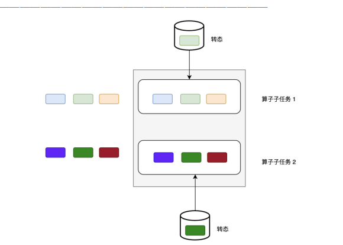

注意: 算子子任务之间的状态不能互相访问

Operator State的实际应用场景不如Keyed State多，它经常**被用在****Source或Sink等算子上**，用来保存流入数据的偏移量或对输出数据做缓存，以保证Flink应用的Exactly-Once语义。

Flink为算子状态提供三种基本数据结构：

列表状态（List state）

将状态表示为一组数据的列表

Ø 联合列表状态（Union list state）

也将状态表示为数据的列表。它与常规列表状态的区别在于，在发生故障时，或者从保存点（savepoint）启动应用程序时如何恢复。

一种是均匀分配(List state)，另外一种是将所有State 合并为全量 State 再分发给每个实例(Union list state)。

Ø 广播状态（Broadcast state）

是一种特殊的算子状态. 如果一个算子有多项任务，而它的每项任务状态又都相同，那么这种特殊情况最适合应用广播状态。

从版本1.5.0开始，Apache Flink具有一种新的状态，称为**广播状态**。

(广播状态被引入以支持这样的用例:来自一个流的一些数据需要广播到所有下游任务，在那里它被本地存储，并用于处理另一个流上的所有传入元素。作为广播状态自然适合出现的一个例子，我们可以想象一个低吞吐量流，其中包含一组规则，我们希望根据来自另一个流的所有元素对这些规则进行评估。考虑到上述类型的用例，广播状态与其他操作符状态的区别在于:

1. 它是一个map格式。

2. 它只对输入有广播流和无广播流的特定操作符可用。

3\. 这样的操作符可以具有不同名称的多个广播状态。)

​  

广播案例代码实现

  

### 状态后端

每传入一条数据，有状态的算子任务都会**读取和更新状态**。由于有效的状态访问对于处理数据的低延迟至关重要，因此每个并行任务(子任务)都会在本地维护其状态，以确保快速的状态访问。

状态的存储、访问以及维护，由一个**可插入**的组件决定，这个组件就叫做**状态后端**（state backend）

**状态后端主要负责两件事：**

Ø 本地的状态管理

Ø 将检查点（checkpoint）状态写入远程存储

​  

​  

状态后端作为一个可插入的组件, 没有固定的配置, 我们可以根据需要选择一个合适的状态后端。

分类:**Ø MemoryStateBackend**

内存级别的状态后端,

**存储方式****:**本地状态存储在TaskManager的内存中, checkpoint 存储在JobManager的内存中。

**特点****:**快速, 低延迟, 但不稳定

**使用场景:** 1\. 本地测试2. 几乎无状态的作业(ETL) 3. JobManager不容易挂, 或者挂了影响不大. 4. 不推荐在生产环境下使用

​  

**Ø FsStateBackend**

**存储方式****:** 本地状态在TaskManager内存, **Checkpoint****存储在文件系统中**

**特点****:** 拥有内存级别的本地访问速度, 和更好的容错保证

**使用场景:** 1. 常规使用状态的作业. 例如分钟级别窗口聚合, join等2. 需要开启HA的作业 3. 可以应用在生产环境中

​  

**Ø RocksDBStateBackend**

将所有的状态序列化之后, 存入本地的RocksDB数据库中.(一种NoSql数据库, KV形式存储)

**存储方式****:** 1\. 本地状态存储在TaskManager的RocksDB数据库中(实际是内存+磁盘) 2\. Checkpoint在外部文件系统中.

**使用场景:** 1\. 超大状态的作业, 例如天级的窗口聚合2. 需要开启HA的作业 3. 对读写状态性能要求不高的作业4. 可以使用在生产环境

​  

配置状态后端:**Ø 全局配置状态后端 Ø 在代码中配置状态后端**

**​**  

**​**  

### Flink的容错机制

当在分布式系统中引入状态做checkpoint时，自然也引入了一致性问题。

一致性实际上是"正确性级别"的另一种说法，也就是说在成功处理故障并恢复之后得到的结果，与没有发生任何故障时得到的结果相比，前者到底有多正确？举例来说，假设要对最近一小时登录的用户计数。在系统经历故障之后，计数结果是多少？如果有偏差，是有漏掉的计数还是重复计数？

​  

#### **一致性级别**

  

在流处理中，一致性可以分为3个级别:

**Ø** **at-most-once(****最多变一次****):**

这其实是没有正确性保障的委婉说法——故障发生之后，计数结果可能丢失。

**Ø** **at-least-once(****至少一次****):**

这表示计数结果可能大于正确值，但绝不会小于正确值。也就是说，计数程序在发生故障后**可能多算**，但是**绝不会少算。**

**Ø** **exactly-once(严格变一次):**

这指的是系统保证在发生故障后得到的计数结果与正确值一致.既不多算也不少算。

Flink的一个重大价值在于，它**既**保证了**exactly-once**，**又**具有**低延迟和高吞吐**的处理能力。

​  

#### **端到端的状态一致性**

目前我们看到的一致性保证都是由流处理器实现的，也就是说都是在 Flink 流处理器内部保证的；而在真实应用中，流处理应用除了流处理器以外还包含了数据源（例如Kafka）和输出到持久化系统。

端到端的一致性保证，意味着结果的正确性贯穿了整个流处理应用的始终；每一个组件都保证了它自己的一致性，整个端到端的一致性级别取决于所有组件中一致性最弱的组件。

​  

具体划分如下:

Ø source端

需要外部源可重设数据的读取位置.

目前我们使用的Kafka Source具有这种特性: 读取数据的时候可以指定offset

Ø flink内部

依赖checkpoint机制

Ø sink端

需要保证从故障恢复时，数据不会重复写入外部系统. 有2种实现形式:

a) 幂等（Idempotent）写入

所谓幂等操作，是说一个操作，可以重复执行很多次，但只导致一次结果更改，也就是说，后面再重复执行就不起作用了。

b) 事务性（Transactional）写入

需要构建事务来写入外部系统，构建的事务对应着 checkpoint，等到 checkpoint 真正完成的时候，才把所有对应的结果写入 sink 系统中。对于事务性写入，具体又有两种实现方式：预写日志（WAL）和两阶段提交（2PC）

​  

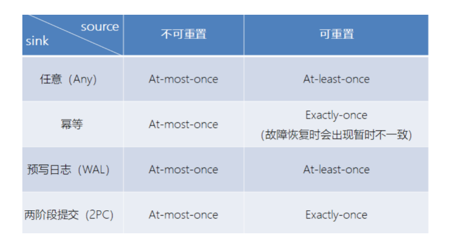

  

#### Checkpoint原理

Flink具体如何保证exactly-once呢? 它使用一种被称为"检查点"（**checkpoint**）的特性，在出现故障时将系统重置回正确状态。

​  

​  

面通过简单的类比来解释检查点的作用。

假设你和两位朋友正在数项链上有多少颗珠子，如下图所示。你捏住珠子，边数边拨，每拨过一颗珠子就给总数加一。你的朋友也这样数他们手中的珠子。当你分神忘记数到哪里时，怎么办呢? 如果项链上有很多珠子，你显然不想从头再数一遍，尤其是当三人的速度不一样却又试图合作的时候，更是如此(比如想记录前一分钟三人一共数了多少颗珠子，回想一下一分钟滚动窗口)。

于是，你想了一个更好的办法: 在项链上每隔一段就松松地系上一根有色皮筋，将珠子分隔开; 当珠子被拨动的时候，皮筋也可以被拨动; 然后，你安排一个助手，让他在你和朋友拨到皮筋时记录总数。用这种方法，当有人数错时，就不必从头开始数。相反，你向其他人发出错误警示，然后你们都从上一根皮筋处开始重数，助手则会告诉每个人重数时的起始数值，例如在粉色皮筋处的数值是多少。

Flink检查点的作用就类似于皮筋标记。数珠子这个类比的关键点是: 对于指定的皮筋而言，珠子的相对位置是确定的; 这让皮筋成为重新计数的参考点。总状态(珠子的总数)在每颗珠子被拨动之后更新一次，助手则会保存与每根皮筋对应的检查点状态，如当遇到粉色皮筋时一共数了多少珠子，当遇到橙色皮筋时又是多少。当问题出现时，这种方法使得重新计数变得简单。

​  

#### **Flink的检查点算法**

checkpoint机制是Flink可靠性的基石，可以保证Flink集群在某个算子因为某些原因(如 异常退出)出现故障时，能够将整个应用流图的状态恢复到故障之前的某一状态，保证应用流图状态的一致性.

快照的实现算法:

1. 简单算法\-\-暂停应用, 然后开始做检查点, 再重新恢复应用

​  

2. Flink的改进Checkpoint算法. Flink的checkpoint机制原理来自"Chandy-Lamport algorithm"算法(分布式快照算法)的一种变体: 异步 barrier 快照（asynchronous barrier snapshotting）

每个需要checkpoint的应用在启动时，Flink的JobManager为其创建一个 **CheckpointCoordinator**，CheckpointCoordinator全权负责本应用的快照制作。

​  

#### **理解****Barrier**

流的barrier是Flink的Checkpoint中的一个核心概念. 多个barrier被插入到数据流中, 然后作为数据流的一部分随着数据流动(有点类似于Watermark).这些barrier不会跨越流中的数据.

每个barrier会把数据流分成两部分: 一部分数据进入**当前的快照** , 另一部分数据进入**下一个快照** **.** 每个barrier携带着快照的id. barrier 不会暂停数据的流动, 所以非常轻量级. 在流中, 同一时间可以有来源于多个不同快照的多个barrier, 这个意味着可以并发的出现不同的快照.

​  

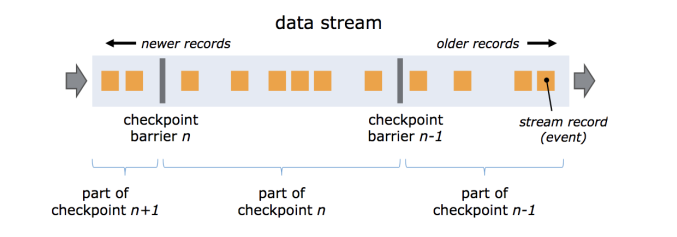

  

#### **Flink的检查点制作过程**

Ø Checkpoint Coordinator 向所有 source 节点 trigger Checkpoint. 然后Source Task会在数据流中安插CheckPoint barrier

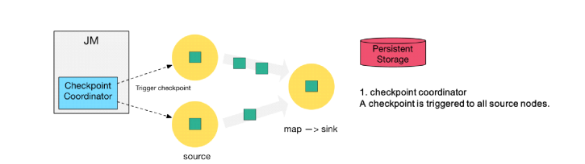

第二步: source 节点向下游广播 barrier，这个 barrier 就是实现 Chandy-Lamport 分布式快照算法的核心，下游的 task 只有收到所有 input 的 barrier 才会执行相应的 Checkpoint

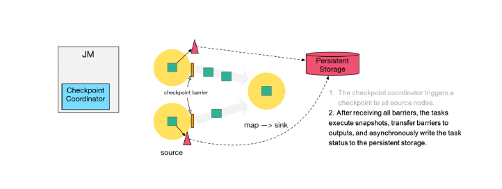

Ø 第三步: 当 task 完成 state 备份后，会将备份数据的地址（state handle）通知给 Checkpoint coordinator。

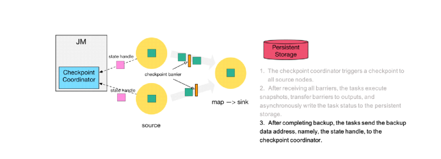

Ø 第四步: 下游的sink 节点收集齐上游两个 input 的 barrier 之后，会执行本地快照，这里特地展示了 RocksDB incremental Checkpoint 的流程，首先 RocksDB 会全量刷数据到磁盘上（红色大三角表示），然后 Flink 框架会从中选择没有上传的文件进行持久化备份（紫色小三角）。

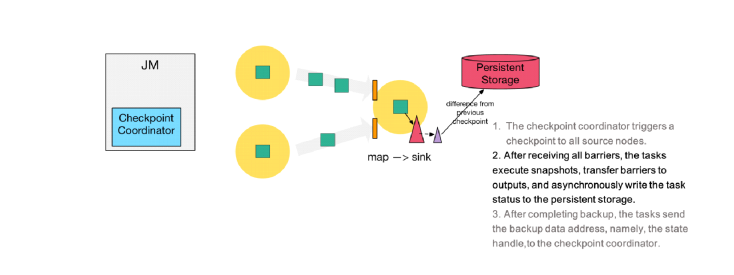

Ø 第五步: 同样的，sink 节点在完成自己的 Checkpoint 之后，会将 state handle 返回通知 Coordinator。

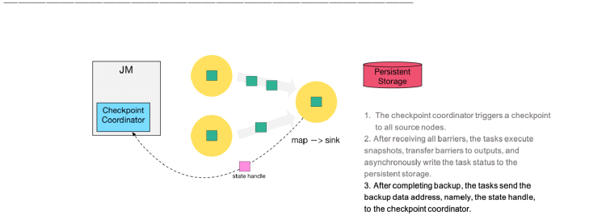

Ø 第六步: 最后，当 Checkpoint coordinator 收集齐所有 task 的 state handle，就认为这一次的 Checkpoint 全局完成了，向持久化存储中再备份一个 Checkpoint meta 文件。

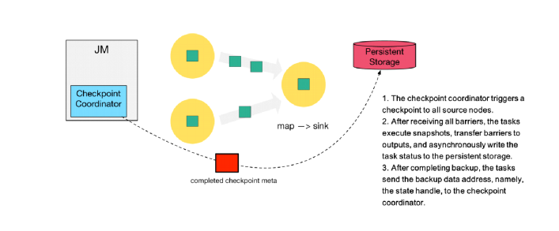

#### **严格一次语义: barrier对齐**

  

当 job graph 中的每个 operator 接收到 barriers 时，它就会记录下其状态。拥有两个输入流的 Operators（例如 CoProcessFunction）会执行 **barrier 对齐**（barrier alignment） 以便当前快照能够包含消费两个输入流 barrier 之前（但不超过）的所有 events 而产生的状态。

​  

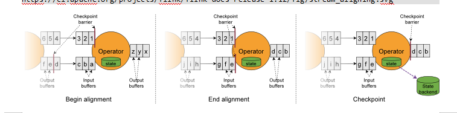

1. 当operator收到数字流的barrier n时, 它就**不能处理****(但是可以接收)**来自该流的任何数据记录，直到它从字母流所有输入接收到 barrier n 为止。否则，它会混合属于快照n 的记录和属于快照n + 1 的记录。

2. 接收到 barrier n 的流(数字流)暂时被搁置。从这些流接收的记录入输入缓冲区, 不会被处理。

3. 图一中的Checkpoint barrier n之后的数据123已结到达了算子, 存入到输入缓冲区没有被处理, 只有等到字母流的Checkpoint barrier n到达之后才会开始处理.

4\. 一旦最后所有输入流都接收到 barrier n，Operator 就会把缓冲区中pending 的输出数据发出去，然后把CheckPoint barrier n 接着往下游发送。这里还会对自身进行快照。

​  

#### **至少一次语义: barrier不对齐**

前面介绍了barrier对齐, 如果barrier不对齐会怎么样? 会重复消费, 就是**至少一次**语义.

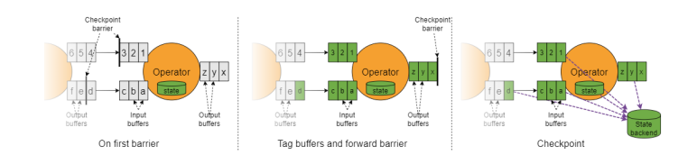

假设不对齐, 在字母流的Checkpoint barrier n到达前, 已经处理了1 2 3. 等字母流Checkpoint barrier n到达之后, 会做Checkpoint n. 假设这个时候程序异常错误了, 则重新启动的时候会Checkpoint n之后的数据重新计算. 1 2 3 会被再次被计算, 所以123出现了重复计算.

​  

### **Savepoint原理**

1. Flink 还提供了可以自定义的镜像保存功能，就是保存点（savepoints）

2. 原则上，创建保存点使用的算法与检查点完全相同，因此保存点可以认为就是具有一些额外元数据的检查点

3. Flink不会自动创建保存点，因此用户（或外部调度程序）必须明确地触发创建操作

4\. 保存点是一个强大的功能。除了故障恢复外，保存点可以用于：有计划的手动备份，更新应用程序，版本迁移，暂停和重启应用，等等

​  

#### checkpoint和savepoint的区别

| **Save****point** | **Checkpoint** |
| --- | --- |
| Savepoint是由命令触发, 由用户创建和删除 | Checkpoint被保存在用户指定的外部路径中 |
| 保存点存储在标准格式存储中，并且可以升级作业版本并可以更改其配置。 | 当作业失败或被取消时，将保留外部存储的检查点。 |
| 用户必须提供用于还原作业状态的保存点的路径。 | 用户必须提供用于还原作业状态的检查点的路径。 |

  

​  

### ​**在代码中测试Checkpoint**

从SavePoint和CK恢复任务步骤：

//启动任务

bin/flink run -d -m hadoop102:8081 -c com.atguigu.day06.Flink10\_SavePoint ./flink-0108-1.0-SNAPSHOT.jar

​  

//保存点(只能手动)

bin/flink savepoint -m hadoop102:8081 JobId hdfs://hadoop102:8020/flink/save

​  

//关闭任务并从保存点恢复任务

bin/flink run -s hdfs://hadoop102:8020/flink/save/... -m hadoop102:8081 -c com.atguigu.WordCount xxx.jar

​  

//从CK位置恢复数据，在代码中开启cancel的时候不会删除checkpoint信息这样就可以根据checkpoint来回复数据了

env.getCheckpointConfig().enableExternalizedCheckpoints(CheckpointConfig.ExternalizedCheckpointCleanup.RETAIN\_ON\_CANCELLATION);

\-s指定恢复的地址

bin/flink run -s hdfs://hadoop102:8020/flink/ck/Jobid/chk-960 -m hadoop102:8081 -c com.atguigu.WordCount xxx.jar

​  

注意:从CK位置恢复数据，在代码中开启cancel的时候不会删除checkpoint信息这样就可以根据checkpoint来回复数据了

​  

### Flink+Kafka 实现端到端严格一次

我们知道，端到端的状态一致性的实现，需要每一个组件都实现，对于Flink + Kafka的数据管道系统（Kafka进、Kafka出）而言，各组件怎样保证exactly-once语义呢？

Ø 内部—— 利用checkpoint机制，把状态存盘，发生故障的时候可以恢复，保证部的状态一致性

Ø source —— kafka consumer作为source，可以将偏移量保存下来，如果后续任务出现了故障，恢复的时候可以由连接器重置偏移量，重新消费数据，保证一致性

Ø sink —— kafka producer作为sink，采用两阶段提交 sink，需要实现一个TwoPhaseCommitSinkFunction

​  

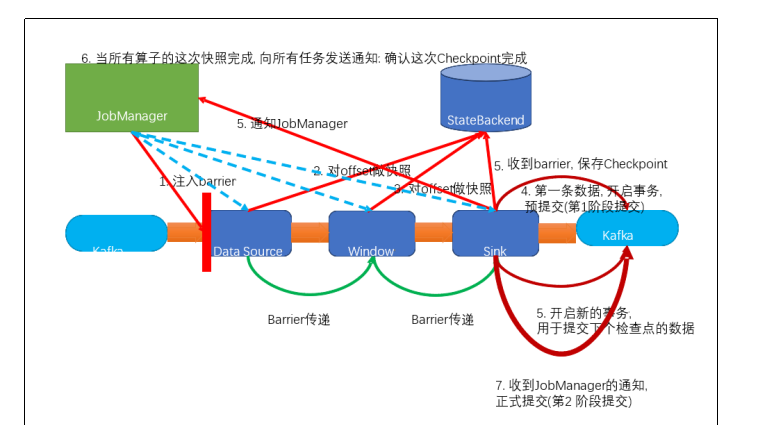

具体的两阶段提交步骤总结如下：

1)jobmanager 触发checkpoint 操作，barrier 从source 开始向下传递，遇到barrier 的算子将状态存入状态后端，并通知jobmanagerr

2)第一条数据来了之后，开启一个 kafka 的事务（transaction），正常写入kafka 分区日志但标记为未提交，这就是“预提交”

3)sink 连接器收到barrier，保存当前状态，存入checkpoint，通知jobmanager，并开启下一阶段的事务，用于提交下个检查点的数据

4)jobmanager 收到所有任务的通知，发出确认信息，表示checkpoint 完成

5)sink 任务收到jobmanager 的确认信息，正式提交这段时间的数据

6)外部kafka关闭事务，提交的数据可以正常消费了

​  

