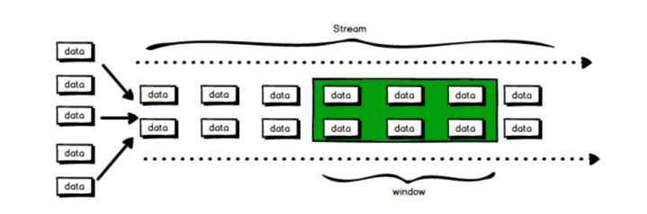
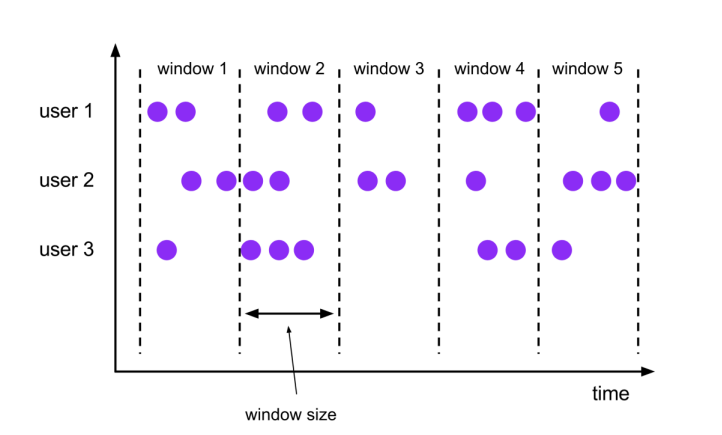
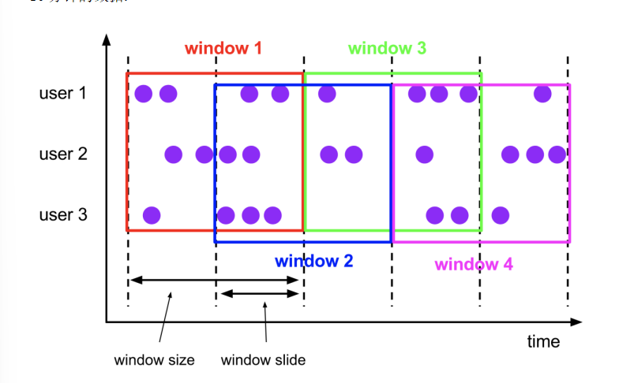
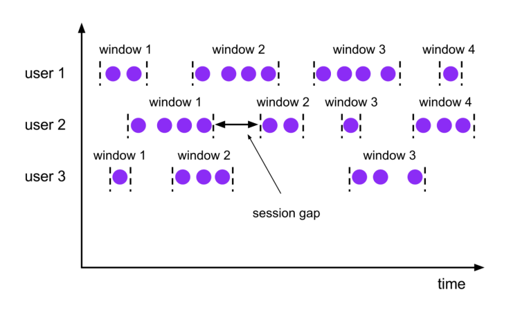
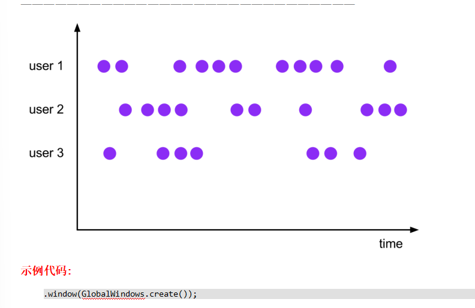
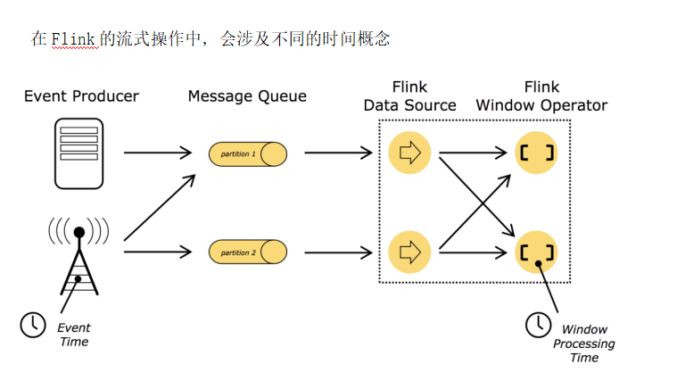
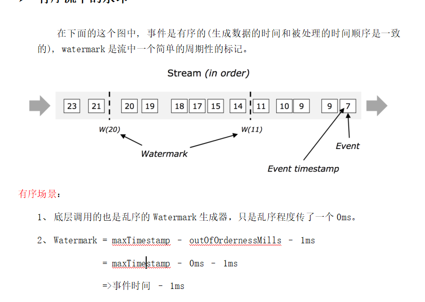
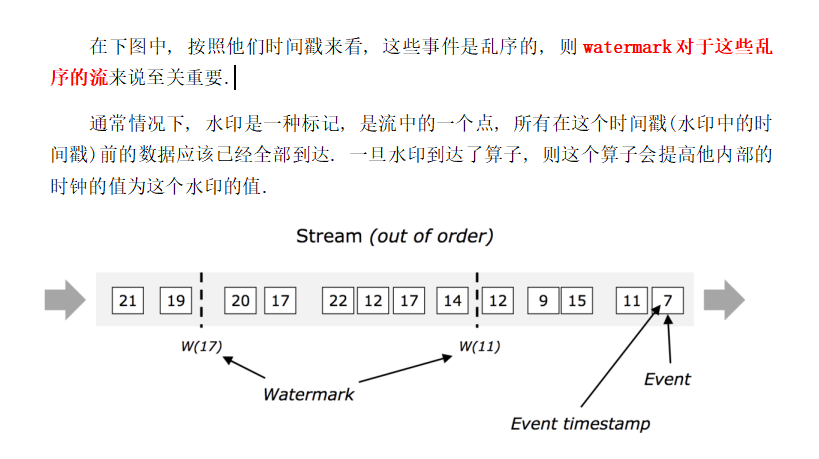
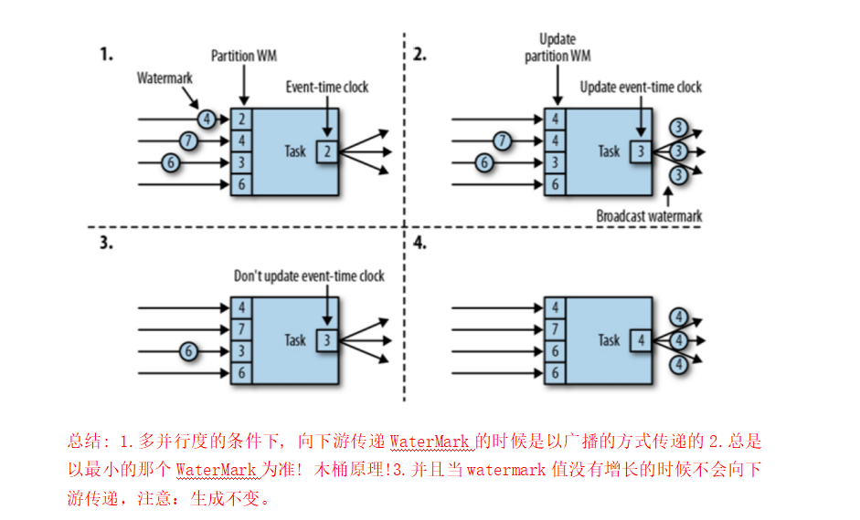
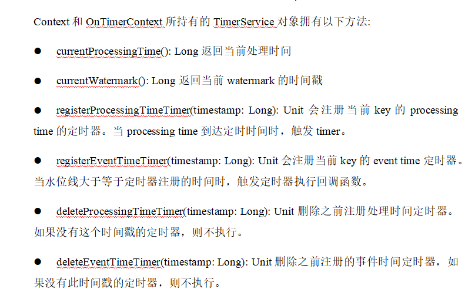

## 第7章 Flink流处理高阶编程

### Flink的window机制

流式计算是一种被设计用于**处理无限数据集**的数据处理引擎，而无限数据集是指一种不断增长的本质上无限的数据集，而Window窗口是一种切割无限数据为有限块进行处理的手段。

在Flink中, 窗口(window)是处理无界流的核心. 窗口把流切割成有限大小的多个"存储桶"(bucket), 我们在这些桶上进行计算

**窗口分为2类:**

1. 基于时间的窗口(时间驱动)

2. 基于元素个数的(数据驱动)

  

#### 时间窗口

时间窗口包含一个开始时间戳(包括)和结束时间戳(不包括), 这两个时间戳一起限制了窗口的尺寸.

在代码中, Flink使用TimeWindow这个类来表示基于时间的窗口. 这个类提供了key查询开始时间戳和结束时间戳的方法, 还提供了针对给定的窗口获取它允许的最大时间差的方法(maxTimestamp())

  

**时间窗口又分4种:**

  

滚动窗口(Tumbling Windows): 滚动窗口有固定的大小, 窗口与窗口之间不会重叠也没有缝隙.比如,如果指定一个长度为5分钟的滚动窗口, 当前窗口开始计算, 每5分钟启动一个新的窗口.

滚动窗口能将数据流切分成不重叠的窗口，**每一个事件只能属于一个窗口**。

说明:

1. 时间间隔可以通过: Time.milliseconds(x), Time.seconds(x), Time.minutes(x),等等来指定.

2. 我们传递给window函数的对象叫**窗口分配器**.

  

- 滑动窗口(Sliding Windows)

与滚动窗口一样, 滑动窗口也是有固定的长度. 另外一个参数我们叫滑动步长, 用来控制滑动窗口启动的频率.

所以, 如果滑动步长小于窗口长度, 滑动窗口会重叠. 这种情况下, 一个元素可能会被分配到多个窗口中

例如, 滑动窗口长度10分钟, 滑动步长5分钟, 则, 每5分钟会得到一个包含最近10分钟的数据.

  

  

会话窗口(Session Windows)

会话窗口分配器会根据活动的元素进行分组. 会话窗口不会有重叠, 与滚动窗口和滑动窗口相比, 会话窗口也没有固定的开启和关闭时间.

如果会话窗口有一段时间没有收到数据, 会话窗口会自动关闭, 这段没有收到数据的时间就是会话窗口的gap(间隔)

我们可以配置静态的gap, 也可以通过一个gap extractor 函数来定义gap的长度. 当时间超过了这个gap, 当前的会话窗口就会关闭, 后序的元素会被分配到一个新的会话窗口

  

**示例代码** **:**

1. 静态gap

.window***(***ProcessingTimeSessionWindows.*withGap** **(***Time.*seconds** **(***10***)))***

2. 动态gap

.window***(***ProcessingTimeSessionWindows.*withDynamicGap** **(** ***new** SessionWindowTimeGapExtractor\<Tuple2\<String, Long>>***() {  
***@Override  
**public long** extract***(***Tuple2\<String, Long> element***) {*** *// 返回 gap值, 单位毫秒  
***return** element.**f0**.length***()*** \* 1000;  
***}  
** ****}))***

** ****  

**创建原理** **:**

因为会话窗口没有固定的开启和关闭时间, 所以会话窗口的创建和关闭与滚动, 滑动窗口不同. 在Flink内部, 每到达一个新的元素都会创建一个新的会话窗口, 如果这些窗口彼此相距比较定义的gap小, 则会对他们进行合并. 为了能够合并, 会话窗口算子需要合并触发器和合并窗口函数: ReduceFunction, AggregateFunction, or ProcessWindowFunction

  

- 全局窗口(Global Windows)

全局窗口分配器会分配相同key的所有元素进入同一个 Global window. 这种窗口机制只有**指定自定义的触发器**时才有用. 否则, 不会做任务计算, 因为这种窗口没有能够处理聚集在一起元素的结束点.

  

#### 基于元素个数的窗口

**分2类:**

- 滚动窗口

**实例代码**

.countWindow(3)

说明:那个窗口先达到3个元素, 哪个窗口就关闭. 不影响其他的窗口.

- 滑动窗口

滑动窗口和滚动窗口的函数名是完全一致的，只是在传参数时需要传入两个参数，一个是window_size，一个是sliding_size。下面代码中的sliding_size设置为了2，也就是说，每收到两个相同key的数据就计算一次，每一次计算的window范围**最多**是3个元素。

**实例代码**

.countWindow***(***3, 2***)***

** ****  

#### Window Function

前面指定了窗口的分配器, 接着我们需要来指定如何计算, 这事由*window function*来负责. 一旦窗口关闭, *window function* 去计算处理窗口中的每个元素.

*window function* 可以是ReduceFunction,AggregateFunction,or ProcessWindowFunction中的任意一种.

ReduceFunction,AggregateFunction更加高效, 原因就是Flink可以对到来的元素进行**增量聚合** **.** ProcessWindowFunction （**全窗口函数**）可以得到一个包含这个窗口中所有元素的迭代器, 以及这些元素所属窗口的一些元数据信息.

ProcessWindowFunction不能被高效执行的原因是Flink在执行这个函数之前, 需要在**内部缓存这个窗口上所有的元素**

**增量聚合函数是来一条计算一条，而全窗口函数则是等到数据都到了再做计算做一次计算。**

** **  

ReduceFunction(增量聚合函数----不会改变数据的类型)

AggregateFunction(增量聚合函数----可以改变数据的类型)

- ProcessWindowFunction(全窗口函数) 全窗口函数应用场景：可以求百分之多少的数据或者求平均数这种需要把全部数据拿到之后再求的场景。

  

### Keyed vs Non-Keyed Windows

在用window前首先需要确认应该是在keyBy后的流上用, 还是在没有keyBy的流上使用.

在keyed streams上使用窗口, 窗口计算被并行的运用在多个task上, 可以认为每个分组都有自己单独窗口. 正如前面的代码所示.

在non-keyed stream上使用窗口,无论并行度设置的是几窗口的并行度都是1, 所有的窗口逻辑只能在一个单独的task上执行.

需要注意的是: 非key分区的流, 即使把并行度设置为大于1 的数, 窗口也只能在某个分区上使用

  

### Flink中的时间语义与WaterMark

**处理时间**是指的执行操作的各个**设备的时间(Process time)**

处理时间是最简单时间语义, 数据流和设备之间不需要做任何的协调. 他提供了最好的性能和最低的延迟. 但是, 在分布式和异步的环境下, 处理时间没有办法保证确定性, 容易受到数据传递速度的影响: 事件的延迟和乱序

在使用窗口的时候, 如果使用处理时间, 就指定时间分配器为处理时间分配器

  

**事件时间**是指的这个事件发生的时间.(event time)

在事件时间体系中, 水印是表示时间进度的标志(作用就相当于**现实时间的时钟**).

在事件时间体系中, 时间的进度依赖于数据本身, 和任何设备的时间无关. 事件时间程序必须制定如何产生*Event Time Watermarks(水印)* . 在事件时间体系中, 水印是表示时间进度的标志(作用就相当于**现实时间的时钟**).

  

在1.12之前默认的时间语义是处理时间, 从**1.12开始**, Flink内部已经把**默认的语义**改成了**事件时间**

** **  

支持event time的流式处理框架需要一种能够**测量event time 进度**的方式.比如, 一个窗口算子创建了一个长度为1小时的窗口,那么这个算子需要知道事件时间已经到达了这个窗口的关闭时间, 从而在程序中去关闭这个窗口.

  

这种在Flink中去**测量事件时间的进度**的机制就是**watermark(水印)**. watermark作为数据流的一部分在流动, 并且携带一个时间戳t.

一个*Watermark(t)*表示在这个流里面事件时间已经到了时间*t*, 意味着此时, 流中**不应该存在**这样的数据: 他的时间戳t2<=t (时间比较旧或者等于时间戳)

总结：

1、 衡量事件时间的进展。

2、 是一个特殊的时间戳，生成之后随着流的流动而向后传递。

3、 用来处理数据乱序的问题。

4、 触发窗口等得计算、关闭。

5、 单调递增的（时间不能倒退）。

6、 Flink认为，小于Watermark时间戳的数据处理完了，不应该再出现。

  

**Ø 有序流中的水印**

**Ø 乱序流中的水印**

乱序场景：

1、 什么是乱序 => 时间戳大的比时间戳小的先来

2、 乱序程度设置多少比较合适？

a) 经验值=\> 对自身集群和数据的了解，大概估算。

b) 对数据进行抽样。

c) 肯定不会设置为几小时，一般设为秒或者分钟。

3、 Watermark = maxTimestamp – outOfOrdernessMills – 1ms

=>当前最大的事件时间– 乱序程度（等待时间）- 1ms

  

#### Flink制造水印

Flink内置了两个WaterMark生成器 1. Monotonously Increasing Timestamps(时间戳单调增长:其实就是允许的延迟为0) 1. Fixed Amount of Lateness(允许固定时间的延迟)

  

自定义WatermarkStrategy :有周期性(periodic) 间歇性(punctuated) 继承接口WatermarkGenerator

  

  

多并行度下WaterMark的传递

  

窗口允许迟到的数据:当触发了窗口计算后, 会先计算当前的结果, 但是此时并不会关闭窗口.以后每来一条迟到数据, 则触发一次这条数据所在窗口计算(增量计算).

那么什么时候会真正的关闭窗口呢? wartermark 超过了**窗口结束时间+等待时间**

**注意** **:**

允许迟到只能运用在event time上

  

### 侧输出流

1,处理窗口关闭后迟到的数据:允许迟到数据+侧输出流作用：

尽量快速提供一个近似准确结果，为了保证时效性，然后加上允许迟到数据+侧输出流得到最终的数据，这样也不用维护大量的窗口，性能也就会好很多。

2,使用侧输出流把一个流拆成多个流, split算子可以把一个流分成两个流, 从1.12开始已经被移除了. 官方建议我们用侧输出流来替换split算子的功能.

  

### ProcessFunction API (底层API)

Process Function用来构建事件驱动的应用以及实现自定义的业务逻辑(使用之前的window函数和转换算子无法实现)

processFunction keyedProcessFunction coProcessFunction ProcessJoinFunction

broadcastprocessFunction keyedBroadcastProcessFunction ProcessWindowFunction

ProcessAllWindowFunction

  

### 定时器

基于处理时间或者事件时间处理过一个元素之后, 注册一个定时器, 然后**指定的时间执行，定时器只能用于keyedStream中，即keyby之后使用.**

  

基于处理时间的定时器

基于事件时间的定时器 : 时间进展依据的是watermark

  

  

