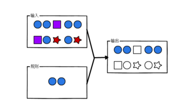

###### 2025补充

-   flink做到不丢失一条数据，首先需要checkpoint存储本次消费的进度，以支持失败后重新消费，上游需要支持数据持久化，例如kafka，反面如http，依靠tcp中的缓冲区，当flink不是意外挂掉的时候，协议的特性导致能缓存点数据等待连接后重新发送 等，下游需要支持数据幂等性，如mysql中的主键
-   flink中的并行度和多线程不是一个东西，前者相当于一个类的多个实例，一个并行度需要一个slot，slot由taskmanger管理，作业由jobmanager提交，在支持 slot复用的情况下，一个工作流需要的slot的个数就是最大的并行度
-   flink中的水印支持 周期的生成，也支持每来一条数据生成一次，
-   当出现多个并行算子的时候，数据发送的规则有 轮询，广播，按照key分区(keyby的场景下)
-   当使用keyby的时候，就是将数据分区的时候，会根据子任务的数量来，有多个subtask就是物理的分区，设计到数据传输，只有一个就是逻辑分区
-   实现checkpoint的原理之一是barrier，其使用的方式有对齐和非对齐两种，对齐是同一数据流的不同分区或并行任务的处理速度不一的时候 等待多个分区同时完成本次barrier，其中速度快的流会阻塞处理进来的数据，直到全局的barrier的形成，(会导致状态的增大)，非对齐是不阻塞，每个分区的完成barrier的动作不必一致，坏处是出现异常的时候有部分数据被重复消费，因缓存未处理的数据导致状态增大，这个行为是算子级别的

​  

​  

## 概述

Apache Flink是为分布式、高性能、随时可用以及准确的流处理应用程序打造的开源的有状态的流处理框架,Apache Flink是一个框架和分布式处理引擎，用于对无界和有界数据流进行有状态计算。Flink被设计在所有常见的集群环境中运行，以内存执行速度和任意规模来执行计算。

​  

事件驱动型:事件驱动型应用是一类具有状态的应用，它从一个或多个事件流提取数据，并根据到来的事件触发计算、状态更新或其他外部动作。比较典型的就是以kafka为代表的消息队列几乎都是事件驱动型应用。(Flink的计算也是事件驱动型)

​  

批处理的特点是有界、大量，非常适合需要访问全套记录才能完成的计算工作，一般用于离线统计。

流处理的特点是无界、实时, 无需针对整个数据集执行操作，而是对通过系统传输的每个数据项执行操作，一般用于实时统计。

在flink的世界观中，一切都是由流组成的，离线数据是有界限的流，实时数据是一个没有界限的流，这就是所谓的有界流和无界流。

​  

处理无界数据通常要求以特定顺序（例如事件发生的顺序）获取event，以便能够推断结果完整性。

处理有界流不需要有序获取，因为可以始终对有界数据集进行排序，**有界流的处理也称为批处理**。

​  

​  

  

Spark和Flink的主要差别就在于**计算模型不同**。Spark采用了微批处理模型，而Flink采用了基于操作符的连续流模型。

​  

使用客户端开发flink,三段project 有界流,无界流,批处理

  

#### flink模式

local-cluster模式(本地模式)

standalone模式(独立集群模式) 独立部署（Standalone）模式由Flink自身提供计算资源，无需其他框架提供资源，这种方式降低了和其他第三方资源框架的耦合性，独立性非常强,Flink主要是计算框架，而不是资源调度框架,和其他专业的资源调度框架集成更靠谱

standalone高可用,一个主jobManager多个备用JobManager以防单点故障

#### Yarn模式:在强大的Yarn环境中Flink是如何使用的

把Flink应用提交给Yarn的ResourceManager, Yarn的ResourceManager会申请容器从Yarn的NodeManager上面. Flink会创建JobManager和TaskManager在这些容器上.Flink会根据运行在JobManger上的job的需要的slot的数量**动态的分配**TaskManager资源

​  

Flink提供了yarn上运行的3模式，分别为**Session-Cluster，Application Mode**和**Per-Job-Cluster**模式

​  

Session-Cluster模式

Session-Cluster模式需要先启动Flink集群，向Yarn申请资源。以后提交任务都向这里提交。这个Flink集群会常驻在yarn集群中，除非手动停止。

在向Flink集群提交Job的时候, 如果资源被用完了,则新的Job不能正常提交.

缺点: 如果提交的作业中有长时间执行的大作业, 占用了该Flink集群的所有资源, 则后续无法提交新的job.

所以, Session-Cluster适合那些需要频繁提交的多个小Job, 并且执行时间都不长的Job.

  

**Per-Job-Cluster**

一个Job会对应一个Flink集群，每提交一个作业会根据自身的情况，都会单独向yarn申请资源，直到作业执行完成，一个作业的失败与否并不会影响下一个作业的正常提交和运行。独享Dispatcher和ResourceManager，按需接受资源申请；**适合规模大长时间运行的作业。**

**每次提交都会创建一个新的flink集群，任务之间互相独立，互不影响，方便管理。任务执行完成之后创建的集群也会消失。**

**​**  

Application Mode

Application Mode会在Yarn上启动集群, 应用jar包的main函数(用户类的main函数)将会在JobManager上执行. 只要应用程序执行结束, Flink集群会马上被关闭. 也可以手动停止集群.

与Per-Job-Cluster的区别：就是Application Mode下, **用户的****main函数式在集群中执行的，并且当一个application中有多个job的话，per-job模式则是一个job对应一个yarn中的application，而Application** **Mode则这个application中对应多个job。**

​  

yarn的高可用

Yarn模式的高可用和Standalone模式的高可用原理不一样。

Standalone模式中, 同时启动多个Jobmanager, 一个为leader其他为standby的, 当leader挂了, 其他的才会有一个成为leader。

yarn的高可用是同时只启动一个Jobmanager, 当这个Jobmanager挂了之后, yarn会再次启动一个, 其实是利用的yarn的重试次数来实现的高可用。

​  

容器化部署  
未讲述(k8s)

​  

​  

### Flink运行架构

  

  

客户端连接:用于准备和发送dataflow到JobManager. 然后客户端可以断开与JobManager的连接(detached mode), 也可以继续保持与JobManager的连接(attached mode)

​  

Jobmanager:控制一个应用程序执行的主进程，也就是说，每个应用程序都会被一个不同的JobManager所控制执行。JobManager会先接收到要执行的应用程序，这个应用程序会包括：作业图（JobGraph）、逻辑数据流图（logical dataflow graph）和打包了所有的类、库和其它资源的JAR包。JobManager会把JobGraph转换成一个物理层面的数据流图，这个图被叫做“执行图”（ExecutionGraph），包含了所有**可以并发执行的任务**。JobManager会向资源管理器（ResourceManager）请求执行任务必要的资源，也就是任务管理器（TaskManager）上的插槽（slot）。一旦它获取到了足够的资源，就会将执行图分发到真正运行它们的TaskManager上。

在运行过程中，JobManager会负责所有需要中央协调的操作，比如说检查点（checkpoints）的协调。

**这个进程包含3个不同的组件 ,JobManager主要作用：1. 接受客户端请求。2. 划分任务。3,申请资源。**

**​**  

ResourceManager:

负责资源的管理，在整个 Flink 集群中只有一个 ResourceManager. 注意这个ResourceManager不是Yarn中的ResourceManager, 是Flink中内置的, 只是赶巧重名了而已.负责管理任务管理器（TaskManager）的插槽（slot），TaskManger插槽是Flink中定义的处理资源单元。当JobManager申请插槽资源时，ResourceManager会将有空闲插槽的TaskManager分配给JobManager。如果ResourceManager没有足够的插槽来满足JobManager的请求，它还可以向资源提供平台发起会话，以提供启动TaskManager进程的容器。另外，ResourceManager还负责终止空闲的TaskManager，释放计算资源。

​  

Dispatcher:

负责接收用户提供的作业，并且负责为这个新提交的作业启动一个新的JobMaster 组件. Dispatcher也会启动一个Web UI，用来方便地展示和监控作业执行的信息。Dispatcher在架构中可能并不是必需的，这取决于应用提交运行的方式。

​  

JobMaster

负责管理**单个**JobGraph的执行.多个Job可以同时运行在一个Flink集群中, 每个Job都有一个自己的JobMaster.

​  

TaskManager

Flink中的**工作进程**。通常在Flink中会有多个TaskManager运行，每一个TaskManager都包含了一定数量的插槽（slots）。插槽的数量限制了TaskManager能够执行的任务数量。启动之后，TaskManager会向资源管理器注册它的插槽；收到资源管理器的指令后，TaskManager就会将一个或者多个插槽提供给JobManager调用。JobManager就可以向插槽分配任务（tasks）来执行了。

在执行过程中，一个TaskManager可以跟其它运行同一应用程序的TaskManager交换数据。

​  

**总结：1.工作进程，任务都在TaskManager上运行 2.TaskManager中有资源（Slot）**

**3.需要向JobManager进行交互从而进行资源的注册和使用 4.多个TaskManager可以交换数据**

**​**  

**​**  

**Taskamanager和TaskSlot**

**​**  

  

Flink中每一个worker(TaskManager)都是一个JVM进程，它可能会在独立的线程上执行一个Task。为了控制一个worker能接收多少个task，worker通过**Task Slot**来进行控制（一个worker至少有一个Task Slot）。

每个task slot表示TaskManager拥有资源的一个固定大小的子集。假如一个TaskManager有三个slot，那么它会将其管理的内存均分成三份给各个slot。资源slot化意味着一个task将不需要跟来自其他job的task竞争被管理的内存，取而代之的是它将拥有一定数量的内存储备。需要注意的是，这里**不会涉及到CPU**的隔离，slot目前仅仅用来隔离task的受管理的内存。

​  

总结：1.slot是可以共享的（Job内部），外部共享只有一种情况（Session）。

2.slot会均分内存资源，进而达到内存隔离，相互之间不会占用内存。但cpu资源不会隔离，可以共享cpu资源。

​  

Parallelism

**一个特定算子的子任务（subtask）的个数被称之为这个算子的并行度（parallelism）**，一般情况下，**一个流程序的并行度**，可以认为就**是其所有算子中最大的并行度**。一个程序中，不同的算子可能具有不同的并行度，**如果是yarn模式会动态申请资源**slot个数小于并行度那么程序将会卡死一直处于create状态，等待足够资源，才运行**，如果是standalone模式，不会动态申请资源**，slot个数小于并行度那么程序将会直接失败。

​  

**并行度优先级：**

**算子指定>env全局指定>提交参数>配置文件**

​  

Task与SubTask

不同算子的子任务（SubTask）经过一定的优化，串在一起，形成一个新的SubTask对TaskManager来讲，就是一个Task。

相同并行度的one to one操作，Flink将这样相连的算子链接在一起形成一个task，原来的算子成为里面的一部分。 每个task被一个线程执行.

  

  

Operator Chains（任务链）

Stream在算子之间传输数据的形式可以是one-to-one(forwarding)的模式也可以是redistributing的模式，具体是哪一种形式，取决于算子的种类。

​  

**Ø** **One-to-one**：

stream(比如在source和flatmap operator之间)维护着分区以及元素的顺序。那意味着flatmap 算子的子任务看到的元素的个数以及顺序跟source 算子的子任务生产的元素的个数、顺序相同，map、fliter、flatMap等算子都是one-to-one的对应关系。

**Ø** **Redistributing**：

stream(map()跟keyBy/window之间或者keyBy/window跟sink之间)的分区会发生改变。每一个算子的子任务依据所选择的transformation发送数据到不同的目标任务。例如，keyBy()基于hashCode重分区、broadcast和rebalance会随机重新分区，这些算子都会引起redistribute过程，而redistribute过程就类似于Spark中的shuffle过程。

​  

将算子链接成task是非常有效的优化：它能减少线程之间的切换和基于缓存区的数据交换，在减少时延的同时提升吞吐量。链接的行为可以在编程API中进行指定。\* 算子.startNewChain() =>与前面都断开  
\* 算子.disableChaining() => 与前后都断开  
\* env.disableOperatorChaining() => 全局都不串

断开操作链的好处在于减少某个slot的压力。

​  

**共享组**：

.slotSharingGroup("group1")

设置共享组后，slot的使用个数并不仅仅是与程序中最大算子的并行度有关了，当算子设置共享组后会使用额外的slot来执行，默认只有一个共享组，因此在默认只有一个共享组的情况下，slot的个数等于程序中最大算子的并行度。

任务链以及共享组：

任务链的好处，避免数据跨节点传输，减少线程间的切换。

断开任务链的好处，减少某个slot的压力。

默认情况下所有算子都是同一个共享组，任务所需要的slot数量：最大算子的并行度。

当使用共享组时，任务所需要的slot数量：每个共享组中最大并行度的和。

​  

ExecutionGraph(执行图)

由Flink程序直接映射成的数据流图是StreamGraph，也被称为**逻辑流图**，因为它们表示的是计算逻辑的高级视图。为了执行一个流处理程序，Flink需要将逻辑流图转换为物理数据流图（也叫执行图），详细说明程序的执行方式。

Flink 中的执行图可以分成四层：**StreamGraph -> JobGraph -> ExecutionGraph -> Physical Graph**。

**Ø** **StreamGraph：**

是根据用户通过 Stream API 编写的代码生成的最初的图。用来表示**程序的拓扑结构**。

**Ø** **JobGraph**：

StreamGraph经过优化后生成了 JobGraph，是提交给 JobManager 的数据结构。主要的优化为: 将多个符合条件的节点 chain 在一起作为一个节点，这样可以减少数据在节点之间流动所需要的序列化/反序列化/传输消耗。

**Ø** **ExecutionGraph**：

JobManager 根据 JobGraph 生成ExecutionGraph。ExecutionGraph是JobGraph的并行化版本，是调度层最核心的数据结构。

**Ø** **Physical Graph****：**

JobManager 根据 ExecutionGraph 对 Job 进行调度后，在各个TaskManager 上部署 Task 后形成的“图”，并不是一个具体的数据结构

​  

  

#### 提交的流程

  

​  

0．Flink任务提交后，Client向HDFS上传Flink的Jar包和配置

1．向Yarn ResourceManager提交任务，ResourceManager分配Container资源

2．通知对应的NodeManager启动ApplicationMaster，ApplicationMaster启动后加载Flink的Jar包和配置构建环境，然后启动JobManager（Dispatcher）

2.1．Dispatcher启动JobMaster

3．JobMaster向ResourceManager（Flink）申请资源

4．ResourceManager（Flink）向ResourceManager（Yarn）申请资源启动TaskManager

5．ResourceManager分配Container资源后，由ApplicationMaster通知资源所在节点的NodeManager启动TaskManager

6．TaskManager注册Slot

7．发出提供Slot命令

8．TaskManager向JobMaster提供Slot

9．JobMaster提交要在Slot中执行的任务

​  

## Flink流处理核心编程

Flink Job在提交执行计算时，需要首先建立和Flink框架之间的联系，也就指的是当前的flink运行环境，只有获取了环境信息，才能将task调度到不同的taskManager执行。而这个环境对象的获取方式相对比较简单

​  

### Environment

  

// 批处理环境

ExecutionEnvironment benv = ExecutionEnvironment.getExecutionEnvironment();

// 流式数据处理环境

StreamExecutionEnvironment env = StreamExecutionEnvironment.getExecutionEnvironment();

​  

### Source

​  

Flink框架可以从不同的来源获取数据，将数据提交给框架进行处理, 我们将获取数据的来源称之为数据源(Source)。

​  

WaterSensor水位传感器:用于接收水位数据

source类型:java集合,文件,socket,kafka,自定义source

自定义SourceFunction：  
1\. 实现SourceFunction相关接口  
2\. 重写两个方法：  
run(): 主要逻辑  
cancel(): 停止逻辑  
如果希望Source可以指定并行度，那么就实现ParallelSourceFunction 这个接口

​  

​  

### Transform

转化算子:

​  

1 ,map: 将数据流中的数据进行转换, 形成新的数据流，消费一个元素并产出一个元素

参数 : lambda表达式或**MapFunction**实现类 返回 : DataStream → DataStream

​  

**所有Flink函数**类都有其Rich版本。它与常规函数的不同在于，可以获取运行环境的上下文，并拥有一些生命周期方法，所以可以实现更复杂的功能。也有意味着提供了更多的，更丰富的功能。例如：**RichMapFunction**

​  

1. 默认生命周期方法, 初始化方法open(), 在每个并行度上只会被调用一次, 而且先被调用

2. 默认生命周期方法, 最后一个方法close(), 做一些清理工作, 在每个并行度上只调用一次, 而且是最后被调用，但读文件时在每个并行度上调用两次。

3\. 运行时上下文getRuntimeContext()方法提供了函数的RuntimeContext的一些信息，例如函数执行的并行度，任务的名字，以及state状态. 开发人员在需要的时候自行调用获取运行时上下文对象.

​  

2,flatmap(消费一个元素并产生零个或多个元素)

FlatMapFunction实现类 DataStream → DataStream

​  

3,Filter (根据指定的规则将满足条件（true）的数据保留，不满足条件(false)的数据丢弃)

FlatMapFunction实现类 DataStream → DataStream

​  

4,KeyBy (把流中的数据分到不同的分区中.具有**相同key的元素**会分到同一个分区中.一个分区中可以有多重不同的key. 在内部是使用的**hash分区**来实现的.)

​  

​分组：是一个逻辑上的划分，按照key进行区分，经过 keyby，同一个分组的数据肯定会进入同一个分区

分区：下游算子的一个并行实例（等价于一个slot），同一个分区内，可能有多个分组

​  

Key选择器函数: interface KeySelector<IN, KEY> DataStream → KeyedStream

5,shuffle 把流中的元素随机打乱. 对同一个组数据, 每次只需得到的结果都不同.

DataStream → DataStream

​  

6,connect

在某些情况下，我们需要将两个不同来源的数据流进行连接，实现数据匹配，Flink中的connect算子可以连接两个保持他们类型的数据流，两个数据流被connect之后，只是被放在了一个同一个流中，内部依然保持各自的数据和形式不发生任何变化，两个流相互独立。

DataStream[A], DataStream[B] -> ConnectedStreams[A,B]

**注意****:**

1. 两个流中存储的数据类型可以不同

2. 只是机械的合并在一起, 内部仍然是分离的2个流

3\. 只能2个流进行connect, 不能有第3个参与

​  

7,Union

对**两个或者两个以上**的DataStream进行union操作，产生一个包含所有DataStream元素的新DataStream

**connect****与****union** **区别：**

1. union之前两个流的类型必须是一样，connect可以不一样

2\. connect只能操作两个流，union可以操作多个。

​  

简单滚动聚合算子:sum, min,max.minBy,maxBy

KeyedStream的每一个支流做聚合。执行完成后，会将聚合的结果合成一个流返回，所以结果都是DataStream

KeyedStream -> SingleOutputStreamOperator

**参数**

如果流中存储的是POJO或者scala的样例类, 参数使用字段名

如果流中存储的是元组, 参数就是位置(基于0...)

​  

**注意****:**

滚动聚合算子： 来一条，聚合一条

1、聚合算子在 keyby之后调用，因为这些算子都是属于 KeyedStream里的

2、聚合算子，作用范围，都是分组内。 也就是说，不同分组，要分开算。

3、max、maxBy的区别：

max：取指定字段的当前的最大值，如果有多个字段，其他非比较字段，以第一条为准

maxBy：取指定字段的当前的最大值，如果有多个字段，其他字段以最大值那条数据为准；

如果出现两条数据都是最大值，由第二个参数决定： true => 其他字段取 比较早的值； false => 其他字段，取最新的值

  

8,reduce

一个分组数据流的聚合操作，合并当前的元素和上次聚合的结果，产生一个新的值，返回的流中包含每一次聚合的结果，而不是只返回最后一次聚合的最终结果。

为什么还要把中间值也保存下来? 考虑流式数据的特点: 没有终点, 也就没有最终的概念了. 任何一个中间的聚合结果都是值!

interface ReduceFunction<T> KeyedStream -> SingleOutputStreamOperator

​  

1,一个分组的第一条数据来的时候，不会进入reduce方法。

2、 输入和输出的数据类型，一定要一样。

​  

9,Process

process算子在Flink算是一个比较底层的算子,很多类型的流上都可以调用,可以从流中获取更多的信息(不仅仅数据本身)

​  

#### 对流重新分区的几个算子

  

**Ø** **KeyBy**

先按照key分组, 按照key的双重hash来选择后面的分区

​  

**Ø** **shuffle**

对流中的元素**随机**分区

**Ø** **re****blance**

对流中的元素平均分布到每个区.当处理倾斜数据的时候, 进行性能优化

**Ø** **rescale**

同rebalance一样, 也是平均循环的分布数据。但是要比rebalance更高效, 因为rescale不需要通过网络, 完全走的"管道"

​  

### sink

Sink有下沉的意思，在Flink中所谓的Sink其实可以表示为将数据存储起来的意思，也可以将范围扩大，表示将处理完的数据发送到指定的存储系统的输出操作

​  

之前我们一直在使用的print方法其实就是一种Sink, Flink内置了一些Sink, 除此之外的Sink需要用户自定义!

​  

kafaksink,redi​sSink ,ElasticSearchSink 自定义Sink,JDBCSink

​  

#### 执行模式选择:

流式API的传统执行模式我们称之为**STREAMING** 执行模式, 这种模式一般用于无界流, 需要持续的在线处理。

1.12.0新增了一个**BATCH**执行模式, 这种执行模式在执行方式上类似于MapReduce框架. 这种执行模式一般用于有界数据,目的为了更像流批一体。

默认是使用的**STREAMING** 执行模式。

**BATCH**执行模式**仅仅用于有界数据**, 而**STREAMING** 执行模式可以用在有界数据和无界数据.

一个公用的规则就是: 当你处理的数据是有界的就应该使用**BATCH**执行模式, 因为它**更加高效**. 当你的数据是无界的, 则必须使用**STREAMING** 执行模式, 因为只有这种模式才能处理持续的数据流.

​  

​  

## 第六章 :Flink流处理核心编程实战

  

通过第三方支付平台的交易数据来做一个实时对账。**需求: 来自两条流的订单交易匹配**

**注意****2****：**

1、一般 使用 Connect连接两条流，做一些条件匹配的时候， 在多并行度条件下，要根据连接条件keyby

2、先分别keyby，再connect 跟 先connect，再keyby ，效果一样

​  

## 第7章 Flink流处理高阶编程

### Flink的window机制

流式计算是一种被设计用于**处理无限数据集**的数据处理引擎，而无限数据集是指一种不断增长的本质上无限的数据集，而Window窗口是一种切割无限数据为有限块进行处理的手段。

在Flink中, 窗口(window)是处理无界流的核心. 窗口把流切割成有限大小的多个"存储桶"(bucket), 我们在这些桶上进行计算

**窗口分为2类:**

1. 基于时间的窗口(时间驱动)

2\. 基于元素个数的(数据驱动)

​  

#### 时间窗口

时间窗口包含一个开始时间戳(包括)和结束时间戳(不包括), 这两个时间戳一起限制了窗口的尺寸.

在代码中, Flink使用TimeWindow这个类来表示基于时间的窗口. 这个类提供了key查询开始时间戳和结束时间戳的方法, 还提供了针对给定的窗口获取它允许的最大时间差的方法(maxTimestamp())

​  

**时间窗口又分4种:**

​  

滚动窗口(Tumbling Windows): 滚动窗口有固定的大小, 窗口与窗口之间不会重叠也没有缝隙.比如,如果指定一个长度为5分钟的滚动窗口, 当前窗口开始计算, 每5分钟启动一个新的窗口.

滚动窗口能将数据流切分成不重叠的窗口，**每一个事件只能属于一个窗口**。

说明:

1. 时间间隔可以通过: Time.milliseconds(x), Time.seconds(x), Time.minutes(x),等等来指定.

2\. 我们传递给window函数的对象叫**窗口分配器**.

​  

Ø 滑动窗口(Sliding Windows)

与滚动窗口一样, 滑动窗口也是有固定的长度. 另外一个参数我们叫滑动步长, 用来控制滑动窗口启动的频率.

所以, 如果滑动步长小于窗口长度, 滑动窗口会重叠. 这种情况下, 一个元素可能会被分配到多个窗口中

例如, 滑动窗口长度10分钟, 滑动步长5分钟, 则, 每5分钟会得到一个包含最近10分钟的数据.

​  

  

会话窗口(Session Windows)

会话窗口分配器会根据活动的元素进行分组. 会话窗口不会有重叠, 与滚动窗口和滑动窗口相比, 会话窗口也没有固定的开启和关闭时间.

如果会话窗口有一段时间没有收到数据, 会话窗口会自动关闭, 这段没有收到数据的时间就是会话窗口的gap(间隔)

我们可以配置静态的gap, 也可以通过一个gap extractor 函数来定义gap的长度. 当时间超过了这个gap, 当前的会话窗口就会关闭, 后序的元素会被分配到一个新的会话窗口

  

**示例代码****:**

1. 静态gap

.window***(***ProcessingTimeSessionWindows.*withGap****(***Time.*seconds****(***10***)))***

2. 动态gap

.window***(***ProcessingTimeSessionWindows.*withDynamicGap****(*****new** SessionWindowTimeGapExtractor<Tuple2<String, Long>>***() {  
***@Override  
**public long** extract***(***Tuple2<String, Long> element***) {*** *// 返回 gap值, 单位毫秒  
***return** element.**f0**.length***()*** \* 1000;  
***}  
******}))***

***​***  

**创建原理****:**

因为会话窗口没有固定的开启和关闭时间, 所以会话窗口的创建和关闭与滚动, 滑动窗口不同. 在Flink内部, 每到达一个新的元素都会创建一个新的会话窗口, 如果这些窗口彼此相距比较定义的gap小, 则会对他们进行合并. 为了能够合并, 会话窗口算子需要合并触发器和合并窗口函数: ReduceFunction, AggregateFunction, or ProcessWindowFunction

​  

Ø 全局窗口(Global Windows)

全局窗口分配器会分配相同key的所有元素进入同一个 Global window. 这种窗口机制只有**指定自定义的触发器**时才有用. 否则, 不会做任务计算, 因为这种窗口没有能够处理聚集在一起元素的结束点.

  

#### 基于元素个数的窗口

**分2类:**

Ø 滚动窗口

**实例代码**

.countWindow(3)

说明:那个窗口先达到3个元素, 哪个窗口就关闭. 不影响其他的窗口.

Ø 滑动窗口

滑动窗口和滚动窗口的函数名是完全一致的，只是在传参数时需要传入两个参数，一个是window\_size，一个是sliding\_size。下面代码中的sliding\_size设置为了2，也就是说，每收到两个相同key的数据就计算一次，每一次计算的window范围**最多**是3个元素。

**实例代码**

.countWindow***(***3, 2***)***

***​***  

#### Window Function

前面指定了窗口的分配器, 接着我们需要来指定如何计算, 这事由*window function*来负责. 一旦窗口关闭, *window function* 去计算处理窗口中的每个元素.

*window function* 可以是ReduceFunction,AggregateFunction,or ProcessWindowFunction中的任意一种.

ReduceFunction,AggregateFunction更加高效, 原因就是Flink可以对到来的元素进行**增量聚合****.** ProcessWindowFunction （**全窗口函数**）可以得到一个包含这个窗口中所有元素的迭代器, 以及这些元素所属窗口的一些元数据信息.

ProcessWindowFunction不能被高效执行的原因是Flink在执行这个函数之前, 需要在**内部缓存这个窗口上所有的元素**

**增量聚合函数是来一条计算一条，而全窗口函数则是等到数据都到了再做计算做一次计算。**

**​**  

ReduceFunction(增量聚合函数----不会改变数据的类型)

AggregateFunction(增量聚合函数----可以改变数据的类型)

Ø ProcessWindowFunction(全窗口函数) 全窗口函数应用场景：可以求百分之多少的数据或者求平均数这种需要把全部数据拿到之后再求的场景。

​  

### Keyed vs Non-Keyed Windows

在用window前首先需要确认应该是在keyBy后的流上用, 还是在没有keyBy的流上使用.

在keyed streams上使用窗口, 窗口计算被并行的运用在多个task上, 可以认为每个分组都有自己单独窗口. 正如前面的代码所示.

在non-keyed stream上使用窗口,无论并行度设置的是几窗口的并行度都是1, 所有的窗口逻辑只能在一个单独的task上执行.

需要注意的是: 非key分区的流, 即使把并行度设置为大于1 的数, 窗口也只能在某个分区上使用

​  

### Flink中的时间语义与WaterMark

**处理时间**是指的执行操作的各个**设备的时间(Process time)**

处理时间是最简单时间语义, 数据流和设备之间不需要做任何的协调. 他提供了最好的性能和最低的延迟. 但是, 在分布式和异步的环境下, 处理时间没有办法保证确定性, 容易受到数据传递速度的影响: 事件的延迟和乱序

在使用窗口的时候, 如果使用处理时间, 就指定时间分配器为处理时间分配器

​  

**事件时间**是指的这个事件发生的时间.(event time)

在事件时间体系中, 水印是表示时间进度的标志(作用就相当于**现实时间的时钟**).

在事件时间体系中, 时间的进度依赖于数据本身, 和任何设备的时间无关. 事件时间程序必须制定如何产生*Event Time Watermarks(水印)* . 在事件时间体系中, 水印是表示时间进度的标志(作用就相当于**现实时间的时钟**).

​  

在1.12之前默认的时间语义是处理时间, 从**1.12开始**, Flink内部已经把**默认的语义**改成了**事件时间**

**​**  

支持event time的流式处理框架需要一种能够**测量event time 进度**的方式.比如, 一个窗口算子创建了一个长度为1小时的窗口,那么这个算子需要知道事件时间已经到达了这个窗口的关闭时间, 从而在程序中去关闭这个窗口.

​  

这种在Flink中去**测量事件时间的进度**的机制就是**watermark(水印)**. watermark作为数据流的一部分在流动, 并且携带一个时间戳t.

一个*Watermark(t)*表示在这个流里面事件时间已经到了时间*t*, 意味着此时, 流中**不应该存在**这样的数据: 他的时间戳t2<=t (时间比较旧或者等于时间戳)

总结：

1、 衡量事件时间的进展。

2、 是一个特殊的时间戳，生成之后随着流的流动而向后传递。

3、 用来处理数据乱序的问题。

4、 触发窗口等得计算、关闭。

5、 单调递增的（时间不能倒退）。

6、 Flink认为，小于Watermark时间戳的数据处理完了，不应该再出现。

​  

**Ø 有序流中的水印**

**Ø 乱序流中的水印**

乱序场景：

1、 什么是乱序 => 时间戳大的比时间戳小的先来

2、 乱序程度设置多少比较合适？

a) 经验值\=\> 对自身集群和数据的了解，大概估算。

b) 对数据进行抽样。

c) 肯定不会设置为几小时，一般设为秒或者分钟。

3、 Watermark = maxTimestamp – outOfOrdernessMills – 1ms

\=>当前最大的事件时间– 乱序程度（等待时间）- 1ms

​  

#### Flink制造水印

Flink内置了两个WaterMark生成器 1. Monotonously Increasing Timestamps(时间戳单调增长:其实就是允许的延迟为0) 1. Fixed Amount of Lateness(允许固定时间的延迟)

​  

自定义WatermarkStrategy :有周期性(periodic) 间歇性(punctuated) 继承接口WatermarkGenerator

​  

​  

多并行度下WaterMark的传递

  

窗口允许迟到的数据:当触发了窗口计算后, 会先计算当前的结果, 但是此时并不会关闭窗口.以后每来一条迟到数据, 则触发一次这条数据所在窗口计算(增量计算).

那么什么时候会真正的关闭窗口呢? wartermark 超过了**窗口结束时间+等待时间**

**注意****:**

允许迟到只能运用在event time上

​  

### 侧输出流

1,处理窗口关闭后迟到的数据:允许迟到数据+侧输出流作用：

尽量快速提供一个近似准确结果，为了保证时效性，然后加上允许迟到数据+侧输出流得到最终的数据，这样也不用维护大量的窗口，性能也就会好很多。

2,使用侧输出流把一个流拆成多个流, split算子可以把一个流分成两个流, 从1.12开始已经被移除了. 官方建议我们用侧输出流来替换split算子的功能.

​  

### ProcessFunction API (底层API)

Process Function用来构建事件驱动的应用以及实现自定义的业务逻辑(使用之前的window函数和转换算子无法实现)

processFunction keyedProcessFunction coProcessFunction ProcessJoinFunction

broadcastprocessFunction keyedBroadcastProcessFunction ProcessWindowFunction

ProcessAllWindowFunction

  

### 定时器

基于处理时间或者事件时间处理过一个元素之后, 注册一个定时器, 然后**指定的时间执行，定时器只能用于keyedStream中，即keyby之后使用.**

  

基于处理时间的定时器

基于事件时间的定时器 : 时间进展依据的是watermark

​  

​  

### Flink状态编程

有状态的计算是流处理框架要实现的重要功能，因为稍复杂的流处理场景都需要记录状态，然后在新流入数据的基础上不断更新状态。SparkStreaming在状态管理这块做的不好, 很多时候需要借助于外部存储(例如Redis)来手动管理状态, 增加了编程的难度。

Flink的状态管理是它的优势之一。

在流式计算中有些操作一次处理一个独立的事件(比如解析一个事件), 有些操作却需要记住多个事件的信息(比如窗口操作)。

那些需要记住多个事件信息的操作就是**有状态**的。

流式计算分为**无状态计算和有状态计算**两种情况。

​  

  

在以下场景会使用到流处理状态的功能: 去重,检测,聚合,在线机器学习模型

​  

#### Flink包括两种基本类型的状态

Managed State 和 Raw State

#### Managed State的分类

  

对Managed State继续细分，它又有两种类型

a) Keyed State(键控状态)。

b)Operator State(算子状态)

​  

​  

区别:​

|  | **Operator**** ****State** | **Keyed**** ****State** |
| --- | --- | --- |
| **适用用算子类型** | 可用于所有算子: 常用于source, 例如FlinkKafkaConsumer | 只适用于KeyedStream上的算子 |
| **状态分配** | 一个算子的子任务对应一个状态 | 一个Key对应一个State: 一个算子会处理多个Key, 则访问相应的多个State |
| **创建和访问方式** | 实现CheckpointedFunction或ListCheckpointed(已经过时)接口 | 重写RichFunction, 通过里面的RuntimeContext访问 |
| **横向扩展** | 并行度改变时有多种重新分配方式可选: 均匀分配和合并后每个得到全量 | 并发改变, State随着Key在实例间迁移 |
| **支持的数据结构** | ListState和BroadCastState | ValueState, ListState,MapState ReduceState, AggregatingState |

  

#### 键控状态的使用

  

键控状态是根据输入数据流中定义的键（key）来维护和访问的。

Flink为每个键值维护一个状态实例，并将具有相同键的所有数据，都分区到同一个算子任务中，这个任务会维护和处理这个key对应的状态。当任务处理一条数据时，它会自动将状态的访问范围限定为当前数据的key。因此，具有相同key的所有数据都会访问相同的状态。

Keyed State很类似于一个分布式的key-value map数据结构，只能用于KeyedStream（keyBy算子处理之后）。

​  

支持的数据类型:

Ø ValueState<T> 保存单个值. 每个key有一个状态值. 设置使用update(T), 获取使用 T value()

Ø ListState<T>: 保存元素列表. 添加元素: add(T) addAll(List<T>)

获取元素: Iterable<T> get() 覆盖所有元素: update(List<T>)

Ø ReducingState<T>: 存储单个值, 表示把所有元素的聚合结果添加到状态中. 与ListState类似, 但是当使用add(T)的时候ReducingState会使用指定的ReduceFunction进行聚合.

Ø AggregatingState<IN, OUT>:

存储单个值. 与ReducingState类似, 都是进行聚合. 不同的是, AggregatingState的聚合的结果和元素类型可以不一样.

Ø MapState<UK, UV>: 存储键值对列表.

添加键值对: put(UK, UV) or putAll(Map<UK, UV>)

根据key获取值: get(UK)

获取所有: entries(), keys() and values()

检测是否为空: isEmpty()

​  

**注意****:**

l 所有的类型都有clear(), 清空当前key的状态

l 这些状态对象仅用于用户与状态进行交互.

l 状态不是必须存储到内存, 也可以存储在磁盘或者任意其他地方

l 从状态获取的值与输入元素的key相关

​  

​  

键控状态的使用案例之:水位五秒内连续上升问题

​  

#### 算子状态的使用

Operator State可以用在所有算子上，每个算子子任务或者说每个算子实例分别维护一个状态，流入这个算子子任务的数据可以访问和更新这个状态。

注意: 算子子任务之间的状态不能互相访问

Operator State的实际应用场景不如Keyed State多，它经常**被用在****Source或Sink等算子上**，用来保存流入数据的偏移量或对输出数据做缓存，以保证Flink应用的Exactly-Once语义。

Flink为算子状态提供三种基本数据结构：

列表状态（List state）

将状态表示为一组数据的列表

Ø 联合列表状态（Union list state）

也将状态表示为数据的列表。它与常规列表状态的区别在于，在发生故障时，或者从保存点（savepoint）启动应用程序时如何恢复。

一种是均匀分配(List state)，另外一种是将所有State 合并为全量 State 再分发给每个实例(Union list state)。

Ø 广播状态（Broadcast state）

是一种特殊的算子状态. 如果一个算子有多项任务，而它的每项任务状态又都相同，那么这种特殊情况最适合应用广播状态。

从版本1.5.0开始，Apache Flink具有一种新的状态，称为**广播状态**。

(广播状态被引入以支持这样的用例:来自一个流的一些数据需要广播到所有下游任务，在那里它被本地存储，并用于处理另一个流上的所有传入元素。作为广播状态自然适合出现的一个例子，我们可以想象一个低吞吐量流，其中包含一组规则，我们希望根据来自另一个流的所有元素对这些规则进行评估。考虑到上述类型的用例，广播状态与其他操作符状态的区别在于:

1. 它是一个map格式。

2. 它只对输入有广播流和无广播流的特定操作符可用。

3\. 这样的操作符可以具有不同名称的多个广播状态。)

​  

广播案例代码实现

  

### 状态后端

每传入一条数据，有状态的算子任务都会**读取和更新状态**。由于有效的状态访问对于处理数据的低延迟至关重要，因此每个并行任务(子任务)都会在本地维护其状态，以确保快速的状态访问。

状态的存储、访问以及维护，由一个**可插入**的组件决定，这个组件就叫做**状态后端**（state backend）

**状态后端主要负责两件事：**

Ø 本地的状态管理

Ø 将检查点（checkpoint）状态写入远程存储

​  

​  

状态后端作为一个可插入的组件, 没有固定的配置, 我们可以根据需要选择一个合适的状态后端。

分类:**Ø MemoryStateBackend**

内存级别的状态后端,

**存储方式****:**本地状态存储在TaskManager的内存中, checkpoint 存储在JobManager的内存中。

**特点****:**快速, 低延迟, 但不稳定

**使用场景:** 1\. 本地测试2. 几乎无状态的作业(ETL) 3. JobManager不容易挂, 或者挂了影响不大. 4. 不推荐在生产环境下使用

​  

**Ø FsStateBackend**

**存储方式****:** 本地状态在TaskManager内存, **Checkpoint****存储在文件系统中**

**特点****:** 拥有内存级别的本地访问速度, 和更好的容错保证

**使用场景:** 1. 常规使用状态的作业. 例如分钟级别窗口聚合, join等2. 需要开启HA的作业 3. 可以应用在生产环境中

​  

**Ø RocksDBStateBackend**

将所有的状态序列化之后, 存入本地的RocksDB数据库中.(一种NoSql数据库, KV形式存储)

**存储方式****:** 1\. 本地状态存储在TaskManager的RocksDB数据库中(实际是内存+磁盘) 2\. Checkpoint在外部文件系统中.

**使用场景:** 1\. 超大状态的作业, 例如天级的窗口聚合2. 需要开启HA的作业 3. 对读写状态性能要求不高的作业4. 可以使用在生产环境

​  

配置状态后端:**Ø 全局配置状态后端 Ø 在代码中配置状态后端**

**​**  

**​**  

### Flink的容错机制

当在分布式系统中引入状态做checkpoint时，自然也引入了一致性问题。

一致性实际上是"正确性级别"的另一种说法，也就是说在成功处理故障并恢复之后得到的结果，与没有发生任何故障时得到的结果相比，前者到底有多正确？举例来说，假设要对最近一小时登录的用户计数。在系统经历故障之后，计数结果是多少？如果有偏差，是有漏掉的计数还是重复计数？

​  

#### **一致性级别**

  

在流处理中，一致性可以分为3个级别:

**Ø** **at-most-once(****最多变一次****):**

这其实是没有正确性保障的委婉说法——故障发生之后，计数结果可能丢失。

**Ø** **at-least-once(****至少一次****):**

这表示计数结果可能大于正确值，但绝不会小于正确值。也就是说，计数程序在发生故障后**可能多算**，但是**绝不会少算。**

**Ø** **exactly-once(严格变一次):**

这指的是系统保证在发生故障后得到的计数结果与正确值一致.既不多算也不少算。

Flink的一个重大价值在于，它**既**保证了**exactly-once**，**又**具有**低延迟和高吞吐**的处理能力。

​  

#### **端到端的状态一致性**

目前我们看到的一致性保证都是由流处理器实现的，也就是说都是在 Flink 流处理器内部保证的；而在真实应用中，流处理应用除了流处理器以外还包含了数据源（例如Kafka）和输出到持久化系统。

端到端的一致性保证，意味着结果的正确性贯穿了整个流处理应用的始终；每一个组件都保证了它自己的一致性，整个端到端的一致性级别取决于所有组件中一致性最弱的组件。

​  

具体划分如下:

Ø source端

需要外部源可重设数据的读取位置.

目前我们使用的Kafka Source具有这种特性: 读取数据的时候可以指定offset

Ø flink内部

依赖checkpoint机制

Ø sink端

需要保证从故障恢复时，数据不会重复写入外部系统. 有2种实现形式:

a) 幂等（Idempotent）写入

所谓幂等操作，是说一个操作，可以重复执行很多次，但只导致一次结果更改，也就是说，后面再重复执行就不起作用了。

b) 事务性（Transactional）写入

需要构建事务来写入外部系统，构建的事务对应着 checkpoint，等到 checkpoint 真正完成的时候，才把所有对应的结果写入 sink 系统中。对于事务性写入，具体又有两种实现方式：预写日志（WAL）和两阶段提交（2PC）

​  

  

#### Checkpoint原理

Flink具体如何保证exactly-once呢? 它使用一种被称为"检查点"（**checkpoint**）的特性，在出现故障时将系统重置回正确状态。

​  

​  

面通过简单的类比来解释检查点的作用。

假设你和两位朋友正在数项链上有多少颗珠子，如下图所示。你捏住珠子，边数边拨，每拨过一颗珠子就给总数加一。你的朋友也这样数他们手中的珠子。当你分神忘记数到哪里时，怎么办呢? 如果项链上有很多珠子，你显然不想从头再数一遍，尤其是当三人的速度不一样却又试图合作的时候，更是如此(比如想记录前一分钟三人一共数了多少颗珠子，回想一下一分钟滚动窗口)。

于是，你想了一个更好的办法: 在项链上每隔一段就松松地系上一根有色皮筋，将珠子分隔开; 当珠子被拨动的时候，皮筋也可以被拨动; 然后，你安排一个助手，让他在你和朋友拨到皮筋时记录总数。用这种方法，当有人数错时，就不必从头开始数。相反，你向其他人发出错误警示，然后你们都从上一根皮筋处开始重数，助手则会告诉每个人重数时的起始数值，例如在粉色皮筋处的数值是多少。

Flink检查点的作用就类似于皮筋标记。数珠子这个类比的关键点是: 对于指定的皮筋而言，珠子的相对位置是确定的; 这让皮筋成为重新计数的参考点。总状态(珠子的总数)在每颗珠子被拨动之后更新一次，助手则会保存与每根皮筋对应的检查点状态，如当遇到粉色皮筋时一共数了多少珠子，当遇到橙色皮筋时又是多少。当问题出现时，这种方法使得重新计数变得简单。

​  

#### **Flink的检查点算法**

checkpoint机制是Flink可靠性的基石，可以保证Flink集群在某个算子因为某些原因(如 异常退出)出现故障时，能够将整个应用流图的状态恢复到故障之前的某一状态，保证应用流图状态的一致性.

快照的实现算法:

1. 简单算法\-\-暂停应用, 然后开始做检查点, 再重新恢复应用

​  

2. Flink的改进Checkpoint算法. Flink的checkpoint机制原理来自"Chandy-Lamport algorithm"算法(分布式快照算法)的一种变体: 异步 barrier 快照（asynchronous barrier snapshotting）

每个需要checkpoint的应用在启动时，Flink的JobManager为其创建一个 **CheckpointCoordinator**，CheckpointCoordinator全权负责本应用的快照制作。

​  

#### **理解****Barrier**

流的barrier是Flink的Checkpoint中的一个核心概念. 多个barrier被插入到数据流中, 然后作为数据流的一部分随着数据流动(有点类似于Watermark).这些barrier不会跨越流中的数据.

每个barrier会把数据流分成两部分: 一部分数据进入**当前的快照** , 另一部分数据进入**下一个快照** **.** 每个barrier携带着快照的id. barrier 不会暂停数据的流动, 所以非常轻量级. 在流中, 同一时间可以有来源于多个不同快照的多个barrier, 这个意味着可以并发的出现不同的快照.

​  

  

#### **Flink的检查点制作过程**

Ø Checkpoint Coordinator 向所有 source 节点 trigger Checkpoint. 然后Source Task会在数据流中安插CheckPoint barrier

第二步: source 节点向下游广播 barrier，这个 barrier 就是实现 Chandy-Lamport 分布式快照算法的核心，下游的 task 只有收到所有 input 的 barrier 才会执行相应的 Checkpoint

Ø 第三步: 当 task 完成 state 备份后，会将备份数据的地址（state handle）通知给 Checkpoint coordinator。

Ø 第四步: 下游的sink 节点收集齐上游两个 input 的 barrier 之后，会执行本地快照，这里特地展示了 RocksDB incremental Checkpoint 的流程，首先 RocksDB 会全量刷数据到磁盘上（红色大三角表示），然后 Flink 框架会从中选择没有上传的文件进行持久化备份（紫色小三角）。

Ø 第五步: 同样的，sink 节点在完成自己的 Checkpoint 之后，会将 state handle 返回通知 Coordinator。

Ø 第六步: 最后，当 Checkpoint coordinator 收集齐所有 task 的 state handle，就认为这一次的 Checkpoint 全局完成了，向持久化存储中再备份一个 Checkpoint meta 文件。

#### **严格一次语义: barrier对齐**

  

当 job graph 中的每个 operator 接收到 barriers 时，它就会记录下其状态。拥有两个输入流的 Operators（例如 CoProcessFunction）会执行 **barrier 对齐**（barrier alignment） 以便当前快照能够包含消费两个输入流 barrier 之前（但不超过）的所有 events 而产生的状态。

​  

1. 当operator收到数字流的barrier n时, 它就**不能处理****(但是可以接收)**来自该流的任何数据记录，直到它从字母流所有输入接收到 barrier n 为止。否则，它会混合属于快照n 的记录和属于快照n + 1 的记录。

2. 接收到 barrier n 的流(数字流)暂时被搁置。从这些流接收的记录入输入缓冲区, 不会被处理。

3. 图一中的Checkpoint barrier n之后的数据123已结到达了算子, 存入到输入缓冲区没有被处理, 只有等到字母流的Checkpoint barrier n到达之后才会开始处理.

4\. 一旦最后所有输入流都接收到 barrier n，Operator 就会把缓冲区中pending 的输出数据发出去，然后把CheckPoint barrier n 接着往下游发送。这里还会对自身进行快照。

​  

#### **至少一次语义: barrier不对齐**

前面介绍了barrier对齐, 如果barrier不对齐会怎么样? 会重复消费, 就是**至少一次**语义.

假设不对齐, 在字母流的Checkpoint barrier n到达前, 已经处理了1 2 3. 等字母流Checkpoint barrier n到达之后, 会做Checkpoint n. 假设这个时候程序异常错误了, 则重新启动的时候会Checkpoint n之后的数据重新计算. 1 2 3 会被再次被计算, 所以123出现了重复计算.

​  

### **Savepoint原理**

1. Flink 还提供了可以自定义的镜像保存功能，就是保存点（savepoints）

2. 原则上，创建保存点使用的算法与检查点完全相同，因此保存点可以认为就是具有一些额外元数据的检查点

3. Flink不会自动创建保存点，因此用户（或外部调度程序）必须明确地触发创建操作

4\. 保存点是一个强大的功能。除了故障恢复外，保存点可以用于：有计划的手动备份，更新应用程序，版本迁移，暂停和重启应用，等等

​  

#### checkpoint和savepoint的区别

| **Save****point** | **Checkpoint** |
| --- | --- |
| Savepoint是由命令触发, 由用户创建和删除 | Checkpoint被保存在用户指定的外部路径中 |
| 保存点存储在标准格式存储中，并且可以升级作业版本并可以更改其配置。 | 当作业失败或被取消时，将保留外部存储的检查点。 |
| 用户必须提供用于还原作业状态的保存点的路径。 | 用户必须提供用于还原作业状态的检查点的路径。 |

  

​  

### ​**在代码中测试Checkpoint**

从SavePoint和CK恢复任务步骤：

//启动任务

bin/flink run -d -m hadoop102:8081 -c com.atguigu.day06.Flink10\_SavePoint ./flink-0108-1.0-SNAPSHOT.jar

​  

//保存点(只能手动)

bin/flink savepoint -m hadoop102:8081 JobId hdfs://hadoop102:8020/flink/save

​  

//关闭任务并从保存点恢复任务

bin/flink run -s hdfs://hadoop102:8020/flink/save/... -m hadoop102:8081 -c com.atguigu.WordCount xxx.jar

​  

//从CK位置恢复数据，在代码中开启cancel的时候不会删除checkpoint信息这样就可以根据checkpoint来回复数据了

env.getCheckpointConfig().enableExternalizedCheckpoints(CheckpointConfig.ExternalizedCheckpointCleanup.RETAIN\_ON\_CANCELLATION);

\-s指定恢复的地址

bin/flink run -s hdfs://hadoop102:8020/flink/ck/Jobid/chk-960 -m hadoop102:8081 -c com.atguigu.WordCount xxx.jar

​  

注意:从CK位置恢复数据，在代码中开启cancel的时候不会删除checkpoint信息这样就可以根据checkpoint来回复数据了

​  

### Flink+Kafka 实现端到端严格一次

我们知道，端到端的状态一致性的实现，需要每一个组件都实现，对于Flink + Kafka的数据管道系统（Kafka进、Kafka出）而言，各组件怎样保证exactly-once语义呢？

Ø 内部—— 利用checkpoint机制，把状态存盘，发生故障的时候可以恢复，保证部的状态一致性

Ø source —— kafka consumer作为source，可以将偏移量保存下来，如果后续任务出现了故障，恢复的时候可以由连接器重置偏移量，重新消费数据，保证一致性

Ø sink —— kafka producer作为sink，采用两阶段提交 sink，需要实现一个TwoPhaseCommitSinkFunction

​  

具体的两阶段提交步骤总结如下：

1)jobmanager 触发checkpoint 操作，barrier 从source 开始向下传递，遇到barrier 的算子将状态存入状态后端，并通知jobmanagerr

2)第一条数据来了之后，开启一个 kafka 的事务（transaction），正常写入kafka 分区日志但标记为未提交，这就是“预提交”

3)sink 连接器收到barrier，保存当前状态，存入checkpoint，通知jobmanager，并开启下一阶段的事务，用于提交下个检查点的数据

4)jobmanager 收到所有任务的通知，发出确认信息，表示checkpoint 完成

5)sink 任务收到jobmanager 的确认信息，正式提交这段时间的数据

6)外部kafka关闭事务，提交的数据可以正常消费了

​  

## 第8章 Flink CEP编程

FlinkCEP(Complex event processing for Flink) 是在Flink实现的**复杂事件处理**库. 它可以让你在无界流中检测出特定的数据,是一种基于动态环境中事件流的分析技术，事件在这里通常是有意义的状态变化，通过分析事件间的关系，利用**过滤、关联、聚合**等技术，根据事件间的时序关系和聚合关系制定检测规则，持续地从事件流中查询出符合要求的事件序列，最终分析得到更复杂的复合事件。

CEP开发步骤:1,导入依赖 2,定义模式->在流上应用模式->获取匹配到的结果

​  

#### 模式的API

作用为: 定义复杂的模式序列

单个模式(单例模式(仅接受一个事件) | 循环模式 (可以接受**多个事件**) 可自定义)

条件:

迭代条件 **IterativeCondition** 用它可以指定一个基于前面已经被接受的事件的属性或者它们的一个子集的统计数据来决定是否接受时间序列的条件。

简单条件 SimpleCondition 它决定是否接受一个事件只取决于事件自身的属性。

停止条件: **until** 如果使用循环模式(oneOrMore, timesOrMore),在读无界流的时候，可以指定一个停止条件, 否则有可能会内存吃不消. 满足了给定的条件的事件出现后，就不会再有事件被接受进入模式了。

**​**  

**组合模式(模式序列):**

严格连续 期望所有匹配的事件严格的一个接一个出现，中间没有任何不匹配的事件,notNext 如果不想后面直接连着一个特定事件

松散连续 notFollowBy 如果不想一个特定事件发生在两个事件之间的任何地方。(notFollowBy不能位于事件的最后)

非确定的松散连续 更进一步的松散连续，允许忽略掉一些匹配事件的附加匹配

当且仅当数据为a,c,b,b时，对于followedBy模式而言命中的为{a,b}，对于followedByAny而言会有两次命中{a,b},{a,b}

​  

前面的连续性也可以运用在单个**循环模式**中. 连续性会被运用在被接受进入模式的事件之间。

默认是松散连续

​  

在组合模式情况下, 对次数的处理尽快能获取最多个的那个次数, 就是**贪婪**!当一个事件***同时满足两个模式***的时候起作用.

​  

1. 一般**贪婪比非贪婪**的**结果要少**!

2\. 模式组不能设置为greedy

模式可选性

​  

模式组

在前面的代码中次数只能用在某个模式上, 比如: .begin(...).where(...).next(...).where(...).times(2) 这里的次数只会用在next这个模式上, 而不会用在begin模式上.

​  

超时数据 .within(Time.second(2))

​  

#### 匹配后跳过策略（了解）

  

对于一个给定的模式，同一个事件可能会分配到多个成功的匹配上。为了控制一个事件会分配到多少个匹配上，你需要指定跳过策略AfterMatchSkipStrategy。 有五种跳过策略，如下：

***·*** ***NO\_SKIP***: 每个成功的匹配都会被输出。（人话：不跳过）

***·*** ***SKIP\_TO\_NEXT***: 丢弃以相同事件开始的所有部分匹配。（人话:事件相同开头只保留一个）

***·*** ***SKIP\_PAST\_LAST\_EVENT***: 丢弃起始在这个匹配的开始和结束之间的所有部分匹配。（人话：丢弃匹配开始后每个已经做过匹配的事件的匹配）

***·*** ***SKIP\_TO\_FIRST***: 丢弃起始在这个匹配的开始和第一个出现的名称为*PatternName*事件之间的所有部分匹配。（人话：以第一个事件匹配为准，丢弃匹配开始后包含这个事件之前的匹配）

***·*** ***SKIP\_TO\_LAST***: 丢弃起始在这个匹配的开始和最后一个出现的名称为*PatternName*事件之间的所有部分匹配。（人话：以最后一个事件匹配为准，丢弃匹配开始后包含这个事件之前的匹配）

| 跳过策略 | 结果 | 描述 |
| --- | --- | --- |
| ***NO_SKIP*** | b1 b2 b3 c b2 b3 c b3 c | 在找到匹配b1 b2 b3 c之后，匹配过程将不会丢弃任何结果。 |
| ***SKIP_TO_NEXT*** | b1 b2 b3 c b2 b3 c b3 c | 找到匹配的b1 b2 b3 c之后，匹配过程将不会丢弃任何结果，因为没有其他匹配可以从b1开始 |
| ***SKIP_PAST_LAST_EVENT*** | b1 b2 b3 c | 找到匹配的b1 b2 b3 c后，匹配过程将丢弃所有开始的部分匹配（） |
| ***SKIP_TO_FIRST*** | b1 b2 b3 c b2 b3 c b3 c | 在发现匹配b1 b2 b3 c之后，匹配过程将尝试丢弃在b1之前开始的所有部分匹配，但是没有这样的匹配。因此，任何东西都不会被丢弃。 |
| ***SKIP_TO_LAST*** | b1 b2 b3 c b3 c | 在发现匹配b1 b2 b3 c之后，匹配过程将尝试丢弃在b3之前开始的所有部分匹配。有一个这样的匹配，b2 b3 c |

​  

​  

AfterMatchSkipStrategy skipStrategy = ...

Pattern.begin("patternName", skipStrategy);

​  

​  

编程实战 >>>>>>>>>>>>>见Flink代码

​