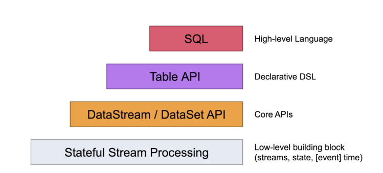
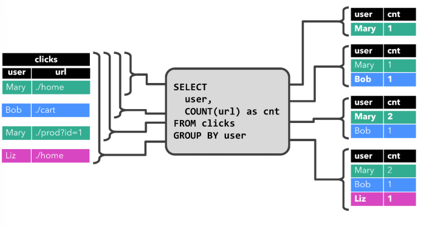
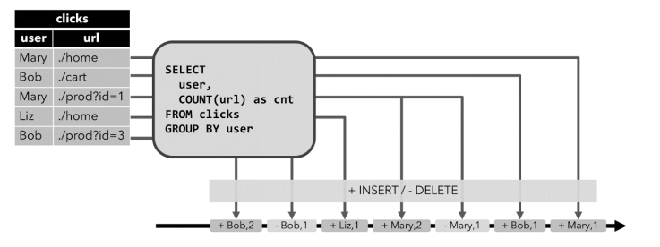
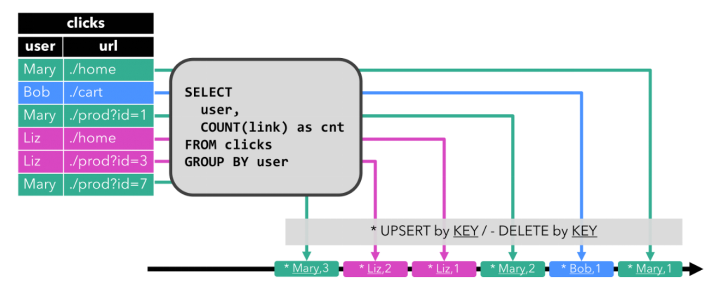
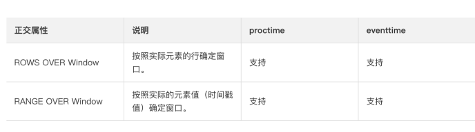
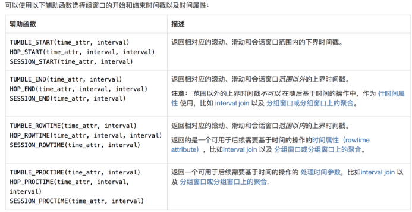
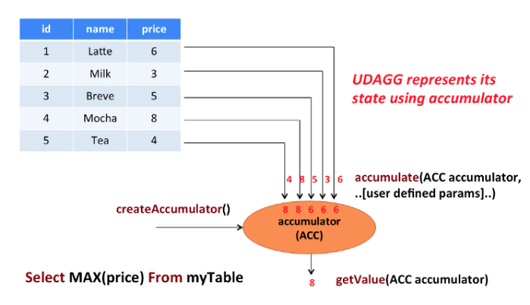
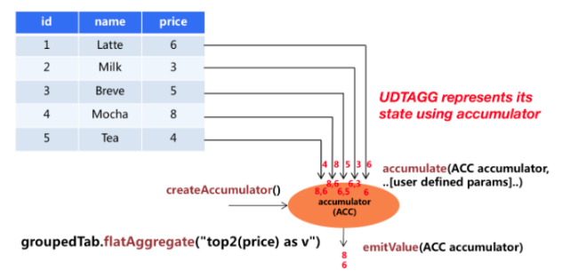

Flink 社区很早就设想过将批数据看作一个有界流数据，将批处理看作流计算的一个特例，从而实现流批统一，Flink 社区的开发人员在多轮讨论后，基本敲定了Flink 未来的技术架构

  

Apache Flink 有两种关系型 API 来做流批统一处理：Table API 和 SQL。

  

Table API 是用于 Scala 和 Java 语言的查询API，它可以用一种非常直观的方式来组合使用选取、过滤、join 等关系型算子。

Flink SQL 是基于 [Apache Calcite](https://calcite.apache.org/) 来实现的标准 SQL。这两种 API 中的查询对于批（DataSet）和流（DataStream）的输入有相同的语义，也会产生同样的计算结果。

Table API 和 SQL 两种 API 是紧密集成的，以及 DataStream 和 DataSet API。你可以在这些 API 之间，以及一些基于这些 API 的库之间轻松的切换。比如，你可以先用 [CEP](https://ci.apache.org/projects/flink/flink-docs-release-1.12/zh/dev/libs/cep.html) 从 DataStream 中做模式匹配，然后用 Table API 来分析匹配的结果；或者你可以用 SQL 来扫描、过滤、聚合一个批式的表，然后再跑一个 [Gelly 图算法](https://ci.apache.org/projects/flink/flink-docs-release-1.12/zh/dev/libs/gelly/) 来处理已经预处理好的数据。

  

Flink 的[Table API](https://ci.apache.org/projects/flink/flink-docs-release-1.12/zh/dev/table/tableApi.html)和[SQL](https://ci.apache.org/projects/flink/flink-docs-release-1.12/zh/dev/table/sql/)是流批统一的 API。这意味着TableAPI & SQL在无论有限的批式输入还是无限的流式输入下，都具有相同的语义。因为传统的关系代数以及 SQL 最开始都是为了批式处理而设计的，关系型查询在流式场景下不如在批式场景下容易理解。

  

  

***动态表** ****(Dynamic Tables)***是Flink的支持流数据的Table API和SQL的核心概念。

与表示批处理数据的静态表不同，动态表是**随时间变化**的。可以像查询静态批处理表一样查询它们。查询动态表将生成一个***连续查询** ****(Continuous Query)***。一个连续查询永远不会终止，结果会生成一个动态表。查询不断更新其(动态)结果表，以反映其(动态)输入表上的更改。

需要注意的是，连续查询的结果在语义上总是等价于以批处理模式在输入表快照上执行的相同查询的结果。

1. 将流转换为动态表。

2. 在动态表上计算一个连续查询，生成一个新的动态表。

3. 生成的动态表被转换回流。

  

  

在动态表上计算一个连续查询，并生成一个新的动态表。与批处理查询不同，连续查询从不终止，并根据**其输入表上的更新** **更新其结果表**。

在任何时候，连续查询的结果在语义上与以批处理模式在输入表快照上执行的相同查询的结果相同。

  

  

**说明** **:**

1. 当查询开始，clicks 表(左侧)是空的。

2. 当**第一行数据**被插入到 clicks 表时，查询开始计算结果表。第一行数据 [Mary,./home] 插入后，结果表(右侧，上部)由一行 [Mary, 1] 组成。

3. 当第二行 [Bob, ./cart] 插入到 clicks 表时，查询会更新结果表并插入了一行新数据 [Bob, 1]。

4. 第三行 [Mary, ./prod?id=1] 将产生已计算的结果行的更新，[Mary, 1] 更新成 [Mary, 2]。

5. 最后，当第四行数据加入 clicks 表时，查询将第三行 [Liz, 1] 插入到结果表中。

  

### 第2章 Flink Table API

表与DataSream混合使用

  

基本使用:聚合操作

// 3. 对动态表进行查询  
Table resultTable = table  
.where($("vc").isGreaterOrEqual(20))  
.groupBy($("id"))  
.aggregate($("vc").sum().as("vc_sum"))  
.select($("id"), $("vc_sum"));

  

//或者

//Table resultTbale = table  
// .where($("vc").isGreaterOrEqual(20))  
// .groupBy($("id"))  
// .select($("id"),$("vc").sum().as("vcSum"));

  
// 4. 把动态表转换成流 如果涉及到数据的更新和改变, 要用到撤回流. 多个了一个boolean标记  
DataStream\<Tuple2\<Boolean, Row>> resultStream = tableEnv.toRetractStream(resultTable, Row.class);

  

#### 表到流的转化

动态表可以像普通数据库表一样通过INSERT、UPDATE和DELETE来不断修改。它可能是一个只有一行、不断更新的表，也可能是一个insert-only的表，没有UPDATE 和 DELETE修改，或者介于两者之间的其他表。

在将动态表转换为流或将其写入外部系统时，需要对这些更改进行编码。Flink的 Table API和SQL支持三种方式来编码一个动态表的变化:

  

Append-only (仅追加流) 仅通过 INSERT 操作修改的动态表可以通过输出插入的行转换为流

Retract (撤回流) retract 流包含两种类型的 message： *add messages* 和 *retract messages* 。通过将INSERT 操作编码为 add message、将 DELETE 操作编码为 retract message、将 UPDATE 操作编码为更新(先前)行的 retract message 和更新(新)行的 add message，将动态表转换为 retract 流。下图显示了将动态表转换为 retract 流的过程。

更新过程：

1）旧的结果，标记为撤回，用 false 表示  
2）新的结果，标记为插入，用 true 表示

  

Upset流

upsert 流包含两种类型的 message： *upsert messages* 和*delete messages*。转换为 upsert 流的动态表需要(可能是组合的)唯一键。通过将 INSERT 和 UPDATE 操作编码为 upsert message，将 DELETE 操作编码为 delete message ，将具有唯一键的动态表转换为流。消费流的算子需要知道唯一键的属性，以便正确地应用 message。与 retract 流的主要区别在于 UPDATE 操作是用单个 message 编码的，因此效率更高。下图显示了将动态表转换为 upsert 流的过程。

**请注意，在将动态表转换为 DataStream 时，只支持 append 流和 retract 流。**

  

#### 通过Connector声明读入数据

使用动态表直接连接到数据

File Source

通过 connect直接将外部系统抽象成动态表,作为数据源

1. 调用 connect方法，传入一个外部系统的描述器，还有一些参数  
2. 调用 withFormat方法，指定数据的存储格式：列分隔符、行分隔符，等等  
3. 调用 withSchema方法，指定表的结构信息： 列名、列的类型  
4. 调用 createTemporaryTable方法，创建一张临时表，并且指定表名

Kafka Source

*// 2. 创建表  
**// 2.1 表的元数据信息  
**// 2.2 连接kafka, 并创建一个临时表, 其实就是一个动态表  
**// 3. 对动态表进行查询  
**// 4. 把动态表转换成流. 如果涉及到数据的更新, 要用到撤回流. 多个了一个boolean标记*

#### 2.1 通过Connector声明写出数据

File Sink

*// 1. 创建表的执行环境  
**// 创建输出表  
**// 把数据写入到输出表中*

Kafka Sink

#### 2.2 其他Connector用法

参考官方文档: https://ci.apache.org/projects/flink/flink-docs-release-1.12/zh/dev/table/connect.html

  

### FlinkSQL

#### 表可分为注册与为注册的两种

未注册:*// 使用sql查询未注册的表  
*Table inputTable = tableEnv.fromDataStream***(***waterSensorStream***)***;  
Table resultTable = tableEnv.sqlQuery***(** ***"select \* from "** \+ inputTable + **" where id='sensor_1'"** ***)***;  
tableEnv.toAppendStream***(***resultTable, Row.**class** ***)***.print***()***;  
已注册:

*// 使用sql查询一个已注册的表  
**// 1. 从流得到一个表  
*Table inputTable = tableEnv.fromDataStream***(***waterSensorStream***)***;  
*// 2. 把表注册为一个临时视图  
***tableEnv.createTemporaryView** ***(** ***"sensor", inputTable** ***)** ***;**  
*// 3. 在临时视图查询数据, 并得到一个新表  
*Table resultTable = tableEnv.sqlQuery***(** ***"select \* from sensor where id='sensor_1'"** ***)***;  
*// 4. 显示resultTable的数据  
*tableEnv.toAppendStream***(***resultTable, Row.**class** ***)***.print***()***;  
方式二:

直接从流，转换成表，并注册表名(没有 Table的对象)

tableEnv.createTemporaryView(**"inputTable"**, waterSensorStream);

// 这种方式，如果需要 Table对象，可以从表名获取  
Table sensorTable = tableEnv.from("inputTable");

  

#### 从KAFAK到KAFAK

使用sql从**Kafka读数据**, 并**写入到Kafka**中

*// 1. 注册SourceTable: source_sensor  
*tableEnv.executeSql***(** ***"create table source_sensor (id string, ts bigint, vc int) with("  
**\+ **"'connector' = 'kafka',"  
**\+ **"'topic' = 'topic_source_sensor',"  
**\+ **"'properties.bootstrap.servers' = 'hadoop102:9092,hadoop103:9092,hadoop104:9092',"  
**\+ **"'properties.group.id' = 'atguigu',"  
**\+ **"'scan.startup.mode' = 'latest-offset',"  
**\+ **"'format' = 'csv'"  
**\+ **")"** ***)***;  
  
*// 2. 注册SinkTable: sink_sensor  
*tableEnv.executeSql***(** ***"create table sink_sensor(id string, ts bigint, vc int) with("  
**\+ **"'connector' = 'kafka',"  
**\+ **"'topic' = 'topic_sink_sensor',"  
**\+ **"'properties.bootstrap.servers' = 'hadoop102:9092,hadoop103:9092,hadoop104:9092',"  
**\+ **"'format' = 'csv'"  
**\+ **")"** ***)***;  
  
*// 3. 从SourceTable 查询数据, 并写入到 SinkTable  
*tableEnv.executeSql***(** ***"insert into sink_sensor select \* from source_sensor where id='sensor_1'"** ***)***;

  

使用 sql 关联外部系统：  
语法：create table 表名（字段名字段类型，字段名字段类型.....） with （参数名=参数值，参数名=参数值.....）  
注意：去官网查看参数名有哪些，有一些是必需的，有一些是可选的[https://ci.apache.org/projects/flink/flink-docs-release-1.12/dev/table/connectors/kafka.html](https://ci.apache.org/projects/flink/flink-docs-release-1.12/dev/table/connectors/kafka.html)

  

### 时间属性:

  
像窗口（在 Table API 和 SQL ）这种基于时间的操作，需要有时间信息。因此，Table API 中的表就需要提供逻辑时间属性来表示时间，以及支持时间相关的操作。

  

#### 处理时间:

两种方式

DataStream 到 Table 转换时定义

处理时间属性可以在schema定义的时候用.proctime后缀来定义。(处理)时间属性一定**不能定义在一个已有字段上**，所以它**只能定义在schema定义的最后**

*// 声明一个额外的字段来作为处理时间字段  
*Table sensorTable = tableEnv.fromDataStream***(***waterSensorStream, *$** **(** ***"id"** ***)***, *$** **(** ***"ts"** ***)***, *$** **(** ***"vc"** ***)***, *$** **(** ***"pt"** ***)***.proctime***()** ****)***;  
  

在创建表的DDL中定义

*// 创建表, 声明一个额外的列作为处理时间  
*tableEnv.executeSql***(** ***"create table sensor(id string,ts bigint,vc int,** **pt_time as PROCTIME()** **) with("  
**\+ **"'connector' = 'filesystem',"  
**\+ **"'path' = 'input/sensor.txt',"  
**\+ **"'format' = 'csv'"  
**\+ **")"** ***)***;

#### 事件时间:

两种方式

  

事件时间允许程序按照数据中包含的时间来处理，这样可以在有乱序或者晚到的数据的情况下产生一致的处理结果。它可以保证从外部存储读取数据后产生可以复现（replayable）的结果。

除此之外，事件时间可以让程序在流式和批式作业中使用同样的语法。在流式程序中的事件时间属性，在批式程序中就是一个正常的时间字段。

为了能够处理乱序的事件，并且区分正常到达和晚到的事件，Flink 需要从事件中获取事件时间并且产生 watermark（[watermarks](https://ci.apache.org/projects/flink/flink-docs-release-1.12/zh/dev/event_time.html)）。

  

DataStream 到 Table 转换时定义

  

事件时间属性可以用.rowtime后缀在定义DataStream schema 的时候来定义。[时间戳和watermark](https://ci.apache.org/projects/flink/flink-docs-release-1.12/zh/dev/event_time.html)在这之前一定是**在** **DataStream** **上已经定义好**了。

在从DataStream到Table转换时定义事件时间属性有两种方式。取决于用 .rowtime 后缀修饰的字段名字是否是已有字段，事件时间字段可以是：

- 在 schema 的结尾追加一个新的字段。

- 替换一个已经存在的字段。

不管在哪种情况下，事件时间字段都表示DataStream中定义的事件的时间戳。

SingleOutputStreamOperator\<WaterSensor> waterSensorStream = env  
.fromElements***(** ***new** WaterSensor***(** ***"sensor_1"**, 1000L, 10***)***,  
**new** WaterSensor***(** ***"sensor_1"**, 2000L, 20***)***,  
**new** WaterSensor***(** ***"sensor_2"**, 3000L, 30***)***,  
**new** WaterSensor***(** ***"sensor_1"**, 4000L, 40***)***,  
**new** WaterSensor***(** ***"sensor_1"**, 5000L, 50***)***,  
**new** WaterSensor***(** ***"sensor_2"**, 6000L, 60***))  
***.assignTimestampsAndWatermarks***(  
***WatermarkStrategy  
.\<WaterSensor>*forBoundedOutOfOrderness** **(***Duration.*ofSeconds** **(***5***))  
***.withTimestampAssigner***((***element, recordTimestamp***)*** -> element.getTs***())  
** ****)***;  
  

StreamTableEnvironment tableEnv = StreamTableEnvironment.*create** **(***env***)***;  
Table table = tableEnv  
*// 用一个额外的字段作为事件时间属性  
*.fromDataStream***(***waterSensorStream, *$** **(** ***"id"** ***)***, *$** **(** ***"ts"** ***)***, *$** **(** ***"vc"** ***)***, *$** **(** ***"et"** ***)***.rowtime***()** ****)***;  
  

*// 使用已有的字段作为时间属性  
*.fromDataStream***(***waterSensorStream, *$** **(** ***"id"** ***)***, *$** **(** ***"ts"** ***)***.rowtime***()***, *$** **(** ***"vc"** ***))***;  
  

在创建表的 DDL 中定义

事件时间属性可以用 WATERMARK 语句在 CREATE TABLE DDL 中进行定义。WATERMARK 语句在一个已有字段上定义一个 watermark 生成表达式，同时标记这个已有字段为时间属性字段。

  

*// 作为事件时间的字段必须是 timestamp(3) 类型, 所以根据 long 类型的 ts 计算出来一个 t  
*tEnv.executeSql***(** ***"create table sensor("** +  
**"id string,"** +  
**"ts bigint,"** +  
**"vc int, "** +  
**"t as to_timestamp(from_unixtime(ts/1000,'yyyy-MM-dd HH:mm:ss')),"** +  
**"watermark for t as t - interval '5' second)"** +  
**"with("  
**\+ **"'connector' = 'filesystem',"  
**\+ **"'path' = 'input/sensor.txt',"  
**\+ **"'format' = 'csv'"  
**\+ **")"** ***)***;  
  
tEnv.sqlQuery***(** ***"select \* from sensor"** ***)***.execute***()***.print***()***;

  

**说明** **:**

1. 把一个现有的列定义为一个为表标记事件时间的属性。该列的类型必须为 **TIMESTAMP(3)**，且是 schema 中的顶层列，它也可以是一个计算列。

2. 严格递增时间戳： WATERMARK FOR rowtime_column AS rowtime_column。

3. 递增时间戳： WATERMARK FOR r'owtime_column AS rowtime_column - INTERVAL '0.001' SECOND。

4. 乱序时间戳： WATERMARK FOR rowtime_column AS rowtime_column - INTERVAL 'string' timeUnit。

5. 当发现时区所导致的时间问题时，可设置本地使用的时区：

Configuration configuration = tableEnv.getConfig().getConfiguration();  
configuration.setString(**"table.local-time-zone"**, **"GMT"**);

6. 参考官网[https://ci.apache.org/projects/flink/flink-docs-release-1.12/dev/table/sql/create.html#watermark](#watermark)  
  

### 窗口

时间语义，要配合窗口操作才能发挥作用。最主要的用途，当然就是开窗口然后根据时间段做计算了。

下面我们就来看看Table API和SQL中，怎么利用时间字段做窗口操作。

在Table API和SQL中，主要有两种窗口：Group Windows和Over Windows。

  

#### 在TableAPI中使用

分组窗口（Group Windows）会根据时间或行计数间隔，将行聚合到有限的组（Group）中，并对每个组的数据执行一次聚合函数。

Table API中的Group Windows都是使用。Window（w:GroupWindow）子句定义的，并且必须由as子句指定一个别名。为了按窗口对表进行分组，窗口的别名必须在group by子句中，像常规的分组字段一样引用。

table  
.window***(***Tumble.*over** **(** **lit** **(***10***)***.second***())***.on***(** **$** **(** ***"ts"** ***))***.as***(** ***"w"** ***))*** ***// 定义滚动窗口并给窗口起一个别名  
***.groupBy***(** **$** **(** ***"id"** ***)***, *$** **(** ***"w"** ***))*** ***// 窗口必须出现的分组字段中***.select***(** **$** **(** ***"id"** ***)***, *$** **(** ***"w"** ***)***.start***()***, *$** **(** ***"w"** ***)***.end***()***, *$** **(** ***"vc"** ***)***.sum***())  
***.execute***()  
***.print***()***;  
  
开窗四部曲：

1.窗口类型：.window***(** ***Tumble**.*over** **(** **lit** **(***10***)***.second***())***.on***(** **$** **(** ***"ts"** ***))***.as***(** ***"w"** ***))***

2.窗口相关参数：比如窗口大小

.window***(***Tumble.***over(lit(** ***10** ***)** ***.second** ***())***.on***(** **$** **(** ***"ts"** ***))***.as***(** ***"w"** ***))***

3.指定时间字段：.window***(***Tumble.*over(lit(*10*)*.second*())***.on** ***($(** ***"ts"** ***))***.as***(** ***"w"** ***))***

4.窗口别名：.window***(***Tumble.*over(lit(*10*)*.second*())*.on*($(*"ts"*))***.as** ***(** ***"w"** ***)** ****)***

**Ø** **滑动窗口**

.window***(***Slide.*over** **(** **lit** **(***10***)***.second***())***.every***(** **lit** **(***5***)***.second***())***.on***(** **$** **(** ***"ts"** ***))***.as***(** ***"w"** ***))***

**Ø** **会话窗口**

.window***(***Session.*withGap** **(** **lit** **(***6***)***.second***())***.on***(** **$** **(** ***"ts"** ***))***.as***(** ***"w"** ***)***

  

Over Windows

Over window聚合是标准SQL中已有的（Over子句），可以在查询的SELECT子句中定义。Over window 聚合，会针对每个输入行，计算相邻行范围内的聚合。

Table API提供了Over类，来配置Over窗口的属性。可以在事件时间或处理时间，以及指定为时间间隔、或行计数的范围内，定义Over windows。

无界的over window是使用常量指定的。也就是说，时间间隔要指定UNBOUNDED_RANGE，或者行计数间隔要指定UNBOUNDED_ROW。而有界的over window是用间隔的大小指定的。

table  
.window***(***Over.*partitionBy** **(** **$** **(** ***"id"** ***))***.orderBy***(** **$** **(** ***"ts"** ***))***.preceding***(UNBOUNDED_ROW)***.as***(** ***"w"** ***))  
***.select***(** **$** **(** ***"id"** ***)***, *$** **(** ***"ts"** ***)***, *$** **(** ***"vc"** ***)***.sum***()***.over***(** **$** **(** ***"w"** ***))***.as***(** ***"sum_vc"** ***))  
***.execute***()  
***.print***()***;  
# 使用***UNBOUNDED_RANGE***

.window***(***Over.*partitionBy** **(** **$** **(** ***"id"** ***))***.orderBy***(** **$** **(** ***"ts"** ***))***.preceding***(UNBOUNDED_RANGE)***.as***(** ***"w"** ***))***  

// 当事件时间向前算3s得到一个窗口  
.window**(**Over.partitionBy**(**$**(** **"id"** **))**.orderBy**(**$**(** **"ts"** **))**.preceding**(**lit**(**3**)**.second**())**.as**(** **"w"** **))**

// 当行向前推算2行算一个窗口  
.window**(**Over.partitionBy**(**$**(** **"id"** **))**.orderBy**(**$**(** **"ts"** **))**.preceding**(**rowInterval**(**2L**))**.as**(** **"w"** **))**

#### 在SQL API中使用

Group Windows

SQL查询的分组窗口是通过GROUP BY子句定义的。类似于使用常规GROUP BY语句的查询，窗口分组语句的GROUP BY子句中带有一个窗口函数为每个分组计算出一个结果。以下是批处理表和流处理表支持的分组窗口函数：

| **分组窗口函数** | **描述** |
| --- | --- |
| TUMBLE(time_attr, interval) | 定义滚动时间窗口。滚动时间窗口将行分配给具有固定持续时间(间隔)的不重叠的连续窗口。例如，一个5分钟的滚动窗口以5分钟的间隔对行进行分组。滚动窗口可以在事件时间(流+批处理)或处理时间(流)上定义。 |
| HOP(time_attr, interval, interval) | 定义一个跳跃时间窗口(在Table API中称为滑动窗口)。跳变时间窗口具有固定的持续时间(第二个间隔参数)和通过指定的跳变间隔(第一个间隔参数)进行跳变。如果跳距小于窗口大小，则跳转窗口重叠。因此，可以将行分配给多个窗口。例如，一个15分钟大小的跳转窗口和5分钟的跳转间隔将每行分配给3个15分钟大小的不同窗口，这些窗口在5分钟的间隔中进行评估。跳跃窗口可以在事件时间(流+批处理)或处理中定义 |
| SESSION(time_attr, interval) | 定义会话时间窗口。会话时间窗口没有固定的持续时间，但其边界由不活动的时间间隔定义，即，如果在定义的间隔时间段内未出现任何事件，则关闭会话窗口。例如，间隔30分钟的会话窗口在30分钟不活动后观察到一行时开始（否则该行将被添加到现有窗口），如果在30分钟内未添加任何行，则关闭该窗口。 会话窗口可以在事件时间（流+批处理）或处理时间（流）上工作。 |

  

tEnv  
.sqlQuery*(  
*"SELECT id, " +  
" hop_start(t, INTERVAL '1' minute, INTERVAL '1' hour) as wStart, " +  
" hop_end(t, INTERVAL '1' minute, INTERVAL '1' hour) as wEnd, " +  
" SUM(vc) sum_vc " +  
"FROM sensor " +  
"GROUP BY hop(t, INTERVAL '1' minute, INTERVAL '1' hour), id"  
*)  
*.execute*()  
  
*

OverWindows

tEnv  
.sqlQuery*(*"select " +  
"id," +  
"vc," +  
"sum(vc) over(partition by id order by t rows between 1 PRECEDING and current row)"

\+ "from sensor"  
*)  
*.execute*()  
*.print*()*;

  

tEnv  
.sqlQuery*(  
*"select " +  
"id," +  
"vc," +  
"count(vc) over w, " +  
"sum(vc) over w " +  
"from sensor " +  
"window w as (partition by id order by t rows between 1 PRECEDING and current row)"  
*)  
*.execute*()  
*.print*()*;

  

### 函数

Flink Table 和 SQL内置了很多SQL中支持的函数；如果有无法满足的需要，则可以实现用户自定义的函数（UDF）来解决。

  

Flink Table API 和 SQL为用户提供了一组用于数据转换的内置函数。SQL中支持的很多函数，Table API和SQL都已经做了实现，其它还在快速开发扩展中。

以下是一些典型函数的举例，全部的内置函数，可以参考官网介绍。

[https://ci.apache.org/projects/flink/flink-docs-release1.13/dev/table/functions/systemFunctions.html](https://ci.apache.org/projects/flink/flink-docs-release-1.13/dev/table/functions/systemFunctions.html)

  

l 比较函数

SQL：

value1 = value2

value1 > value2

Table API：

ANY1 === ANY2

ANY1 > ANY2

l 逻辑函数

SQL：

boolean1 OR boolean2

boolean IS FALSE

NOT boolean

Table API：

BOOLEAN1 || BOOLEAN2

BOOLEAN.isFalse

!BOOLEAN

l 算术函数

SQL：

numeric1 + numeric2

POWER(numeric1, numeric2)

Table API：

NUMERIC1 + NUMERIC2

NUMERIC1.power(NUMERIC2)

l 字符串函数

SQL：

string1 || string2

UPPER(string)

CHAR_LENGTH(string)

Table API：

STRING1 + STRING2

STRING.upperCase()

STRING.charLength()

l 时间函数

SQL：

DATE string

TIMESTAMP string

CURRENT_TIME

INTERVAL string range

Table API：

STRING.toDate

STRING.toTimestamp

currentTime()

NUMERIC.days

NUMERIC.minutes

l 聚合函数

SQL：

COUNT(\*)

SUM([ ALL | DISTINCT ] expression)

RANK()

ROW_NUMBER()

Table API：

FIELD.count

FIELD.sum0

  

### UDF

学习建议：面向官网编程！

用户定义函数（User-defined Functions，UDF）是一个重要的特性，因为它们显著地扩展了查询（Query）的表达能力。一些系统内置函数无法解决的需求，我们可以用UDF来自定义实现。

[https://ci.apache.org/projects/flink/flink-docs-release-1.12/dev/table/functions/udfs.html#table-functions](#table-functions)

  

注册用户自定义函数UDF

在大多数情况下，用户定义的函数必须先注册，然后才能在查询中使用。不需要专门为Scala 的Table API注册函数。

函数通过调用registerFunction()方法在TableEnvironment中注册。当用户定义的函数被注册时，它被插入到TableEnvironment的函数目录中，这样Table API或SQL解析器就可以识别并正确地解释它。

  

#### 标量函数

用户定义的标量函数，可以将0、1或多个标量值，映射到新的标量值。

为了定义标量函数，必须在org.apache.flink.table.functions中扩展基类Scalar Function，并实现（一个或多个）求值（evaluation，eval）方法。标量函数的行为由求值方法决定，求值方法必须公开声明并命名为eval（直接public声明，没有override）。求值方法的参数类型和返回类型，确定了标量函数的参数和返回类型。

*//4.不注册函数直接使用  
**// table.select(call(Mylenth.class,$("id"))).execute().print();  
  
**//4.1先注册再使用  
*tableEnv.createTemporarySystemFunction(**"MyLenth"**, Mylenth.**class**);  
  
*//TableAPI  
**// table.select(call("MyLenth", $("id"))).execute().print();  
  
**//SQL  
*tableEnv.executeSql(**"select MyLenth(id) from "**+table).print();  
  
}  
*//自定义UDF函数，求数据的长度***public static class** Mylenth **extends** ScalarFunction{  
**public int** eval(String value) {  
**return** value.length();  
}  
}

  

#### 表函数（Table Functions）(UDTF)一进多出

与用户定义的标量函数类似，用户定义的表函数，可以将0、1或多个标量值作为输入参数；与标量函数不同的是，它可以返回任意数量的行作为输出，而不是单个值。

为了定义一个表函数，必须扩展org.apache.flink.table.functions中的基类TableFunction并实现（一个或多个）求值方法。表函数的行为由其求值方法决定，求值方法必须是public的，并命名为eval。求值方法的参数类型，决定表函数的所有有效参数。

返回表的类型由TableFunction的泛型类型确定。求值方法使用protected collect（T）方法发出输出行。

在Table API中，Table函数需要与.joinLateral或.leftOuterJoinLateral一起使用。

joinLateral算子，会将外部表中的每一行，与表函数（TableFunction，算子的参数是它的表达式）计算得到的所有行连接起来。

而leftOuterJoinLateral算子，则是左外连接，它同样会将外部表中的每一行与表函数计算生成的所有行连接起来；并且，对于表函数返回的是空表的外部行，也要保留下来。

在SQL中，则需要使用Lateral Table（\<TableFunction>），或者带有ON TRUE条件的左连接。

*//3.将流转换为动态表  
*Table table = tableEnv.fromDataStream(waterSensorDataStreamSource);  
  
*//4先注册再使用  
*tableEnv.createTemporarySystemFunction(**"split"**, SplitFunction.**class**);  
  
*//TableAPI  
**/\* table  
**.joinLateral(call("split", $("id")))  
**.select($("id"),$("word"))  
**.execute()  
**.print();  
**\*/  
  
**//SQL  
*tableEnv.executeSql(**"select id, word from "**+table +**", lateral table(split(id))"**).print();  
  
  
}  
  
*//自定义UDTF函数将传入的id按照下划线炸裂成两条数据**//hint暗示，主要作用为类型推断时使用  
*@FunctionHint(output = @DataTypeHint(**"ROW\<word STRING>"**))  
**public static class** SplitFunction **extends** TableFunction\<Row> {  
**public void** eval(String str) {  
**for** (String s : str.split(**"_"**)) {  
collect(Row.*of*(s));  
}  
}  
}

#### 聚合函数（Aggregate Functions）(UDAF多进一出)

用户自定义聚合函数（User-Defined Aggregate Functions，UDAGGs）可以把一个表中的数据，聚合成一个标量值。用户定义的聚合函数，是通过继承AggregateFunction抽象类实现的。

上图中显示了一个聚合的例子。

假设现在有一张表，包含了各种饮料的数据。该表由三列（id、name和price）、五行组成数据。现在我们需要找到表中所有饮料的最高价格，即执行max（）聚合，结果将是一个数值。

AggregateFunction的工作原理如下。

l 首先，它需要一个累加器，用来保存聚合中间结果的数据结构（状态）。可以通过调用AggregateFunction的createAccumulator（）方法创建空累加器。

l 随后，对每个输入行调用函数的accumulate（）方法来更新累加器。

l 处理完所有行后，将调用函数的getValue（）方法来计算并返回最终结果。

AggregationFunction要求必须实现的方法：

l createAccumulator()

l accumulate()

l getValue()

除了上述方法之外，还有一些可选择实现的方法。其中一些方法，可以让系统执行查询更有效率，而另一些方法，对于某些场景是必需的。例如，如果聚合函数应用在会话窗口（session group window）的上下文中，则merge（）方法是必需的。

l retract()

l merge()

l resetAccumulator()

  

接下来我们写一个自定义AggregateFunction，计算一下每个WaterSensor中VC的平均值。

**public static void** main(String[] args) **throws** Exception {  
*//1.获取执行环境  
*StreamExecutionEnvironment env = StreamExecutionEnvironment.*getExecutionEnvironment*();  
env.setParallelism(1);  
StreamTableEnvironment tableEnv = StreamTableEnvironment.*create*(env);  
  
*//2.读取文件得到DataStream  
*DataStreamSource\<WaterSensor> waterSensorDataStreamSource = env.fromElements(**new** WaterSensor(**"sensor_1"**, 1000L, 10),  
**new** WaterSensor(**"sensor_1"**, 2000L, 20),  
**new** WaterSensor(**"sensor_2"**, 3000L, 30),  
**new** WaterSensor(**"sensor_1"**, 4000L, 40),  
**new** WaterSensor(**"sensor_1"**, 5000L, 50),  
**new** WaterSensor(**"sensor_2"**, 6000L, 60));  
  
*//3.将流转换为动态表  
*Table table = tableEnv.fromDataStream(waterSensorDataStreamSource);  
  
*//4先注册再使用  
*tableEnv.createTemporarySystemFunction(**"myavg"**, MyAvg.**class**);  
  
*//TableAPI  
*table.groupBy(*$*(**"id"**))  
.select(*$*(**"id"**),*call*(**"myavg"**,*$*(**"vc"**)))  
.execute()  
.print();  
  
*//SQL  
*tableEnv.executeSql(**"select id, myavg(vc) from "**+table +**" group by id"**).print();  
  
  
}  
  
  
*//定义一个类当做累加器，并声明总数和总个数这两个值  
***public static class** MyAvgAccumulator{  
**public long** **sum** = 0;  
**public int** **count** = 0;  
}  
  
*//自定义UDAF函数,求每个WaterSensor中VC的平均值***public static class** MyAvg **extends** AggregateFunction\<Double, MyAvgAccumulator> {  
  
*//创建一个累加器  
*@Override  
**public** MyAvgAccumulator createAccumulator() {  
**return new** MyAvgAccumulator();  
}  
  
*//做累加操作  
***public void** accumulate(MyAvgAccumulator acc, Integer vc) {  
acc.**sum** += vc;  
acc.**count** += 1;  
  
}  
  
*//将计算结果值返回  
*@Override  
**public** Double getValue(MyAvgAccumulator accumulator) {  
**return** accumulator.**sum**\*1D/accumulator.**count**;  
}  
}

#### 表聚合函数（Table Aggregate Functions）(UDATF多近多出)

用户定义的表聚合函数（User-Defined Table Aggregate Functions，UDTAGGs），可以把一个表中数据，聚合为具有多行和多列的结果表。这跟AggregateFunction非常类似，只是之前聚合结果是一个标量值，现在变成了一张表。

比如现在我们需要找到表中所有WaterSensor的前2个最高水位线，即执行top2（）表聚合。

用户定义的表聚合函数，是通过继承TableAggregateFunction抽象类来实现的。

  

TableAggregateFunction的工作原理如下。

l 首先，它同样需要一个累加器（Accumulator），它是保存聚合中间结果的数据结构。通过调用TableAggregateFunction的createAccumulator（）方法可以创建空累加器。

l 随后，对每个输入行调用函数的accumulate（）方法来更新累加器。

l 处理完所有行后，将调用函数的emitValue（）方法来计算并返回最终结果。

  

AggregationFunction要求必须实现的方法：

l createAccumulator()

l getValue()

除了上述方法之外，还有一些可选择实现的方法。

l retract()

l merge()

l resetAccumulator()

l emitValue()

l emitUpdateWithRetract()

  

  

接下来我们写一个自定义TableAggregateFunction，用来提取每个WaterSensor最高的两个水位值。

**public static void** main(String[] args) **throws** Exception {  
*//1.获取执行环境  
*StreamExecutionEnvironment env = StreamExecutionEnvironment.*getExecutionEnvironment*();  
env.setParallelism(1);  
StreamTableEnvironment tableEnv = StreamTableEnvironment.*create*(env);  
  
*//2.读取文件得到DataStream  
*DataStreamSource\<WaterSensor> waterSensorDataStreamSource = env.fromElements(**new** WaterSensor(**"sensor_1"**, 1000L, 10),  
**new** WaterSensor(**"sensor_1"**, 2000L, 20),  
**new** WaterSensor(**"sensor_2"**, 3000L, 30),  
**new** WaterSensor(**"sensor_1"**, 4000L, 40),  
**new** WaterSensor(**"sensor_1"**, 5000L, 50),  
**new** WaterSensor(**"sensor_2"**, 6000L, 60));  
  
*//3.将流转换为动态表  
*Table table = tableEnv.fromDataStream(waterSensorDataStreamSource);  
  
*//4先注册再使用  
*tableEnv.createTemporarySystemFunction(**"Top2"**, Top2.**class**);  
  
*//TableAPI  
*table.groupBy(*$*(**"id"**))  
.flatAggregate(*call*(**"Top2"**, *$*(**"vc"**)).as(**"top"**, **"rank"**))  
.select(*$*(**"id"**), *$*(**"top"**), *$*(**"rank"**))  
.execute()  
.print();  
  
}  
  
*//定义一个类当做累加器，并声明第一和第二这两个值  
***public static class** vCTop2 {  
**public** Integer **first** = Integer.***MIN_VALUE***;  
**public** Integer **second** = Integer.***MIN_VALUE***;  
}  
  
  
*//自定义UDATF函数（多进多出）,求每个WaterSensor中最高的两个水位值***public static class** Top2 **extends** TableAggregateFunction\<Tuple2\<Integer, Integer>, vCTop2> {  
  
*//创建累加器  
*@Override  
**public** vCTop2 createAccumulator() {  
**return new** vCTop2();  
}  
  
*//比较数据，如果当前数据大于累加器中存的数据则替换，并将原累加器中的数据往下（第二）赋值  
***public void** accumulate(vCTop2 acc, Integer value) {  
**if** (value > acc.**first**) {  
acc.**second** = acc.**first**;  
acc.**first** = value;  
} **else if** (value > acc.**second**) {  
acc.**second** = value;  
}  
}  
  
*//计算（排名）  
***public void** emitValue(vCTop2 acc, Collector\<Tuple2\<Integer, Integer>> out) {  
*// emit the value and rank  
***if** (acc.**first** != Integer.***MIN_VALUE***) {  
out.collect(Tuple2.*of*(acc.**first**, 1));  
}  
**if** (acc.**second** != Integer.***MIN_VALUE***) {  
out.collect(Tuple2.*of*(acc.**second**, 2));  
}  
}  
}

  

### Catalog

Catalog 提供了**元数据信息**，例如数据库、表、分区、视图以及数据库或其他外部系统中存储的函数和信息。

数据处理最关键的方面之一是**管理元数据**。元数据可以是临时的，例如临时表、或者通过 TableEnvironment 注册的UDF。元数据也可以是持久化的，例如 Hive Metastore 中的元数据。Catalog 提供了一个统一的API，用于管理元数据，并使其可以从 Table API 和 SQL 查询语句中来访问。

前面用到Connector其实就是在使用Catalog。

Catalog类型:GenericlnMemoryCatalog(临时的)GenericInMemoryCatalog是基于内存实现的Catalog，所有元数据只在 session 的生命周期内可用。

JdbcCatalog类型:JdbcCatalog 使得用户可以将Flink通过JDBC协议连接到关系数据库。PostgresCatalog 是当前实现的唯一一种JDBC Catalog。

HiveCatalog有两个用途：作为原生 Flink 元数据的持久化存储，以及作为读写现有Hive元数据的接口。 Flink的[Hive 文档](https://ci.apache.org/projects/flink/flink-docs-release-1.12/zh/dev/table/connectors/hive/)提供了有关设置HiveCatalog以及访问现有Hive元数据的详细信息。

  

连接Hive

*//设置用户权限  
*System.*setProperty*(**"HADOOP_USER_NAME"**, **"atguigu"**);

StreamExecutionEnvironment env = StreamExecutionEnvironment.*getExecutionEnvironment** **()***;  
env.setParallelism***(***1***)***;  
StreamTableEnvironment tEnv = StreamTableEnvironment.*create** **(***env***)***;  
  
String name = **"myhive"**; *// Catalog* *名字*String defaultDatabase = **"flink_test"**; *//* *默**认数**据**库*String hiveConfDir = **"c:/conf"**; *// hive**配置文件的目**录**.* ***需要把** ****hive** ****-site.xml** ****添加到该目录** **// 1.* *创**建**HiveCatalog*HiveCatalog hive = **new** HiveCatalog***(***name, defaultDatabase, hiveConfDir***)***;  
*// 2.* *注**册**HiveCatalog*tEnv.registerCatalog***(***name, hive***)***;  
*// 3.* *把* *HiveCatalog: myhive* *作**为当**前**session**的**catalog*tEnv.useCatalog***(***name***)***;  
tEnv.useDatabase***(** ***"flink_test"** ***)***;

  
tEnv.sqlQuery***(** ***"select \* from stu"** ***)***.execute***()***.print***()***;

  

### SqlClient

  

启动完一个yarn-session, 然后启动另一个sql客户端。

建立与KAFKA的连接

下面创建一个流表从Kafka读取数据

copy “flink-sql-connector-kafka_2.11-1.13.3.jar”依赖到flink的lib 目录下flink-sql-connector-kafka_2.11-1.13.3.jar 下载地址: [https://repo.maven.apache.org/maven2/org/apache/flink/flink-sql-connector-kafka_2.11/1.13.3/flink-sql-connector-kafka_2.11-1.13.3.jar](https://repo.maven.apache.org/maven2/org/apache/flink/flink-sql-connector-kafka_2.11/1.13.3/flink-sql-connector-kafka_2.11-1.13.3.jar)

create table sensor(id string, ts bigint, vc int)

with(

'connector'='kafka',

'topic'='sensor',

'properties.bootstrap.servers'='hadoop102:9092',

'properties.group.id'='atguigu',

'format'='csv',

'scan.startup.mode'='latest-offset'

)

从流标查询数据

select \* from sensor;

  

向Kafka写入数据:先开启一个生产者

kafka-console-producer.sh --broker-list hadoop102:9092 --topic sensor

写入csv格式的数据：sensor_1,1,1

  

建立到MySQL的连接:依赖: flink-connector-jdbc_2.11-1.13.3.jar：mysql-connector-java-5.1.49.jar

  

copy mysql驱动到lib目录

create table sensor1(id string, ts bigint, vc int)

with(

'connector' = 'jdbc',

'url' = 'jdbc:mysql://hadoop102:3306/test',

'username'='root',

'password'='000000',

'table-name'='sensor',

'driver' = 'com.mysql.jdbc.Driver'

)