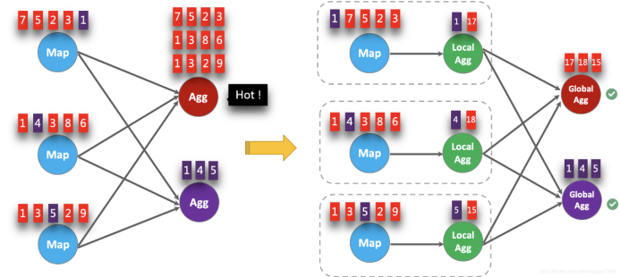
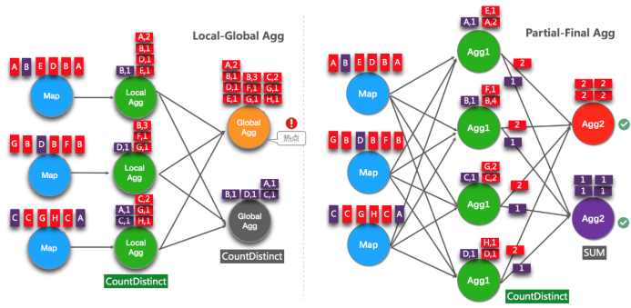

# FlinkSQL优化

## 1.1 **设置空闲状态保留时间**

Flink SQL新手有可能犯的错误，其中之一就是忘记设置空闲状态保留时间导致状态爆炸。列举两个场景：

Ø FlinkSQL的regular join（inner、left、right），左右表的数据都会一直保存在状态里，不会清理！要么设置TTL，要么使用FlinkSQL的interval join。

Ø 使用Top-N语法进行去重，重复数据的出现一般都位于特定区间内（例如一小时或一天内），过了这段时间之后，对应的状态就不再需要了。

Flink SQL可以指定空闲状态(即未更新的状态)被保留的最小时间，当状态中某个key对应的状态未更新的时间达到阈值时，该条状态被自动清理：

​  

#API指定  
tableEnv.getConfig().setIdleStateRetention(Duration.ofHours(1));

#参数指定

Configuration configuration = tableEnv.getConfig().getConfiguration();

configuration.setString("table.exec.state.ttl", "1 h");

## 1.1 **开启MiniBatch**

  

MiniBatch是微批处理，原理是缓存一定的数据后再触发处理，以减少对State的访问，从而提升吞吐并减少数据的输出量。MiniBatch主要依靠在每个Task上注册的Timer线程来触发微批，需要消耗一定的线程调度性能。

​  

**Ø** **MiniBatch默认关闭，开启方式如下****:**

// 初始化table environment

TableEnvironment tEnv = ...

​  

// 获取tableEnv的配置对象

Configuration configuration = tEnv.getConfig().getConfiguration();

// 设置参数：

// 开启miniBatch

configuration.setString("table.exec.mini-batch.enabled", "true");

// 批量输出的间隔时间

configuration.setString("table.exec.mini-batch.allow-latency", "5 s");

// 防止OOM设置每个批次最多缓存数据的条数，可以设为2万条

configuration.setString("table.exec.mini-batch.size", "20000");

Ø 适用场景

微批处理通过增加延迟换取高吞吐，如果有超低延迟的要求，不建议开启微批处理。通常对于聚合的场景，微批处理可以显著的提升系统性能，建议开启。

**Ø** **注意事项：**

1）目前，key-value 配置项仅被 Blink planner 支持。

2）1.12之前的版本有bug，开启miniBatch，不会清理过期状态，也就是说如果设置状态的TTL，无法清理过期状态。1.12版本才修复这个问题。

参考ISSUE：[https://issues.apache.org/jira/browse/FLINK-17096](https://issues.apache.org/jira/browse/FLINK-17096)

  

## 1.1 **开启LocalGlobal**

### 1.1.1 **原理概述**

LocalGlobal优化将原先的Aggregate分成Local+Global两阶段聚合，即MapReduce模型中的Combine+Reduce处理模式。第一阶段在上游节点本地攒一批数据进行聚合（localAgg），并输出这次微批的增量值（Accumulator）。第二阶段再将收到的Accumulator合并（Merge），得到最终的结果（GlobalAgg）。

LocalGlobal本质上能够靠LocalAgg的聚合筛除部分倾斜数据，从而降低GlobalAgg的热点，提升性能。结合下图理解LocalGlobal如何解决数据倾斜的问题。

由上图可知：

l 未开启LocalGlobal优化，由于流中的数据倾斜，Key为红色的聚合算子实例需要处理更多的记录，这就导致了热点问题。

l 开启LocalGlobal优化后，先进行本地聚合，再进行全局聚合。可大大减少GlobalAgg的热点，提高性能。

**Ø** **LocalGlobal****开启方式：**

1）LocalGlobal优化需要先开启MiniBatch，依赖于MiniBatch的参数。

2）table.optimizer.agg-phase-strategy: 聚合策略。默认AUTO，支持参数AUTO、TWO\_PHASE(使用LocalGlobal两阶段聚合)、ONE\_PHASE(仅使用Global一阶段聚合)。

// 初始化table environment

TableEnvironment tEnv = ...

​  

// 获取tableEnv的配置对象

Configuration configuration = tEnv.getConfig().getConfiguration();

​  

// 设置参数：

// 开启miniBatch

configuration.setString("table.exec.mini-batch.enabled", "true");

// 批量输出的间隔时间

configuration.setString("table.exec.mini-batch.allow-latency", "5 s");

// 防止OOM设置每个批次最多缓存数据的条数，可以设为2万条

configuration.setString("table.exec.mini-batch.size", "20000");

// 开启LocalGlobal

configuration.setString("table.optimizer.agg-phase-strategy", "TWO\_PHASE");

**Ø** **注意事项：**

1）需要先开启MiniBatch

2）开启LocalGlobal需要UDAF实现Merge方法。

​  

## 1.1 **开启Split Distinct**

LocalGlobal优化针对普通聚合（例如SUM、COUNT、MAX、MIN和AVG）有较好的效果，对于DISTINCT的聚合（如COUNT DISTINCT）收效不明显，因为COUNT DISTINCT在Local聚合时，对于DISTINCT KEY的去重率不高，导致在Global节点仍然存在热点。

### 1.1.1 **原理概述**

之前，为了解决COUNT DISTINCT的热点问题，通常需要手动改写为两层聚合（增加按Distinct Key取模的打散层）。

从Flink1.9.0版本开始，提供了COUNT DISTINCT自动打散功能，通过HASH\_CODE(distinct\_key) % BUCKET\_NUM打散，不需要手动重写。Split Distinct和LocalGlobal的原理对比参见下图。

**Ø** **Split Distinct****开启方式**

默认不开启，使用参数显式开启：

l table.optimizer.distinct-agg.split.enabled: true，默认false。

l table.optimizer.distinct-agg.split.bucket-num: Split Distinct优化在第一层聚合中，被打散的bucket数目。默认1024。

​  

​  

**Ø** **注意事项：**

（1）目前不能在包含UDAF的Flink SQL中使用Split Distinct优化方法。

（2）拆分出来的两个GROUP聚合还可参与LocalGlobal优化。

（3）该功能在Flink1.9.0版本及以上版本才支持。

  

​  

## 1.1 **多维DISTINCT使用Filter**

在某些场景下，可能需要从不同维度来统计count（distinct）的结果（比如统计uv、app端的uv、web端的uv），可能会使用如下CASE WHEN语法。

​  

SELECT

​a,

COUNT(DISTINCT b) AS total\_b,

COUNT(DISTINCT **CASE WHEN** c IN ('A', 'B') THEN b ELSE NULL END) AS AB\_b,

COUNT(DISTINCT **CASE WHEN** c IN ('C', 'D') THEN b ELSE NULL END) AS CD\_b

FROM T

GROUP BY a

​  

在这种情况下，建议使用FILTER语法, 目前的Flink SQL优化器可以识别同一唯一键上的不同FILTER参数。如，在上面的示例中，三个COUNT DISTINCT都作用在b列上。此时，经过优化器识别后，Flink可以只使用一个共享状态实例，而不是三个状态实例，可减少状态的大小和对状态的访问。

​  

**将上边的****CASE WHEN替换成FILTER后**，如下所示:

SELECT

a,

COUNT(DISTINCT b) AS total\_b,

COUNT(DISTINCT b) FILTER (WHERE c IN ('A', 'B')) AS AB\_b,

COUNT(DISTINCT b) FILTER (WHERE c IN ('C', 'D')) AS CD\_b

FROM T

GROUP BY a

## 1.1 **设置参数总结**

总结以上的调优参数，代码如下：

// 初始化table environment

TableEnvironment tEnv = ...

​  

// 获取tableEnv的配置对象

Configuration configuration = tEnv.getConfig().getConfiguration();

​  

// 设置参数：

// 开启miniBatch

configuration.setString("table.exec.mini-batch.enabled", "true");

// 批量输出的间隔时间

configuration.setString("table.exec.mini-batch.allow-latency", "5 s");

// 防止OOM设置每个批次最多缓存数据的条数，可以设为2万条

configuration.setString("table.exec.mini-batch.size", "20000");

// 开启LocalGlobal

configuration.setString("table.optimizer.agg-phase-strategy", "TWO\_PHASE");

// 开启Split Distinct

configuration.setString("table.optimizer.distinct-agg.split.enabled", "true");

// 第一层打散的bucket数目

configuration.setString("table.optimizer.distinct-agg.split.bucket-num", "1024");

// 指定时区

configuration.setString("table.local-time-zone", "Asia/Shanghai");

# 常见故障排除

## 1.1 **非法配置异常**

## 1.1 **Java 堆空间异常**

## 1.1 **直接缓冲存储器异常**

## 1.1 **元空间异常**

## 1.1 **网络缓冲区数量不足**

## 1.1 **超出容器内存异常**

## 1.1 **Checkpoint 失败**

### 1.1.1 **Checkpoint Decline**

### 1.1.1 **Checkpoint Expire**

## 1.1 **Checkpoint 慢**

## 1.1 **Kafka动态发现分区**

## 1.1 **Watermark不更新**

## 1.1 **依赖冲突**

## 1.1 **超出文件描述符限制**

## 1.1 **脏数据导致数据转发失败**

## 1.1 **通讯超时**

## 1.1 **Flink on Yarn其他常见错误**