# 资源配置优化

Flink性能调优的第一步，就是为任务分配合适的资源，在一定范围内，增加资源的分配与性能的提升是成正比的，实现了最优的资源配置后，在此基础上再考虑进行后面论述的性能调优策略。

提交方式主要是yarn-per-job，资源的分配在使用脚本提交Flink任务时进行指定

###   

Ø标准的Flink任务提交脚本（Generic CLI 模式）

从1.11开始，增加了通用客户端模式，参数使用\-D <property=value>指定

bin/flink run \\

\-t yarn-per-job \\

\-d \\

\-p 3 \\ 指定并行度

\-Dyarn.application.queue=default \\ 指定yarn队列

\-Djobmanager.memory.process.size=1024mb \\ 指定JM的总进程大小

\-Dtaskmanager.memory.process.size=1024mb \\ 指定每个TM的总进程大小

\-Dtaskmanager.numberOfTaskSlots=2 \\ 指定每个TM的slot数

\-c com.atguigu.flink.tuning.UvDemo \\

/opt/module/flink-1.13.1/myjar/flink-tuning-1.0-SNAPSHOT.jar

参数列表：

[https://ci.apache.org/projects/flink/flink-docs-release-1.13/deployment/config.html](https://ci.apache.org/projects/flink/flink-docs-release-1.13/deployment/config.html)

### 内存设置

​  

​  

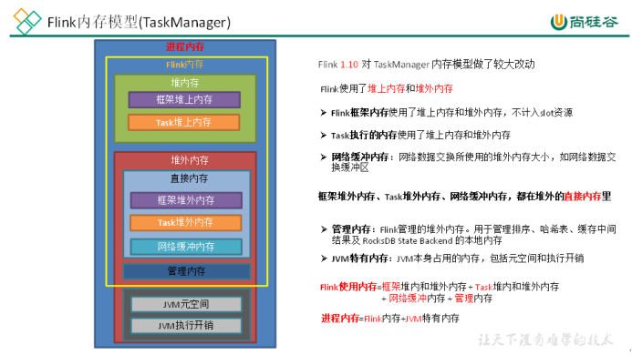

​  

Task的内存=进程内存-JVM特有内存-网络内存-托管内存-框架内存(堆内,堆外)

​  

**1、内存模型详解**

**l** **JVM** **特定内存：**JVM本身使用的内存，包含JVM的metaspace和over-head

1）JVM metaspace：JVM元空间

taskmanager.memory.jvm-metaspace.size，默认256mb

2）JVM over-head执行开销：JVM执行时自身所需要的内容，包括线程堆栈、IO、编译缓存等所使用的内存。

taskmanager.memory.jvm-overhead.fraction，默认0.1

taskmanager.memory.jvm-overhead.min，默认192mb

taskmanager.memory.jvm-overhead.max，默认1gb

**总进程内存****\*fraction，如果小于****配置的****min****（或大于配置的****max****）****大小，则使用****min/max大小**

**l** **框架内存：**Flink框架，即TaskManager本身所占用的内存，**不计入****Slot的资源中。**

堆内：taskmanager.memory.framework.heap.size，默认128MB

堆外：taskmanager.memory.framework.off-heap.size，默认128MB

**l** **Task内存：**Task执行用户代码时所使用的内存

堆内：taskmanager.memory.task.heap.size，默认none，由Flink内存扣除掉其他部分的内存得到。

堆外：taskmanager.memory.task.off-heap.size，默认0，表示不使用堆外内存

**l** **网络内存：**网络数据交换所使用的堆外内存大小，如网络数据交换缓冲区

堆外：taskmanager.memory.network.fraction，默认0.1

taskmanager.memory.network.min，默认64mb

taskmanager.memory.network.max，默认1gb

**Flink内存\*fraction，如果小于****配置的****min****（或大于配置的****max****）****大小，则使用****min/max大小**

**l** **托管内存****：**用于RocksDB State Backend 的本地内存和批的排序、哈希表、缓存中间结果。

堆外：taskmanager.memory.managed.fraction，默认0.4

​taskmanager.memory.managed.size，默认none

**如果****size没指定，则等于Flink内存\*fraction**

**2、案例分析**

基于Yarn模式，一般参数指定的是总进程内存，taskmanager.memory.process.size，比如指定为4G，每一块内存得到大小如下：

（1）计算Flink内存

JVM元空间256m

JVM执行开销： 4g\*0.1=409.6m，在[192m,1g]之间，最终结果409.6m

Flink内存=4g\-256m\-409.6m\=3430.4m

（2）网络内存=3430.4m\*0.1=343.04m，在[64m,1g]之间，最终结果343.04m

（3）托管内存=3430.4m\*0.4=1372.16m

（4）框架内存，堆内和堆外都是128m

（5）Task堆内内存=3430.4m-128m-128m-343.04m-1372.16m=1459.2m

​  

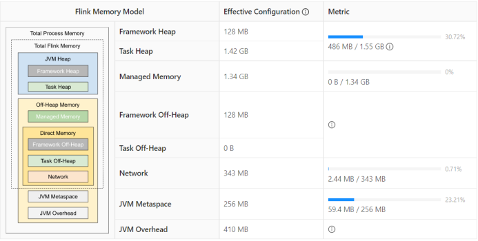

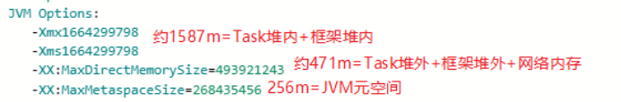

所以进程内存给多大，每一部分内存需不需要调整，可以看内存的使用率来调整。

#### 1.1.1 生产资源配置示例

bin/flink run \\

\-t yarn-per-job \\

\-d \\

\-p 3 \\ 指定并行度

\-Dyarn.application.queue=default \\ 指定yarn队列

\-Djobmanager.memory.process.size=2048mb \\ JM2~4G足够

\-Dtaskmanager.memory.process.size=4096mb \\ 单个TM2~8G足够

\-Dtaskmanager.numberOfTaskSlots=2 \\ 与容器核数1core：1slot或1core：2slot

\-c com.atguigu.flink.tuning.UvDemo \\

/opt/module/flink-1.13.1/myjar/flink-tuning-1.0-SNAPSHOT.jar

Flink是实时流处理，关键在于资源情况能不能抗住高峰时期每秒的数据量，通常用QPS/TPS来描述数据情况。

### 合理使用CPU资源

Yarn的容量调度器默认情况下是使用“DefaultResourceCalculator”分配策略，只根据内存调度资源，所以在Yarn的资源管理页面上看到每个容器的vcore个数还是1。

可以修改策略为 DominantResourceCalculator，该资源计算器在计算资源的时候会综合考虑cpu和内存的情况。在capacity-scheduler.xml 中修改属性:

<property>

<name>yarn.scheduler.capacity.resource-calculator</name>

<!-- <value>org.apache.hadoop.yarn.util.resource.DefaultResourceCalculator</value> -->

<value>org.apache.hadoop.yarn.util.resource.DominantResourceCalculator</value>

</property>

#### 1.1.1 使用DefaultResourceCalculator 策略

bin/flink run \\

\-t yarn-per-job \\

\-d \\

\-p 3 \\

\-Dyarn.application.queue=default \\

\-Djobmanager.memory.process.size=1024mb \\

\-Dtaskmanager.memory.process.size=4096mb \\

\-Dtaskmanager.numberOfTaskSlots=2 \\

\-c com.atguigu.flink.tuning.UvDemo \\

/opt/module/flink-1.13.1/myjar/flink-tuning-1.0-SNAPSHOT.jar

可以看到一个容器只有一个vcore：

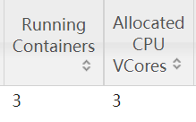

#### 1.1.2 使用DominantResourceCalculator策略

修改后yarn配置后，分发配置并重启yarn，再次提交flink作业：

bin/flink run \\

\-t yarn-per-job \\

\-d \\

\-p 3 \\

\-Drest.flamegraph.enabled=true \\

\-Dyarn.application.queue=default \\

\-Djobmanager.memory.process.size=1024mb \\

\-Dtaskmanager.memory.process.size=4096mb \\

\-Dtaskmanager.numberOfTaskSlots=2 \\

\-c com.atguigu.flink.tuning.UvDemo \\

/opt/module/flink-1.13.1/myjar/flink-tuning-1.0-SNAPSHOT.jar

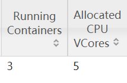

  

#### 1.1.3 使用DominantResourceCalculator策略并指定容器vcore数

指定yarn容器的vcore数，提交：

bin/flink run \\

\-t yarn-per-job \\

\-d \\

\-p 3 \\

\-Drest.flamegraph.enabled=true \\

\-Dyarn.application.queue=default \\

\-Dyarn.containers.vcores=3 \\

\-Djobmanager.memory.process.size=1024mb \\

\-Dtaskmanager.memory.process.size=4096mb \\

\-Dtaskmanager.numberOfTaskSlots=2 \\

\-c com.atguigu.flink.tuning.UvDemo \\

/opt/module/flink-1.13.1/myjar/flink-tuning-1.0-SNAPSHOT.jar

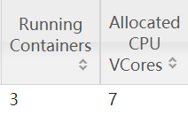

JobManager1个，占用1个容器，vcore=1

TaskManager2个，占用3个容器，每个容器vcore =3，总vcore=2\*3=6

### 并行度设置

#### 1.1.1 全局并行度计算

开发完成后，先进行压测。任务并行度给10以下，测试单个并行度的处理上限。然后 总QPS/单并行度的处理能力 = 并行度

开发完Flink作业，压测的方式很简单，先在kafka中积压数据，之后开启Flink任务，出现反压，就是处理瓶颈。相当于水库先积水，一下子泄洪。

不能只从QPS去得出并行度，因为有些字段少、逻辑简单的任务，单并行度一秒处理几万条数据。而有些数据字段多，处理逻辑复杂，单并行度一秒只能处理1000条数据。

最好根据高峰期的QPS压测，并行度\*1.2倍，富余一些资源。

#### 1.1.2 Source 端并行度的配置

数据源端是 Kafka，Source的并行度设置为Kafka对应Topic的分区数。

如果已经等于 Kafka 的分区数，消费速度仍跟不上数据生产速度，考虑下Kafka 要扩大分区，同时调大并行度等于分区数。

Flink 的一个并行度可以处理一至多个分区的数据，如果并行度多于 Kafka 的分区数，那么就会造成有的并行度空闲，浪费资源。

#### 1.1.3 Transform端并行度的配置

Ø Keyby之前的算子

一般不会做太重的操作，都是比如map、filter、flatmap等处理较快的算子，并行度可以和source保持一致。

Ø Keyby之后的算子 -\- keyGroup

如果并发较大，建议调整最大并行度并行度；

#### 1.1.4 Sink 端并行度的配置

Sink 端是数据流向下游的地方，可以根据 Sink 端的数据量及下游的服务抗压能力进行评估。如果Sink端是Kafka，可以设为Kafka对应Topic的分区数。

Sink 端的数据量小，比较常见的就是监控告警的场景，并行度可以设置的小一些。

Source 端的数据量是最小的，拿到 Source 端流过来的数据后做了细粒度的拆分，数据量不断的增加，到 Sink 端的数据量就非常大。那么在 Sink 到下游的存储中间件的时候就需要提高并行度。

另外 Sink 端要与下游的服务进行交互，并行度还得根据下游的服务抗压能力来设置，如果在 Flink Sink 这端的数据量过大的话，且 Sink 处并行度也设置的很大，但下游的服务完全撑不住这么大的并发写入，可能会造成下游服务直接被写挂，所以最终还是要在 Sink 处的并行度做一定的权衡。

​  

​  

# 大状态及CheckPoint调优

### RockDS及其大状态调优

RocksDB 是基于 LSM Tree 实现的（类似HBase），写数据都是先缓存到内存中，所以RocksDB 的写请求效率比较高。RocksDB 使用内存结合磁盘的方式来存储数据，每次获取数据时，先从内存中 blockcache 中查找，如果内存中没有再去磁盘中查询。使用 RocksDB 时，状态大小仅受可用磁盘空间量的限制，性能瓶颈主要在于 RocksDB 对磁盘的读请求，每次读写操作都必须对数据进行反序列化或者序列化。当处理性能不够时，仅需要横向扩展并行度即可提高整个Job 的吞吐量。

从Flink1.10开始，Flink默认将RocksDB的内存大小配置为每个task slot的托管内存。调试内存性能的问题主要是通过调整配置项taskmanager.memory.managed.size 或者taskmanager.memory.managed.fraction以增加Flink的托管内存(即堆外的托管内存)。进一步可以调整一些参数进行高级性能调优，这些参数也可以在应用程序中通过RocksDBStateBackend.setRocksDBOptions(RocksDBOptionsFactory)指定。下面介绍提高资源利用率的几个重要配置：

#### 1.1.1 开启State访问性能监控

Flink 1.13 中引入了 State 访问的性能监控，即 latency trackig state。此功能不局限于 State Backend 的类型，自定义实现的 State Backend 也可以复用此功能。

​  

State 访问的性能监控会产生一定的性能影响，所以，默认每 100 次做一次取样 (sample)，对不同的 State Backend 性能损失影响不同：

对于 RocksDB State Backend，性能损失大概在 1% 左右

对于 Heap State Backend，性能损失最多可达 10%

state.backend.latency-track.keyed-state-enabled：true #启用访问状态的性能监控

state.backend.latency-track.sample-interval: 100 #采样间隔

state.backend.latency-track.history-size: 128 #保留的采样数据个数，越大越精确

state.backend.latency-track.state-name-as-variable: true #将状态名作为变量

正常开启第一个参数即可。

bin/flink run \\

\-t yarn-per-job \\

\-d \\

\-p 3 \\

\-Drest.flamegraph.enabled=true \\

\-Dyarn.application.queue=default \\

\-Djobmanager.memory.process.size=1024mb \\

\-Dtaskmanager.memory.process.size=4096mb \\

\-Dtaskmanager.numberOfTaskSlots=2 \\

\-Dstate.backend.latency-track.keyed-state-enabled=true \\

\-c com.atguigu.flink.tuning.RocksdbTuning \\

/opt/module/flink-1.13.1/myjar/flink-tuning-1.0-SNAPSHOT.jar

#### 1.1.2 开启增量检查点和本地恢复

1）开启增量检查点

RocksDB是目前唯一可用于支持有状态流处理应用程序增量检查点的状态后端，可以修改参数开启增量检查点：

state.backend.incremental: true #默认false，改为true。

或代码中指定

new EmbeddedRocksDBStateBackend(true)

2）开启本地恢复

当 Flink 任务失败时，可以基于本地的状态信息进行恢复任务，可能不需要从 hdfs 拉取数据。本地恢复目前仅涵盖键控类型的状态后端（RocksDB），MemoryStateBackend不支持本地恢复并忽略此选项。

state.backend.local-recovery: true

3）设置多目录

如果有多块磁盘，也可以考虑指定本地多目录

state.backend.rocksdb.localdir: /data1/flink/rocksdb,/data2/flink/rocksdb,/data3/flink/rocksdb

注意：不要配置单块磁盘的多个目录，务必将目录配置到多块不同的磁盘上，让多块磁盘来分担压力。

bin/flink run \\

\-t yarn-per-job \\

\-d \\

\-p 3 \\

\-Drest.flamegraph.enabled=true \\

\-Dyarn.application.queue=default \\

\-Djobmanager.memory.process.size=1024mb \\

\-Dtaskmanager.memory.process.size=4096mb \\

\-Dtaskmanager.numberOfTaskSlots=2 \\

\-Dstate.backend.incremental=true \\

\-Dstate.backend.local-recovery=true \\

\-Dstate.backend.latency-track.keyed-state-enabled=true \\

\-c com.atguigu.flink.tuning.RocksdbTuning \\

/opt/module/flink-1.13.1/myjar/flink-tuning-1.0-SNAPSHOT.jar

#### 1.1.3 调整预定义选项

Flink针对不同的设置为RocksDB提供了一些预定义的选项集合,其中包含了后续提到的一些参数，如果调整预定义选项后还达不到预期，再去调整后面的block、writebuffer等参数。

当前支持的预定义选项有DEFAULT、SPINNING\_DISK\_OPTIMIZED、SPINNING\_DISK\_OPTIMIZED\_HIGH\_MEM或FLASH\_SSD\_OPTIMIZED。有条件上SSD的，可以指定为FLASH\_SSD\_OPTIMIZED

state.backend.rocksdb.predefined-options：SPINNING\_DISK\_OPTIMIZED\_HIGH\_MEM

#设置为机械硬盘+内存模式

#### 1.1.4 增大block缓存

整个 RocksDB 共享一个 block cache，读数据时内存的 cache 大小，该参数越大读数据时缓存命中率越高，默认大小为 8 MB，建议设置到64 ~ 256 MB。

state.backend.rocksdb.block.cache-size: 64m #默认8m

#### 1.1.5 增大write buffer和 level 阈值大小

RocksDB 中，每个 State 使用一个 Column Family，每个 Column Family 使用独占的 write buffer，默认64MB，建议调大。

调整这个参数通常要适当增加 L1 层的大小阈值max-size-level-base，默认256m。该值太小会造成能存放的SST文件过少，层级变多造成查找困难，太大会造成文件过多，合并困难。建议设为 target\_file\_size\_base（默认64MB） 的倍数，且不能太小，例如5~10倍，即320~640MB。

state.backend.rocksdb.writebuffer.size: 128m

state.backend.rocksdb.compaction.level.max-size-level-base: 320m

#### 1.1.6 增大write buffer数量

每个 Column Family 对应的 writebuffer 最大数量，这实际上是内存中“只读内存表“的最大数量，默认值是 2。对于机械磁盘来说，如果内存足够大，可以调大到 5 左右

state.backend.rocksdb.writebuffer.count: 5

#### 1.1.7 增大后台线程数和write buffer合并数

1）增大线程数

用于后台 flush 和合并 sst 文件的线程数，默认为 1，建议调大，机械硬盘用户可以改为 4 等更大的值

state.backend.rocksdb.thread.num: 4

2）增大writebuffer最小合并数

将数据从 writebuffer 中 flush 到磁盘时，需要合并的 writebuffer 最小数量，默认值为 1，可以调成3。

state.backend.rocksdb.writebuffer.number-to-merge: 3

#### 1.1.8 开启分区索引功能

Flink 1.13 中对 RocksDB 增加了分区索引功能，复用了 RocksDB 的 partitioned Index & filter 功能，简单来说就是对 RocksDB 的 partitioned Index 做了多级索引。也就是将内存中的最上层常驻，下层根据需要再 load 回来，这样就大大降低了数据 Swap 竞争。线上测试中，相对于**内存比较小**的场景中，性能提升10 倍左右。如果在内存管控下 Rocksdb 性能不如预期的话，这也能成为一个性能优化点。

state.backend.rocksdb.memory.partitioned-index-filters:true #默认false

#### 1.1.9 参数设定案例

bin/flink run \\

\-t yarn-per-job \\

\-d \\

\-p 3 \\

\-Drest.flamegraph.enabled=true \\

\-Dyarn.application.queue=default \\

\-Djobmanager.memory.process.size=1024mb \\

\-Dtaskmanager.memory.process.size=4096mb \\

\-Dtaskmanager.numberOfTaskSlots=2 \\

\-Dstate.backend.incremental=true \\

\-Dstate.backend.local-recovery=true \\

\-Dstate.backend.rocksdb.predefined-options=SPINNING\_DISK\_OPTIMIZED\_HIGH\_MEM \\

\-Dstate.backend.rocksdb.block.cache-size=64m \\

\-Dstate.backend.rocksdb.writebuffer.size=128m \\

\-Dstate.backend.rocksdb.compaction.level.max-size-level-base=320m \\

\-Dstate.backend.rocksdb.writebuffer.count=5 \\

\-Dstate.backend.rocksdb.thread.num=4 \\

\-Dstate.backend.rocksdb.writebuffer.number-to-merge=3 \\

\-Dstate.backend.rocksdb.memory.partitioned-index-filters=true \\

\-Dstate.backend.latency-track.keyed-state-enabled=true \\

\-c com.atguigu.flink.tuning.RocksdbTuning \\

/opt/module/flink-1.13.1/myjar/flink-tuning-1.0-SNAPSHOT.jar

​  

### CheckPoint调优

  

一般需求，我们的 Checkpoint 时间间隔可以设置为分钟级别（1 ~5 分钟）。对于状态很大的任务每次 Checkpoint 访问 HDFS 比较耗时，可以设置为 5~10 分钟一次Checkpoint，并且调大两次 Checkpoint 之间的暂停间隔，例如设置两次Checkpoint 之间至少暂停 4或8 分钟。同时，也需要考虑时效性的要求,需要在时效性和性能之间做一个平衡，如果时效性要求高，结合end\- to\-end时长，设置秒级或毫秒级。如果 Checkpoint 语义配置为 EXACTLY\_ONCE，那么在 Checkpoint 过程中还会存在 barrier 对齐的过程，可以通过 Flink Web UI 的 Checkpoint 选项卡来查看 Checkpoint 过程中各阶段的耗时情况，从而确定到底是哪个阶段导致 Checkpoint 时间过长然后针对性的解决问题。

RocksDB相关参数在前面已说明，可以在flink-conf.yaml指定，也可以在Job的代码中调用API单独指定，这里不再列出。

// 使⽤ RocksDBStateBackend 做为状态后端，并开启增量 Checkpoint

RocksDBStateBackend rocksDBStateBackend = new RocksDBStateBackend("hdfs://hadoop102:8020/flink/checkpoints", true);

env.setStateBackend(rocksDBStateBackend);

​  

// 开启Checkpoint，间隔为 3 分钟

env.enableCheckpointing(TimeUnit.MINUTES.toMillis(3));

// 配置 Checkpoint

CheckpointConfig checkpointConf = env.getCheckpointConfig();

checkpointConf.setCheckpointingMode(CheckpointingMode.EXACTLY\_ONCE)

// 最小间隔 4分钟

checkpointConf.setMinPauseBetweenCheckpoints(TimeUnit.MINUTES.toMillis(4))

// 超时时间 10分钟

checkpointConf.setCheckpointTimeout(TimeUnit.MINUTES.toMillis(10));

// 保存checkpoint

checkpointConf.enableExternalizedCheckpoints(

CheckpointConfig.ExternalizedCheckpointCleanup.RETAIN\_ON\_CANCELLATION);

​  

​  

# 反压机制

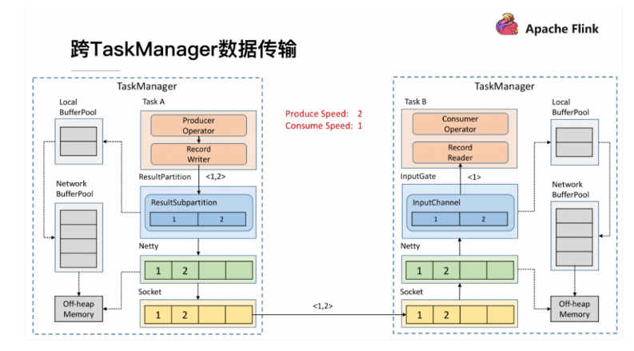

### 概述

反压（backpressure）是流式计算中十分常见的问题。**反压意味着数据管道中某个节点成为瓶颈，处理速率跟不上上游发送数据的速率，而需要对上游进行限速**。由于实时计算应用通常使用消息队列来进行生产端和消费端的解耦，消费端数据源是 **pull-based** 的，所以**反压通常是从某个节点传导至数据源并降低数据源（比如 Kafka consumer）的摄入速率。**

① 节点有性能瓶颈可能是**该节点所在的机器有故障（网络、磁盘等）、机器的网络延迟和磁盘不足、频繁GC、数据热点**等原因。  
② 大多数消息中间件，例如**kafka的consumer从broker把数据pull到本地，而producer把数据push到broker**。

​  

简单来说，Flink 拓扑中每个节点（Task）间的数据都以阻塞队列的方式传输，下游来不及消费导致队列被占满后，上游的生产也会被阻塞，最终导致数据源的摄入被阻塞。

反压（BackPressure）通常产生于这样的场景：短时间的负载高峰导致系统接收数据的速率远高于它处理数据的速率。许多日常问题都会导致反压，例如，垃圾回收停顿可能会导致流入的数据快速堆积，或遇到大促、秒杀活动导致流量陡增。

​  

### **反压的危害**

反压如果不能得到正确的处理，可能会影响到checkpoint 时长和 state 大小，甚至可能会导致资源耗尽甚至系统崩溃。

1）影响checkpoint时长：barrier 不会越过普通数据，数据处理被阻塞也会导致 checkpoint barrier 流经整个数据管道的时长变长，导致 checkpoint 总体时间（End to End Duration）变长。

2）影响state大小：barrier对齐时，接受到较快的输入管道的 barrier 后，它后面数据会被缓存起来但不处理，直到较慢的输入管道的 barrier 也到达，这些被缓存的数据会被放到state 里面，导致 checkpoint 变大。

这两个影响对于生产环境的作业来说是十分危险的，因为 checkpoint 是保证数据一致性的关键，checkpoint 时间变长有可能导致 checkpoint **超时失败**，而 state 大小同样可能拖慢 checkpoint 甚至导致 **OOM** （使用 Heap-based StateBackend）或者物理内存使用**超出容器资源**（使用 RocksDBStateBackend）的稳定性问题。

因此，我们在生产中要尽量避免出现反压的情况。

### 定位反压节点

解决反压首先要做的是定位到造成反压的节点，排查的时候，先把operator chain禁用，方便定位到具体算子。

#### 使用Flink Web UI定位

Flink Web UI 的反压监控提供了 SubTask 级别的反压监控，1.13版本以前是通过周期性对 Task 线程的栈信息采样，得到线程被阻塞在请求 Buffer（意味着被下游队列阻塞）的频率来判断该节点是否处于反压状态。默认配置下，这个频率在 0.1 以下则为 OK，0.1 至 0.5 为 LOW，而超过 0.5 则为 HIGH。

Flink 1.13 优化了反压检测的逻辑（使用基于任务 Mailbox 计时，而不在再于堆栈采样），并且重新实现了作业图的 UI 展示：Flink 现在在 UI 上通过颜色和数值来展示繁忙和反压的程度。

​  

​  

#### 分析瓶颈算子

如果处于反压状态，那么有两种可能性：

（1）该节点的发送速率跟不上它的产生数据速率。这一般会发生在一条输入多条输出的 Operator（比如 flatmap）。这种情况，该节点是反压的根源节点，它是从 Source Task 到 Sink Task 的第一个出现反压的节点。

（2）下游的节点接受速率较慢，通过反压机制限制了该节点的发送速率。这种情况，需要继续排查下游节点，一直找到第一个为OK的一般就是根源节点。

总体来看，如果我们找到第一个出现反压的节点，反压根源要么是就这个节点，要么是它紧接着的下游节点。

通常来讲，第二种情况更常见。如果无法确定，还需要结合 Metrics进一步判断。

#### 使用Metrics定位

监控反压时会用到的 Metrics 主要和 Channel 接受端的 Buffer 使用率有关，最为有用的是以下几个 Metrics:

| **Metris** | **描述** |
| --- | --- |
| outPoolUsage | 发送端 Buffer 的使用率 |
| inPoolUsage | 接收端 Buffer 的使用率 |
| floatingBuffersUsage（1.9 以上） | 接收端 Floating Buffer 的使用率 |
| exclusiveBuffersUsage（1.9 以上） | 接收端 Exclusive Buffer 的使用率 |

其中 inPoolUsage = floatingBuffersUsage + exclusiveBuffersUsage。

**1）根据指标分析反压**

分析反压的大致思路是：如果一个 Subtask 的发送端 Buffer 占用率很高，则表明它被下游反压限速了；如果一个 Subtask 的接受端 Buffer 占用很高，则表明它将反压传导至上游。反压情况可以根据以下表格进行对号入座(1.9以上):

| ​ | **outPoolUsage****低** | **outPoolUsage****高** |
| --- | --- | --- |
| **inPoolUsage****低** | 正常 | 被下游反压，处于临时情况 （还没传递到上游） |
|  |  | 可能是反压的根源，一条输入多条输出的场景 |
| **inPoolUsage****高** | 如果上游所有outPoolUsage都是低，有可能最终可能导致反压（还没传递到上游） | 被下游反压 |
|  | 如果上游的outPoolUsage是高，则为反压根源 |  |

**2）可以进一步分析数据传输**

Flink 1.9及以上版本，还可以根据 floatingBuffersUsage/exclusiveBuffersUsage 以及其上游 Task 的 outPoolUsage 来进行进一步的分析一个 Subtask 和其上游 Subtask 的数据传输。

在流量较大时，Channel 的 Exclusive Buffer 可能会被写满，此时 Flink 会向 Buffer Pool 申请剩余的 Floating Buffer。这些 **Floating Buffer 属于备用 Buffer****。**

| ​ | **exclusiveBuffersUsage****低** | **exclusiveBuffersUsage****高** |
| --- | --- | --- |
| **floatingBuffersUsage ********低** **所有上游****outPoolUsage ****低** | 正常 | ​ |
| **floatingBuffersUsage ********低** **上游某个****outPoolUsage ****高** | 潜在的网络瓶颈 | ​ |
| **floatingBuffersUsage ********高** **所有上游****outPoolUsage ****低** | 最终对部分inputChannel反压（正在传递） | 最终对大多数或所有inputChannel反压（正在传递） |
| **floatingBuffersUsage ********高** **上游某个****outPoolUsage ****高** | 只对部分inputChannel反压 | 对大多数或所有inputChannel反压 |

总结：

1）floatingBuffersUsage 为高，则表明反压正在传导至上游

2）同时exclusiveBuffersUsage为低，则表明可能有倾斜

比如，floatingBuffersUsage 高、exclusiveBuffersUsage 低为有倾斜，因为少数 channel 占用了大部分的 Floating Buffer。

### 反压原因及处理

注意：反压可能是暂时的，可能是由于负载高峰、CheckPoint 或作业重启引起的数据积压而导致反压。如果反压是暂时的，应该忽略它。另外，请记住，断断续续的反压会影响我们分析和解决问题。

定位到反压节点后，分析造成原因的办法主要是观察 Task Thread。按照下面的顺序，一步一步去排查。

#### 查看是否有数据倾斜的情况

在实践中，很多情况下的反压是由于数据倾斜造成的，这点我们可以通过 Web UI 各个 SubTask 的 Records Sent 和 Record Received 来确认，另外 Checkpoint detail 里不同 SubTask 的 State size 也是一个分析数据倾斜的有用指标。

​  

#### 外部组件的交互

如果发现我们的 Source 端数据读取性能比较低或者 Sink 端写入性能较差，需要检查第三方组件是否遇到瓶颈，还有就是做维表join时的性能问题。

例如：

Kafka 集群是否需要扩容，Kafka 连接器是否并行度较低

HBase 的 rowkey 是否遇到热点问题，是否请求处理不过来

ClickHouse并发能力较弱，是否达到瓶颈

……

关于第三方组件的性能问题，需要结合具体的组件来分析，最常用的思路：

1）异步io+热缓存来优化读写性能

2）先攒批再读写

维表join参考：

[https://flink-learning.org.cn/article/detail/b8df32fbc6542257a5b449114e137cc3](https://flink-learning.org.cn/article/detail/b8df32fbc6542257a5b449114e137cc3)

[https://www.jianshu.com/p/a62fa483ff54](https://www.jianshu.com/p/a62fa483ff54)

#### 使用火焰图分析

如果不是数据倾斜，最常见的问题可能是用户代码的执行效率问题（频繁被阻塞或者性能问题），需要找到瓶颈算子中的哪部分计算逻辑消耗巨大。

最有用的办法就是对 TaskManager 进行 CPU profile，从中我们可以分析到 Task Thread 是否跑满一个 CPU 核：如果是的话要分析 CPU 主要花费在哪些函数里面；如果不是的话要看 Task Thread 阻塞在哪里，可能是用户函数本身有些同步的调用，可能是 checkpoint 或者 GC 等系统活动导致的暂时系统暂停。

​  

**1）开启火焰图功能**

Flink 1.13直接在 WebUI 提供 JVM 的 CPU 火焰图，这将大大简化性能瓶颈的分析，默认是不开启的，需要修改参数：

rest.flamegraph.enabled: true #默认false

也可以在提交时指定：

bin/flink run \\

\-t yarn-per-job \\

\-d \\

\-p 3 \\

\-Drest.flamegraph.enabled=true \\

\-Dyarn.application.queue=default \\

\-Drest.flamegraph.enabled=true \\

\-Djobmanager.memory.process.size=1024mb \\

\-Dtaskmanager.memory.process.size=2048mb \\

\-Dtaskmanager.numberOfTaskSlots=2 \\

\-c com.atguigu.flink.tuning.UvDemo \\

/opt/module/flink-1.13.1/myjar/flink-tuning-1.0-SNAPSHOT.jar

**2）WebUI查看火焰图**

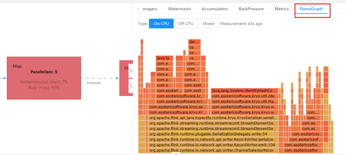

火焰图是通过对堆栈跟踪进行多次采样来构建的。每个方法调用都由一个条形表示，其中条形的长度与其在样本中出现的次数成正比。

Ø On-CPU: 处于 [RUNNABLE, NEW]状态的线程

Ø Off-CPU: 处于 [TIMED\_WAITING, WAITING, BLOCKED]的线程，用于查看在样本中发现的阻塞调用。

**3）分析火焰图**

颜色没有特殊含义，具体查看：

Ø 纵向是调用链，从下往上，顶部就是正在执行的函数

Ø 横向是样本出现次数，可以理解为执行时长。

**看顶层的哪个函数占据的宽度最大。只要有****"平顶"（plateaus），就表示该函数可能存在性能问题。**

如果是Flink 1.13以前的版本，可以手动做火焰图：

如何生成火焰图：[http://www.54tianzhisheng.cn/2020/10/05/flink-jvm-profiler/](http://www.54tianzhisheng.cn/2020/10/05/flink-jvm-profiler/)

**​**  

#### 分析GC情况

### 1.1.1 **分析****GC情况**

TaskManager 的内存以及 GC 问题也可能会导致反压，包括 TaskManager JVM 各区内存不合理导致的频繁 Full GC 甚至失联。通常建议使用默认的G1垃圾回收器。

可以通过打印GC日志（-XX:+PrintGCDetails），使用GC 分析器（GCViewer工具）来验证是否处于这种情况。

Ø 在Flink提交脚本中,设置JVM参数，打印GC日志：

bin/flink run \\

\-t yarn-per-job \\

\-d \\

\-p 3 \\

\-Drest.flamegraph.enabled=true \\

\-Denv.java.opts="-XX:+PrintGCDetails -XX:+PrintGCDateStamps" \\

\-Dyarn.application.queue=default \\

\-Djobmanager.memory.process.size=1024mb \\

\-Dtaskmanager.memory.process.size=2048mb \\

\-Dtaskmanager.numberOfTaskSlots=2 \\

\-c com.atguigu.flink.tuning.UvDemo \\

/opt/module/flink-1.13.1/myjar/flink-tuning-1.0-SNAPSHOT.jar

Ø 下载GC日志的方式：

因为是on yarn模式，运行的节点一个一个找比较麻烦。可以打开WebUI，选择JobManager或者TaskManager，点击Stdout，即可看到GC日志，点击下载按钮即可将GC日志通过HTTP的方式下载下来。

​  

Ø 分析GC日志：

通过 GC 日志分析出单个 Flink Taskmanager 堆总大小、年轻代、老年代分配的内存空间、Full GC 后老年代剩余大小等，相关指标定义可以去 Github 具体查看。

GCViewer地址：[https://github.com/chewiebug/GCViewer](https://github.com/chewiebug/GCViewer)

Linux下分析：

java -jar gcviewer\_1.3.4.jar gc.log

Windows下分析：

直接双击gcviewer\_1.3.4.jar，打开GUI界面，选择gc的log打开

*扩展：最重要的指标是**Full GC 后，老年代剩余大小**这个指标，按照《Java 性能优化权威指南》这本书 Java 堆大小计算法则，设 Full GC 后老年代剩余大小空间为 M，那么堆的大小建议 3 ~ 4倍 M，新生代为 1 ~ 1.5 倍 M，老年代应为 2 ~ 3 倍 M。*

  

# 数据倾斜

## 判断是否存在数据倾斜

相同 Task 的多个 Subtask 中，个别Subtask 接收到的数据量明显大于其他 Subtask 接收到的数据量，通过 Flink Web UI 可以精确地看到每个 Subtask 处理了多少数据，即可判断出 Flink 任务是否存在数据倾斜。通常，数据倾斜也会引起反压。

另外， 有时Checkpoint detail 里不同 SubTask 的 State size 也是一个分析数据倾斜的有用指标。

## 解决数据倾斜

### keyby之前

如果 keyBy 之前就存在数据倾斜，上游算子的某些实例可能处理的数据较多，某些实例可能处理的数据较少，产生该情况可能是因为数据源的数据本身就不均匀，例如由于某些原因 Kafka 的 topic 中某些 partition 的数据量较大，某些 partition 的数据量较少。对于不存在 keyBy 的 Flink 任务也会出现该情况。

这种情况，需要让 Flink 任务强制进行shuffle。使用shuffle、rebalance 或 rescale算子即可将数据均匀分配，从而解决数据倾斜的问题。

### keyby之后聚合操作引起的数据倾斜

提交案例：

bin/flink run \\

\-t yarn-per-job \\

\-d \\

\-p 3 \\

\-Drest.flamegraph.enabled=true \\

\-Dyarn.application.queue=default \\

\-Djobmanager.memory.process.size=1024mb \\

\-Dtaskmanager.memory.process.size=2048mb \\

\-Dtaskmanager.numberOfTaskSlots=2 \\

\-c com.atguigu.flink.tuning.SkewDemo1 \\

/opt/module/flink-1.13.1/myjar/flink-tuning-1.0-SNAPSHOT.jar \\

\--local-keyby false

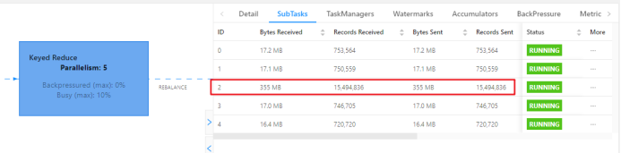

​  

**为什么不能直接用二次聚合来处理**

Flink是实时流处理，如果keyby之后的聚合操作存在数据倾斜，且没有开窗口（没攒批）的情况下，简单的认为使用两阶段聚合，是不能解决问题的。因为这个时候Flink是来一条处理一条，且向下游发送一条结果，对于原来keyby的维度（第二阶段聚合）来讲，数据量并没有减少，且结果重复计算（非FlinkSQL，未使用回撤流），如下图所示

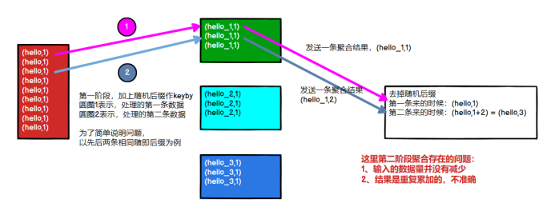

​  

**2****）使用****LocalKeyBy****的思想**

在 keyBy 上游算子数据发送之前，首先在上游算子的本地对数据进行聚合后，再发送到下游，使下游接收到的数据量大大减少，从而使得 keyBy 之后的聚合操作不再是任务的瓶颈。类似MapReduce 中 Combiner 的思想，但是这要求聚合操作必须是多条数据或者一批数据才能聚合，单条数据没有办法通过聚合来减少数据量。从Flink LocalKeyBy 实现原理来讲，必然会存在一个积攒批次的过程，在上游算子中必须攒够一定的数据量，对这些数据聚合后再发送到下游。

**实现方式：**

Ø DataStreamAPI需要自己写代码实现

Ø SQL可以指定参数，开启miniBatch和LocalGlobal功能（推荐，后续介绍）

​  

### keyby之后窗口聚合引起的数据倾斜

因为使用了窗口，变成了有界数据（攒批）的处理，窗口默认是触发时才会输出一条结果发往下游，所以可以使用两阶段聚合的方式：

**1）实现思路：**

Ø 第一阶段聚合：key拼接随机数前缀或后缀，进行keyby、开窗、聚合

*注意：**聚合完不再是**WindowedStream，要获取WindowEnd作为窗口标记作为第二阶段分组依据，避免不同窗口的结果聚合到一起）*

Ø 第二阶段聚合：按照原来的key及windowEnd作keyby、聚合

​  

随机数范围，需要自己去测，因为keyby的分区器是（两次hash\*下游并行度/最大并行度）

# Job优化

## 1.1 **使用DataGen造数据**

开发完Flink作业，压测的方式很简单，先在kafka中积压数据，之后开启Flink任务，出现反压，就是处理瓶颈。相当于水库先积水，一下子泄洪。

数据可以是自己造的模拟数据，也可以是生产中的部分数据。造测试数据的工具：DataFactory、datafaker 、DBMonster、Data-Processer 、Nexmark、Jmeter等。

Flink从1.11开始提供了一个内置的DataGen 连接器，主要是用于生成一些随机数，用于在没有数据源的时候，进行流任务的测试以及性能测试等。

### DataStream的DataGenerator

### ​**SQL的DataGenerator**

## 1.1 **算子指定UUID**

对于有状态的 Flink 应用，推荐给每个算子都指定唯一用户ID（UUID）。 严格地说，仅需要给有状态的算子设置就足够了。但是因为 Flink 的某些内置算子（如 window）是有状态的，而有些是无状态的，可能用户不是很清楚哪些内置算子是有状态的，哪些不是。所以从实践经验上来说，我们建议每个算子都指定上 UUID。

默认情况下，算子UID是根据JobGraph自动生成的，JobGraph的更改可能会导致UUID改变。手动指定算子 UUID ，可以让 Flink 有效地将算子的状态从 savepoint 映射到作业修改后（拓扑图可能也有改变）的正确的算子上。比如替换原来的Operator实现、增加新的Operator、删除Operator等等，至少我们有可能与Savepoint中存储的Operator状态对应上。这是 savepoint 在 Flink 应用中正常工作的一个基本要素。

Flink 算子的 UUID 可以通过 uid(String uid) 方法指定，通常也建议指定name

​  

#算子.uid("指定uid")

.reduce((value1, value2) -> Tuple3.of("uv", value2.f1, value1.f2 + value2.f2))

.uid("uv-reduce").name("uv-reduce")

## 1.1 **链路延迟测量**

对于实时的流式处理系统来说，我们需要关注数据输入、计算和输出的及时性，所以处理延迟是一个比较重要的监控指标，特别是在数据量大或者软硬件条件不佳的环境下。Flink提供了开箱即用的LatencyMarker机制来测量链路延迟。开启如下参数：

metrics.latency.interval: 30000 #默认0，表示禁用，单位毫秒

监控的粒度，分为以下3档：

Ø single：每个算子单独统计延迟；

Ø operator（默认值）：每个下游算子都统计自己与Source算子之间的延迟；

Ø subtask：每个下游算子的sub-task都统计自己与Source算子的sub-task之间的延迟。

metrics.latency.granularity: operator #默认operator

一般情况下采用默认的operator粒度即可，这样在**Sink端观察到的latency metric就是我们最想要的全链路（端到端）延迟**。subtask粒度太细，会增大所有并行度的负担，不建议使用。

LatencyMarker不会参与到数据流的用户逻辑中的，而是直接被各算子转发并统计。为了让它尽量精确，有两点特别需要注意：

Ø 保证Flink集群内所有节点的时区、时间是同步的：ProcessingTimeService产生时间戳最终是靠System.currentTimeMillis()方法，可以用ntp等工具来配置。

Ø metrics.latency.interval的时间间隔宜大不宜小：一般配置成30000（30秒）左右。一是因为延迟监控的频率可以不用太频繁，二是因为LatencyMarker的处理也要消耗一定性能。

​  

端到端延迟的tag只有murmur hash过的算子ID（用uid()方法设定的），并没有算子名称，（[https://issues.apache.org/jira/browse/FLINK-8592](https://issues.apache.org/jira/browse/FLINK-8592)）并且官方暂时不打算解决这个问题，所以我们要么用最大值来表示，要么将作业中Sink算子的ID统一化。比如使用了Prometheus和Grafana来监控，效果如下：

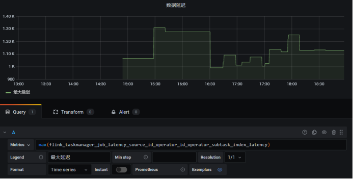

## 1.1 **开启对象重用**

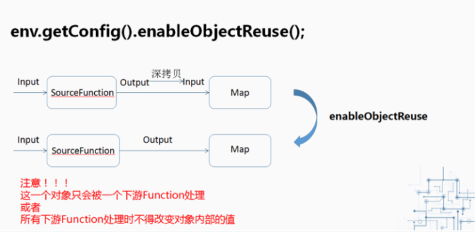

当调用了enableObjectReuse方法后，Flink会把中间深拷贝的步骤都省略掉，SourceFunction产生的数据直接作为MapFunction的输入，可以减少gc压力。但需要特别注意的是，这个方法不能随便调用，必须要确保下游Function只有一种，或者下游的Function均不会改变对象内部的值。否则可能会有线程安全的问题。

## 1.1 **细粒度滑动窗口优化**

**细粒度滑动的影响**

当使用细粒度的滑动窗口（窗口长度远远大于滑动步长）时，重叠的窗口过多，一个数据会属于多个窗口，性能会急剧下降。

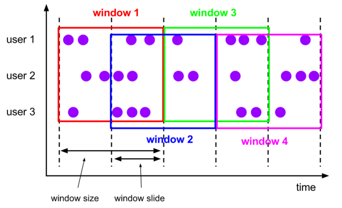

我们经常会碰到这种需求：以3分钟的频率实时计算App内各个子模块近24小时的PV和UV。我们需要用粒度为1440 / 3 = 480的滑动窗口来实现它，但是细粒度的滑动窗口会带来性能问题，有两点：

Ø 状态

对于一个元素，会将其写入对应的(key, window)二元组所圈定的windowState状态中。如果粒度为480，那么每个元素到来，更新windowState时都要遍历480个窗口并写入，开销是非常大的。在采用RocksDB作为状态后端时，checkpoint的瓶颈也尤其明显。

Ø 定时器

每一个(key, window)二元组都需要注册两个定时器：一是触发器注册的定时器，用于决定窗口数据何时输出；二是registerCleanupTimer()方法注册的清理定时器，用于在窗口彻底过期（如allowedLateness过期）之后及时清理掉窗口的内部状态。细粒度滑动窗口会造成维护的定时器增多，内存负担加重。

**2****）解决思路**

DataStreamAPI中，自己解决（[https://issues.apache.org/jira/browse/FLINK-7001](https://issues.apache.org/jira/browse/FLINK-7001)）。

我们一般使用**滚动窗口****+在线存储+读时聚合**的思路作为解决方案：

（1）从业务的视角来看，往往窗口的长度是可以被步长所整除的，可以找到窗口长度和窗口步长的最小公约数作为时间分片（一个滚动窗口的长度）；

（2）每个滚动窗口将其周期内的数据做聚合，存到下游状态或打入外部在线存储（内存数据库如Redis，LSM-based NoSQL存储如HBase）；

（3）扫描在线存储中对应时间区间（可以灵活指定）的所有行，并将计算结果返回给前端展示。

  

# FlinkSQL优化

## 1.1 **设置空闲状态保留时间**

Flink SQL新手有可能犯的错误，其中之一就是忘记设置空闲状态保留时间导致状态爆炸。列举两个场景：

Ø FlinkSQL的regular join（inner、left、right），左右表的数据都会一直保存在状态里，不会清理！要么设置TTL，要么使用FlinkSQL的interval join。

Ø 使用Top-N语法进行去重，重复数据的出现一般都位于特定区间内（例如一小时或一天内），过了这段时间之后，对应的状态就不再需要了。

Flink SQL可以指定空闲状态(即未更新的状态)被保留的最小时间，当状态中某个key对应的状态未更新的时间达到阈值时，该条状态被自动清理：

​  

#API指定  
tableEnv.getConfig().setIdleStateRetention(Duration.ofHours(1));

#参数指定

Configuration configuration = tableEnv.getConfig().getConfiguration();

configuration.setString("table.exec.state.ttl", "1 h");

## 1.1 **开启MiniBatch**

  

MiniBatch是微批处理，原理是缓存一定的数据后再触发处理，以减少对State的访问，从而提升吞吐并减少数据的输出量。MiniBatch主要依靠在每个Task上注册的Timer线程来触发微批，需要消耗一定的线程调度性能。

​  

**Ø** **MiniBatch默认关闭，开启方式如下****:**

// 初始化table environment

TableEnvironment tEnv = ...

​  

// 获取tableEnv的配置对象

Configuration configuration = tEnv.getConfig().getConfiguration();

// 设置参数：

// 开启miniBatch

configuration.setString("table.exec.mini-batch.enabled", "true");

// 批量输出的间隔时间

configuration.setString("table.exec.mini-batch.allow-latency", "5 s");

// 防止OOM设置每个批次最多缓存数据的条数，可以设为2万条

configuration.setString("table.exec.mini-batch.size", "20000");

Ø 适用场景

微批处理通过增加延迟换取高吞吐，如果有超低延迟的要求，不建议开启微批处理。通常对于聚合的场景，微批处理可以显著的提升系统性能，建议开启。

**Ø** **注意事项：**

1）目前，key-value 配置项仅被 Blink planner 支持。

2）1.12之前的版本有bug，开启miniBatch，不会清理过期状态，也就是说如果设置状态的TTL，无法清理过期状态。1.12版本才修复这个问题。

参考ISSUE：[https://issues.apache.org/jira/browse/FLINK-17096](https://issues.apache.org/jira/browse/FLINK-17096)

  

## 1.1 **开启LocalGlobal**

### 1.1.1 **原理概述**

LocalGlobal优化将原先的Aggregate分成Local+Global两阶段聚合，即MapReduce模型中的Combine+Reduce处理模式。第一阶段在上游节点本地攒一批数据进行聚合（localAgg），并输出这次微批的增量值（Accumulator）。第二阶段再将收到的Accumulator合并（Merge），得到最终的结果（GlobalAgg）。

LocalGlobal本质上能够靠LocalAgg的聚合筛除部分倾斜数据，从而降低GlobalAgg的热点，提升性能。结合下图理解LocalGlobal如何解决数据倾斜的问题。

由上图可知：

l 未开启LocalGlobal优化，由于流中的数据倾斜，Key为红色的聚合算子实例需要处理更多的记录，这就导致了热点问题。

l 开启LocalGlobal优化后，先进行本地聚合，再进行全局聚合。可大大减少GlobalAgg的热点，提高性能。

**Ø** **LocalGlobal****开启方式：**

1）LocalGlobal优化需要先开启MiniBatch，依赖于MiniBatch的参数。

2）table.optimizer.agg-phase-strategy: 聚合策略。默认AUTO，支持参数AUTO、TWO\_PHASE(使用LocalGlobal两阶段聚合)、ONE\_PHASE(仅使用Global一阶段聚合)。

// 初始化table environment

TableEnvironment tEnv = ...

​  

// 获取tableEnv的配置对象

Configuration configuration = tEnv.getConfig().getConfiguration();

​  

// 设置参数：

// 开启miniBatch

configuration.setString("table.exec.mini-batch.enabled", "true");

// 批量输出的间隔时间

configuration.setString("table.exec.mini-batch.allow-latency", "5 s");

// 防止OOM设置每个批次最多缓存数据的条数，可以设为2万条

configuration.setString("table.exec.mini-batch.size", "20000");

// 开启LocalGlobal

configuration.setString("table.optimizer.agg-phase-strategy", "TWO\_PHASE");

**Ø** **注意事项：**

1）需要先开启MiniBatch

2）开启LocalGlobal需要UDAF实现Merge方法。

​  

## 1.1 **开启Split Distinct**

LocalGlobal优化针对普通聚合（例如SUM、COUNT、MAX、MIN和AVG）有较好的效果，对于DISTINCT的聚合（如COUNT DISTINCT）收效不明显，因为COUNT DISTINCT在Local聚合时，对于DISTINCT KEY的去重率不高，导致在Global节点仍然存在热点。

### 1.1.1 **原理概述**

之前，为了解决COUNT DISTINCT的热点问题，通常需要手动改写为两层聚合（增加按Distinct Key取模的打散层）。

从Flink1.9.0版本开始，提供了COUNT DISTINCT自动打散功能，通过HASH\_CODE(distinct\_key) % BUCKET\_NUM打散，不需要手动重写。Split Distinct和LocalGlobal的原理对比参见下图。

**Ø** **Split Distinct****开启方式**

默认不开启，使用参数显式开启：

l table.optimizer.distinct-agg.split.enabled: true，默认false。

l table.optimizer.distinct-agg.split.bucket-num: Split Distinct优化在第一层聚合中，被打散的bucket数目。默认1024。

​  

​  

**Ø** **注意事项：**

（1）目前不能在包含UDAF的Flink SQL中使用Split Distinct优化方法。

（2）拆分出来的两个GROUP聚合还可参与LocalGlobal优化。

（3）该功能在Flink1.9.0版本及以上版本才支持。

  

​  

## 1.1 **多维DISTINCT使用Filter**

在某些场景下，可能需要从不同维度来统计count（distinct）的结果（比如统计uv、app端的uv、web端的uv），可能会使用如下CASE WHEN语法。

​  

SELECT

​a,

COUNT(DISTINCT b) AS total\_b,

COUNT(DISTINCT **CASE WHEN** c IN ('A', 'B') THEN b ELSE NULL END) AS AB\_b,

COUNT(DISTINCT **CASE WHEN** c IN ('C', 'D') THEN b ELSE NULL END) AS CD\_b

FROM T

GROUP BY a

​  

在这种情况下，建议使用FILTER语法, 目前的Flink SQL优化器可以识别同一唯一键上的不同FILTER参数。如，在上面的示例中，三个COUNT DISTINCT都作用在b列上。此时，经过优化器识别后，Flink可以只使用一个共享状态实例，而不是三个状态实例，可减少状态的大小和对状态的访问。

​  

**将上边的****CASE WHEN替换成FILTER后**，如下所示:

SELECT

a,

COUNT(DISTINCT b) AS total\_b,

COUNT(DISTINCT b) FILTER (WHERE c IN ('A', 'B')) AS AB\_b,

COUNT(DISTINCT b) FILTER (WHERE c IN ('C', 'D')) AS CD\_b

FROM T

GROUP BY a

## 1.1 **设置参数总结**

总结以上的调优参数，代码如下：

// 初始化table environment

TableEnvironment tEnv = ...

​  

// 获取tableEnv的配置对象

Configuration configuration = tEnv.getConfig().getConfiguration();

​  

// 设置参数：

// 开启miniBatch

configuration.setString("table.exec.mini-batch.enabled", "true");

// 批量输出的间隔时间

configuration.setString("table.exec.mini-batch.allow-latency", "5 s");

// 防止OOM设置每个批次最多缓存数据的条数，可以设为2万条

configuration.setString("table.exec.mini-batch.size", "20000");

// 开启LocalGlobal

configuration.setString("table.optimizer.agg-phase-strategy", "TWO\_PHASE");

// 开启Split Distinct

configuration.setString("table.optimizer.distinct-agg.split.enabled", "true");

// 第一层打散的bucket数目

configuration.setString("table.optimizer.distinct-agg.split.bucket-num", "1024");

// 指定时区

configuration.setString("table.local-time-zone", "Asia/Shanghai");

# 常见故障排除

## 1.1 **非法配置异常**

## 1.1 **Java 堆空间异常**

## 1.1 **直接缓冲存储器异常**

## 1.1 **元空间异常**

## 1.1 **网络缓冲区数量不足**

## 1.1 **超出容器内存异常**

## 1.1 **Checkpoint 失败**

### 1.1.1 **Checkpoint Decline**

### 1.1.1 **Checkpoint Expire**

## 1.1 **Checkpoint 慢**

## 1.1 **Kafka动态发现分区**

## 1.1 **Watermark不更新**

## 1.1 **依赖冲突**

## 1.1 **超出文件描述符限制**

## 1.1 **脏数据导致数据转发失败**

## 1.1 **通讯超时**

## 1.1 **Flink on Yarn其他常见错误**