# MapReduce

## MapReduce概述

MapReduce是一个分布式运算程序的编程框架，是用户开发“基于Hadoop的数据分析应用”的核心框架。

MapReduce核心功能是将用户编写的业务逻辑代码和自带默认组件整合成一个完整的分布式运算程序，并发运行在一个Hadoop集群上。

优缺点:mapreduce易于编程,----------它简单的实现一些接口，就可以完成一个分布式程序

良好的拓展性-----------简单的增加机器来扩展它的计算能力

**高容错性-----**其中一台机器挂了，它可以把上面的计算任务转移到另外一个节点上运行，不至于这个任务运行失败

**适合PB级以上海量数据的离线处理**

**不擅长实时计算**

**不擅长流式计算--------**MapReduce的输入数据集是静态的，不能动态变化。这是因为MapReduce自身的设计特点决定了数据源必须是静态的。

**不擅长DAG（有向无环图）计算------------**使用后，每个MapReduce作业的输出结果都会写入到磁盘，会造成大量的磁盘IO，导致性能非常的低下

### MapReduce核心思想

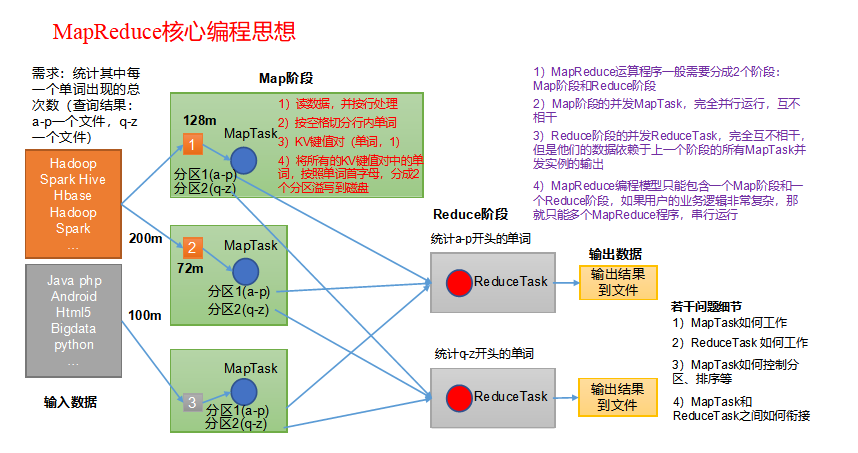

（1）分布式的运算程序往往需要分成至少2个阶段。

（2）第一个阶段的MapTask并发实例，完全并行运行，互不相干。

（3）第二个阶段的ReduceTask并发实例互不相干，但是他们的数据依赖于上一个阶段的所有MapTask并发实例的输出。

（4）MapReduce编程模型只能包含一个Map阶段和一个Reduce阶段，如果用户的业务逻辑非常复杂，那就只能多个MapReduce程序，串行运行。

总结：分析WordCount数据流走向深入理解MapReduce核心思想。

#### 1.4 MapReduce进程

一个完整的MapReduce程序在分布式运行时有三类实例进程：

（1）**MrAppMaster**：负责整个程序的过程调度及状态协调。

（2）**MapTask**：负责Map阶段的整个数据处理流程。

（3）**ReduceTask**：负责Reduce阶段的整个数据处理流程。

  

#### 常用数据序列化类型

| **Java** **类型** | **Hadoop Writable** **类型** |
| --- | --- |
| Boolean | BooleanWritable |
| Byte | ByteWritable |
| Int | IntWritable |
| Float | FloatWritable |
| Long | LongWritable |
| Double | DoubleWritable |
| String | Text |
| Map | MapWritable |
| Array | ArrayWritable |
| Null | NullWritable |

  

#### MapReduce编程规范

用户编写的程序分成三个部分：Mapper、Reducer和Driver。

  

  

## MapReduce框架原理

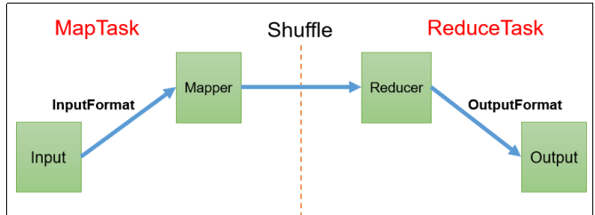

#### 切片与maptask的并行度

**MapTask** **并行度决定** **机制**

MapTask的并行度决定Map阶段的任务处理并发度，进而影响到整个Job的处理速度

**数据** **块：**Block是HDFS物理上把数据分成一块一块。数据块是HDFS存储数据单位。

**数据切片：**数据切片只是在逻辑上对输入进行分片，并不会在磁盘上将其切分成片进行存储。数据切片是MapReduce程序计算输入数据的单位，一个切片会对应启动一个MapTask。

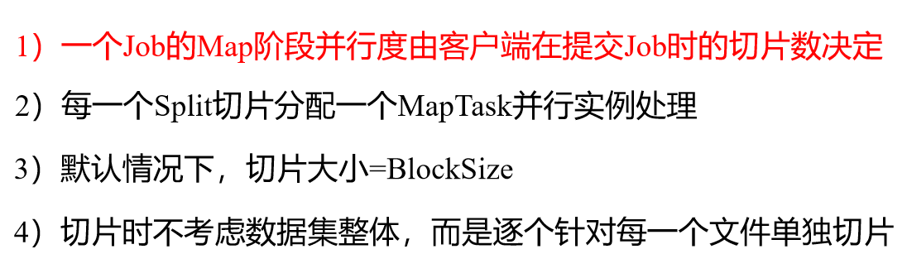

#### FileinputFormat切片

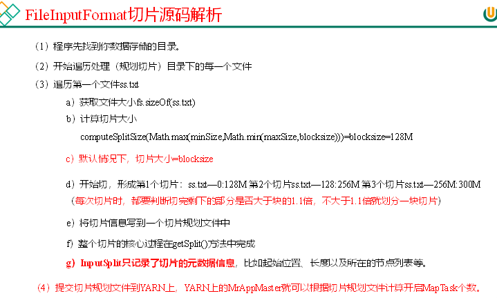

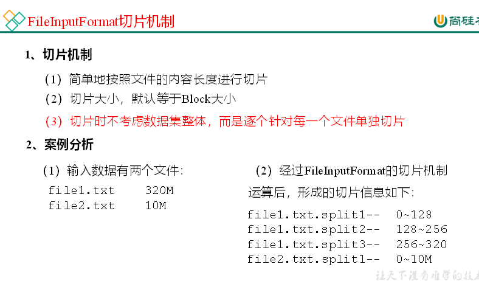

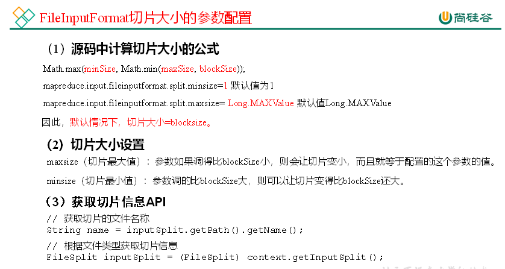

#### TextInputFormat

**FileInputFormat** **实现类**

思考：在运行MapReduce程序时，输入的文件格式包括：基于行的日志文件、二进制格式文件、数据库表等。那么，针对不同的数据类型，MapReduce是如何读取这些数据的呢？

FileInputFormat常见的接口实现类包括：TextInputFormat、KeyValueTextInputFormat、NLineInputFormat、CombineTextInputFormat和自定义InputFormat等

TextInputFormat是默认的FileInputFormat实现类。按行读取每条记录。键是存储该行在整个文件中的起始字节偏移量， LongWritable类型。值是这行的内容，不包括任何行终止符（换行符和回车符），Text类型。

#### CombineTextInputFormat

框架默认的TextInputFormat切片机制是对任务按文件规划切片，不管文件多小，都会是一个单独的切片，都会交给一个MapTask，这样如果有大量小文件，就会产生大量的MapTask，处理效率极其低下。

使用场景:

CombineTextInputFormat用于小文件过多的场景，它可以将多个小文件从逻辑上规划到一个切片中，这样，多个小文件就可以交给一个MapTask处理。

存储虚拟切片最大值设置:

CombineTextInputFormat.setMaxInputSplitSize(job, 4194304);// 4m

注意：虚拟存储切片最大值设置最好根据实际的小文件大小情况来设置具体的值。

**切片机制**

生成切片过程包括：虚拟存储过程和切片过程二部分。

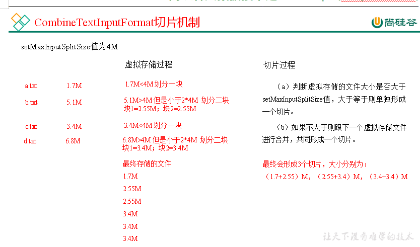

  

  

虚拟存储过程：

将输入目录下所有文件大小，依次和设置的setMaxInputSplitSize值比较，如果不大于设置的最大值，逻辑上划分一个块。如果输入文件大于设置的最大值且大于两倍，那么以最大值切割一块；当剩余数据大小超过设置的最大值且不大于最大值2倍，此时将文件均分成2个虚拟存储块（防止出现太小切片）。

(1) 虚拟存储过程：

将输入目录下所有文件大小，依次和设置的setMaxInputSplitSize值比较，如果不大于设置的最大值，逻辑上划分一个块。如果输入文件大于设置的最大值且大于两倍，那么以最大值切割一块；当剩余数据大小超过设置的最大值且不大于最大值2倍，此时将文件均分成2个虚拟存储块（防止出现太小切片）。

（2）切片过程：

①判断虚拟存储的文件大小是否大于setMaxInputSplitSize值，大于等于则单独形成一个切片。

②如果不大于则跟下一个虚拟存储文件进行合并，共同形成一个切片。

### shuffle

#### 工作流程

具体Shuffle过程详解，如下：

（1）MapTask收集我们的map()方法输出的kv对，放到内存缓冲区中

（2）从内存缓冲区不断溢出本地磁盘文件，可能会溢出多个文件

（3）多个溢出文件会被合并成大的溢出文件

（4）在溢出过程及合并的过程中，都要调用Partitioner进行分区和针对key进行排序

（5）ReduceTask根据自己的分区号，去各个MapTask机器上取相应的结果分区数据

（6）ReduceTask会抓取到同一个分区的来自不同MapTask的结果文件，ReduceTask会将这些文件再进行合并（归并排序）

（7）合并成大文件后，Shuffle的过程也就结束了，后面进入ReduceTask的逻辑运算过程（从文件中取出一个一个的键值对Group，调用用户自定义的reduce()方法）

**注意** **：**

（1）Shuffle中的缓冲区大小会影响到MapReduce程序的执行效率，原则上说，缓冲区越大，磁盘io的次数越少，执行速度就越快。

（2）缓冲区的大小可以通过参数调整，参数：mapreduce.task.io.sort.mb默认100M。

#### Partition分区

默认的分区为key的hashcode除以reducetask个数的余数来分区

可以自定义分区方法

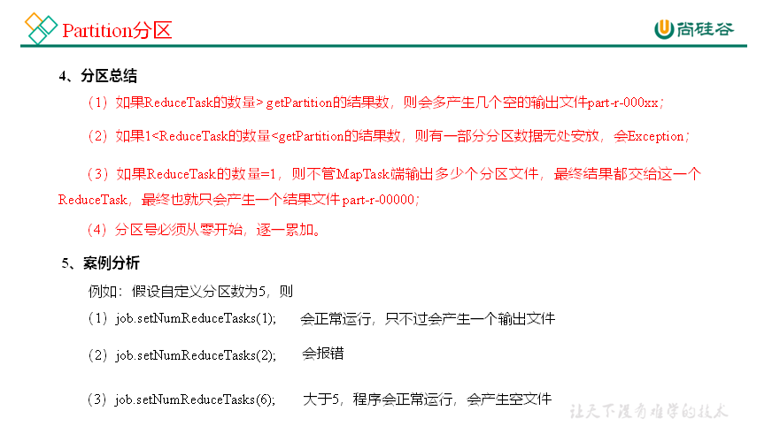

  

#### WriteableComparable

排序是Mapreduce框架中重要的操作,maptask与reducetask都会依据key进行排序,是hadoop的默认行为,任何的数据都会被排序,不论逻辑是否需要,默认依据字典表排序,方法为快速排序

  

maptask会将处理的数据暂时放到环形缓冲区中,当环形缓冲区的使用率达到一定的阈值之后,会对缓冲区的数据进行一次快速排序,将他们溢写到磁盘,数据处理完成后,对磁盘的所有文件进行归并排序.

  

ReduceTask从每个maptask中远程拷贝相应的数据文件,若大小过一定的阈值,溢写到磁盘,否则存储在内存中,若磁盘达到了一定的阈值,来一次归并排序,生成一个更大的文件,若内存中的文件大小或者数目过了一定的阈值,则合并之后将数据溢写到磁盘,当数据拷贝完成后,RedeceTask统一对内存上的所有数据进行一次归并排序 .

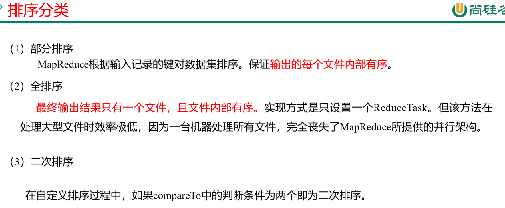

** **  

**自定义排序WritableComparable原理分析**

bean对象做为key传输，需要实现WritableComparable接口重写compareTo方法，就可以实现排序。

  

#### writableComparable案例实操

  

#### Combiner

combiner是ME程序中Mapper与Reducer之外的一个组件

combiner组件的父类就是Reducer

Combiner在每一个Maptask所在的节点运行,Reducer是接收全局所有的Mapper的输出结果

combiner的使用前提是不影响业务逻辑,且输出的kv类型要与Reducer的输入类型对应,其意义在于对于每一个MapTask的输出进行局部汇总,减少网络传输量

  

#### Combiner合并案例实操

  

### MapReduce源码解析

1）Read阶段：MapTask通过InputFormat获得的RecordReader，从输入InputSplit中解析出一个个key/value。

（2）Map阶段：该节点主要是将解析出的key/value交给用户编写map()函数处理，并产生一系列新的key/value。

（3）Collect收集阶段：在用户编写map()函数中，当数据处理完成后，一般会调用OutputCollector.collect()输出结果。在该函数内部，它会将生成的key/value分区（调用Partitioner），并写入一个环形内存缓冲区中。

（4）Spill阶段：即“溢写”，当环形缓冲区满后，MapReduce会将数据写到本地磁盘上，生成一个临时文件。需要注意的是，将数据写入本地磁盘之前，先要对数据进行一次本地排序，并在必要时对数据进行合并、压缩等操作。

溢写阶段详情：

步骤1：利用快速排序算法对缓存区内的数据进行排序，排序方式是，先按照分区编号Partition进行排序，然后按照key进行排序。这样，经过排序后，数据以分区为单位聚集在一起，且同一分区内所有数据按照key有序。

步骤2：按照分区编号由小到大依次将每个分区中的数据写入任务工作目录下的临时文件output/spillN.out（N表示当前溢写次数）中。如果用户设置了Combiner，则写入文件之前，对每个分区中的数据进行一次聚集操作。

步骤3：将分区数据的元信息写到内存索引数据结构SpillRecord中，其中每个分区的元信息包括在临时文件中的偏移量、压缩前数据大小和压缩后数据大小。如果当前内存索引大小超过1MB，则将内存索引写到文件output/spillN.out.index中。

（5）Merge阶段：当所有数据处理完成后，MapTask对所有临时文件进行一次合并，以确保最终只会生成一个数据文件。

当所有数据处理完后，MapTask会将所有临时文件合并成一个大文件，并保存到文件output/file.out中，同时生成相应的索引文件output/file.out.index。

在进行文件合并过程中，MapTask以分区为单位进行合并。对于某个分区，它将采用多轮递归合并的方式。每轮合并mapreduce.task.io.sort.factor（默认10）个文件，并将产生的文件重新加入待合并列表中，对文件排序后，重复以上过程，直到最终得到一个大文件。

让每个MapTask最终只生成一个数据文件，可避免同时打开大量文件和同时读取大量小文件产生的随机读取带来的开销。

  

#### ReduceTask工作机制

（1）Copy阶段：ReduceTask从各个MapTask上远程拷贝一片数据，并针对某一片数据，如果其大小超过一定阈值，则写到磁盘上，否则直接放到内存中。

（2）Sort阶段：在远程拷贝数据的同时，ReduceTask启动了两个后台线程对内存和磁盘上的文件进行合并，以防止内存使用过多或磁盘上文件过多。按照MapReduce语义，用户编写reduce()函数输入数据是按key进行聚集的一组数据。为了将key相同的数据聚在一起，Hadoop采用了基于排序的策略。由于各个MapTask已经实现对自己的处理结果进行了局部排序，因此，ReduceTask只需对所有数据进行一次归并排序即可。

（3）Reduce阶段：reduce()函数将计算结果写到HDFS上。

#### ReduceTask并行度决定机制

**回顾：**MapTask并行度由切片个数决定，切片个数由输入文件和切片规则决定。

**思考：**ReduceTask并行度由谁决定？

**1** **）** **设置** **ReduceTask** **并行度（个数）**

ReduceTask的并行度同样影响整个Job的执行并发度和执行效率，但与MapTask的并发数由切片数决定不同，ReduceTask数量的决定是可以直接手动设置：

// 默认值是1，手动设置为4

job.setNumReduceTasks(4);

  

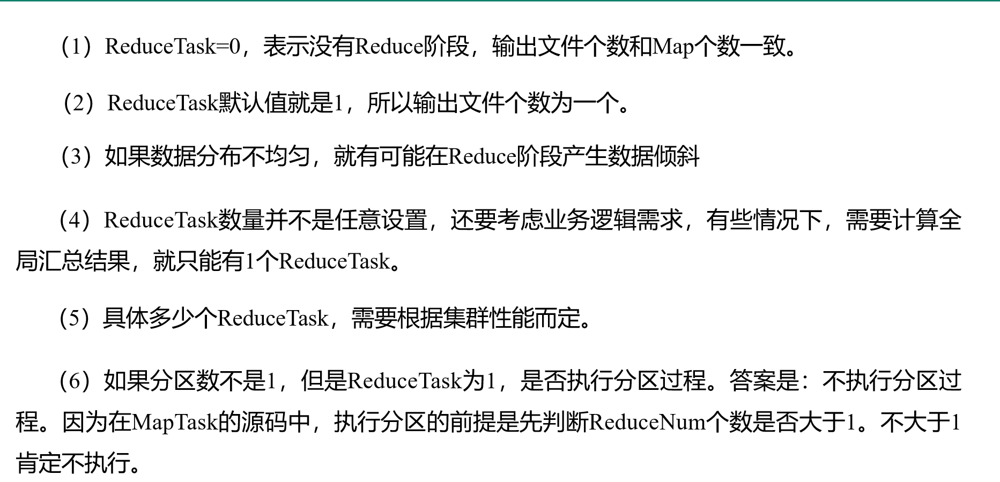

###   

#### MapTask & ReduceTask源码解析

**1** **）** **Map** **Task** **源码** **解析流程**

=================== MapTask ===================

context.write(k, NullWritable.get()); //自定义的map方法的写出，进入

output.write(key, value);

//MapTask727行，收集方法，进入两次

collector.collect(key, value,partitioner.getPartition(key, value, partitions));

HashPartitioner(); //默认分区器

collect() //MapTask1082行map端所有的kv全部写出后会走下面的close方法

close() //MapTask732行

collector.flush() // 溢出刷写方法，MapTask735行，提前打个断点，进入

sortAndSpill() //溢写排序，MapTask1505行，进入

sorter.sort() QuickSort //溢写排序方法，MapTask1625行，进入

mergeParts(); //合并文件，MapTask1527行，进入

collector.close(); //MapTask739行,收集器关闭,即将进入ReduceTask

**2** **）** **ReduceTask** **源码** **解析流程**

=================== ReduceTask ===================

if (isMapOrReduce()) //reduceTask324行，提前打断点

initialize() // reduceTask333行,进入

init(shuffleContext); // reduceTask375行,走到这需要先给下面的打断点

totalMaps = job.getNumMapTasks(); // ShuffleSchedulerImpl第120行，提前打断点

 merger = createMergeManager(context); //合并方法，Shuffle第80行

// MergeManagerImpl第232 235行，提前打断点

this.inMemoryMerger = createInMemoryMerger(); //内存合并

this.onDiskMerger = new OnDiskMerger(this); //磁盘合并

rIter = shuffleConsumerPlugin.run();

eventFetcher.start(); //开始抓取数据，Shuffle第107行，提前打断点

eventFetcher.shutDown(); //抓取结束，Shuffle第141行，提前打断点

copyPhase.complete(); //copy阶段完成，Shuffle第151行

taskStatus.setPhase(TaskStatus.Phase.SORT); //开始排序阶段，Shuffle第152行

sortPhase.complete(); //排序阶段完成，即将进入reduce阶段 reduceTask382行

reduce(); //reduce阶段调用的就是我们自定义的reduce方法，会被调用多次

cleanup(context); //reduce完成之前，会最后调用一次Reducer里面的cleanup方法

  

### Join

#### Reduce Join

  

Map端的主要工作：为来自不同表或文件的key/value对，打标签以区别不同来源的记录。然后用连接字段作为key，其余部分和新加的标志作为value，最后进行输出。

Reduce端的主要工作：在Reduce端以连接字段作为key的分组已经完成，我们只需要在每一个分组当中将那些来源于不同文件的记录（在Map阶段已经打标志）分开，最后进行合并就ok了。

  

这种方式中，合并的操作是在Reduce阶段完成，Reduce端的处理压力太大，Map节点的运算负载则很低，资源利用率不高，且在Reduce阶段极易产生数据倾斜。

解决方案：Map端实现数据合并。

#### Map Join

）使用场景

Map Join适用于一张表十分小、一张表很大的场景。

**2** **）** **优点**

思考：在Reduce端处理过多的表，非常容易产生数据倾斜。怎么办？

在Map端缓存多张表，提前处理业务逻辑，这样增加Map端业务，减少Reduce端数据的压力，尽可能的减少数据倾斜。

  

#### MapReduce开发总结

**1** **）输入数据接口：** **InputFormat**

（1）默认使用的实现类是：TextInputFormat

（2）TextInputFormat的功能逻辑是：一次读一行文本，然后将该行的起始偏移量作为key，行内容作为value返回。

（3）CombineTextInputFormat可以把多个小文件合并成一个切片处理，提高处理效率。

**2** **）逻辑处理接口：** **Mapper**

用户根据业务需求实现其中三个方法：map() setup() cleanup ()

**3** **）** **Partitioner** **分区**

（1）有默认实现 HashPartitioner，逻辑是根据key的哈希值和numReduces来返回一个分区号；key.hashCode()&Integer.MAXVALUE % numReduces

（2）如果业务上有特别的需求，可以自定义分区。

**4** **）** **Comparable** **排序**

（1）当我们用自定义的对象作为key来输出时，就必须要实现WritableComparable接口，重写其中的compareTo()方法。

（2）部分排序：对最终输出的每一个文件进行内部排序。

（3）全排序：对所有数据进行排序，通常只有一个Reduce。

（4）二次排序：排序的条件有两个。

**5** **）** **Combiner** **合并**

Combiner合并可以提高程序执行效率，减少IO传输。但是使用时必须不能影响原有的业务处理结果。

**6** **）逻辑处理接口：** **Reducer**

用户根据业务需求实现其中三个方法：reduce() setup() cleanup ()

**7** **）输出数据接口：** **OutputFormat**

（1）默认实现类是TextOutputFormat，功能逻辑是：将每一个KV对，向目标文本文件输出一行。

（2）用户还可以自定义OutputFormat。

# Yarn

Yarn是一个资源调度平台，负责为运算程序提供服务器运算资源，相当于一个分布式的操作系统平台，而MapReduce等运算程序则相当于运行于操作系统之上的应用程序。

#### Yarn的基础架构

YARN主要由ResourceManager、NodeManager、ApplicationMaster和Container等组件构成。

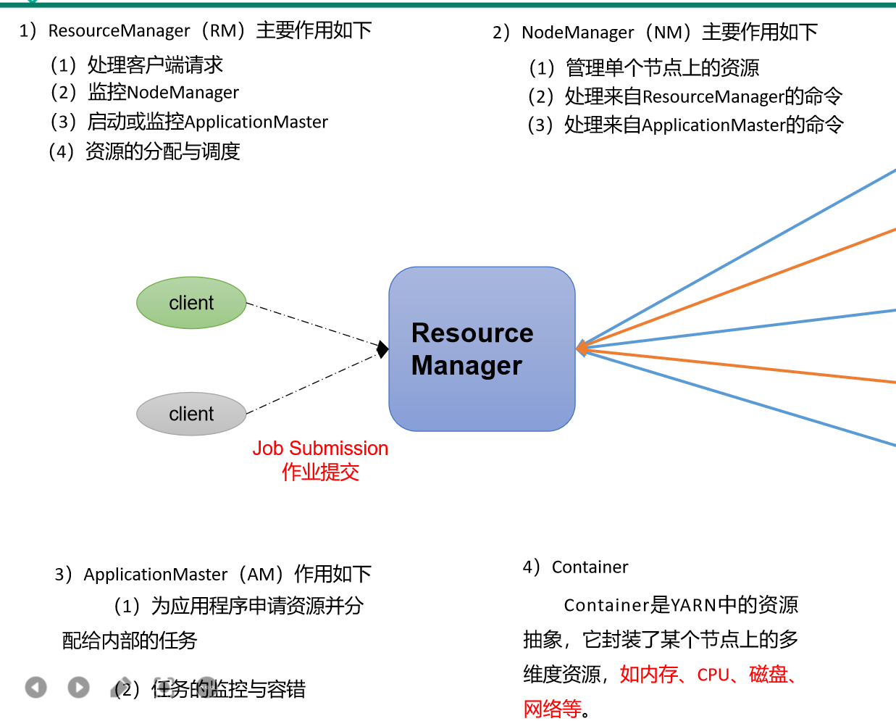

#### Yarn的工作机制

（1）MR程序提交到客户端所在的节点。

（2）YarnRunner向ResourceManager申请一个Application。

（3）RM将该应用程序的资源路径返回给YarnRunner。

（4）该程序将运行所需资源提交到HDFS上。

（5）程序资源提交完毕后，申请运行mrAppMaster。

（6）RM将用户的请求初始化成一个Task。

（7）其中一个NodeManager领取到Task任务。

（8）该NodeManager创建容器Container，并产生MRAppmaster。

（9）Container从HDFS上拷贝资源到本地。

（10）MRAppmaster向RM 申请运行MapTask资源。

（11）RM将运行MapTask任务分配给另外两个NodeManager，另两个NodeManager分别领取任务并创建容器。

（12）MR向两个接收到任务的NodeManager发送程序启动脚本，这两个NodeManager分别启动MapTask，MapTask对数据分区排序。

（13）MrAppMaster等待所有MapTask运行完毕后，向RM申请容器，运行ReduceTask。

（14）ReduceTask向MapTask获取相应分区的数据。

（15）程序运行完毕后，MR会向RM申请注销自己。

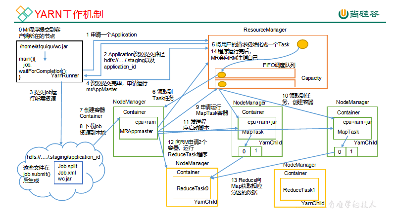

#### 作业提交流程

作业提交全过程详解

（1）作业提交

第1步：Client调用job.waitForCompletion方法，向整个集群提交MapReduce作业。

第2步：Client向RM申请一个作业id。

第3步：RM给Client返回该job资源的提交路径和作业id。

第4步：Client提交jar包、切片信息和配置文件到指定的资源提交路径。

第5步：Client提交完资源后，向RM申请运行MrAppMaster。

（2）作业初始化

第6步：当RM收到Client的请求后，将该job添加到容量调度器中。

第7步：某一个空闲的NM领取到该Job。

第8步：该NM创建Container，并产生MRAppmaster。

第9步：下载Client提交的资源到本地。

（3）任务分配

第10步：MrAppMaster向RM申请运行多个MapTask任务资源。

第11步：RM将运行MapTask任务分配给另外两个NodeManager，另两个NodeManager分别领取任务并创建容器。

（4）任务运行

第12步：MR向两个接收到任务的NodeManager发送程序启动脚本，这两个NodeManager分别启动MapTask，MapTask对数据分区排序。

第13步：MrAppMaster等待所有MapTask运行完毕后，向RM申请容器，运行ReduceTask。

第14步：ReduceTask向MapTask获取相应分区的数据。

第15步：程序运行完毕后，MR会向RM申请注销自己。

（5）进度和状态更新

YARN中的任务将其进度和状态(包括counter)返回给应用管理器, 客户端每秒(通过mapreduce.client.progressmonitor.pollinterval设置)向应用管理器请求进度更新, 展示给用户。

（6）作业完成

除了向应用管理器请求作业进度外, 客户端每5秒都会通过调用waitForCompletion()来检查作业是否完成。时间间隔可以通过mapreduce.client.completion.pollinterval来设置。作业完成之后, 应用管理器和Container会清理工作状态。作业的信息会被作业历史服务器存储以备之后用户核查。

## Yarn资源调度器

目前，Hadoop作业调度器主要有三种：FIFO、容量（Capacity Scheduler）和公平（Fair Scheduler）。Apache Hadoop3.1.3默认的资源调度器是Capacity Scheduler。

CDH框架默认调度器是Fair Scheduler。

FIFO调度器（First In First Out）：单队列，根据提交作业的先后顺序，先来先服务。

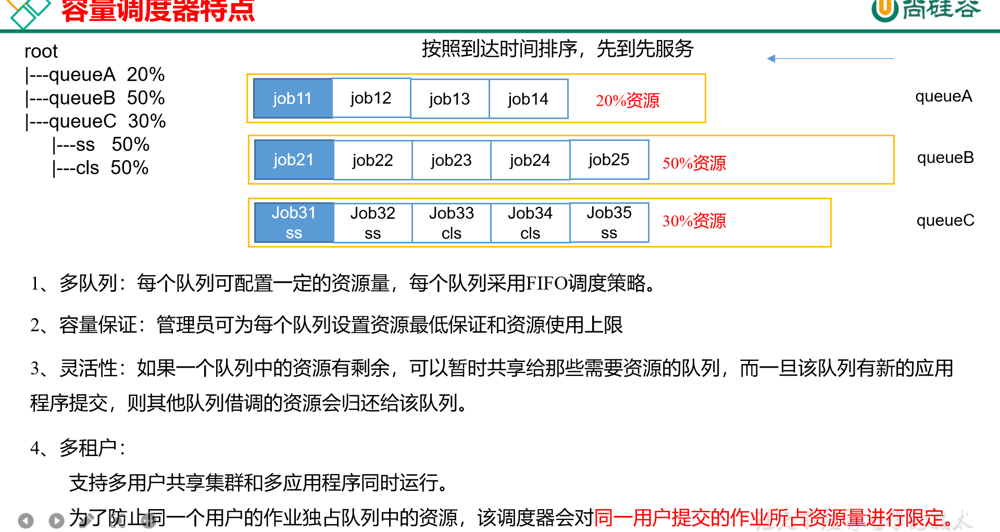

## 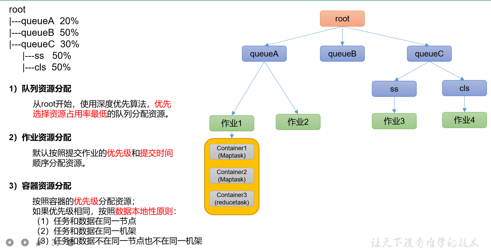

  

## Yarn案例实操

  

