​  

# Hadoop概述

Hadoop是一个分布式系统基础架构

解决海量数据存储与分析计算

是一个生态圈

​  

#### Hadoop发行版本

Apache,Cloudera,Hortonworks,

#### Hadoop优势

高可靠, 底层维护多个副本,即使某个计算元素或存储出现问题,不会导致数据的丢失

高扩展, 可拓展多节点

高效性,MapReduce加快了任务的处理速度

高容错;失败的任务可以重新分配

#### Hadoop的组成

MapReduce(计算) ,Yarn(资源调度),HDFS(数据存储),Common(辅助工具)

2.x新增的Yarn

​  

#### HDFS概述:

Hadoop Distributed File System简称HDFS,分布式文件系统

由NN(NameNode):存储文件的元数据,文件名,文件目录结构,文件属性(生成时间,副本数,文件权限),以及块列表,和块所在的DataNode等

.DN(DateNode),:在本地文件系统存储文件块数据,以及块数据的校验和

2NN(Secondary NameNode):每隔一段时间堆Namenode元数据备份

​  

#### Yarn构架概述

Yet Another Resource Negotiator简称YARN,资源协调者,是Hadoop的资源管理器

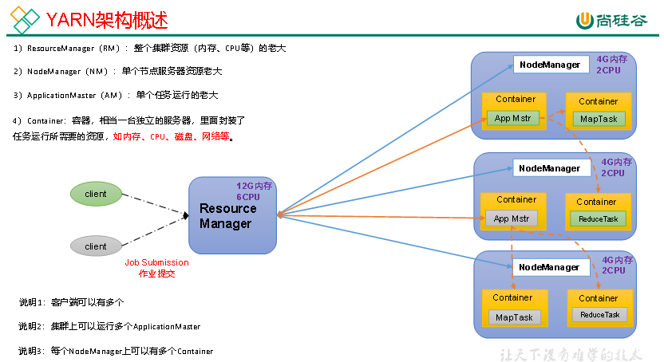

  

​  

#### Mapreduce架构概述

将计算过程分为两个阶段:Map与Reduce

map阶段进行并行处理输出数据

redece阶段对Map结果进行汇总

​  

#### 三者的关系

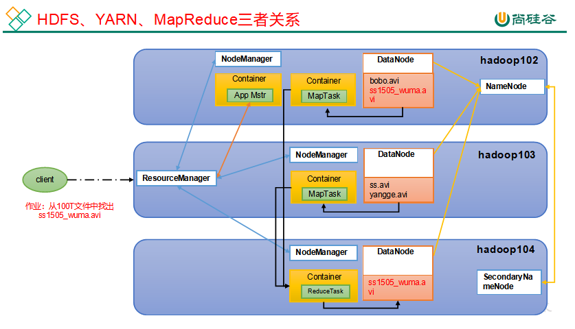

​  

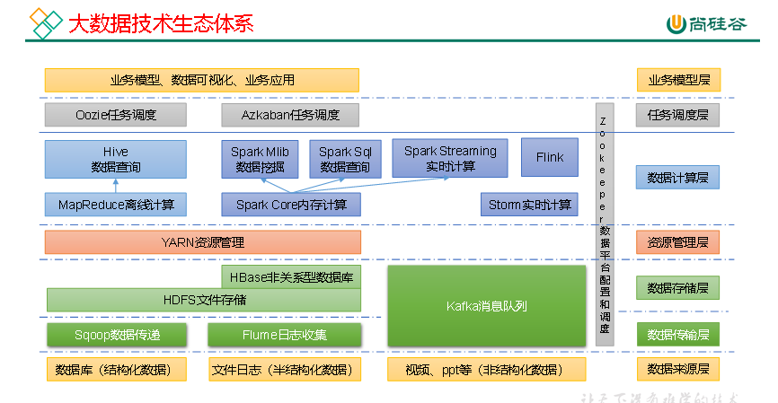

​  

图中涉及的技术名词解释如下：

（1）Sqoop：Sqoop是一款开源的工具，主要用于在Hadoop、Hive与传统的数据库（MySQL）间进行数据的传递，可以将一个关系型数据库（例如：MySQL，Oracle 等）中的数据导进到Hadoop的HDFS中，也可以将HDFS的数据导进到关系型数据库中。

（2）Flume：Flume是一个高可用的，高可靠的，分布式的海量日志采集、聚合和传输的系统，Flume支持在日志系统中定制各类数据发送方，用于收集数据；

（3）Kafka：Kafka是一种高吞吐量的分布式发布订阅消息系统；

（4）Spark：Spark是当前最流行的开源大数据内存计算框架。可以基于Hadoop上存储的大数据进行计算。

（5）Flink：Flink是当前最流行的开源大数据内存计算框架。用于实时计算的场景较多。

（6）Oozie：Oozie是一个管理Hadoop作业（job）的工作流程调度管理系统。

（7）HBase：HBase是一个分布式的、面向列的开源数据库。HBase不同于一般的关系数据库，它是一个适合于非结构化数据存储的数据库。

（8）Hive：Hive是基于Hadoop的一个数据仓库工具，可以将结构化的数据文件映射为一张数据库表，并提供简单的SQL查询功能，可以将SQL语句转换为MapReduce任务进行运行。其优点是学习成本低，可以通过类SQL语句快速实现简单的MapReduce统计，不必开发专门的MapReduce应用，十分适合数据仓库的统计分析。

（9）ZooKeeper：它是一个针对大型分布式系统的可靠协调系统，提供的功能包括：配置维护、名字服务、分布式同步、组服务等。

​  

### Hadoop序列化

**什么是序列化**

**序列化**就是把内存中的对象，转换成字节序列（或其他数据传输协议）以便于存储到磁盘（持久化）和网络传输。

**反序列化**就是将收到字节序列（或其他数据传输协议）或者是磁盘的持久化数据，转换成内存中的对象。

序列化作用于保存数据,发送数据

**为什么不用****Java****的序列化**

Java的序列化是一个重量级序列化框架（Serializable），一个对象被序列化后，会附带很多额外的信息（各种校验信息，Header，继承体系等），不便于在网络中高效传输。所以，Hadoop自己开发了一套序列化机制（Writable）

**Hadoop****序列化特点**

**Ø** **紧凑****：**高效使用存储空间。

**Ø** **快速：**读写数据的额外开销小。

**Ø 互操作：**支持多语言的交互

​  

#### 自定义bean对象实现序列化接口(writable)

在企业开发中往往常用的基本序列化类型不能满足所有需求，比如在Hadoop框架内部传递一个bean对象，那么该对象就需要实现序列化接口。

​  

具体实现bean对象序列化步骤如下7步。

（1）必须实现Writable接口

（2）反序列化时，需要反射调用空参构造函数，所以必须有空参构造

（3）重写序列化方法

（4）重写反序列化方法

（5）注意反序列化的顺序和序列化的顺序完全一致。

（6）要想把结果显示在文件中，需要重写toString()，可用"\\t"分开，方便后续用。

（7）如果需要将自定义的bean放在key中传输，则还需要实现Comparable接口，因为MapReduce框中的Shuffle过程要求对key必须能排序。

​  

  

#### 案例实操

​  

### Hadoop数据压缩

压缩的优点：以减少磁盘IO、减少磁盘存储空间。

压缩的缺点：增加CPU开销。

原则:

1）运算密集型的Job，少用压缩。

（2）IO密集型的Job，多用压缩。

#### 支持的压缩

1）压缩算法对比介绍

| 压缩格式 | Hadoop自带？ | 算法 | 文件扩展名 | 是否可切片 | 换成压缩格式后，原来的程序是否需要修改 |
| --- | --- | --- | --- | --- | --- |
| DEFLATE | 是，直接使用 | DEFLATE | .deflate | 否 | 和文本处理一样，不需要修改 |
| Gzip | 是，直接使用 | DEFLATE | .gz | 否 | 和文本处理一样，不需要修改 |
| bzip2 | 是，直接使用 | bzip2 | .bz2 | 是 | 和文本处理一样，不需要修改 |
| LZO | 否，需要安装 | LZO | .lzo | 是 | 需要建索引，还需要指定输入格式 |
| Snappy | 是，直接使用 | Snappy | .snappy | 否 | 和文本处理一样，不需要修改 |

2）压缩性能的比较

| 压缩算法 | 原始文件大小 | 压缩文件大小 | 压缩速度 | 解压速度 |
| --- | --- | --- | --- | --- |
| gzip | 8.3GB | 1.8GB | 17.5MB/s | 58MB/s |
| bzip2 | 8.3GB | 1.1GB | 2.4MB/s | 9.5MB/s |
| LZO | 8.3GB | 2.9GB | 49.3MB/s | 74.6MB/s |

[http://google.github.io/snappy/](http://google.github.io/snappy/)

Snappy is a compression/decompression library. It does not aim for maximum compression, or compatibility with any other compression library; instead, it aims for very high speeds and reasonable compression. For instance, compared to the fastest mode of zlib, Snappy is an order of magnitude faster for most inputs, but the resulting compressed files are anywhere from 20% to 100% bigger.On a single core of a Core i7 processor in 64-bit mode, Snappy compresses at about 250 MB/sec or more and decompresses at about 500 MB/sec or more.

​  

压缩方式选择时重点考虑：压缩/解压缩速度、压缩率（压缩后存储大小）、压缩后是否可以支持切片。

​  

Gzip压缩

优点：压缩率比较高。

缺点：不支持Split；压缩/解压速度一般。

Bzip2压缩

优点：压缩率高；支持Split。

缺点：压缩/解压速度慢。

Lzo压缩

优点：压缩/解压速度比较快；支持Split。

缺点：压缩率一般；想支持切片需要额外创建索引。

Snappy压缩

优点：压缩和解压缩速度快。

缺点：不支持Split；压缩率一般。

#### 压缩位置选择

压缩可以在MapReduce作用的任意阶段启用。

#### 压缩参数配置

1）为了支持多种压缩/解压缩算法，Hadoop引入了编码/解码器

| 压缩格式 | 对应的编码/解码器 |
| --- | --- |
| DEFLATE | org.apache.hadoop.io.compress.DefaultCodec |
| gzip | org.apache.hadoop.io.compress.GzipCodec |
| bzip2 | org.apache.hadoop.io.compress.BZip2Codec |
| LZO | com.hadoop.compression.lzo.LzopCodec |
| Snappy | org.apache.hadoop.io.compress.SnappyCodec |

2）要在Hadoop中启用压缩，可以配置如下参数

| 参数 | 默认值 | 阶段 | 建议 |
| --- | --- | --- | --- |
| io.compression.codecs （在core-site.xml中配置） | 无，这个需要在命令行输入hadoop checknative查看 | 输入压缩 | Hadoop使用文件扩展名判断是否支持某种编解码器 |
| mapreduce.map.output.compress（在mapred-site.xml中配置） | false | mapper输出 | 这个参数设为true启用压缩 |
| mapreduce.map.output.compress.codec（在mapred-site.xml中配置） | org.apache.hadoop.io.compress.DefaultCodec | mapper输出 | 企业多使用LZO或Snappy编解码器在此阶段压缩数据 |
| mapreduce.output.fileoutputformat.compress（在mapred-site.xml中配置） | false | reducer输出 | 这个参数设为true启用压缩 |
| mapreduce.output.fileoutputformat.compress.codec（在mapred-site.xml中配置） | org.apache.hadoop.io.compress.DefaultCodec | reducer输出 | 使用标准工具或者编解码器，如gzip和bzip2 |

  

### 压缩实操案例

#### 4.5.1 Map输出端采用压缩

即使你的MapReduce的输入输出文件都是未压缩的文件，你仍然可以对Map任务的中间结果输出做压缩，因为它要写在硬盘并且通过网络传输到Reduce节点，对其压缩可以提高很多性能，这些工作只要设置两个属性即可，我们来看下代码怎么设置。

#### reduce输出端采用压缩

# Hadoop之HDFS

​  

## HDFS概述

HDFS只是分布式文件管理系统中的一种。

一种系统来管理多台机器上的文件，这就是分布式文件管理系统

hdfs(Hadoop Distributed File System)用于存储文件的系统,通过目录树来定位文件,分布式的,由很多服务器联合起来实现其功能，集群中的服务器有各自的角色

​  

HDFS的使用场景：适合一次写入，多次读出的场景。一个文件经过创建、写入和关闭之后就不需要改变。

​  

#### 优缺点

(1)高容错-----------多副本机制,可自动恢复丢失的副本

(2)适合处理大数据-------数据规模可达PB级别,文件规模可达到百万规模以上

(3)可购建在廉价机器上,多副本机制提供可靠性

缺点

(1)不适合低延时的数据访问------做不到毫秒级别的数据存储

(2)无法高效的对大小文件进行存储---------小文件问题,占用NN的存储信息,寻址时间超过读取时间

寻址时间最佳为传输时间的1%,目前的磁盘传输效率普遍为100mb/s

(3)不支持并发写入,文件随机修改-------一文件仅能有一个写,不支持多个线程同时写,仅支持文件的追加写(append)

#### HDFS的组成架构

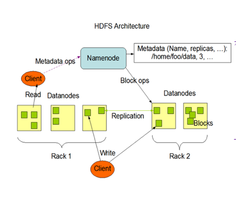

NN(NAMENODE)作为master,主管,管理者,--------1,管理hdfs的名称空间2,配置副本策略3,管理数据块的映射信息4,处理客户端读写请求

DN(datanode)作为slave,worker,执行nn下达的操作,----------存储实际的数据块,执行数据块的读写操作

Client:客户端,----------1,切分上传hdfs的文件成Block后长传,2,与nn交互,获取文件的位置信息,3,与DN交互,读取或写入数据4,提供命令管理hdfs,例如格式化nn,访问hdfs,例如对hdfs增删改查

2NN(Secondary NameNode):当nn挂掉的时候不能马上替换nn并提供服务,----1,辅助nn,分担工作量, 2,紧急情况下,辅助恢复nn

#### HDFS文件块大小

在物理上是分块(Block)存储的,大小可以通配置参数(dfs.blocksize)来确定,在2.x之后默认是128m,1.x是64

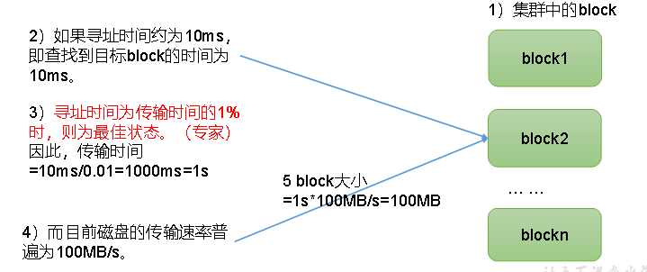

文件块大小要适宜,小了占据寻址时间,大了磁盘传输时间,处理速度

hfds的块文件的大小主要取决于磁盘的传输效率

## HDFS的shell操作

见常用组件及其命令

## HDFS的API操作

1,配置环境

2,写代码

## HDFS的读写流程

### 写流程

  

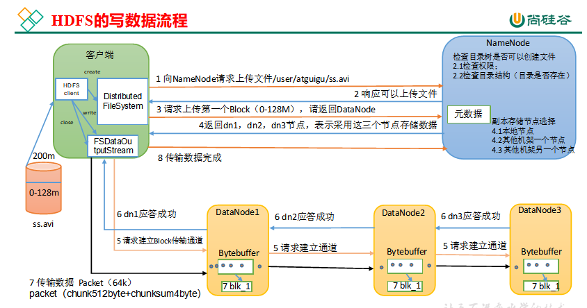

（1）客户端通过Distributed FileSystem模块向NameNode请求上传文件，NameNode检查目标文件是否已存在，父目录是否存在。

（2）NameNode返回是否可以上传。

（3）客户端请求第一个 Block上传到哪几个DataNode服务器上。

（4）NameNode返回3个DataNode节点，分别为dn1、dn2、dn3。

（5）客户端通过FSDataOutputStream模块请求dn1上传数据，dn1收到请求会继续调用dn2，然后dn2调用dn3，将这个通信管道建立完成。

（6）dn1、dn2、dn3逐级应答客户端。

（7）客户端开始往dn1上传第一个Block（先从磁盘读取数据放到一个本地内存缓存），以Packet为单位，dn1收到一个Packet就会传给dn2，dn2传给dn3；dn1每传一个packet会放入一个应答队列等待应答。

（8）当一个Block传输完成之后，客户端再次请求NameNode上传第二个Block的服务器。（重复执行3-7步）。

#### 网络拓扑-节点距离计算

在HDFS写数据的过程中，NameNode会选择距离待上传数据最近距离的DataNode接收数据。那么这个最近距离怎么计算呢？

节点距离：两个节点到达最近的共同祖先的距离总和。

  

#### 机架感知

机架感知说明

（1）官方说明

[http://hadoop.apache.org/docs/r3.1.3/hadoop-project-dist/hadoop-hdfs/HdfsDesign.html#Data\_Replication](#Data_Replication)

（2）源码说明

Crtl + n 查找BlockPlacementPolicyDefault，在该类中查找chooseTargetInOrder方法。

#### 副本选择

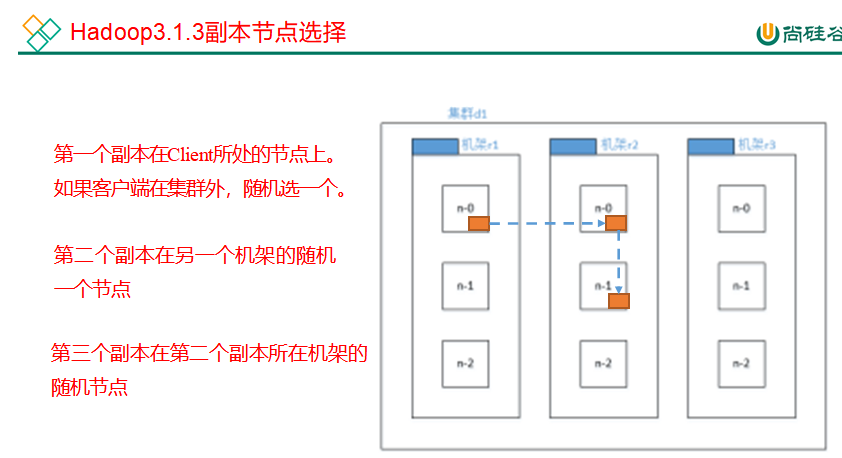

​  

​  

### 读流程

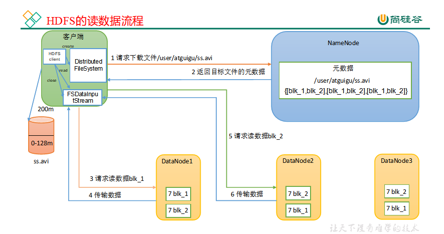

（1）客户端通过DistributedFileSystem向NameNode请求下载文件，NameNode通过查询元数据，找到文件块所在的DataNode地址。

（2）挑选一台DataNode（就近原则，然后随机）服务器，请求读取数据。

（3）DataNode开始传输数据给客户端（从磁盘里面读取数据输入流，以Packet为单位来做校验）。

（4）客户端以Packet为单位接收，先在本地缓存，然后写入目标文件。

## NN与2NN

#### 工作机制

因为经常需要进行随机访问，还有响应客户请求，元数据需要存放在内存中,一旦断电，元数据丢失，整个集群就无法工作了。因此产生在磁盘中备份元数据的FsImage。

当在内存中的元数据更新时，如果同时更新FsImage，就会导致效率过低，但如果不更新，就会发生一致性问题,一旦NameNode节点断电，就会产生数据丢失。因此，引入Edits文件（只进行追加操作，效率很高）。每当元数据有更新或者添加元数据时，修改内存中的元数据并追加到Edits中。

一旦NameNode节点断电，可以通过FsImage和Edits的合并，合成元数据。

如果长时间添加数据到Edits中，会导致该文件数据过大，效率降低，而且一旦断电，恢复元数据需要的时间过长。因此，需要定期进行FsImage和Edits的合并，如果这个操作由NameNode节点完成，又会效率过低。因此，引入一个新的节点SecondaryNamenode，专门用于FsImage和Edits的合并。

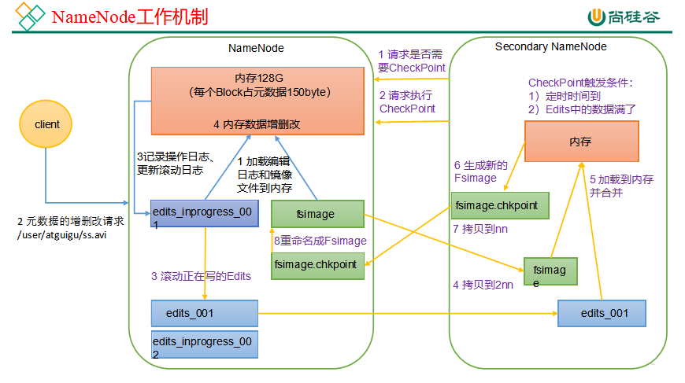

**第一****阶段：****NameNode****启动**

（1）第一次启动NameNode格式化后，创建Fsimage和Edits文件。如果不是第一次启动，直接加载编辑日志和镜像文件到内存。

（2）客户端对元数据进行增删改的请求。

（3）NameNode记录操作日志，更新滚动日志。

（4）NameNode在内存中对元数据进行增删改。

**2****）第二****阶段：****Secondary NameNode****工作**

（1）Secondary NameNode询问NameNode是否需要CheckPoint。直接带回NameNode是否检查结果。

（2）Secondary NameNode请求执行CheckPoint。

（3）NameNode滚动正在写的Edits日志。

（4）将滚动前的编辑日志和镜像文件拷贝到Secondary NameNode。

（5）Secondary NameNode加载编辑日志和镜像文件到内存，并合并。

（6）生成新的镜像文件fsimage.chkpoint。

（7）拷贝fsimage.chkpoint到NameNode。

（8）NameNode将fsimage.chkpoint重新命名成fsimage。

#### Fsimage和Edits解析

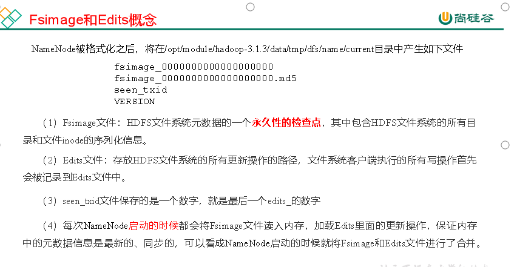

**oiv****查看****Fsimage****文件**

（1）查看oiv和oev命令

[atguigu@hadoop102 current]$ hdfs

**oiv** apply the offline fsimage viewer to an fsimage

**oev** apply the offline edits viewer to an edits file

​  

（2）基本语法

hdfs oiv -p 文件类型 \-i镜像文件 \-o 转换后文件输出路径

（3）案例实操

[atguigu@hadoop102 current]$ pwd

/opt/module/hadoop-3.1.3/data/dfs/name/current

​  

[atguigu@hadoop102 current]$ hdfs oiv -p XML -i fsimage\_0000000000000000025 -o /opt/module/hadoop-3.1.3/fsimage.xml

​  

[atguigu@hadoop102 current]$ cat /opt/module/hadoop-3.1.3/fsimage.xml

**oev****查看****Edits****文件**

（1）基本语法

hdfs oev -p 文件类型 \-i编辑日志 \-o 转换后文件输出路径

（2）案例实操

[atguigu@hadoop102 current]$ hdfs oev -p XML -i edits\_0000000000000000012-0000000000000000013 -o /opt/module/hadoop-3.1.3/edits.xml

​  

[atguigu@hadoop102 current]$ cat /opt/module/hadoop-3.1.3/edits.xml

​  

#### checkpoint时间设置

1）通常情况下，SecondaryNameNode每隔一小时执行一次

**一分钟****检查一次操作次数，当操作次数达到****1****百万****时，****SecondaryNameNode****执行****一次。**

<property>

​<name>dfs.namenode.checkpoint.txns</name>

​<value>1000000</value>

<description>操作动作次数</description>

</property>

​  

<property>

​<name>dfs.namenode.checkpoint.check.period</name>

​<value>60s</value>

<description> 1分钟检查一次操作次数</description>

</property>

## DN

#### DataNode工作机制

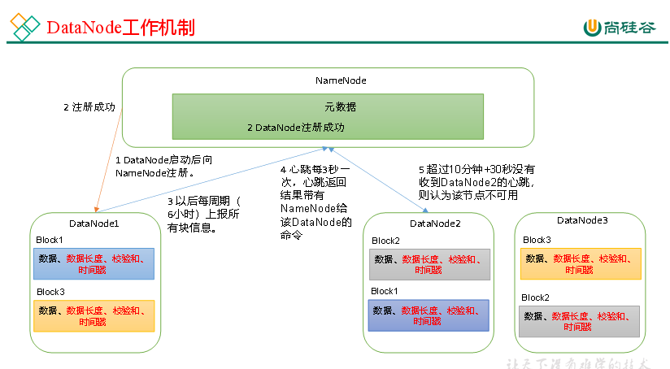

（1）一个数据块在DataNode上以文件形式存储在磁盘上，包括两个文件，一个是数据本身，一个是元数据包括数据块的长度，块数据的校验和，以及时间戳。

（2）DataNode启动后向NameNode注册，通过后，周期性（6小时）的向NameNode上报所有的块信息。

#### 心跳机制

心跳是每3秒一次，心跳返回结果带有NameNode给该DataNode的命令如复制块数据到另一台机器，或删除某个数据块。如果超过10分钟没有收到某个DataNode的心跳，则认为该节点不可用。

#### 数据完整性

如下是DataNode节点保证数据完整性的方法。

（1）当DataNode读取Block的时候，它会计算CheckSum。

（2）如果计算后的CheckSum，与Block创建时值不一样，说明Block已经损坏。

（3）Client读取其他DataNode上的Block。

（4）常见的校验算法crc（32），md5（128），sha1（160）。

（5）DataNode在其文件创建后周期验证CheckSum。

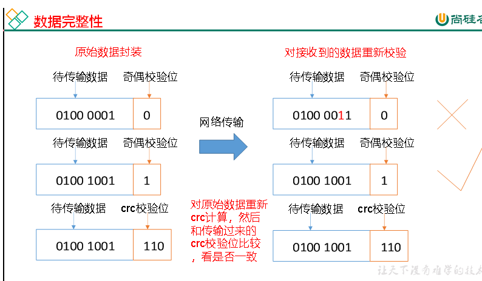

#### 掉线时限参数设置

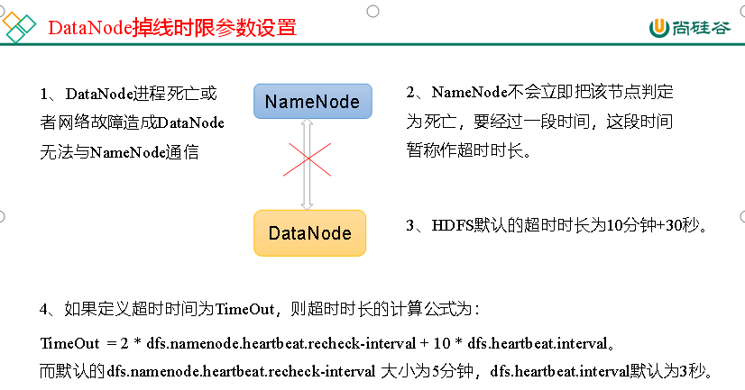

需要注意的是hdfs-site.xml 配置文件中的heartbeat.recheck.interval的单位为毫秒，dfs.heartbeat.interval的单位为秒。

# MapReduce

## MapReduce概述

MapReduce是一个分布式运算程序的编程框架，是用户开发“基于Hadoop的数据分析应用”的核心框架。

MapReduce核心功能是将用户编写的业务逻辑代码和自带默认组件整合成一个完整的分布式运算程序，并发运行在一个Hadoop集群上。

优缺点:mapreduce易于编程,----------它简单的实现一些接口，就可以完成一个分布式程序

良好的拓展性-----------简单的增加机器来扩展它的计算能力

**高容错性-----**其中一台机器挂了，它可以把上面的计算任务转移到另外一个节点上运行，不至于这个任务运行失败

**适合PB级以上海量数据的离线处理**

**不擅长实时计算**

**不擅长流式计算--------**MapReduce的输入数据集是静态的，不能动态变化。这是因为MapReduce自身的设计特点决定了数据源必须是静态的。

**不擅长DAG（有向无环图）计算------------**使用后，每个MapReduce作业的输出结果都会写入到磁盘，会造成大量的磁盘IO，导致性能非常的低下

### MapReduce核心思想

（1）分布式的运算程序往往需要分成至少2个阶段。

（2）第一个阶段的MapTask并发实例，完全并行运行，互不相干。

（3）第二个阶段的ReduceTask并发实例互不相干，但是他们的数据依赖于上一个阶段的所有MapTask并发实例的输出。

（4）MapReduce编程模型只能包含一个Map阶段和一个Reduce阶段，如果用户的业务逻辑非常复杂，那就只能多个MapReduce程序，串行运行。

总结：分析WordCount数据流走向深入理解MapReduce核心思想。

#### 1.4 MapReduce进程

一个完整的MapReduce程序在分布式运行时有三类实例进程：

（1）**MrAppMaster**：负责整个程序的过程调度及状态协调。

（2）**MapTask**：负责Map阶段的整个数据处理流程。

（3）**ReduceTask**：负责Reduce阶段的整个数据处理流程。

​  

#### 常用数据序列化类型

| **Java****类型** | **Hadoop Writable****类型** |
| --- | --- |
| Boolean | BooleanWritable |
| Byte | ByteWritable |
| Int | IntWritable |
| Float | FloatWritable |
| Long | LongWritable |
| Double | DoubleWritable |
| String | Text |
| Map | MapWritable |
| Array | ArrayWritable |
| Null | NullWritable |

  

#### MapReduce编程规范

用户编写的程序分成三个部分：Mapper、Reducer和Driver。

  

  

## MapReduce框架原理

#### 切片与maptask的并行度

**MapTask****并行度决定****机制**

MapTask的并行度决定Map阶段的任务处理并发度，进而影响到整个Job的处理速度

**数据****块：**Block是HDFS物理上把数据分成一块一块。数据块是HDFS存储数据单位。

**数据切片：**数据切片只是在逻辑上对输入进行分片，并不会在磁盘上将其切分成片进行存储。数据切片是MapReduce程序计算输入数据的单位，一个切片会对应启动一个MapTask。

#### FileinputFormat切片

#### TextInputFormat

**FileInputFormat****实现类**

思考：在运行MapReduce程序时，输入的文件格式包括：基于行的日志文件、二进制格式文件、数据库表等。那么，针对不同的数据类型，MapReduce是如何读取这些数据的呢？

FileInputFormat常见的接口实现类包括：TextInputFormat、KeyValueTextInputFormat、NLineInputFormat、CombineTextInputFormat和自定义InputFormat等

TextInputFormat是默认的FileInputFormat实现类。按行读取每条记录。键是存储该行在整个文件中的起始字节偏移量， LongWritable类型。值是这行的内容，不包括任何行终止符（换行符和回车符），Text类型。

#### CombineTextInputFormat

框架默认的TextInputFormat切片机制是对任务按文件规划切片，不管文件多小，都会是一个单独的切片，都会交给一个MapTask，这样如果有大量小文件，就会产生大量的MapTask，处理效率极其低下。

使用场景:

CombineTextInputFormat用于小文件过多的场景，它可以将多个小文件从逻辑上规划到一个切片中，这样，多个小文件就可以交给一个MapTask处理。

存储虚拟切片最大值设置:

CombineTextInputFormat.setMaxInputSplitSize(job, 4194304);// 4m

注意：虚拟存储切片最大值设置最好根据实际的小文件大小情况来设置具体的值。

**切片机制**

生成切片过程包括：虚拟存储过程和切片过程二部分。

  

​  

虚拟存储过程：

将输入目录下所有文件大小，依次和设置的setMaxInputSplitSize值比较，如果不大于设置的最大值，逻辑上划分一个块。如果输入文件大于设置的最大值且大于两倍，那么以最大值切割一块；当剩余数据大小超过设置的最大值且不大于最大值2倍，此时将文件均分成2个虚拟存储块（防止出现太小切片）。

(1) 虚拟存储过程：

将输入目录下所有文件大小，依次和设置的setMaxInputSplitSize值比较，如果不大于设置的最大值，逻辑上划分一个块。如果输入文件大于设置的最大值且大于两倍，那么以最大值切割一块；当剩余数据大小超过设置的最大值且不大于最大值2倍，此时将文件均分成2个虚拟存储块（防止出现太小切片）。

（2）切片过程：

①判断虚拟存储的文件大小是否大于setMaxInputSplitSize值，大于等于则单独形成一个切片。

②如果不大于则跟下一个虚拟存储文件进行合并，共同形成一个切片。

### shuffle

#### 工作流程

具体Shuffle过程详解，如下：

（1）MapTask收集我们的map()方法输出的kv对，放到内存缓冲区中

（2）从内存缓冲区不断溢出本地磁盘文件，可能会溢出多个文件

（3）多个溢出文件会被合并成大的溢出文件

（4）在溢出过程及合并的过程中，都要调用Partitioner进行分区和针对key进行排序

（5）ReduceTask根据自己的分区号，去各个MapTask机器上取相应的结果分区数据

（6）ReduceTask会抓取到同一个分区的来自不同MapTask的结果文件，ReduceTask会将这些文件再进行合并（归并排序）

（7）合并成大文件后，Shuffle的过程也就结束了，后面进入ReduceTask的逻辑运算过程（从文件中取出一个一个的键值对Group，调用用户自定义的reduce()方法）

**注意****：**

（1）Shuffle中的缓冲区大小会影响到MapReduce程序的执行效率，原则上说，缓冲区越大，磁盘io的次数越少，执行速度就越快。

（2）缓冲区的大小可以通过参数调整，参数：mapreduce.task.io.sort.mb默认100M。

#### Partition分区

默认的分区为key的hashcode除以reducetask个数的余数来分区

可以自定义分区方法

  

#### WriteableComparable

排序是Mapreduce框架中重要的操作,maptask与reducetask都会依据key进行排序,是hadoop的默认行为,任何的数据都会被排序,不论逻辑是否需要,默认依据字典表排序,方法为快速排序

  

maptask会将处理的数据暂时放到环形缓冲区中,当环形缓冲区的使用率达到一定的阈值之后,会对缓冲区的数据进行一次快速排序,将他们溢写到磁盘,数据处理完成后,对磁盘的所有文件进行归并排序.

​  

ReduceTask从每个maptask中远程拷贝相应的数据文件,若大小过一定的阈值,溢写到磁盘,否则存储在内存中,若磁盘达到了一定的阈值,来一次归并排序,生成一个更大的文件,若内存中的文件大小或者数目过了一定的阈值,则合并之后将数据溢写到磁盘,当数据拷贝完成后,RedeceTask统一对内存上的所有数据进行一次归并排序 .

**​**  

**自定义排序WritableComparable原理分析**

bean对象做为key传输，需要实现WritableComparable接口重写compareTo方法，就可以实现排序。

​  

#### writableComparable案例实操

​  

#### Combiner

combiner是ME程序中Mapper与Reducer之外的一个组件

combiner组件的父类就是Reducer

Combiner在每一个Maptask所在的节点运行,Reducer是接收全局所有的Mapper的输出结果

combiner的使用前提是不影响业务逻辑,且输出的kv类型要与Reducer的输入类型对应,其意义在于对于每一个MapTask的输出进行局部汇总,减少网络传输量

​  

#### Combiner合并案例实操

​  

### MapReduce源码解析

1）Read阶段：MapTask通过InputFormat获得的RecordReader，从输入InputSplit中解析出一个个key/value。

（2）Map阶段：该节点主要是将解析出的key/value交给用户编写map()函数处理，并产生一系列新的key/value。

（3）Collect收集阶段：在用户编写map()函数中，当数据处理完成后，一般会调用OutputCollector.collect()输出结果。在该函数内部，它会将生成的key/value分区（调用Partitioner），并写入一个环形内存缓冲区中。

（4）Spill阶段：即“溢写”，当环形缓冲区满后，MapReduce会将数据写到本地磁盘上，生成一个临时文件。需要注意的是，将数据写入本地磁盘之前，先要对数据进行一次本地排序，并在必要时对数据进行合并、压缩等操作。

溢写阶段详情：

步骤1：利用快速排序算法对缓存区内的数据进行排序，排序方式是，先按照分区编号Partition进行排序，然后按照key进行排序。这样，经过排序后，数据以分区为单位聚集在一起，且同一分区内所有数据按照key有序。

步骤2：按照分区编号由小到大依次将每个分区中的数据写入任务工作目录下的临时文件output/spillN.out（N表示当前溢写次数）中。如果用户设置了Combiner，则写入文件之前，对每个分区中的数据进行一次聚集操作。

步骤3：将分区数据的元信息写到内存索引数据结构SpillRecord中，其中每个分区的元信息包括在临时文件中的偏移量、压缩前数据大小和压缩后数据大小。如果当前内存索引大小超过1MB，则将内存索引写到文件output/spillN.out.index中。

（5）Merge阶段：当所有数据处理完成后，MapTask对所有临时文件进行一次合并，以确保最终只会生成一个数据文件。

当所有数据处理完后，MapTask会将所有临时文件合并成一个大文件，并保存到文件output/file.out中，同时生成相应的索引文件output/file.out.index。

在进行文件合并过程中，MapTask以分区为单位进行合并。对于某个分区，它将采用多轮递归合并的方式。每轮合并mapreduce.task.io.sort.factor（默认10）个文件，并将产生的文件重新加入待合并列表中，对文件排序后，重复以上过程，直到最终得到一个大文件。

让每个MapTask最终只生成一个数据文件，可避免同时打开大量文件和同时读取大量小文件产生的随机读取带来的开销。

​  

#### ReduceTask工作机制

（1）Copy阶段：ReduceTask从各个MapTask上远程拷贝一片数据，并针对某一片数据，如果其大小超过一定阈值，则写到磁盘上，否则直接放到内存中。

（2）Sort阶段：在远程拷贝数据的同时，ReduceTask启动了两个后台线程对内存和磁盘上的文件进行合并，以防止内存使用过多或磁盘上文件过多。按照MapReduce语义，用户编写reduce()函数输入数据是按key进行聚集的一组数据。为了将key相同的数据聚在一起，Hadoop采用了基于排序的策略。由于各个MapTask已经实现对自己的处理结果进行了局部排序，因此，ReduceTask只需对所有数据进行一次归并排序即可。

（3）Reduce阶段：reduce()函数将计算结果写到HDFS上。

#### ReduceTask并行度决定机制

**回顾：**MapTask并行度由切片个数决定，切片个数由输入文件和切片规则决定。

**思考：**ReduceTask并行度由谁决定？

**1****）****设置****ReduceTask****并行度（个数）**

ReduceTask的并行度同样影响整个Job的执行并发度和执行效率，但与MapTask的并发数由切片数决定不同，ReduceTask数量的决定是可以直接手动设置：

// 默认值是1，手动设置为4

job.setNumReduceTasks(4);

​  

###   

#### MapTask & ReduceTask源码解析

**1****）****Map****Task****源码****解析流程**

\=================== MapTask \===================

context.write(k, NullWritable.get()); //自定义的map方法的写出，进入

output.write(key, value);

//MapTask727行，收集方法，进入两次

collector.collect(key, value,partitioner.getPartition(key, value, partitions));

HashPartitioner(); //默认分区器

collect() //MapTask1082行map端所有的kv全部写出后会走下面的close方法

close() //MapTask732行

collector.flush() // 溢出刷写方法，MapTask735行，提前打个断点，进入

sortAndSpill() //溢写排序，MapTask1505行，进入

sorter.sort() QuickSort //溢写排序方法，MapTask1625行，进入

mergeParts(); //合并文件，MapTask1527行，进入

collector.close(); //MapTask739行,收集器关闭,即将进入ReduceTask

**2****）****ReduceTask****源码****解析流程**

\=================== ReduceTask \===================

if (isMapOrReduce()) //reduceTask324行，提前打断点

initialize() // reduceTask333行,进入

init(shuffleContext); // reduceTask375行,走到这需要先给下面的打断点

totalMaps = job.getNumMapTasks(); // ShuffleSchedulerImpl第120行，提前打断点

​ merger = createMergeManager(context); //合并方法，Shuffle第80行

// MergeManagerImpl第232 235行，提前打断点

this.inMemoryMerger = createInMemoryMerger(); //内存合并

this.onDiskMerger = new OnDiskMerger(this); //磁盘合并

rIter = shuffleConsumerPlugin.run();

eventFetcher.start(); //开始抓取数据，Shuffle第107行，提前打断点

eventFetcher.shutDown(); //抓取结束，Shuffle第141行，提前打断点

copyPhase.complete(); //copy阶段完成，Shuffle第151行

taskStatus.setPhase(TaskStatus.Phase.SORT); //开始排序阶段，Shuffle第152行

sortPhase.complete(); //排序阶段完成，即将进入reduce阶段 reduceTask382行

reduce(); //reduce阶段调用的就是我们自定义的reduce方法，会被调用多次

cleanup(context); //reduce完成之前，会最后调用一次Reducer里面的cleanup方法

​  

### Join

#### Reduce Join

  

Map端的主要工作：为来自不同表或文件的key/value对，打标签以区别不同来源的记录。然后用连接字段作为key，其余部分和新加的标志作为value，最后进行输出。

Reduce端的主要工作：在Reduce端以连接字段作为key的分组已经完成，我们只需要在每一个分组当中将那些来源于不同文件的记录（在Map阶段已经打标志）分开，最后进行合并就ok了。

​  

这种方式中，合并的操作是在Reduce阶段完成，Reduce端的处理压力太大，Map节点的运算负载则很低，资源利用率不高，且在Reduce阶段极易产生数据倾斜。

解决方案：Map端实现数据合并。

#### Map Join

）使用场景

Map Join适用于一张表十分小、一张表很大的场景。

**2****）****优点**

思考：在Reduce端处理过多的表，非常容易产生数据倾斜。怎么办？

在Map端缓存多张表，提前处理业务逻辑，这样增加Map端业务，减少Reduce端数据的压力，尽可能的减少数据倾斜。

​  

#### MapReduce开发总结

**1****）输入数据接口：****InputFormat**

（1）默认使用的实现类是：TextInputFormat

（2）TextInputFormat的功能逻辑是：一次读一行文本，然后将该行的起始偏移量作为key，行内容作为value返回。

（3）CombineTextInputFormat可以把多个小文件合并成一个切片处理，提高处理效率。

**2****）逻辑处理接口：****Mapper**

用户根据业务需求实现其中三个方法：map() setup() cleanup ()

**3****）****Partitioner****分区**

（1）有默认实现 HashPartitioner，逻辑是根据key的哈希值和numReduces来返回一个分区号；key.hashCode()&Integer.MAXVALUE % numReduces

（2）如果业务上有特别的需求，可以自定义分区。

**4****）****Comparable****排序**

（1）当我们用自定义的对象作为key来输出时，就必须要实现WritableComparable接口，重写其中的compareTo()方法。

（2）部分排序：对最终输出的每一个文件进行内部排序。

（3）全排序：对所有数据进行排序，通常只有一个Reduce。

（4）二次排序：排序的条件有两个。

**5****）****Combiner****合并**

Combiner合并可以提高程序执行效率，减少IO传输。但是使用时必须不能影响原有的业务处理结果。

**6****）逻辑处理接口：****Reducer**

用户根据业务需求实现其中三个方法：reduce() setup() cleanup ()

**7****）输出数据接口：****OutputFormat**

（1）默认实现类是TextOutputFormat，功能逻辑是：将每一个KV对，向目标文本文件输出一行。

（2）用户还可以自定义OutputFormat。

# Yarn

Yarn是一个资源调度平台，负责为运算程序提供服务器运算资源，相当于一个分布式的操作系统平台，而MapReduce等运算程序则相当于运行于操作系统之上的应用程序。

#### Yarn的基础架构

YARN主要由ResourceManager、NodeManager、ApplicationMaster和Container等组件构成。

#### Yarn的工作机制

（1）MR程序提交到客户端所在的节点。

（2）YarnRunner向ResourceManager申请一个Application。

（3）RM将该应用程序的资源路径返回给YarnRunner。

（4）该程序将运行所需资源提交到HDFS上。

（5）程序资源提交完毕后，申请运行mrAppMaster。

（6）RM将用户的请求初始化成一个Task。

（7）其中一个NodeManager领取到Task任务。

（8）该NodeManager创建容器Container，并产生MRAppmaster。

（9）Container从HDFS上拷贝资源到本地。

（10）MRAppmaster向RM 申请运行MapTask资源。

（11）RM将运行MapTask任务分配给另外两个NodeManager，另两个NodeManager分别领取任务并创建容器。

（12）MR向两个接收到任务的NodeManager发送程序启动脚本，这两个NodeManager分别启动MapTask，MapTask对数据分区排序。

（13）MrAppMaster等待所有MapTask运行完毕后，向RM申请容器，运行ReduceTask。

（14）ReduceTask向MapTask获取相应分区的数据。

（15）程序运行完毕后，MR会向RM申请注销自己。

#### 作业提交流程

作业提交全过程详解

（1）作业提交

第1步：Client调用job.waitForCompletion方法，向整个集群提交MapReduce作业。

第2步：Client向RM申请一个作业id。

第3步：RM给Client返回该job资源的提交路径和作业id。

第4步：Client提交jar包、切片信息和配置文件到指定的资源提交路径。

第5步：Client提交完资源后，向RM申请运行MrAppMaster。

（2）作业初始化

第6步：当RM收到Client的请求后，将该job添加到容量调度器中。

第7步：某一个空闲的NM领取到该Job。

第8步：该NM创建Container，并产生MRAppmaster。

第9步：下载Client提交的资源到本地。

（3）任务分配

第10步：MrAppMaster向RM申请运行多个MapTask任务资源。

第11步：RM将运行MapTask任务分配给另外两个NodeManager，另两个NodeManager分别领取任务并创建容器。

（4）任务运行

第12步：MR向两个接收到任务的NodeManager发送程序启动脚本，这两个NodeManager分别启动MapTask，MapTask对数据分区排序。

第13步：MrAppMaster等待所有MapTask运行完毕后，向RM申请容器，运行ReduceTask。

第14步：ReduceTask向MapTask获取相应分区的数据。

第15步：程序运行完毕后，MR会向RM申请注销自己。

（5）进度和状态更新

YARN中的任务将其进度和状态(包括counter)返回给应用管理器, 客户端每秒(通过mapreduce.client.progressmonitor.pollinterval设置)向应用管理器请求进度更新, 展示给用户。

（6）作业完成

除了向应用管理器请求作业进度外, 客户端每5秒都会通过调用waitForCompletion()来检查作业是否完成。时间间隔可以通过mapreduce.client.completion.pollinterval来设置。作业完成之后, 应用管理器和Container会清理工作状态。作业的信息会被作业历史服务器存储以备之后用户核查。

## Yarn资源调度器

目前，Hadoop作业调度器主要有三种：FIFO、容量（Capacity Scheduler）和公平（Fair Scheduler）。Apache Hadoop3.1.3默认的资源调度器是Capacity Scheduler。

CDH框架默认调度器是Fair Scheduler。

FIFO调度器（First In First Out）：单队列，根据提交作业的先后顺序，先来先服务。

## 

  

## Yarn案例实操

  

# Hadoop优化

### 多目录

DataNode设置多目录来存储不同的数据,

​  

磁盘间数据平衡问题,3.x出现的新特性,

​  

生成均衡计划 hdfs diskbalancer -plan

执行均衡计划 hdfs diskbalancer -execute

查看当前均衡任务的执行情况 hdfs diskbalancer

### 集群扩容及缩容

添加白名单 :白名单：表示在白名单的主机IP地址可以，用来存储数据。

企业中：配置白名单，可以尽量防止黑客恶意访问攻击。

​  

#### 服役新服务器

拷贝另一台服务器之后记得删除历史数据 data与log

将拷贝来的环境配置文件生效(source)

hdfs --daemon start datanode

yarn --daemon start nodemanager

在白名单中添加改服务器的信息

刷新namenode hdfs dfsadmin -refreshNodes

​  

#### 服务器间数据均衡

**开启数据均衡命令**

[atguigu@hadoop105 hadoop-3.1.3]$ sbin/start-balancer.sh -threshold 10

对于参数10，代表的是集群中各个节点的磁盘空间利用率相差不超过10%，可根据实际情况进行调整。

注意：由于HDFS需要启动单独的Rebalance Server来执行Rebalance操作，[所以尽量不要在NameNode上执行start-balancer.sh](http://xn--NameNodestart-balancer-sy68a2bx05ag98dux2afg9ay6af924fm2hzl3e.sh)，而是找一台比较空闲的机器。

#### 黑名单退役服务器

黑名单：表示在黑名单的主机IP地址不可以，用来存储数据。

企业中：配置黑名单，用来退役服务器。

​  

**第一次添加黑名单必须重启集群，不是第一次，只需要刷新NameNode节点即可**

hdfs dfsadmin -refreshNodes

​  

**检查Web浏览器，退役节点的状态为decommission in progress（退役中），说明数据节点正在复制块到其他节点**

**等待退役节点状态为decommissioned（所有块已经复制完成），停止该节点及节点资源管理器。注意：如果副本数是3，服役的节点小于等于3，是不能退役成功的，需要修改副本数后才能退役**

### 故障排除

NameNode挂掉了:NameNode进程挂了并且存储的数据也丢失了，如何恢复NameNode

拷贝2nn中的数据传到原NameNode存储数据目录

  

集群安全模式&磁盘恢复

安全模式:文件系统只接受读数据请求，而不接受删除、修改等变更请求

**进入安全模式场景**

Ø NameNode在加载镜像文件和编辑日志期间处于安全模式

Ø NameNode再接收DataNode注册时，处于安全模式

​  

**退出安全模式条件**

dfs.namenode.safemode.min.datanodes:最小可用datanode数量，默认0

dfs.namenode.safemode.threshold-pct:副本数达到最小要求的block占系统总block数的百分比，默认0.999f。（只允许丢一个块）

dfs.namenode.safemode.extension:稳定时间，默认值30000毫秒，即30秒

​  

​  

### 企业优化

### MapReduce优化

MapReduce优化方法主要从六个方面考虑：数据输入、Map阶段、Reduce阶段、IO传输、数据倾斜问题和常用的调优参数

​  

#### 数据输入端口

合并小文件:在执行MR任务前,将小文件合并,大量的小文件会产生大量的Map

增大了map的任务装载次数,任务的装载耗时,加大运行的时长

采用CombineTextInputFormat输入端解决了输入端大量小文件的场景

#### Map阶段

(1)减少溢写(Spill)次数 通过调整mapreduce.task.io.sort.mb以及mapreduce.map.sort.spill.percent参数值,增大触发Spill的内存上限,减少了spill的次数,减少了磁盘的IO

(2)减少合并(Merge)次数,通过调整mapreduce.task.io.sort.factor参数,

(3)在map之后,不影响业务逻辑前提下,先进行combine处理,减少I/O

​  

#### Reduce阶段

  

(1)合理设置Map与reduce的次数,太少,Task等待,延长处理时间 .

太多,map,reduce任务竞争,

(2)设置map.reduce共存,调整mapreduce.job.reduce.slowstart.completedmaps参数

,使得map运行到一定的程度之后,reduce开始运行,减少reduce的等待时间

(3)规避适应Reduce,reduce在连接数据集的时候会产生大量的网络消耗

(4)合理的设置Reduce端的Buffer:buffer与reduce不是直接关联的,通过设置参数来配置使得buffer的一部分数据可以直接输送到Reduce,来减少IO开销,mapreduce.reduce.input.percent,设置的值大于零的时候,会保留指定比例的内存读buffer的数据直接给Reduce使用

#### I/O传输

(1)采集数据压缩的方式,减少网络IO 的时间,安装压缩编码器

(2)使用SequeenceFile二进制文件

​  

#### 数据倾斜问题

数据倾斜的问题:数据倾斜现象,--------数据频率倾斜,数据大小倾斜

解决方法:(1)抽样和范围分区, 对原始数据抽样得到的结果集来预设分区边界值

(2)自定义分区

(3)Combiner

(4)采用mapjoin 避免reduce join

### 常用的调优参数

**资源相关参数**

（1）以下参数是在用户自己的MR应用程序中配置就可以生效（mapred-default.xml）

| 配置参数 | 参数说明 |
| --- | --- |
| mapreduce.map.memory.mb | 一个MapTask可使用的资源上限（单位:MB），默认为1024。如果MapTask实际使用的资源量超过该值，则会被强制杀死。 |
| mapreduce.reduce.memory.mb | 一个ReduceTask可使用的资源上限（单位:MB），默认为1024。如果ReduceTask实际使用的资源量超过该值，则会被强制杀死。 |
| mapreduce.map.cpu.vcores | 每个MapTask可使用的最多cpu core数目，默认值: 1 |
| mapreduce.reduce.cpu.vcores | 每个ReduceTask可使用的最多cpu core数目，默认值: 1 |
| mapreduce.reduce.shuffle.parallelcopies | 每个Reduce去Map中取数据的并行数。默认值是5 |
| mapreduce.reduce.shuffle.merge.percent | Buffer中的数据达到多少比例开始写入磁盘。默认值0.66 |
| mapreduce.reduce.shuffle.input.buffer.percent | Buffer大小占Reduce可用内存的比例。默认值0.7 |
| mapreduce.reduce.input.buffer.percent | 指定多少比例的内存用来存放Buffer中的数据，默认值是0.0 |

（2）应该在YARN启动之前就配置在服务器的配置文件中才能生效（yarn-default.xml）

| 配置参数 | 参数说明 |
| --- | --- |
| yarn.scheduler.minimum-allocation-mb | 给应用程序Container分配的最小内存，默认值：1024 |
| yarn.scheduler.maximum-allocation-mb | 给应用程序Container分配的最大内存，默认值：8192 |
| yarn.scheduler.minimum-allocation-vcores | 每个Container申请的最小CPU核数，默认值：1 |
| yarn.scheduler.maximum-allocation-vcores | 每个Container申请的最大CPU核数，默认值：32 |
| yarn.nodemanager.resource.memory-mb | 给Containers分配的最大物理内存，默认值：8192 |

（3）Shuffle性能优化的关键参数，应在YARN启动之前就配置好（mapred-default.xml）

| 配置参数 | 参数说明 |
| --- | --- |
| mapreduce.task.io.sort.mb | Shuffle的环形缓冲区大小，默认100m |
| mapreduce.map.sort.spill.percent | 环形缓冲区溢出的阈值，默认80% |

**2****）容错相关参数（****M****ap****R****educe****性能优化）**

| 配置参数 | 参数说明 |
| --- | --- |
| mapreduce.map.maxattempts | 每个Map Task最大重试次数，一旦重试次数超过该值，则认为Map Task运行失败，默认值：4。 |
| mapreduce.reduce.maxattempts | 每个Reduce Task最大重试次数，一旦重试次数超过该值，则认为Map Task运行失败，默认值：4。 |
| mapreduce.task.timeout | Task超时时间，经常需要设置的一个参数，该参数表达的意思为：如果一个Task在一定时间内没有任何进入，即不会读取新的数据，也没有输出数据，则认为该Task处于Block状态，可能是卡住了，也许永远会卡住，为了防止因为用户程序永远Block住不退出，则强制设置了一个该超时时间（单位毫秒），默认是600000（10分钟）。如果你的程序对每条输入数据的处理时间过长（比如会访问数据库，通过网络拉取数据等），建议将该参数调大，该参数过小常出现的错误提示是：“AttemptID:attempt_14267829456721_123456_m_000224_0 Timed out after 300 secsContainer killed by the ApplicationMaster.”。 |

### hadoop小文件问题

​  

HDFS的每个文件都要在NN上创建对应的元数据,每个占用150(byte),

这样当小文件比较多的时候，就会产生很多的元数据文件，一方面会大量占用NameNode的内存空间，另一方面就是元数据文件过多，使得寻址索引速度变慢。

小文件过多，在进行MR计算时，会生成过多切片，需要启动过多的MapTask。每个MapTask处理的数据量小，导致MapTask的处理时间比启动时间还小，白白消耗资源。

​  

#### 小文件优化的方案及其解决

(1) 数据采集--------Hadoop Archive

是一个高效的将小文件放入HDFS块中的文件存档工具，能够将多个小文件打包成一个HAR文件，从而达到减少NameNode的内存使用

(2)业务处理--------使用mapreduce程序对小文件进行合并

(3)mapreduce阶段-------combineTextInputFormat将多个小文件在切片过程中生成一个单独的切片或者少量的切片。

(4)uber阶段-------开启JVM重用 ,默认情况下，每个Task任务都需要启动一个JVM来运行，如果Task任务计算的数据量很小，我们可以让同一个Job的多个Task运行在一个JVM中，不必为每个Task都开启一个JVM.

​  

### Hadoop扩展

**1）scp实现两个远程主机之间的文件复制**

scp -r hello.txt [root@hadoop103:/user/atguigu/hello.txt](mailto:root@hadoop103:/user/atguigu/hello.txt) // 推push

scp -r [root@hadoop103:/user/atguigu/hello.txt  hello.txt](mailto:root@hadoop103:/user/atguigu/hello.txt%20%20hello.txt) // 拉 pull

scp -r [root@hadoop103:/user/atguigu/hello.txt](mailto:root@hadoop103:/user/atguigu/hello.txt) root@hadoop104:/user/atguigu //是通过本地主机中转实现两个远程主机的文件复制；如果在两个远程主机之间ssh没有配置的情况下可以使用该方式。

  

**2****）****采用****distcp****命令****实现****两个****Hadoop****集群之间的递归数据复制**

[atguigu@hadoop102 hadoop-3.1.3]$ bin/hadoop distcp hdfs://hadoop102:8020/user/atguigu/hello.txt hdfs://hadoop105:8020/user/atguigu/hello.txt

  

#### 小文件存档问题

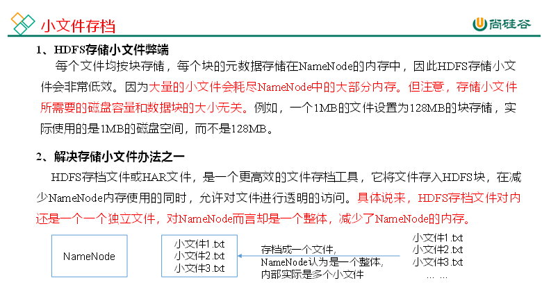

  

  

#### 回收站

开启回收站功能，可以将删除的文件在不超时的情况下，恢复原数据，起到防止误删除、备份等作用。

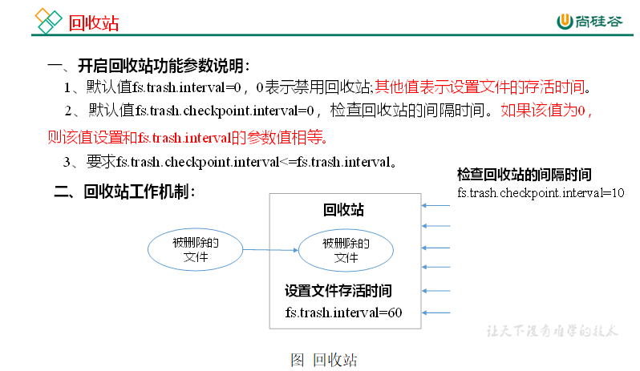

  

# HA高可用

#### HA(High Availabilty)概述

（1）所谓HA（High Availablity），即高可用（7 \* 24小时不中断服务）。

（2）实现高可用最关键的策略是消除单点故障。HA严格来说应该分成各个组件的HA机制：HDFS的HA和YARN的HA。

（3）NameNode主要在以下两个方面影响HDFS集群

Ø NameNode机器发生意外，如宕机，集群将无法使用，直到管理员重启。

Ø NameNode机器需要升级，包括软件、硬件升级，此时集群也将无法使用。

HDFS HA功能通过配置多个NameNodes(Active/Standby)实现在集群中对NameNode的热备来解决上述问题。如果出现故障，如机器崩溃或机器需要升级维护，这时可通过此种方式将NameNode很快的切换到另外一台机器。

#### HDFS-HA核心问题

**1****）怎么保证三台****namenode****的数据一致**

（1）Fsimage：让一台nn生成数据，让其他机器nn同步。

（2）Edits：需要引进新的模块JournalNode来保证edtis的文件的数据一致性。

**2）****怎么让同时只有一台****nn****是****active****，其他所有是****standby****的**

（1）手动分配

（2）自动分配

**3****）****2nn****在****ha****架构中并不存在，定期合并****fsimage****和****edtis****的活谁来干**

​由standby的nn来干。

**4****）如果****nn****真的发生了问题，怎么让其他的****nn****上位干活**

（1）手动故障转移

（2）自动故障转移

  

#### HDFS-HA 自动模式

自动故障转移为HDFS部署增加了两个新组件：ZooKeeper和ZKFailoverController（ZKFC）进程，如图所示。ZooKeeper是维护少量协调数据，通知客户端这些数据的改变和监视客户端故障的高可用服务。

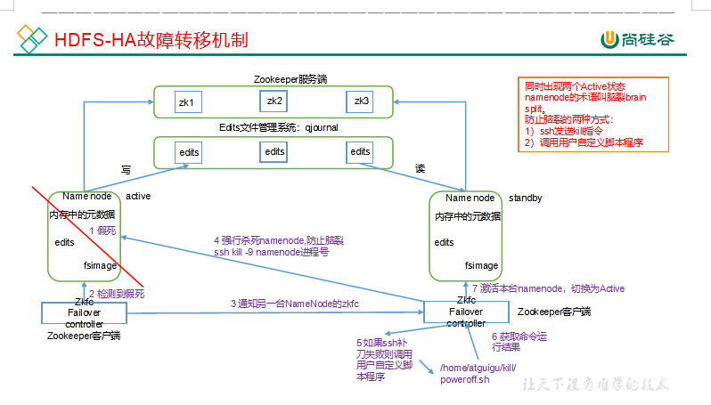

#### HDFS-HA自动故障转移

详见配置文件

#### 连接不上JournalNode的问题

**<!-- NN连接JN重试次数，默认是10次-->**

**<!-- 重试时间间隔，默认1s -->**

也可以在core-site.xml里面适当调大上面的两个参数：

  

Yarn-HA配置

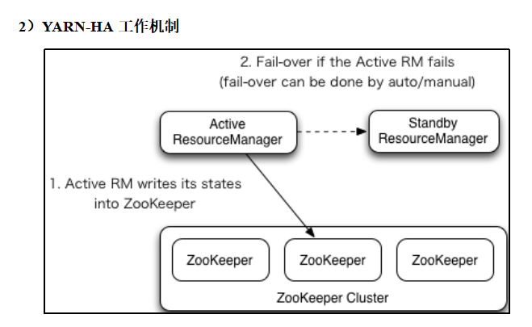

  

**2）****核心问题**

**（****1****）如果当前****active rm****挂了，其他****rm****怎么将其他****standby rm****上位**

核心原理跟HDFS一样，利用了zk的临时节点。

**（****2****）当前****rm****上有很多的计算程序在等待运行，其他的****rm****怎么将这些程序接手过来接着跑**

rm会将当前的所有计算程序的状态存储在zk中，其他rm上位后会去读取，然后接着跑。

​  

​  

​  

​  

​  

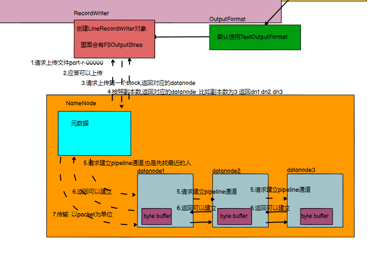