spark中间的结果不落盘,但是shuffle是要落盘的

# 知识点概述

基于内存,大数据分析计算引擎,有自己的资源调度框架,一般常用的是yarn,高速,兼容性,通用,

spark的组件丰富,spark SQL ,Spark Streaming,Mlib,Gragh X

Spark Core：实现了Spark的基本功能，包含任务调度、内存管理、错误恢复、与存储系统交互等模块。Spark Core中还包含了对弹性分布式数据集(Resilient Distributed DataSet，简称RDD)的API定义。

Spark SQL：是Spark用来操作结构化数据的程序包。通过Spark SQL，我们可以使用 SQL或者Apache Hive版本的HQL来查询数据。Spark SQL支持多种数据源，比如Hive表、Parquet以及JSON等。

Spark Streaming：是Spark提供的对实时数据进行流式计算的组件。提供了用来操作数据流的API，并且与Spark Core中的 RDD API高度对应。

Spark MLlib：提供常见的机器学习功能的程序库。包括分类、回归、聚类、协同过滤等，还提供了模型评估、数据导入等额外的支持功能。

Spark GraphX：主要用于图形并行计算和图挖掘系统的组件。

集群管理器：Spark设计为可以高效地在一个计算节点到数千个计算节点之间伸缩计算。为了实现这样的要求，同时获得最大灵活性，Spark支持在各种集群管理器（Cluster Manager）上运行，包括Hadoop YARN、Apache Mesos，以及Spark自带的一个简易调度器，叫作独立调度器。

# 运行模式

运行模式有:local,standalone,yarn,集群,mesos

Spark有yarn-client和yarn-cluster两种模式，主要区别在于：Driver程序的运行节点。

yarn-client：Driver程序运行在客户端，适用于交互、调试，希望立即看到app的输出。

yarn-cluster：Driver程序运行在由ResourceManager启动的APPMaster，适用于生产环境。

#### 端口号总结

1）Spark查看当前Spark-shell运行任务情况端口号：4040

2）Spark Master内部通信服务端口号：7077 （类比于yarn的**8032****(R****M****和****NM****的内部通信****)**端口）

3）Spark Standalone模式Master Web端口号：8080（类比于Hadoop YARN任务运行情况查看端口号：8088）

4）Spark历史服务器端口号：18080 （类比于Hadoop历史服务器端口号：19888）

# SrarkCore

  

### RDD概述

RDD（Resilient Distributed Dataset）叫做弹性分布式数据集，是Spark中最基本的数据抽象。

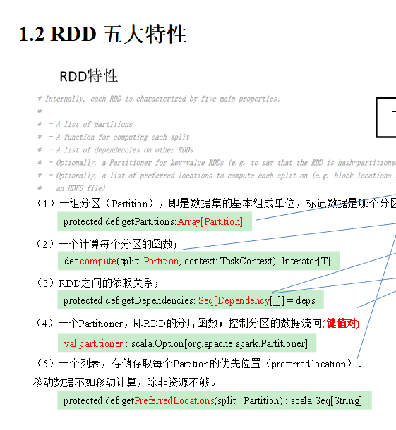

在Spark中创建RDD的创建方式可以分为三种：从集合中创建RDD、从外部存储创建RDD、从其他RDD创建。

注意：getSplits文件返回的是切片规划，真正读取是在compute方法中创建LineRecordReader读取的，有两个关键变量：start = split.getStart() end = start + split.getLength

1.分区数量的计算方式:

totalSize = 10

goalSize = 10 / 3 = 3(byte) 表示每个分区存储3字节的数据

分区数\= totalSize/ goalSize \= 10 /3 \=> 3,3,4

4子节大于3子节的1.1倍,符合hadoop切片1.1倍的策略,因此会多创建一个分区,即一共有4个分区 3,3,3,1

2. Spark读取文件，采用的是hadoop的方式读取，所以一行一行读取，跟字节数没有关系

3.数据读取位置计算是以偏移量为单位来进行计算的。

4.数据分区的偏移量范围的计算

0 \=> [0,3] 1@@ 012 0 \=> 1,2

1 \=> [3,6] 2@@ 345 1 \=> 3

2 \=> [6,9] 3@@ 678 2 \=> 4

3 => [9,9] 4 9 3 => 无

  

### RDD编程

#### Transformation转化算子

RDD整体上分为Value类型、双Value类型和Key-Value类型

value类型

map,mappartition,mappartitionwithIndex(),flatmap(),groupby,sortby,filter,distinct,coalesce,reparttion

双Vaule类型

zip(),substract(),union().intersection()

key\_value类型

partitionby(),rducebykey(),foldbykey(),aggregateByKey(),combineByKey(),sortbykey(),cogroup(),join()

#### Action行动算子

collection,first,foreach,count,take,takeordered,countbykey,save

#### RDD序列化

在实际开发中我们往往需要自己定义一些对于RDD的操作，那么此时需要注意的是，初始化工作是在Driver端进行的，而实际运行程序是在Executor端进行的，这就涉及到了跨进程通信，是需要序列化的。

Driver：算子以外的代码都是在Driver端执行

Executor：算子里面的代码都是在Executor端执行

kryo序列化

Java的序列化能够序列化任何的类。但是比较重，序列化后对象的体积也比较大。

Spark出于性能的考虑，Spark2.0开始支持另外一种Kryo序列化机制。Kryo速度是Serializable的10倍。当RDD在Shuffle数据的时候，简单数据类型、数组和字符串类型已经在Spark内部使用Kryo来序列化。

#### RDD依赖关系

RDD只支持粗粒度转换，即在大量记录上执行的单个操作。将创建RDD的一系列Lineage（血统）记录下来，以便恢复丢失的分区。RDD的Lineage会记录RDD的元数据信息和转换行为，当该RDD的部分分区数据丢失时，它可以根据这些信息来重新运算和恢复丢失的数据分区。

#### ​  

注意：要想理解RDDS是如何工作的，最重要的就是理解Transformations。

RDD之间的关系可以从两个维度来理解：一个是RDD是从哪些RDD转换而来，也就是 RDD的parent RDD(s)是什么(**血缘**); 另一个就是RDD依赖于parent RDD(s)的哪些Partition(s)，这种关系就是RDD之间的依赖(**依赖**)。

窄依赖表示每一个父RDD的Partition最多被子RDD的一个Partition使用(一对一or多对一)，窄依赖我们形象的比喻为独生子女。

宽依赖表示同一个父RDD的Partition被多个子RDD的Partition依赖(只能是一对多)，会引起Shuffle，总结：宽依赖我们形象的比喻为超生

​  

具有宽依赖的*transformations*包括：*sort*、*reduceByKey*、*groupByKey*、*join*和调用*rePartition*函数的任何操作。

宽依赖对Spark去评估一个transformations有更加重要的影响，比如对性能的影响。

在不影响业务要求的情况下，要尽量避免使用有宽依赖的转换算子，因为有宽依赖,就一定会走shuffle，影响性能

​  

DAG有向无环图

DAG（Directed Acyclic Graph）有向无环图是由点和线组成的拓扑图形，该图形具有方向，不会闭环。例如，DAG记录了RDD的转换过程和任务的阶段。

​  

#### 任务划分

RDD任务切分中间分为：Application、Job、Stage和Task

（1）Application：初始化一个SparkContext即生成一个Application；

（2）Job：一个Action算子就会生成一个Job；

（3）Stage：Stage等于宽依赖的个数加1；

（4）Task：一个Stage阶段中，最后一个RDD的分区个数就是Task的个数。

注意：Application->Job->Stage->Task每一层都是1对n的关系。

​  

#### RDD持久化

RDD通过Cache或者Persist方法将前面的计算结果缓存，默认情况下会把数据以序列化的形式缓存在JVM的堆内存中。但是并不是这两个方法被调用时立即缓存，而是触发后面的action算子时，该RDD将会被缓存在计算节点的内存中，并供后面重用。

缓存有可能丢失，或者存储于内存的数据由于内存不足而被删除，RDD的缓存容错机制保证了即使缓存丢失也能保证计算的正确执行。通过基于RDD的一系列转换，丢失的数据会被重算，由于RDD的各个Partition是相对独立的，因此只需要计算丢失的部分即可，并不需要重算全部Partition。

3）自带缓存算子

Spark会自动对一些Shuffle操作的中间数据做持久化操作（比如：reduceByKey）。这样做的目的是为了当一个节点Shuffle失败了避免重新计算整个输入。但是，在实际使用的时候，如果想重用数据，仍然建议调用persist或cache。

​  

chectpoint检查点

检查点：是通过将RDD中间结果写入磁盘。

2）为什么要做检查点？

由于血缘依赖过长会造成容错成本过高，这样就不如在中间阶段做检查点容错，如果检查点之后有节点出现问题，可以从检查点开始重做血缘，减少了开销。

3）检查点存储路径：Checkpoint的数据通常是存储在HDFS等容错、高可用的文件系统

4）检查点数据存储格式为：二进制的文件

5）检查点切断血缘：在Checkpoint的过程中，该RDD的所有依赖于父RDD中的信息将全部被移除。

6）检查点触发时间：对RDD进行Checkpoint操作并不会马上被执行，必须执行Action操作才能触发。但是检查点为了数据安全，会从血缘关系的最开始执行一遍。

对RDD进行checkpoint操作并不会马上被执行,需等到Action操作才能被触发

​  

​  

### **缓存和检查点区别**

1）Cache缓存只是将数据保存起来，不切断血缘依赖。Checkpoint检查点切断血缘依赖。

2）Cache缓存的数据通常存储在磁盘、内存等地方，可靠性低。Checkpoint的数据通常存储在HDFS等容错、高可用的文件系统，可靠性高。

3）建议对checkpoint()的RDD使用Cache缓存，这样checkpoint的job只需从Cache缓存中读取数据即可，否则需要再从头计算一次RDD。

4）如果使用完了缓存，可以通过unpersist()方法释放缓存

​  

​  

#### 键值对RDD分区

Spark目前支持Hash分区、Range分区和用户自定义分区。Hash分区为当前的默认分区。分区器直接决定了RDD中分区的个数、RDD中每条数据经过Shuffle后进入哪个分区和Reduce的个数。

1）注意：

（1）只有Key-Value类型的RDD才有分区器，非Key-Value类型的RDD分区的值是None

（2）每个RDD的分区ID范围：0~numPartitions-1，决定这个值是属于那个分区的。

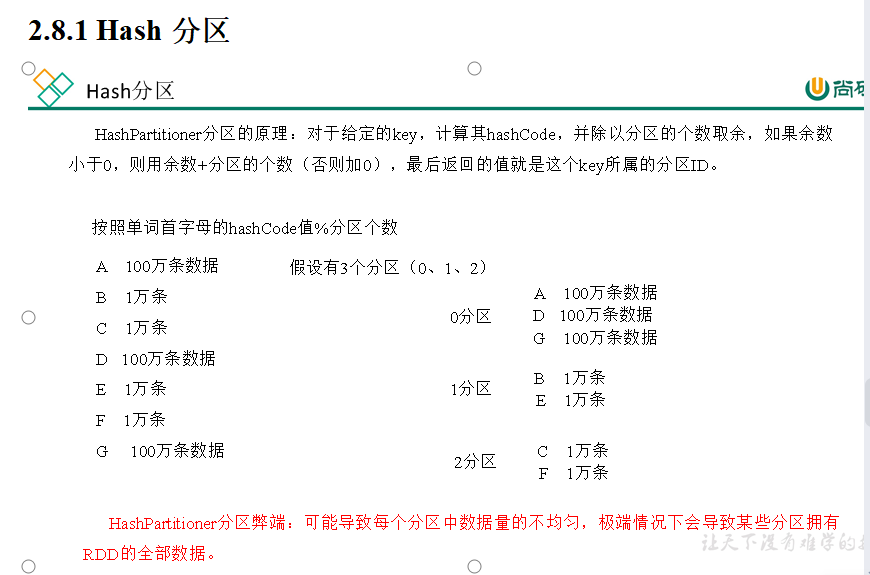

​  

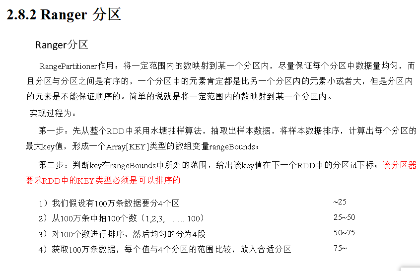

  

  

### 数据的读取与保存

Spark的数据读取及数据保存可以从两个维度来作区分：文件格式以及文件系统。

文件格式分为：Text文件、Sequence文件以及Object文件；

文件系统分为：本地文件系统、HDFS以及数据库。

### **Text****文件**

1）基本语法

（1）数据读取：textFile(String)

（2）数据保存：saveAsTextFile(String)

SequenceFile文件是Hadoop用来存储二进制形式的key-value对而设计的一种平面文件(Flat File)。在SparkContext中，可以调用sequenceFile\[keyClass, valueClass\](path)。

object对象文件

对象文件是将对象序列化后保存的文件，采用hadoop的序列化机制。可以通过objectFile\[k,v\](path)函数接收一个路径，读取对象文件，返回对应的RDD，也可以通过调用saveAsObjectFile()实现对对象文件的输出。因为要序列化所以要指定类型。

​  

Spark的整个生态系统与Hadoop是完全兼容的，所以对于Hadoop所支持的文件类型或者数据库类型，Spark也同样支持。另外，由于Hadoop的API有新旧两个版本，所以Spark为了能够兼容Hadoop所有的版本，也提供了两套创建操作接口。如TextInputFormat，新旧两个版本所引用分别是org.apache.hadoop.mapred.InputFormat、org.apache.hadoop.mapreduce.InputFormat(NewInputFormat)

​  

### 累加器

累加器：分布式共享只写变量。（Executor和Executor之间不能读数据）

累加器用来把Executor端变量信息聚合到Driver端。在Driver中定义的一个变量，在Executor端的每个task都会得到这个变量的一份新的副本，每个task更新这些副本的值后，传回Driver端进行合并计算。

1）累加器使用

（1）累加器定义（SparkContext.accumulator(initialValue)方法）

val sum: LongAccumulator = sc.longAccumulator("sum")

（2）累加器添加数据（累加器.add方法）

sum.add(count)

（3）累加器获取数据（累加器.value）

注意：Executor端的任务不能读取累加器的值（例如：在Executor端调用sum.value，获取的值不是累加器最终的值）。因此我们说，累加器是一个分布式共享只写变量。

3）累加器要放在行动算子中

因为转换算子执行的次数取决于job的数量，如果一个spark应用有多个行动算子，那么转换算子中的累加器可能会发生不止一次更新，导致结果错误。所以，如果想要一个无论在失败还是重复计算时都绝对可靠的累加器，我们必须把它放在foreach()这样的行动算子中。

对于在行动算子中使用的累加器，Spark只会把每个Job对各累加器的修改应用一次。

​  

可选择自定义累加器

自定义累加器步骤

（1）继承AccumulatorV2，设定输入、输出泛型

（2）重写6个抽象方法

（3）使用自定义累加器需要注册:：sc.register(累加器,"累加器名字")

​  

### 广播变量

广播变量：分布式共享只读变量。

广播变量用来高效分发较大的对象。向所有工作节点发送一个较大的只读值，以供一个或多个Spark Task操作使用。比如，如果你的应用需要向所有节点发送一个较大的只读查询表，广播变量用起来会很顺手。在多个Task并行操作中使用同一个变量，但是Spark会为每个Task任务分别发送。

1）使用广播变量步骤：

（1）调用SparkContext.broadcast（广播变量）创建出一个广播对象，任何可序列化的类型都可以这么实现。

（2）通过广播变量.value，访问该对象的值。

（3）广播变量只会被发到各个节点一次，作为只读值处理（修改这个值不会影响到别的节点）。

​  

### SparkCore实战

使用spark实现的四种方案

  

# SparkSQL

## 概述

spark SQL 是用于处理结构化数据的saprk模块

Hive on spark(HQL语法,存储和优化都是Hive,仅换了执行引擎)与spark on hive的区别

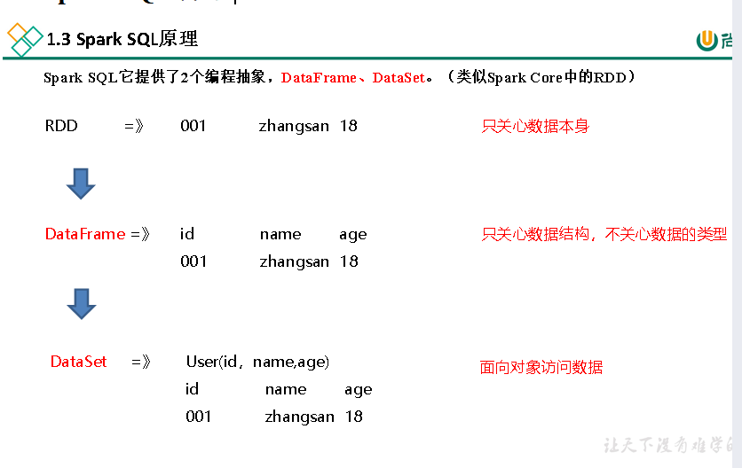

  

1）DataFrame是一种类似RDD的分布式数据集，类似于传统数据库中的二维表格。

2）DataFrame与RDD的主要区别在于，DataFrame带有schema元信息，即DataFrame所表示的二维表数据集的每一列都带有名称和类型。

3）Spark SQL性能上比RDD要高。因为Spark SQL了解数据内部结构，从而对藏于DataFrame背后的数据源以及作用于DataFrame之上的变换进行了针对性的优化，最终达到大幅提升运行时效率的目标。反观RDD，由于无从得知所存数据元素的具体内部结构，Spark Core只能在Stage层面进行简单、通用的流水线优化。

​  

DataSet是分布式数据集。

Ø DataSet是强类型的。比如可以有DataSet[Car]，DataSet[User]。具有类型安全检查

**DataFrame是DataSet的特例**，type DataFrame = DataSet[Row] ，Row是一个类型，跟Car、User这些的类型一样，所有的表结构信息都用Row来表示。

如果同样的数据都给到这三个数据结构，他们分别计算之后，都会给出相同的结果。不同的是他们的执行效率和执行方式。在后期的Spark版本中，DataSet有可能会逐步取代RDD和DataFrame成为唯一的API接口。

​  

2）三者的共性

（1）RDD、DataFrame、DataSet全都是Spark平台下的分布式弹性数据集，为处理超大型数据提供便利

（2）三者都有惰性机制，在进行创建、转换，如map方法时，不会立即执行，只有在遇到Action行动算子如foreach时，三者才会开始遍历运算

（3）三者有许多共同的函数，如filter，排序等

（4）三者都会根据Spark的内存情况自动缓存运算

（5）三者都有分区的概念

​  

易整合

无缝的整合了SQL查询和Spark编程。

统一的数据访问方式

使用相同的方式连接不同的数据源。

兼容Hive

在已有的仓库上直接运行SQL或者HQL。

标准的数据连接

通过JDBC或者ODBC来连接

  

## 编程

在老的版本中，SparkSQL提供两种SQL查询起始点：

Ø 一个叫SQLContext，用于Spark自己提供的SQL查询；

Ø 一个叫HiveContext，用于连接Hive的查询。

SparkSession是Spark最新的SQL查询起始点，实质上是SQLContext和HiveContext的组合，所以在SQLContext和HiveContext上可用的API在SparkSession上同样是可以使用的。

SparkSession内部封装了SparkContext，所以计算实际上是由SparkContext完成的。当我们使用spark-shell的时候，Spark框架会自动的创建一个名称叫做Spark的SparkSession，就像我们以前可以自动获取到一个sc来表示SparkContext

​  

#### DataFrame

DataFrame是一种类似于RDD的分布式数据集，类似于传统数据库中的二维表格。

在Spark SQL中SparkSession是创建DataFrame和执行SQL的入口，创建DataFrame有三种方式：

Ø 通过Spark的数据源进行创建；

Ø 从一个存在的RDD进naj行转换；

Ø 还可以从Hive Table进行查询返回。

注意：如果从内存中获取数据，Spark可以知道数据类型具体是什么，如果是数字，默认作为Int处理；但是从文件中读取的数字，不能确定是什么类型，所以用BigInt接收，可以和Long类型转换，但是和Int不能进行转换。

​  

SQL语法风格是指我们查询数据的时候使用SQL语句来查询，这种风格的查询必须要有临时视图或者全局视图来辅助。

视图：对特定表的数据的查询结果重复使用。View只能查询，不能修改和插入。

​  

#### DataSet

DataSet是具有强类型的数据集合，需要提供对应的类型信息

注意：在实际开发的时候，很少会把序列转换成DataSet，更多是通过RDD和DataFrame转换来得到DataSet

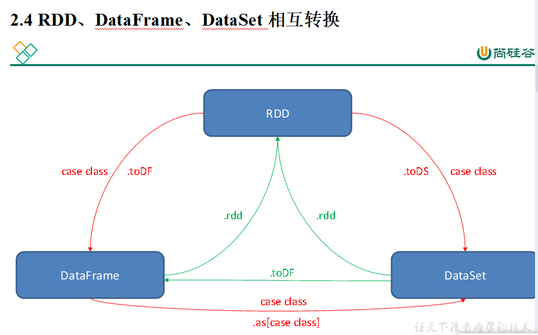

  

  

#### RDD与DataFrame相互转换

1）RDD转换为DataFrame

Ø 手动转换：RDD.toDF(“列名1”, “列名2”)

Ø 通过样例类反射转换：UserRDD.map{ x=>User(x.\_1,x.\_2) }.toDF()

2）DataFrame转换为RDD

DataFrame.rdd

#### RDD与DataSet相互转换

1）RDD转换为DataSet

RDD.map { x => User(x.\_1, x.\_2) }.toDS()

SparkSQL能够自动将包含有样例类的RDD转换成DataSet，样例类定义了table的结构，样例类属性通过反射变成了表的列名。样例类可以包含诸如Seq或者Array等复杂的结构。

2）DataSet转换为RDD

DS.rdd

  

#### DataFrame与DataSet相互转换

1）DataFrame转为DataSet

df.as[User]

2）Dataset转为DataFrame

ds.toDF

​  

#### 用户自定义函数

UDF：一行进入，一行出

UDAF:

UDTF:

​  

#### SparkSQL的加载与保存

#### 加载数据

1）加载数据通用方法

spark.read.load是加载数据的通用方法

保存数据通用方法

df.write.save是保存数据的通用方法

​  

​  

SparkSQL可以采用内嵌Hive，也可以采用外部Hive。企业开发中，通常采用外部Hive。

​  

​  

​  

# SparkSreaming

​  

## 概述

SparkSreaming用于流式数据的处理,支持多数据输入源,例如;kafka,Flume,Hdfs

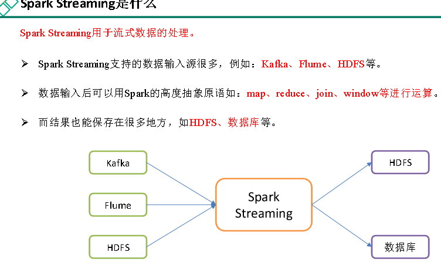

  

#### 架构原理

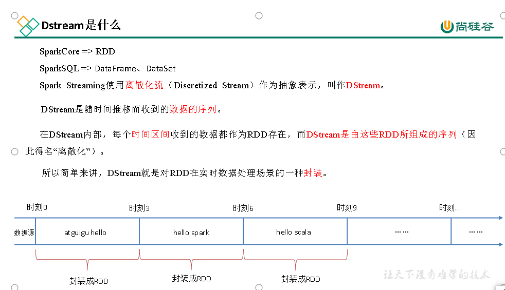

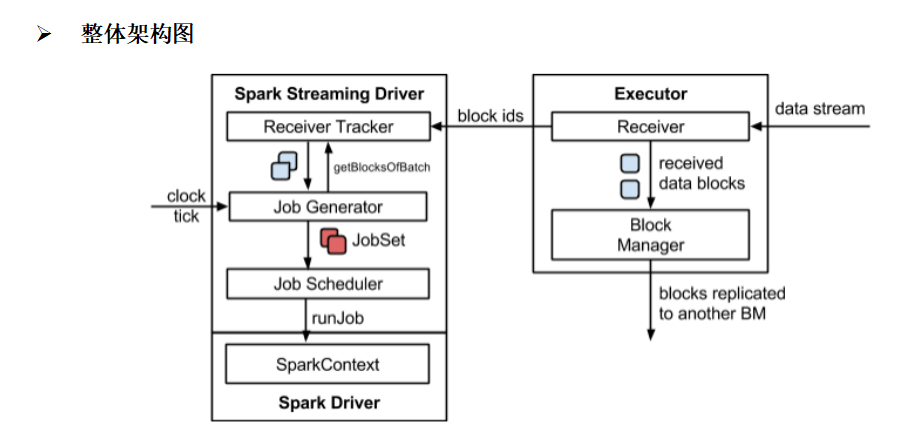

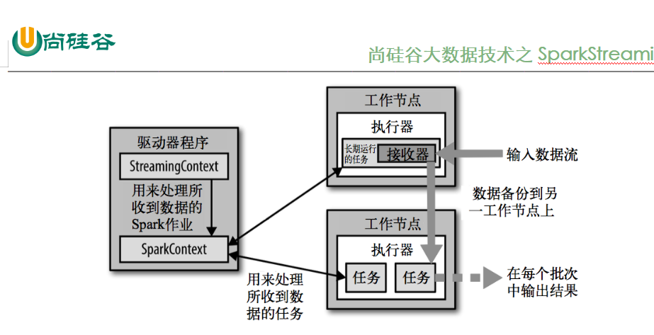

  

背压机制

Spark 1.5以前版本，用户如果要限制Receiver的数据接收速率，可以通过设置静态配制参数“spark.streaming.receiver.maxRate”的值来实现，此举虽然可以通过限制接收速率，来适配当前的处理能力，防止内存溢出，但也会引入其它问题。比如：producer数据生产高于maxRate，当前集群处理能力也高于maxRate，这就会造成资源利用率下降等问题。

为了更好的协调数据接收速率与资源处理能力，1.5版本开始Spark Streaming可以动态控制数据接收速率来适配集群数据处理能力。背压机制（即Spark Streaming Backpressure）：根据JobScheduler反馈作业的执行信息来动态调整Receiver数据接收率。

通过属性“spark.streaming.backpressure.enabled”来控制是否启用背压机制，默认值false，即不启用。

  

DStream是Spark Streaming的基础抽象，代表持续性的数据流和经过各种Spark算子操作后的结果数据流。

在内部实现上，每一批次的数据封装成一个RDD，一系列连续的RDD组成了DStream。对这些RDD的转换是由Spark引擎来计算。

说明：DStream中批次与批次之间计算相互独立。如果批次设置时间小于计算时间会出现计算任务叠加情况，需要多分配资源。通常情况，批次设置时间要大于计算时

## 使用

自定义数据源接收器

需要继承Receiver，并实现onStart、onStop方法来自定义数据源采集。

Kafka数据源

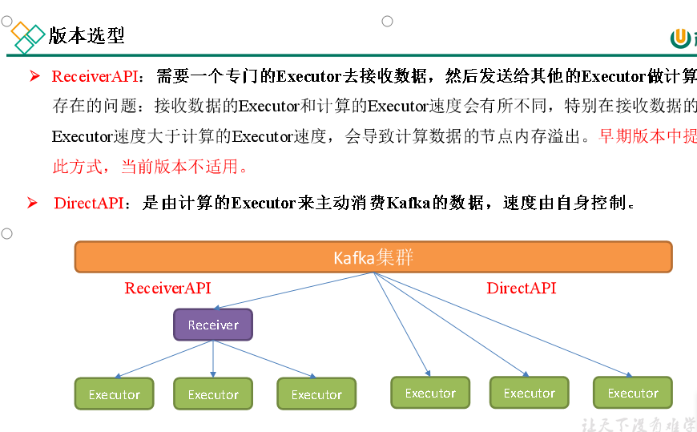

​  

​  

## DStream转换

DStream上的操作与RDD的类似，分为转换和输出两种，此外转换操作中还有一些比较特殊的原语，如：updateStateByKey()、transform()以及各种Window相关的原语。

​  

无状态转化操作

无状态转化操作：就是把RDD转化操作应用到DStream每个批次上，每个批次相互独立，自己算自己的。

常规无状态转化操作

DStream的部分无状态转化操作列在了下表中，都是DStream自己的API。

注意，针对键值对的DStream转化操作，要添加import StreamingContext.\_才能在Scala中使用，比如reduceByKey()。

需要记住的是，尽管这些函数看起来像作用在整个流上一样，但事实上每个DStream在内部是由许多RDD批次组成，且无状态转化操作是分别应用到每个RDD(一个批次的数据)上的。

​  

  

​  

  

Window Operations可以设置窗口的大小和滑动窗口的间隔来动态的获取当前Streaming的允许状态。所有基于窗口的操作都需要两个参数，分别为窗口时长以及滑动步长。

Ø 窗口时长：计算内容的时间范围；

Ø 滑动步长：隔多久触发一次计算。

注意：这两者都必须为采集批次大小的整数倍。

​  

​  

reduceByKeyAndWindow（反向Reduce）

1）基本语法：

Ø reduceByKeyAndWindow(func, invFunc, windowLength, slideInterval, [numTasks]): 这个函数是上述函数的变化版本，每个窗口的reduce值都是通过用前一个窗的reduce值来递增计算。通过reduce进入到滑动窗口数据并“反向reduce”离开窗口的旧数据来实现这个操作。一个例子是随着窗口滑动对keys的“加”“减”计数。通过前边介绍可以想到，这个函数只适用于“可逆的reduce函数”，也就是这些reduce函数有相应的“反reduce”函数（以参数invFunc形式传入）。如前述函数，reduce任务的数量通过可选参数来配置。

​  

window的其它操作

（1）countByWindow(windowLength, slideInterval): 返回一个滑动窗口计数流中的元素个数；

（2）reduceByWindow(func, windowLength, slideInterval): 通过使用自定义函数整合滑动区间流元素来创建一个新的离散化数据流；

​  

​  

## DStream输出

DStream通常将数据输出到，外部数据库或屏幕上。

DStream与RDD中的惰性求值类似，如果一个DStream及其派生出的DStream都没有被执行输出操作，那么这些DStream就都不会被求值。如果StreamingContext中没有设定输出操作，整个Context就都不会启动。

1）输出操作API如下：

Ø saveAsTextFiles(prefix, [suffix])：以text文件形式存储这个DStream的内容。每一批次的存储文件名基于参数中的prefix和suffix。“prefix-Time\_IN\_MS[.suffix]”。

Ø saveAsObjectFiles(prefix, [suffix])：以Java对象序列化的方式将DStream中的数据保存为 SequenceFiles 。每一批次的存储文件名基于参数中的为"prefix-TIME\_IN\_MS[.suffix]"。

Ø saveAsHadoopFiles(prefix, [suffix])：将Stream中的数据保存为 Hadoop files。每一批次的存储文件名基于参数中的为"prefix-TIME\_IN\_MS[.suffix]"。

注意：以上操作都是每一批次写出一次，会产生大量小文件，在生产环境，很少使用。

Ø print()：在运行流程序的驱动结点上打印DStream中每一批次数据的最开始10个元素。这用于开发和调试。

Ø foreachRDD(func)：这是最通用的输出操作，即将函数func用于产生DStream的每一个RDD。其中参数传入的函数func应该实现将每一个RDD中数据推送到外部系统，如将RDD存入文件或者写入数据库。

在企业开发中通常采用foreachRDD()，它用来对DStream中的RDD进行任意计算。这和transform()有些类似，都可以让我们访问任意RDD。在foreachRDD()中，可以重用我们在Spark中实现的所有行动操作(action算子)。比如，常见的用例之一是把数据写到如MySQL的外部数据库中。

在企业开发中通常采用foreachRDD()，它用来对DStream中的RDD进行任意计算。这和transform()有些类似，都可以让我们访问任意RDD。在foreachRDD()中，可以重用我们在Spark中实现的所有行动操作(action算子)。比如，常见的用例之一是把数据写到如MySQL的外部数据库中。

​  

（1）连接不能写在Driver层面（序列化）

（2）如果写在foreach则每个RDD中的每一条数据都创建，得不偿失；

（3）增加foreachPartition，在分区创建（获取）。

#### 关闭方式

流式任务需要7\*24小时执行，但是有时涉及到升级代码需要主动停止程序，但是分布式程序，没办法做到一个个进程去杀死，所以配置优雅的关闭就显得至关重要了。

关闭方式：使用外部文件系统来控制内部程序关闭。

​  

​  

# Spark内核源码

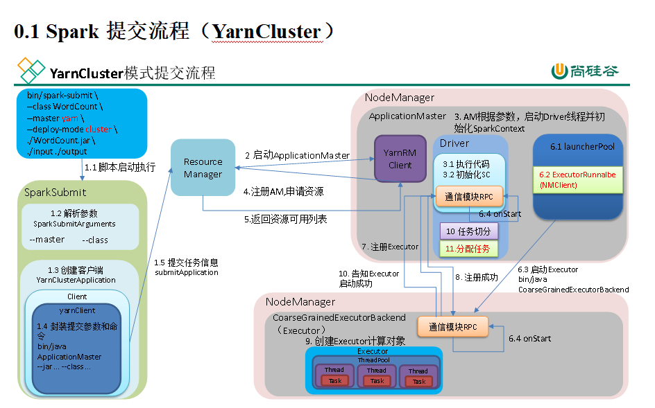

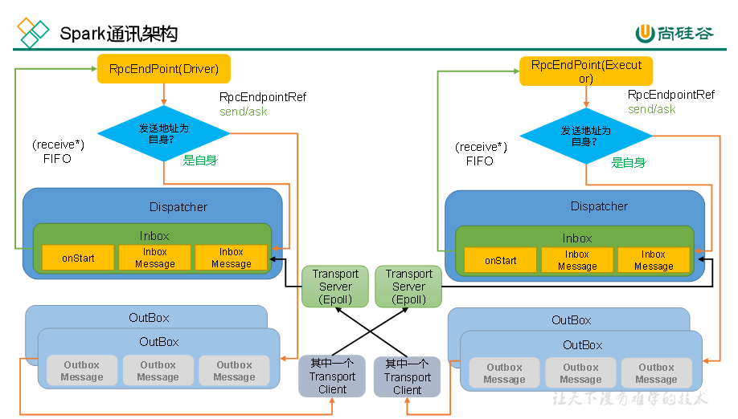

  

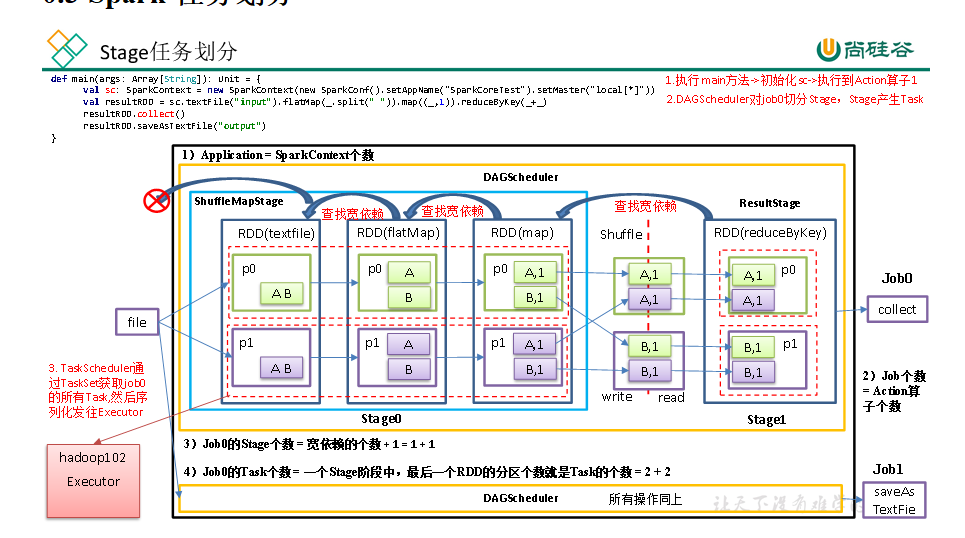

  

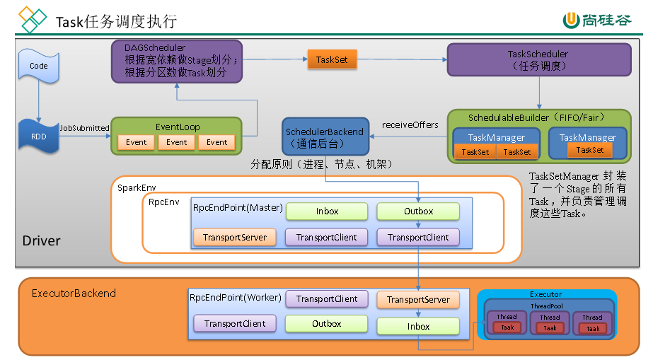

  

Shuffle的优化

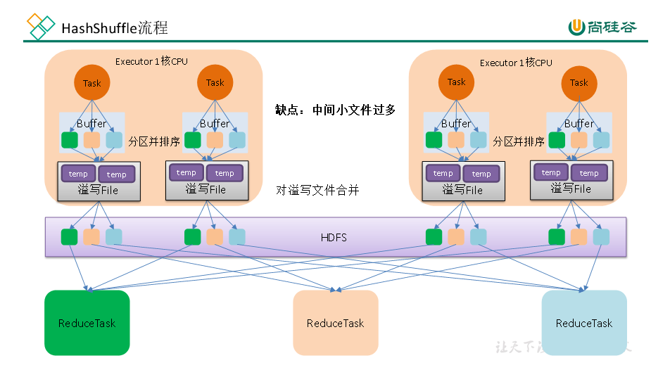

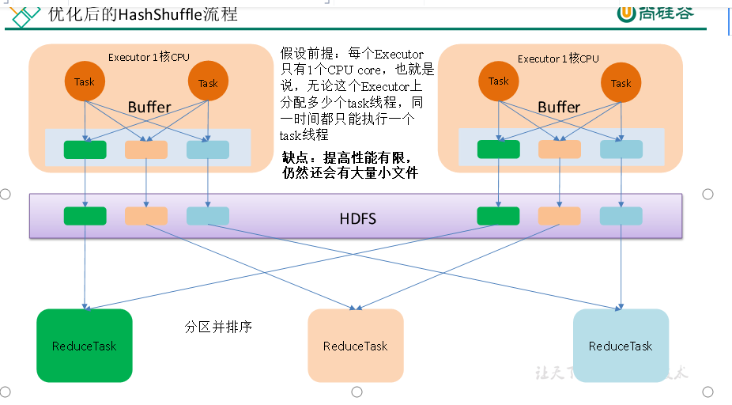

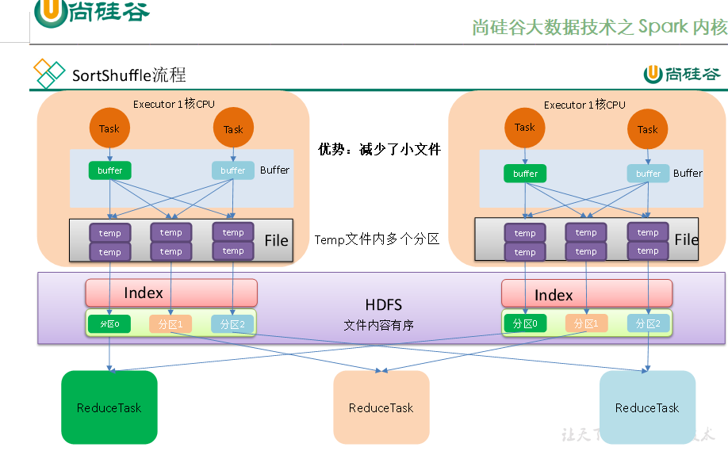

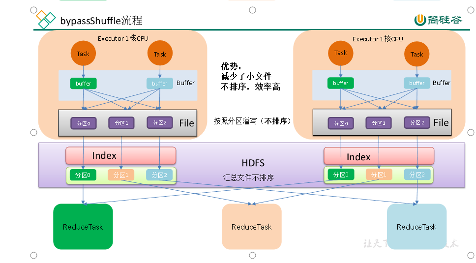

​  

Spark支持堆内内存也支持堆外内存

1）堆内内存：程序在运行时动态地申请某个大小的内存空间

2）堆外内存：直接向操作系统进行申请的内存，不受JVM控制

#### 堆内内存和对外内存优缺点

1）**堆外内存，相比于堆内内存有几个优势：**

（1）减少了垃圾回收的工作，因为垃圾回收会暂停其他的工作

（2）加快了复制的速度。因为堆内在Flush到远程时，会先序列化，然后在发送；而堆外内存本身是序列化的相当于省略掉了这个工作。

**说明：**堆外内存是序列化的，其占用的内存大小可直接计算。堆内内存是非序列化的对象，其占用的内存是通过周期性地采样近似估算而得，即并不是每次新增的数据项都会计算一次占用的内存大小，这种方法降低了时间开销但是有可能误差较大，导致某一时刻的实际内存有可能远远超出预期。此外，在被Spark标记为释放的对象实例，很有可能在实际上并没有被JVM回收，导致实际可用的内存小于Spark记录的可用内存。所以 Spark并不能准确记录实际可用的堆内内存，从而也就无法完全避免内存溢出OOM的异常。

**2****）堆外内存，相比于堆内内存有几个缺点：**

（1）堆外内存难以控制，如果内存泄漏，那么很难排查

（2）堆外内存相对来说，不适合存储很复杂的对象。一般简单的对象或者扁平化的比较适合。

  

堆内内存包括：**存储（Storage）内存**、**执行（Execution）内存**、**其他内存**

  

在**Spark最初采用的静态内存管理机制**下，存储内存、执行内存和其他内存的大小在Spark应用程序运行期间均为固定的，但用户可以应用程序启动前进行配置，堆内内存的分配如图所示：

​  

​  

​  

(Spark内核源码没有看完,放弃了)