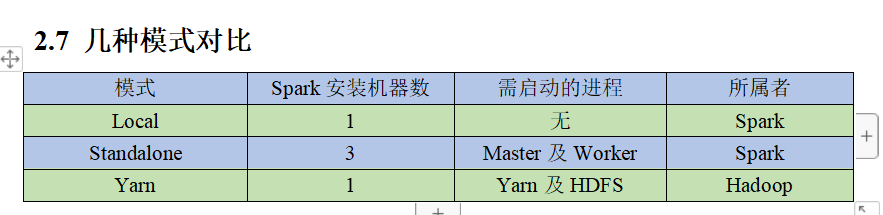
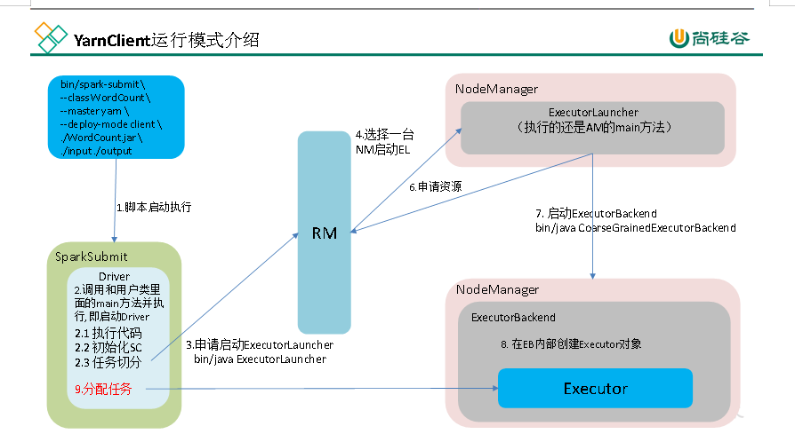
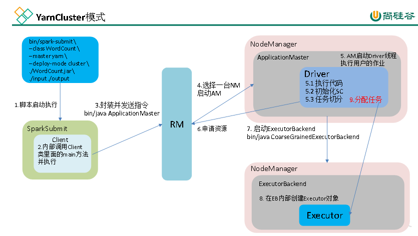

# Spark

> [!note] 拆分说明
> 原 Spark.md 为 27KB 总集(概述/Core/SQL/Streaming/内核源码全收),2026-09-06 照 Flink/Hadoop 模式转为索引:Core 章拆为 [[SparkCore]],内核源码-内存管理章拆为 [[Spark内核源码-内存管理]],SQL/Streaming 章与既有子篇重复部分删除、独有行回填子篇。概述与运行模式保留如下。

## 概述与运行模式

# 知识点概述

基于内存,大数据分析计算引擎,有自己的资源调度框架,一般常用的是yarn,高速,兼容性,通用,

spark的组件丰富,spark SQL ,Spark Streaming,Mlib,Gragh X

Spark Core：实现了Spark的基本功能，包含任务调度、内存管理、错误恢复、与存储系统交互等模块。Spark Core中还包含了对弹性分布式数据集(Resilient Distributed DataSet，简称RDD)的API定义。

Spark SQL：是Spark用来操作结构化数据的程序包。通过Spark SQL，我们可以使用 SQL或者Apache Hive版本的HQL来查询数据。Spark SQL支持多种数据源，比如Hive表、Parquet以及JSON等。

Spark Streaming：是Spark提供的对实时数据进行流式计算的组件。提供了用来操作数据流的API，并且与Spark Core中的 RDD API高度对应。

Spark MLlib：提供常见的机器学习功能的程序库。包括分类、回归、聚类、协同过滤等，还提供了模型评估、数据导入等额外的支持功能。

Spark GraphX：主要用于图形并行计算和图挖掘系统的组件。

集群管理器：Spark设计为可以高效地在一个计算节点到数千个计算节点之间伸缩计算。为了实现这样的要求，同时获得最大灵活性，Spark支持在各种集群管理器（Cluster Manager）上运行，包括Hadoop YARN、Apache Mesos，以及Spark自带的一个简易调度器，叫作独立调度器。

# 运行模式

运行模式有:local,standalone,yarn,集群,mesos

Spark有yarn-client和yarn-cluster两种模式，主要区别在于：Driver程序的运行节点。

yarn-client：Driver程序运行在客户端，适用于交互、调试，希望立即看到app的输出。

yarn-cluster：Driver程序运行在由ResourceManager启动的APPMaster，适用于生产环境。

#### 端口号总结

1）Spark查看当前Spark-shell运行任务情况端口号：4040

2）Spark Master内部通信服务端口号：7077 （类比于yarn的**8032** **(R** **M** **和** **NM** **的内部通信** **)**端口）

3）Spark Standalone模式Master Web端口号：8080（类比于Hadoop YARN任务运行情况查看端口号：8088）

4）Spark历史服务器端口号：18080 （类比于Hadoop历史服务器端口号：19888）

## 子篇索引

- [[SparkCore]] — RDD 概述/编程/持久化/累加器/广播变量/实战
- [[SparkSQL]] — DataFrame/DataSet/UDF/加载保存
- [[SparkStreaming]] — DStream/背压/输出
- [[Spark数据倾斜]] — 倾斜表现/定位/六方案
- [[SparkCore源码解析]] — 提交流程/任务划分/黑名单机制
- [[Spark内核源码-内存管理]] — 堆内外内存(与 SparkCore源码解析 互补)
