#### YarnCluster的提交流程

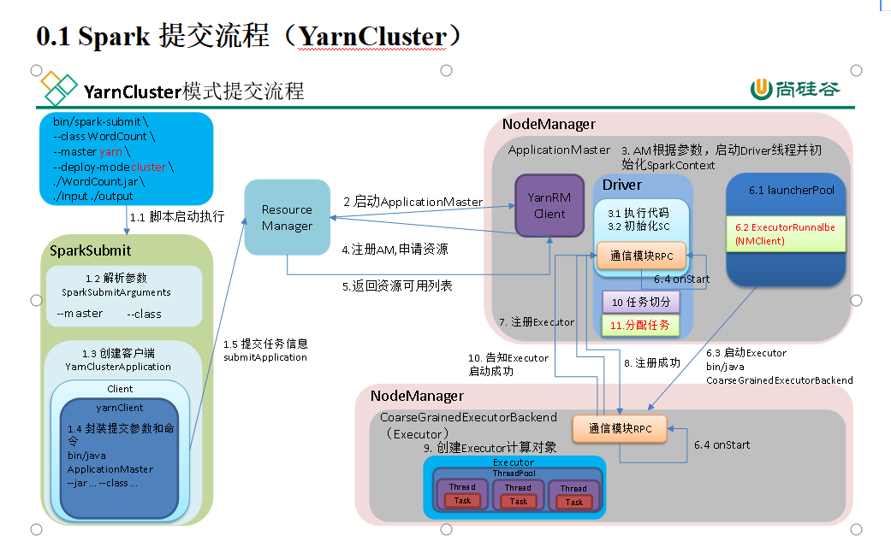

#### spark内部通讯架构

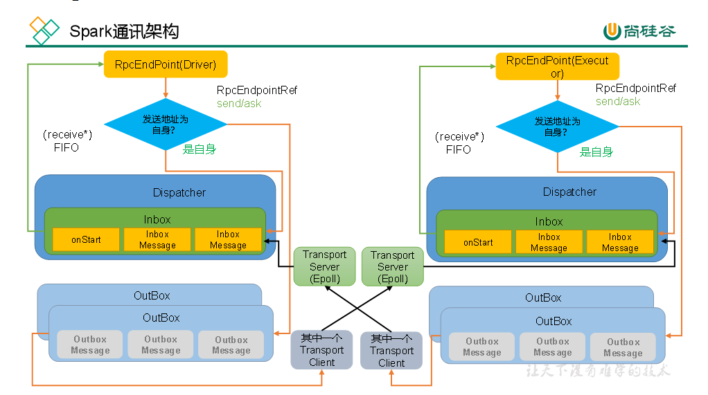

### 任务划分

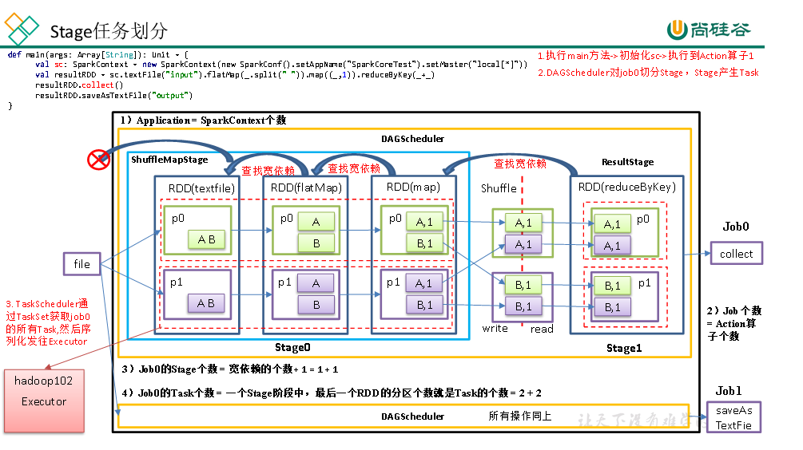

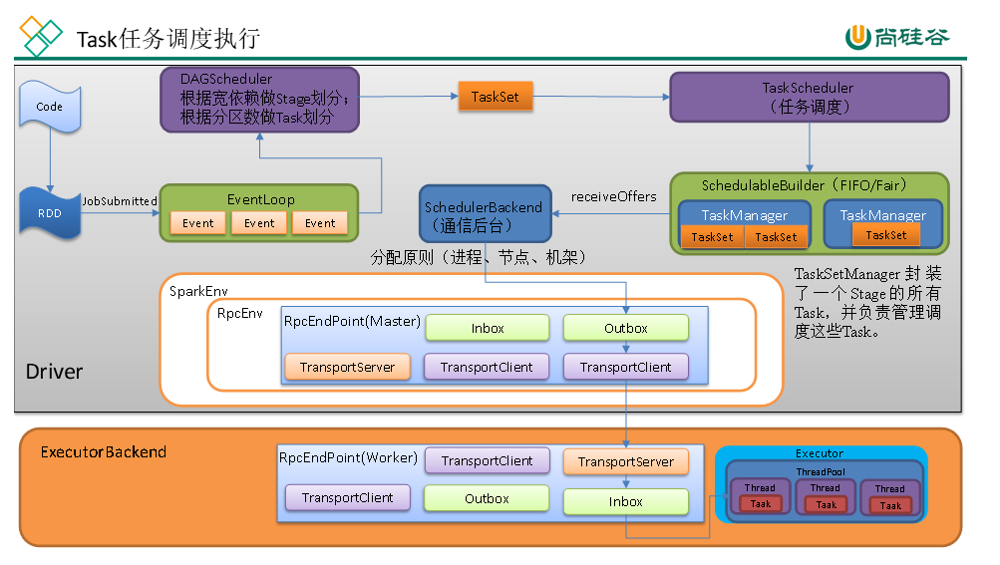

任务分配原则：根据每个Task的优先位置，确定Task的Locality（本地化）级别，本地化一共有五种，优先级由高到低顺序：

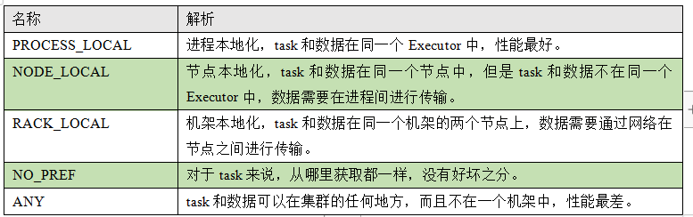

#### 失败重试与黑名单机制

除了选择合适的Task调度运行外，还需要监控Task的执行状态，前面也提到，与外部打交道的是SchedulerBackend，Task被提交到Executor启动执行后，Executor会将执行状态上报给SchedulerBackend，SchedulerBackend则告诉TaskScheduler，TaskScheduler找到该Task对应的TaskSetManager，并通知到该TaskSetManager，这样TaskSetManager就知道Task的失败与成功状态，对于失败的Task，会记录它失败的次数，如果失败次数还没有超过最大重试次数，那么就把它放回待调度的Task池子中，否则整个Application失败。

在记录Task失败次数过程中，会记录它上一次失败所在的Executor Id和Host，这样下次再调度这个Task时，会使用黑名单机制，避免它被调度到上一次失败的节点上，起到一定的容错作用。黑名单记录Task上一次失败所在的Executor Id和Host，以及其对应的“拉黑”时间，“拉黑”时间是指这段时间内不要再往这个节点上调度这个Task了。

  

  

#### shuffle

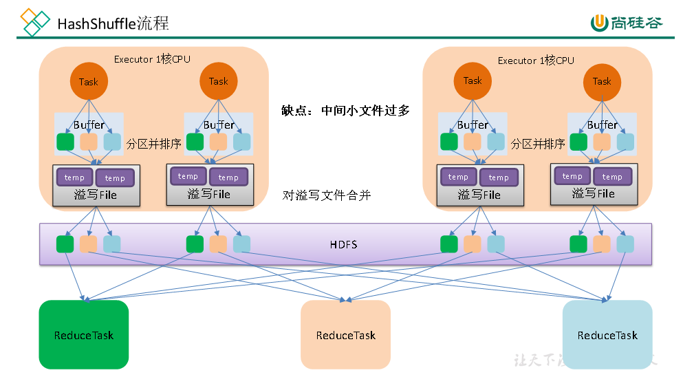

优化的HashShuffle过程就是启用合并机制，合并机制就是复用buffer，开启合并机制的配置是spark.shuffle.consolidateFiles。该参数默认值为false，将其设置为true即可开启优化机制。通常来说，如果我们使用HashShuffleManager，那么都建议开启这个选项。

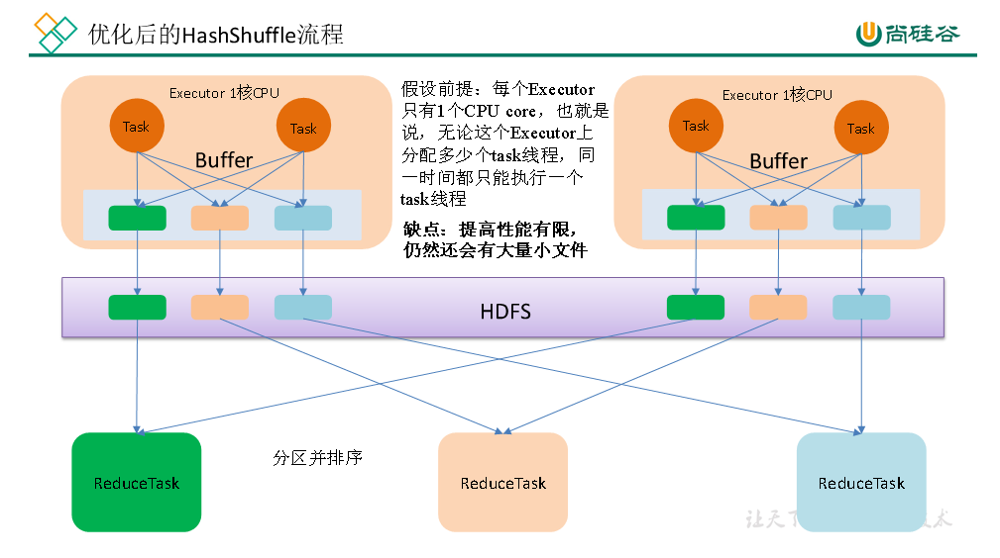

  

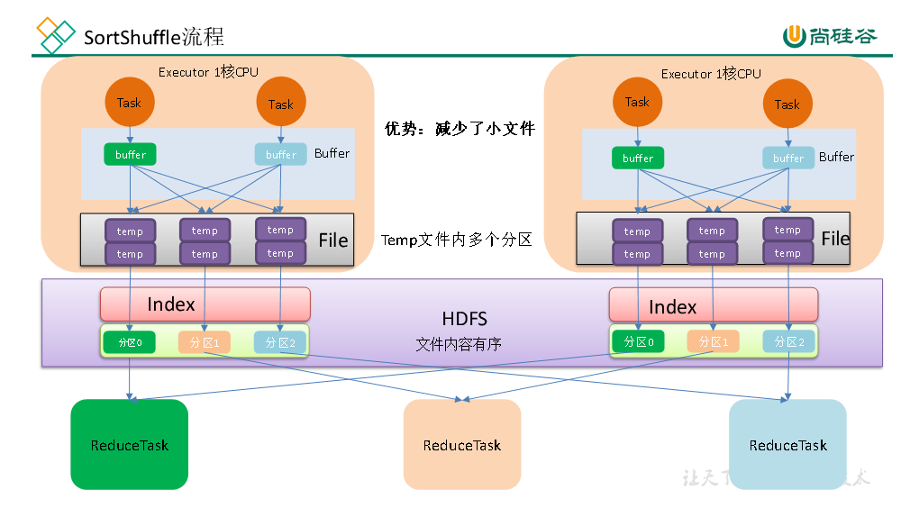

在该模式下，数据会先写入一个数据结构，reduceByKey写入Map，一边通过Map局部聚合，一边写入内存。Join算子写入ArrayList直接写入内存中。然后需要判断是否达到阈值，如果达到就会将内存数据结构的数据写入到磁盘，清空内存数据结构。

在溢写磁盘前，先根据key进行排序，排序过后的数据，会分批写入到磁盘文件中。默认批次为10000条，数据会以每批一万条写入到磁盘文件。写入磁盘文件通过缓冲区溢写的方式，每次溢写都会产生一个磁盘文件，也就是说一个Task过程会产生多个临时文件。

最后在每个Task中，将所有的临时文件合并，这就是merge过程，此过程将所有临时文件读取出来，一次写入到最终文件。意味着一个Task的所有数据都在这一个文件中。同时单独写一份索引文件，标识下游各个Task的数据在文件中的索引，start offset和end offset。

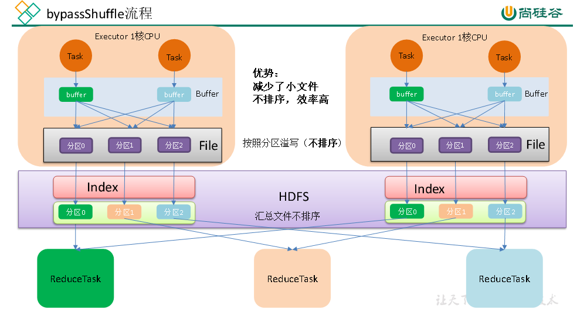

bypassShuffle和SortShuffle的区别就是不对数据排序。

bypass运行机制的触发条件如下：

1）shuffle reduce task数量小于等于spark.shuffle.sort.bypassMergeThreshold参数的值，默认为200。

2）不是聚合类的shuffle算子（比如reduceByKey不行）。

#### 使用SerializedShuffle条件

SerializedShuffleHandle使用条件：

**1** **）序列化规则支持重定位操作（** **java** **序列化不支持，** **Kryo** **支持）**

**2** **）不能使用预聚合**

**3）如果下游的分区数量小于或等于1677216**

  

  

Spark最初版本HashShuffle

Spark0.8.1版本以后优化后的HashShuffle

Spark1.1版本加入SortShuffle，默认是HashShuffle

Spark1.2版本默认是SortShuffle，但是可配置HashShuffle

Spark2.0版本删除HashShuffle只有SortShuffle

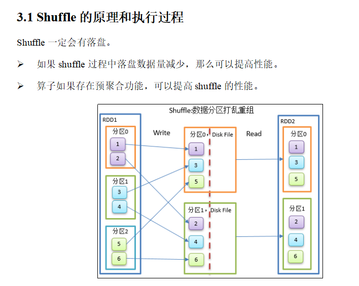

  

  

#### 通讯框架的发展

  

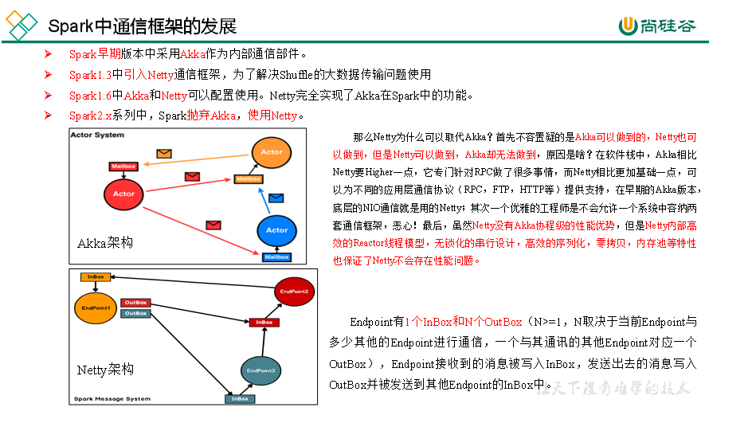

  

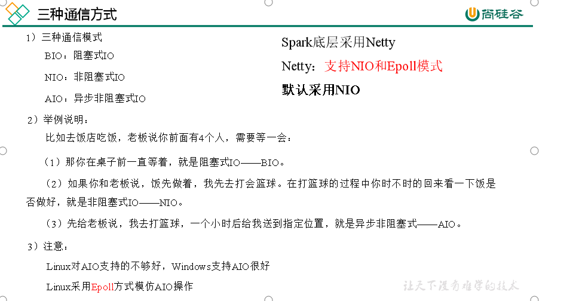

备注(源码只能依靠自己后续理解加深,光看视频时没用的,在这之前,先死脑子背下流程图,以便后续理解)

  

#### Spark底层通讯原理

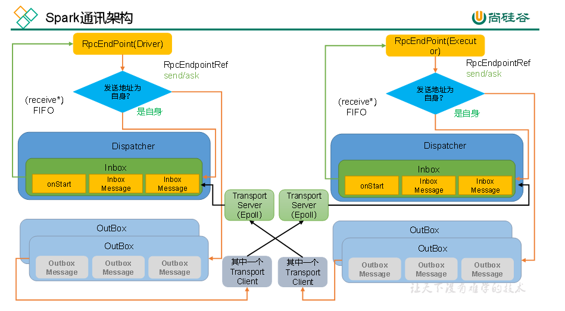

**Ø** **RpcEndpoint** **：** **RPC** **通信终端**。Spark针对每个节点（Client/Master/Worker）都称之为一个RPC终端，且都实现RpcEndpoint接口，内部根据不同端点的需求，设计不同的消息和不同的业务处理，如果需要发送（询问）则调用Dispatcher。在Spark中，所有的终端都存在生命周期：

Constructor =》**onStart** =》**receive**\* =》onStop

**Ø** **RpcEnv** **：** **RPC** **上下文环境**，每个RPC终端运行时依赖的上下文环境称为RpcEnv；在当前Spark版本中使用的NettyRpcEnv

**Ø** **Dispatcher** **：消息调度（分发）器**，针对于RPC终端需要发送远程消息或者从远程RPC接收到的消息，分发至对应的指令收件箱（发件箱）。如果指令接收方是自己则存入收件箱，如果指令接收方不是自己，则放入发件箱；

**Ø** **Inbox** **：指令消息收件箱。**一个本地RpcEndpoint对应一个收件箱，Dispatcher在每次向Inbox存入消息时，都将对应EndpointData加入内部ReceiverQueue中，另外Dispatcher创建时会启动一个单独线程进行轮询ReceiverQueue，进行收件箱消息消费；

**Ø** **Rpc** **EndpointRef** **：** **RpcEndpointRef** **是对远程** **RpcEndpoint** **的一个引用。**当我们需要向一个具体的RpcEndpoint发送消息时，一般我们需要获取到该RpcEndpoint的引用，然后通过该应用发送消息。

**Ø** **OutBox** **：指令消息发件箱。**对于当前RpcEndpoint来说，一个目标RpcEndpoint对应一个发件箱，如果向多个目标RpcEndpoint发送信息，则有多个OutBox。当消息放入Outbox后，紧接着通过TransportClient将消息发送出去。消息放入发件箱以及发送过程是在同一个线程中进行；

**Ø** **Rpc** **Address** **：** **表示远程的** **RpcEndpointRef** **的地址**，Host + Port。

**Ø** **TransportClient** **：** **Netty** **通信客户端**，一个OutBox对应一个TransportClient，TransportClient不断轮询OutBox，根据OutBox消息的receiver信息，请求对应的远程TransportServer；

**Ø TransportServer：Netty通信服务端**，一个RpcEndpoint对应一个TransportServer，接受远程消息后调用Dispatcher分发消息至对应收发件箱；