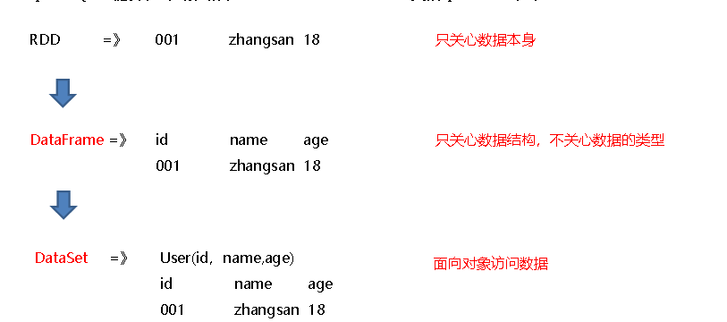
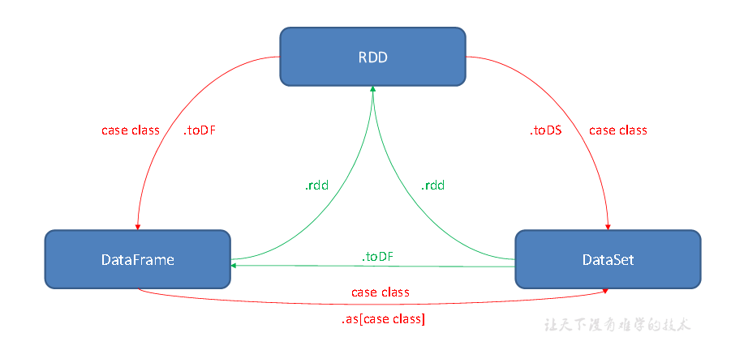

#### RDD、DataFrame和DataSet之间关系

SparkSQL是Spark用于结构化数据(Structuerd Data)处理的Spark模块(半结构化,结构化)

Spark提供了两个编程抽象:DataFrame DataSet

  

DataFrame是一种类似RDD的分布式数据集，类似于传统数据库中的二维表格

DataFrame与RDD的主要区别在于，DataFrame带有schema元信息，即DataFrame所表示的二维表数据集的每一列都带有名称和类型。

3）Spark SQL性能上比RDD要高。因为Spark SQL了解数据内部结构，从而对藏于DataFrame背后的数据源以及作用于DataFrame之上的变换进行了针对性的优化，最终达到大幅提升运行时效率的目标。反观RDD，由于无从得知所存数据元素的具体内部结构，Spark Core只能在Stage层面进行简单、通用的流水线优化。

​  

DataSet是分布式数据集。

Ø DataSet是强类型的。比如可以有DataSet[Car]，DataSet[User]。具有类型安全检查

Ø **DataFrame是DataSet的特例**，type DataFrame = DataSet[Row] ，Row是一个类型，跟Car、User这些的类型一样，所有的表结构信息都用Row来表示。

​  

如果同样的数据都给到这三个数据结构，他们分别计算之后，都会给出相同的结果。不同的是他们的执行效率和执行方式。

RDD、DataFrame、DataSet全都是Spark平台下的分布式弹性数据集，为处理超大型数据提供便利

（2）三者都有惰性机制，在进行创建、转换，如map方法时，不会立即执行，只有在遇到Action行动算子如foreach时，三者才会开始遍历运算

（3）三者有许多共同的函数，如filter，排序等

（4）三者都会根据Spark的内存情况自动缓存运算

（5）三者都有分区的概念

​  

sparkSQL的特点:1)易整合 统一的数据访问方式 兼容hive 标准的数据连接

​  

#### SparkSession

Ø 一个叫SQLContext，用于Spark自己提供的SQL查询；

Ø 一个叫HiveContext，用于连接Hive的查询。

SparkSession是Spark最新的SQL查询起始点，实质上是SQLContext和HiveContext的组合，所以在SQLContext和HiveContext上可用的API在SparkSession上同样是可以使用的。

SparkSession内部封装了SparkContext，所以计算实际上是由SparkContext完成的。当我们使用spark-shell的时候，Spark框架会自动的创建一个名称叫做Spark的SparkSession，

​  

#### DataFrame

在Spark SQL中SparkSession是创建DataFrame和执行SQL的入口，创建DataFrame有三种方式：

Ø 通过Spark的数据源进行创建；

Ø 从一个存在的RDD进行转换；

Ø 还可以从Hive Table进行查询返回。

如果从内存中获取数据，Spark可以知道数据类型具体是什么，如果是数字，默认作为Int处理；但是从文件中读取的数字，不能确定是什么类型，所以用BigInt接收，可以和Long类型转换，但是和Int不能进行转换。

  

#### 语法风格(SQL DSL)

SQL语法风格是指我们查询数据的时候使用SQL语句来查询，这种风格的查询必须要有临时视图或者全局视图来辅助。(普通临时视图是Session范围内的，如果想全局有效，可以创建全局临时视图。)

视图：对特定表的数据的查询结果重复使用。View只能查询，不能修改和插入。

​  

DataFrame提供一个特定领域语言（domain-specific language，DSL）去管理结构化的数据，可以在Scala，Java，Python和R中使用DSL，使用DSL语法风格不必去创建临时视图了。

df.select("name").show() df.select('name).show

注意：列名要用双引号引起来，如果是单引号的话，只能在前面加一个单引号。

​  

scala> df.select($"name",$"age" + 1).show

scala> df.select('name, 'age + 1).show()

涉及到运算的时候，每列都必须使用$，或者采用单引号表达式：单引号+字段名

  

#### DataSet

DataSet是具有强类型的数据集合，需要提供对应的类型信息。

使用基本类型的序列创建DataSet

使用样例类序列创建DataSet

​  

#### RDD与DataFrame相互转换

RDD转换为DataFrame

RDD和DF、DS转换必须要导的包(隐式转换)

import spark.implicits.\_

​  

Ø 手动转换：RDD.toDF(“列名1”, “列名2”)

(普通rdd转换成DF,需要手动为每一列补上列名(补充元数据))

Ø 通过样例类反射转换：UserRDD.map{ x=>User(x.\_1,x.\_2) }.toDF()

​  

DF=>RDD

//DF转换成RDD,直接.rdd即可,但是要注意转换出来的rdd数据类型会变成Row

#### RDD与DataSet相互转换

1）RDD转换为DataSet

SparkSQL能够自动将包含有样例类的RDD转换成DataSet，样例类定义了table的结构，样例类属性通过反射变成了表的列名。样例类可以包含诸如Seq或者Array等复杂的结构。

2）DataSet转换为RDD

普通rdd转DS,没办法补充元数据,因此一般不用

样例类RDD转换DS,直接toDS转换即可,不需要补充元数据,因此转DS一定要用样例类RDD

​  

ds转成rdd,直接.rdd即可,并且ds不会改变rdd里面的数据类型

#### DataFrame与DataSet相互转换

1）DataFrame转为DataSet

df.as[User]

2）Dataset转为DataFrame

ds.toDF

​  

### 用户自定义函数

UDF UDAF UDTF

UDF：一行进入，一行出

1 创建上下文环境配置对象 2 创建SparkSession对象 3 读取数据 4 创建DataFrame临时视图

5 注册UDF函数 6 调用自定义UDF函数

UDAF：输入多行，返回一行。(不同于UDF,需自行编写样例类)

Spark3.x推荐使用extends Aggregator自定义UDAF，属于强类型的Dataset方式。

Spark2.x使用extends UserDefinedAggregateFunction，属于弱类型的DataFrame

​  

SparkSQL中没有UDTF，Spark中用flatMap即可实现该功能

​  

### SparkSQL数据的加载与保存

加载数据

spark.read.load是加载数据的通用方法

1 创建上下文环境配置对象

2 创建SparkSession对象  
3.1 spark.read直接读取数据：csv format jdbc json load option  
// options orc parquet schema table text textFile

3.2 format指定加载数据类型

// spark.read.format("…")[.option("…")].load("…")  
// format("…")：指定加载的数据类型，包括"csv"、"jdbc"、"json"、"orc"、"parquet"和"text"

// load("…")：在"csv"、"jdbc"、"json"、"orc"、"parquet"和"text"格式下需要传入加载数据路径

// option("…")：在"jdbc"格式下需要传入JDBC相应参数，url、user、password和dbtable

​  

保存数据通用方法

df.write.save是保存数据的通用方法

// 1 创建上下文环境配置对象

2 创建SparkSession对象

3 获取数据

// 4.1 df.write.保存数据：csv jdbc json orc parquet text

// 默认保存为parquet文件 默认读取文件parquet  
// 4.2 format指定保存数据类型

// 4.3 可以指定为保存格式，直接保存，不需要再调用save了

df.write.mode("append||overwrite||ignore||error||append").json("output2")

​  

#### 与MySQL交互

(1)导入依赖(2)1 创建上下文环境配置对象2 创建SparkSession对象 3.1 通用的load方法读取mysql的表数据 3.2 创建视图 3.3 查询想要的数据

向MySQL写数据的时候 注意：id是主键，不能和MySQL数据库中的id重复  
  
  

### 与Hive交互(一般是使用外部Hive)

内嵌Hive，元数据存储在Derby数据库。

多了$SPARK\_HOME/metastore\_db和derby.log，用于存储元数据  
多了$SPARK\_HOME/spark-warehouse/user，用于存储数据库数据  
然而在实际使用中，几乎没有任何人会使用内置的Hive，因为元数据存储在derby数据库，不支持多客户端访问。

#### 外部Hive应用

为了说明内嵌Hive和外部Hive区别：删除内嵌Hive的metastore\_db和spark-warehouse

Spark SQL CLI可以很方便的在本地运行Hive元数据服务以及从命令行执行查询任务

#### 3.4.4 IDEA操作外部Hive

System.setProperty("HADOOP\_USER\_NAME","atguigu")//在虚拟机中以atguigu的用户身份创建

​  

# **SparkSQL项目实战**

  
  

​