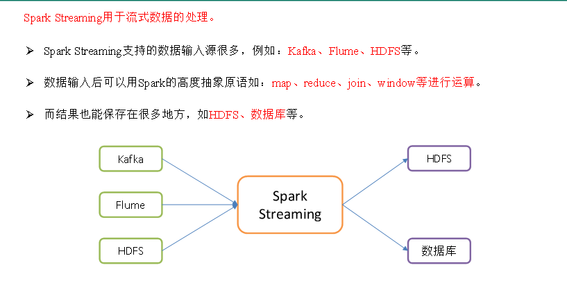
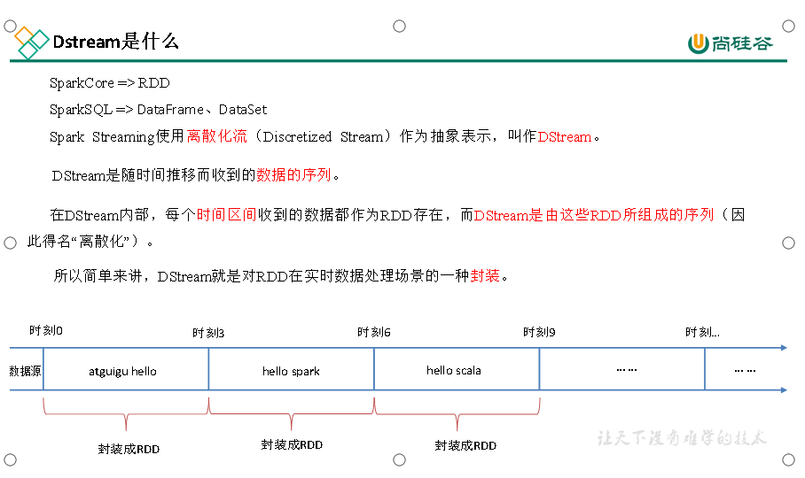
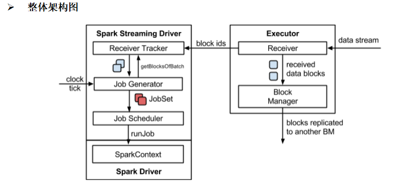
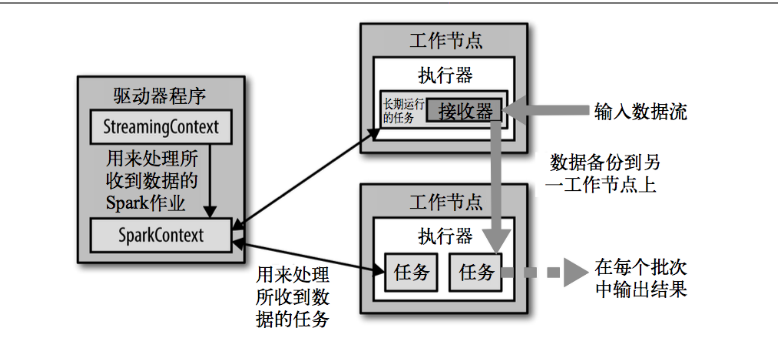

SparkStreaming用于流式处理数据

Dstream

  

#### 背压机制

Spark 1.5以前版本，用户如果要限制Receiver的数据接收速率,可 以通过设置静态配制参数“spark.streaming.receiver.maxRate”的值来实现，此举虽然可以通过限制接收速率，来适配当前的处理能力，防止内存溢出，但也会引入其它问题。比如：producer数据生产高于maxRate，当前集群处理能力也高于maxRate，这就会造成资源利用率下降等问题。

为了更好的协调数据接收速率与资源处理能力，1.5版本开始Spark Streaming可以动态控制数据接收速率来适配集群数据处理能力。背压机制（即Spark Streaming Backpressure）：根据JobScheduler反馈作业的执行信息来动态调整Receiver数据接收率。

通过属性“spark.streaming.backpressure.enabled”来控制是否启用背压机制，默认值false，即不启用。

​  

wordcount案例实操

需求：使用netcat(黑客常用)工具向9999端口不断的发送数据，通过SparkStreaming读取端口数据并统计不同单词出现的次数

​  

DStream是Spark Streaming的基础抽象，代表持续性的数据流和经过各种Spark算子操作后的结果数据流。在内部实现上，每一批次的数据封装成一个RDD，一系列连续的RDD组成了DStream。对这些RDD的转换是由Spark引擎来计算。DStream中批次与批次之间计算相互独立。如果批次设置时间小于计算时间会出现计算任务叠加情况，需要多分配资源。通常情况，批次设置时间要大于计算时间。