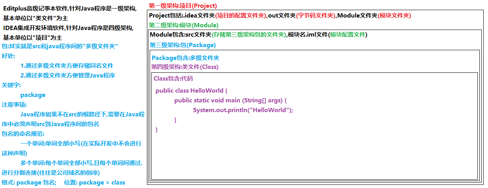
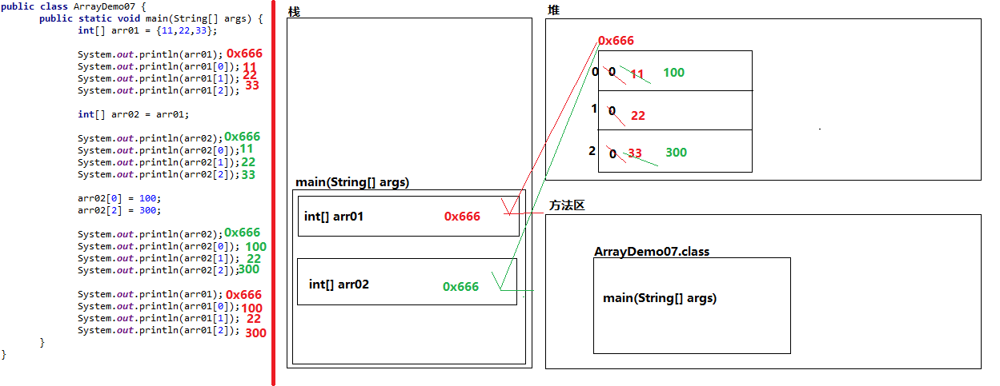
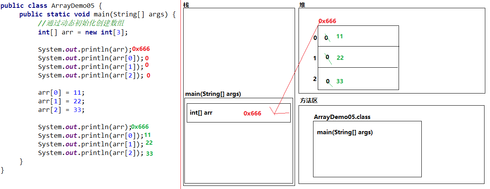
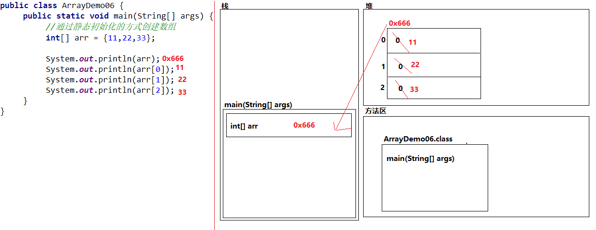

## 基础

单行注释:// 多行注释:/\* \*/ 文档注释:/\*\* \*/

一个.Java文件只能有一个public class.

public static void main(String[] args){}为主方法,程序的执行入口,

关键字共53个,全部小写

变量三要素:数据类型,变量名,初始化值

初始化格式:直接声明初始化:数据类型 变量名=初始化值

先声明后初始化:数据类型 变量名;

变量名=初始化值;

​  

数据类型:

基本类型(4类8种)整数型:byte(1字节) short(2字节) int(4字节) long (8字节)

浮点型:float(4字节) double(8字节)

字符型:存储的是单个字符(数字,字母,中文,标点符号),char () 遵守内外码规则,内2,外的GBK为2,UTF-8的中文3字节,数字标点符号字母1字节

布尔型:boolean 真true 假false 普通变量4字节,Boolean的数组每个元素1字节

引用类型:数组 接口 类

java中的字符串的内容不可变，如果一个字符串变量赋值后被重新赋值，那么是修改了对应的地址值

​  

标识符:给包,类,接口,方法等起的名字(必须由26个英文大小写字母,0-9数字(不能作为开头),$,下划线,中文组成)

变量的初始化:注意变量数据类型的值范围,给long类型,要在初始化值的结尾加上L或者l,float叫F或者f,

char类型用'',里面有且仅有一个字符,""为字符串

​  

整数类型的初始化值{

二进制表示法:初始化值以0b,0B作为开头,数字仅有0,12

八进制表示法:初始化值以0作为开头,数字为0-7

十六进制表示法:初始化值以0x或者0X开头,a-f表示10-15}

字符类型的初始化值{

数字表示法(0-65535):十进制和Unicode码表的字符一一对应

十六进制表示法:'\\uXXXX',XXXX表示十六进制数字,不足以0补位

}

字符集:十进制和个个字符的对应规则

int类型，内存溢出，第一位被后位的挤占，那么从0变成1，也就变成负数

对于浮点数 比较 利用差值小于某个临界值来判断

​  

局部变量:声明在方法中的变量;使用前必须初始化,同一个作用域的变量不可以同名,同一类型的变量名可以赋值

​  

#### 数据类型转换

数据类型的转换:基本类型间的转换(依据取值范围),引用类型间的转换,基本与包装类型的转换,基本与字符串类型的转换;

​  

基本类型的转换分类:自动转换(隐式),强制转换(显式)

​  

隐式转换:byte<short<int<long<float<double

char<int<long<float<double

long与float的转换:1.基本类型间转换和占用字节大小无关,只能取值范围有关2,底层规则不同

​  

强制转换:取值范围大的数据类型转换成小的

格式:小的数据类型 变量名=(小的数据类型)大的数据类型的变量名int a=(int)b

#### 常量优化机制

boolean无法转化;byte,short,char一参与数学运算就转化为int再运算,1.当声明初始化byte,short,char类型变量时,当右面的初始化值是字面值常量,且该字面值常量还在其数据类型的取值范围内,JVM自动会在编译时期自动将这个字面值常量优化为该数据类型,我们将这一过程称之为"常量优化机制"2.当进行数学运算的时候,运算符号两边都是字面值常量,且运算后的结果还在其数据类型的取值范围内,JVM自动会在编译时期自动将该运算运算完毕,我们将这一过程也称之为"常量优化机制"

​  

运算符:算数,赋值,关系,逻辑,三元,位运算符

+号两边任一边出现字符串,+起连接作用,得到新的字符串

++,--区分单独使用和复合使用

关系表达式的运算结果一定是boolean

逻辑运算符: & | ^(异或) !(非) 短路运算符:&& ||

拓展的赋值运算符,将运算后的结果赋值给左边的变量前,会根据左边的数据类型进行强制转换

关系运算符:> >= < <= == !=

关系表达式的结果一定是boolean值

基本逻辑运算符与短路逻辑运算符的区别在于:一个执行完,一个不执行完

!将结果取反

三元运算符: 关系表达式?结果值1:结果值2

#### 原码反码补码

原码(显示数据对应的二进制足位表示) 反码(用于原码补码的转换) 补码(一切数据的计算)  
数据存储和运算过程:  
1.将十进制数据转换成原码二进制2.数据的原码转换成数据的反码(如果数据是正整数:其反码和原码是一致的,如果数据是负整数:其反码就是在原码的基础上进行逐位取反(符号位保持不变)}  
3.数据的反码转换成数据的补码(如果数据是正整数:其补码和反码是一致的,如果数据是负整数:其补码就是在反码的基础上进行+1运算)  
4.根据补码进行运算获取到结果的补码  
5.结果的补码转换成结果的反码(如果结果是正整数:其反码和补码是一致的,如果结果是负整数:其反码就是在补码的基础上进行-1运算)  
6.结果的反码转换成结果的原码(如果结果是正整数:其原码和反码是一致的,如果结束时负整数:其原码就是在反码的基础上进行逐位取反(符号位保持不变))  
7.结果的原码转换成十进制数据  
  

#### 位运算符,顺序结构,for,switch结构

按位运算符:&按位与(都是1才1),|按位或(有1则1),^按位非(相同为0,不同为1,包括符号位),~按位非(每个位数取反,包括符号位)  
<<左移运算符:二进制向左移动指定位数,符号位也移动,如果低位有空位,以0补位

\>>右移运算符:二进制向右移动指定位数,符号位也移动,如果高位有空位,以和符号位相同的数字进行补位

\>>>无符号右移运算符:右移,符号位也动,以0补位

  

顺序结构中包含:分支结构,循环结构,调用结构

分支结构和循环结构统称为"流程控制语句"

分支结构 判断语句:if语句 选择语句:switch语句

循环结构 for语句 while语句 do...while语句

for语句结束,变量在内存中释放 while和dowhile语句在语句结束后依然可以使用

continue关键字作用:结束当次循环,继续下一次循环

for语句的格式:

for (初始化语句;循环条件语句;迭代语句) {

循环体语句

}

switch语句的格式:

switch (数据值) {

case 数据值1:

语句体1

break;

case 数据值2:

语句体2

break;

......

case 数据值n:

语句体n

break;

default:

语句体n+1

break

}

switch语句的注意事项:

1.switch()中数据值的数据类型:基本类型只支持int类型,考虑到有三种类型可以自动提升成int,衍生出四种支持类型,分别是byte,short,char,int

引用类型:

在JDK1.4(包含)及其以前,不支持引用类型

在JDK5.0(包含)及其以后,支持枚举类型Enum

在JDK7.0(包含)及其以后,支持字符串类型String

2.swtich语句中的default和if语句第三种格式中的else一样,都可以省略不写,推荐写上

3.switch语句中的case和default顺序可以颠倒,不影响执行流程,推荐将default写在所有case的下面

4.switch语句中break关键字可以省略不写,但是会出现case穿透效果

for死循环格式

for (;;) {

循环体语句

}

while死循环格式

while (true) {

循环体语句

}

#### 循环嵌套

循环嵌套的特点:

1.循环嵌套往往指代的是for循环嵌套语句

2.将外层循环语句称之为"外层循环"

将内层循环语句称之为"内层循环"

3.外层循环和内层循环是一对相对的概念

4.在实际应用的过程中,当循环语句嵌套3层以上的,往往有更简便的方式

5.在循环嵌套中,外层循环的初始化语句执行了(1)次

6.在循环嵌套中,内层循环的初始化语句执行了(外层循环次数)次

7.在循环嵌套中,内层循环的循环体语句执行了(外层循环次数\*内层循环次数)次

​  

循环嵌套的格式:

for (外层循环的初始化语句;外层循环的循环条件语句;外层循环的迭代语句) {

for (内层循环的初始化语句;内层循环的循环条件语句;内层循环的迭代语句) {

内层循环的循环体语句

}

}

执行流程:

1.先执行外层循环的初始化语句;

2.确认外层循环的循环条件语句是true还是false;

3.如果是true,执行内层循环语句(执行第a步);

a.执行内层循环的初始化语句;

b.确认内层循环的循环条件语句是true还是false;

c.如果是true,执行内层循环的循环条件语句;

如果是false,内层循环语句结束,继续执行第4步

d.执行内层循环的迭代语句;

e.跳回第b步继续执行

如果是false,循环嵌套语句结束;

4.执行外层循环的迭代语句;

5.跳回第2步,继续执行

#### 方法

方法:在程序中封装特殊功能的代码块

方法的格式:

修饰符 返回类型 方法名 (形参类型1 形参名1,形参类型2 形参名2,......,形参类型n 形参名n) {

方法体语句

return 返回值;

}

修饰符:针对内容修饰的关键字

返回类型:返回结果的数据类型

无返回类型

基本类型

引用类型

方法名:标识符,就是给方法起的名字,做到"见名知意"

():形参列表

什么都没有

基本类型

引用类型

方法体语句:特殊功能的代码块

return:(1)结束方法(2)如果return后面存在返回值,在结束方式的同时将返回值进行返回

返回值:返回的结果数据

返回(自定义方法==>调用者方法):

当调用者方法需要使用自定义方法中的结果数据值,无法直接获取,需要返回的方式将结果数据进行返回

传参(调用者方法==>自定义方法):

当自定义方法需要使用调用者方法中的数据时,无法直接获取,需要通过参数传递的方式将数据进行传递

​声明方法前的两个明确

返回类型:明确方法返回值的数据类型

形参列表:明确需要用到调用者方法中的几个数据,且每个数据是什么数据类型

方法的特点:不调用,不执行

方法调用方式:

1.如果方法归属于对象,调用格式:

对象名.方法名(实参);

2.如果方法归属于类,调用格式:

类名.方法名(实参);

3.如果调用同一个类中的方法,调用格式:

单独调用(直接调用):方法名(实参);

输出调用(打印调用):System.out.println(方法名(实参));

赋值调用:数据类型 变量名 = 方法名(实参);

void关键字:在程序中表示方法没有返回值

void的注意事项:

1.当方法没有合适的返回值时,返回类型的位置也不能空着,需要void关键字进行占位

2.当方法的返回类型是void时,方法的调用方式只能是单独调用

3.当方法的返回类型是void时,方法体后面的return关键字可以省略不写

#### 方法的重载

在同一个类中(或者子父类继承关系中),出现了方法名相同,形参列表不同的现象

方法重载的前提条件:

1.必须在同一个类中或者子父类继承关系中 2.必须方法名相同 3.必须形参列表不同(至少满足以下一点)

(1)形参列表中参数的数据类型不同

(2)形参列表中参数的个数不同

(3)形参列表中参数数据类型顺序不同

方法重载的注意事项: 在方法重载的时候,具体调用哪个方法取决于方法的实参

​  

方法的递归: 在程序中方法自身调用自身的现象

分类: 直接递归:(方法自身调用自身)

间接递归: 方法A调用方法B,方法B调用方法C,方法C调用方法A

方法递归的前提条件:

如果使用递归进行特殊的循环,需要给递归添加限定条件,否则会发生栈内存溢出

如果使用递归进行特殊的循环,即使添加限定条件,也不能让递归的层数太多,否则会发生栈内存溢出

递归的好处:

递归是一种特殊的循环,在实际应用中,往往会有一些场景无法使用for和while语句进行遍历,

只能通过递归进行解决

举例:多级文件夹的复制

斐波那契数列

​  

#### 数组

数组:在程序中存储同一种数据类型多个元素的固定容器

数组的前提条件:

1.数组一旦进行初始化其长度是固定不变的

2.数组中的元素在内存中必须是同一种数据类型

3.数组中的元素个数必须是多个 (在程序中可以声明初始化长度为0或者1的数组,但没有任何意义)

数组的声明初始化

​  

数组的声明: 数据类型[] 数组名;(推荐)

数组的初始化:

动态初始化:初始化数组的时候只初始化数组的长度,不会初始化数组里面的具体数据值,JVM可以直接获取数组的长度

* 格式:

* 数据类型[] 数组名 = new 数据类型[数组长度];

* 

静态初始化:初始化数组的时候只初始化数组里面的具体数据值,不会初始化数组的长度,JVM可以间接获取数组的长度

* 标准格式:

* 数据类型[] 数组名 = new 数据类型[]{元素1,元素2,......,元素n};

* 简化格式:

* 数据类型[] 数据名 = {元素1,元素2,......,元素n};

* 

* 数组声明初始化的名词解释:

* 数据类型:数组中元素的数据类型

* []:声明的是一维数组

* 数据类型[]:数组的数据类型

* 数组名:数组的名字

* new:向内存申请并开辟合适内存空间

* 数组长度:数组中可以存储多少个元素

* 

* 数组声明初始化的注意事项:

* 1.数组的动态初始化和静态初始化没有推荐一说,需要根据实际需求再进行决定使用哪种初始化的方式

* 2.在程序中不允许通过动静结合的方式进行数组的声明初始化

* 3.在数组中的元素支持变量的类型转换

* 4.数组静态初始化的简化格式不允许先声明,后初始化

* 原因:变量的声明初始化,初始化值是多少取决于变量名前的数据类型,静态初始化的标准格式先声明后初始化,通过new申请并开辟内存空间,静态初始化的简化格式直接声明初始化,JVM根据变量名前面的数据类型自动给其申请并开辟内存空间,静态初始化的简化格式先声明后初始化,JVM无法直接获取到前面的数据类型,所以给其申请并开辟内存空间,导致编译报错

数组声明初始化的面试题?

* 数组静态初始化标准版和简化版的区别?

* 数组动态初始化和静态初始化的区别?

​  

数组的使用: 获取数组中的元素 获取数组的长度

获取数组中的元素:

* 需要通过"索引值"进行获取

* 索引值:针对数组中的元素按照一定的规则进行的数字编号

* 索引值的规则:

* 元素编号从0开始,一直到数组的长度-1,长度为0的数组不存在索引值

* 格式:

* 数组名[索引值]

* 获取数组的长度

* 数组名.length

​  

本地方法栈:负责和操作系统相关的内容,和开发关系不大

* 栈内存:存储的正在运行的方法

* 堆内存:存储new出来的东西

* 方法区:存储并处理字节码文件对象,包含:字节码文件区,静态区,常量区

​  

堆内存的特点:

1.堆内存中的每块内存区域都有分配的地址值

2.堆内存中每块内存区域中的变量都有默认值

* 整数类型 默认值:0

* 浮点类型 默认值:0.0

* 字符类型 默认值:'\\u0000'

* 布尔类型 默认值:false

* 引用类型 默认值:null

3.一旦new立刻在堆内存申请并开辟内存区域(进堆),new出来的内存区域和其它内存没有任何关联不会在堆内存中立刻消失,会标记为"垃圾数据"

4.在堆内存中有一条独立线程,被称之为"垃圾回收器",垃圾回收器可以理解为生活中的"扫地机器人",垃圾回收器会根据设定 的扫描规则不间断的扫描堆内存中的各个区域,一旦发现垃圾数据,立刻进行回收(清理),回收后,new出来的区域才彻底在堆内存中消失

  

  

#### 方法传参的特点:

* 当方法的形参是基本类型时,

* 1.传递的内容是基本类型的数据值

* 2.形式参数(形参)数据值的改变不会影响实际参数(实参)的数据值

* 当方法的形参是引用类型时,

* 1.传递的内容是引用类型的地址值

* 2.形式参数(形参)地址值的改变不会影响实际参数(实参)的地址值

* 3.形式参数(形参)地址值不改变,形式参数(形参)地址值中元素值的改变会影响实际参数(实参)地址值中的元素值

​  

可变参数(JDK5.0中的新特性)

* 格式:

* 数据类型... 可变参数名

* 好处:

* 实参可以根据实际需求给其传递,最少可以传递0个实参,最多传递无数个实参

* 含义:

* 其实就是将实参作为元素进行静态初始化的数组

可变参数的注意事项:

1.当声明一个方法时,方法的形参列表除了可变参数外还存在其它参数,需要将可变参数声明在形参列表中的最后位置,否则编译报错

* 2.当声明一个方法时,方法的形参列表中最多只能含有一个可变参数,否则编译报错

​  

二分查找法(折半查找法)

含义:在有序的数组中不断查找中间量索引,从而以更快速的方式查询到索引

前提条件: 数组必须是有序的数组 数组的长度必须达到实际开发要求

​  

#### 二维数组:

数组中的元素依然是数组

* 二维数组的声明:

* 数据类型[][] 数组名;(推荐)

* 数据类型 数组名[][];

* 数据类型[] 数组名[];

* 二维数组的初始化:

* 动态初始化

* 格式1:初始化二维数组的同时,初始化里面每个一维数组

* 数据类型[][] 数组名 = new 数据类型[x][y];

* x : 二维数组中含有多少个一维数组

* y : 每个一维数组中含有多少个元素

* 格式2:初始化二维数组但不会初始化里面每个一维数组

* 数据类型[][] 数组名 = new 数据类型[x][];

* 静态初始化

* 格式1:

* 数据类型[][] 数组名 = new 数据类型[][]{new 数据类型[]{元素1,元素2,......,元素n},new 数据类型[]{元素1,元素2,......,元素n},......,new 数据类型[]{元素1,元素2,......,元素n}}

* 格式2:

* 数据类型[][] 数组名 = new 数据类型[][]{{元素1,元素2,......,元素n},{元素1,元素2,......,元素n},......,{元素1,元素2,......,元素n}}

* 格式3:

* 数据类型[][] 数组名 = {{元素1,元素2,......,元素n},{元素1,元素2,......,元素n},......,{元素1,元素2,......,元素n}}

二维数组元素的访问:索引

* 格式:

* 数组名[x][y]

* x:访问元素所在一维数组在二维数组中的索引是多少

* y:访问元素在一维数组中索引是多少

  

