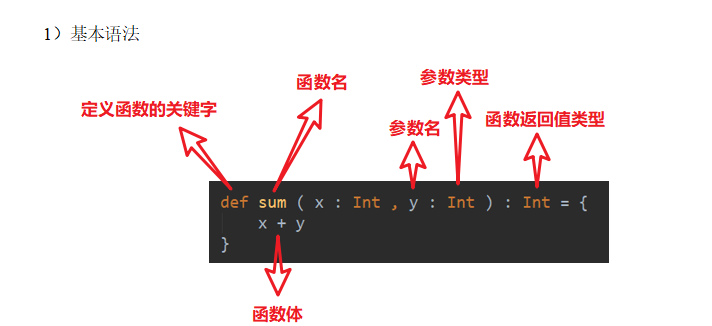

# 函数式编程

  

  

核心概念

（1）为完成某一功能的程序语句的集合，称为函数。

（2）类中的函数称之方法。

​  

（1）Scala语言可以在任何的语法结构中声明任何的语法

（2）函数没有重载和重写的概念；方法可以进行重载和重写

（3）Scala中函数可以嵌套定义

​  

​  

​  

#### 函数参数

1）案例实操

（1）可变参数

（2）如果参数列表中存在多个参数，那么可变参数一般放置在最后

（3）参数默认值，一般将有默认值的参数放置在参数列表的后面

（4）带名参数

​  

​  

​  

​  

object XXX

// 伴生对象中的方法 相当于java的静态方法

// 静态方法调用 不需要创建对象

调用类中的方法 需要创建对象

定义函数 => 嵌套在方法内部的叫做函数

函数的定义可以嵌套在任意位置

​  

def sayHi1(names:String\*):Unit = {

可变参数在函数内部是一个集合

可变参数传参的时候 可以传入0个1个或者多个

如果参数列表中存在多个参数，那么可变参数一般放置在最后

参数默认值，一般将有默认值的参数放置在参数列表的后面

不填写参数可以调用函数参数默认值

​  

### 函数至简原则（重点）

  

1）return可以省略，Scala会使用函数体的最后一行代码作为返回值

（2）如果函数体只有一行代码，可以省略花括号

如果强行省略掉大括号 只能识别下面的一行代码作为函数体

（3）返回值类型如果能够推断出来，那么可以省略（:和返回值类型一起省略）

特别注意事项：

（4）如果有return，则不能省略返回值类型，必须指定

（5）如果函数明确声明unit，那么即使函数体中使用return关键字也不起作用

（6）Scala如果期望是无返回值类型，可以省略等号

（7）如果函数无参，但是声明了参数列表，那么调用时，小括号，可加可不加

（8）如果函数没有参数列表，那么小括号可以省略，调用时小括号必须省略

修改为匿名函数：

（9）如果不关心名称，只关心逻辑处理，那么函数名（def）可以省略

​  

object Test04\_FuncSimply {

​  

def main(args: Array[String]): Unit = {

​  

**​****//** **定义一个原函数**

def func0(x: Int, y: Int): Int = {

​println("func0的调用")

if (x < 20) {

return x + y

}

2 \* x + 3 \* y

}

​  

println(func0(10, 20))

​  

**​****//** **（****1****）****return****可以省略，****Scala****会使用函数体的最后一行代码作为返回值**

def func1(x: Int, y: Int): Int = {

​println("func1的调用")

x + y

}

​  

val i: Int = func1(10, 20)

println(i)

​  

​  

**​****//** **（****2****）如果函数体只有一行代码，可以省略花括号**

​// 如果不写大括号 默认有效范围只有一行

def func2(x: Int, y: Int): Int = x + y

​  

​  

**​****//** **（****3****）返回值类型如果能够推断出来，那么可以省略（****:****和返回值类型一起省略）**

def func3(x: Int, y: Int) = x + y

​  

​  

**​****//** **（****4****）如果有****return****，则不能省略返回值类型，必须指定**

def func4(x: Int, y: Int): Int = {

if (x < 20) {

return x + y

}

2 \* x + 3 \* y

}

​  

func4(10, 20)

​  

**​****//** **（****5****）如果函数明确声明****unit****，那么即使函数体中使用****return****关键字也不起作用**

def func5(x: Int, y: Int): Unit = return x + y

​  

val unit: Unit = func5(10, 20)

​  

**​****//** **（****6****）****Scala****如果期望是无返回值类型，可以省略等号**

def func6(x: Int, y: Int) {

println(x + y)

}

​  

​  

**​****//** **（****7****）如果函数无参，但是声明了参数列表，那么调用时，小括号，可加可不加**

def func7(): Unit = {

println("hello")

}

​  

func7()

func7

​  

**​****//** **（****8****）如果函数没有参数列表，那么小括号可以省略，调用时小括号必须省略**

def func8 {

println("hello")

}

​  

func8

​  

**​****//** **（****9****）如果不关心名称，只关心逻辑处理，那么函数名（****def****）可以省略**

def func9(x: Int, y: Int) = x + y

​  

​  

val function: (Int, Int) => Int = (x: Int, y: Int) => x + y

​  

}

}

​  

​  

### **匿名函数化简**

没有名字的函数就是匿名函数。

(x:Int)\=>{函数体}

x：表示输入参数类型；Int：表示输入参数类型；函数体：表示具体代码逻辑

匿名函数的语法中 没有返回值类型和return

（1）参数的类型可以省略，会根据形参进行自动的推导

（2）类型省略之后，发现只有一个参数，则圆括号可以省略；其他情况：没有参数和参数超过1的永远不能省略圆括号。

（3）匿名函数如果只有一行，则大括号也可以省略

（4）如果参数只出现一次，且按照顺序出现则参数省略且后面参数可以用\_代替

不能化简为下划线的情况：1.化简之后只有一个下划线 2.化简后的函数存在嵌套

​  

​  

def main(args: Array[String]): Unit = {

val f0: (Int, Int) => Int = (x: Int, y: Int) => x + y

​  

**​****//** **（****1****）参数的类型可以省略，会根据形参进行自动的推导**

val f1: (Int, Int) => Int = (x, y) => x + y

​  

**​****//** **（****2****）类型省略之后，发现只有一个参数，则圆括号可以省略；**

​// 其他情况：没有参数和参数超过1的永远不能省略圆括号。

val f2: (Int, Int) => Int = (x, y) => x + y

val f3: Int => Int = x => x + 22

​  

val f4: () => Int = () => 10

​  

​  

**​****//** **（****3****）匿名函数如果只有一行，则大括号也可以省略**

val f5: (Int, Int) => Int = (x, y) => {

​println("匿名函数")

x + y

}

​  

**​****//** **（****4****）如果参数只出现一次，且按照顺序出现，则参数省略且后面参数可以用****\_****代替**

val f6: (Int, Int) => Int = \_ + \_

​  

​  

​// 化简为\_的条件

**​****// 1.** **传入的参数类型可以推断 所以可以省略**

val f7: (Int, Int) => Int = (x, y) => y - x

​  

**​****// 2.** **参数必须只使用一次 使用的顺序必要和定义的顺序一样**

val f8: (Int, Int) => Int = -\_ + \_

​  

​  

**​****//** **如果化简为匿名函数 只剩下一个****\_** **则不可以化简**

val function: String => String = \_ + ""

val str: String = function("linhai")

val function1: String => String = a => a

​  

​  

**​****//** **如果化简的下划线在函数里面 也会报错**

// val function1: String => Unit = println(\_ + "hi")

​  

val function2: String => Unit = println

function2("linhai")

}

​  

​  

### 函数高级

  

#### 高阶函数

  

  

在Scala中，函数是一等公民。怎么体现的呢？

对于一个函数我们可以：定义函数、调用函数。

​  

（1）函数可以作为值进行传递

  

（2）函数可以作为参数进行传递

（3）函数可以作为函数返回值返回

#### 函数柯里化&闭包

  

**闭包：**函数式编程的标配

闭包：如果一个函数，访问到了它的外部（局部）变量的值，那么这个函数和他所处的环境，称为闭包。

函数柯里化：把一个参数列表的多个参数，变成多个参数列表。

​  

  

#### 递归

1）说明

一个函数/方法在函数/方法体内又调用了本身，我们称之为递归调用。

  

​  

**//** **阶乘**

var n = 5

var res = 1

for (i <- 1 to n) {

res \*= i

}

​  

println(res)

​  

**​****//** **递归**

**​****// 1.** **调用自身**

**​****// 2.** **跳出条件**

**​****// 3.** **填入的参数必须有规律**

**​****// 4.** **递归必须声明函数返回值类型**

def rec(n: Int): Int = {

if (n == 1) 1 else rec(n - 1) \* n

}

​  

println(rec(5))

​  

​  

**​****//** **尾递归优化**

@tailrec

def rec1(n: Int, res: Int = 1): Int = {

if (n == 1) res else rec1(n - 1,res \* n)

}

​  

​  

​  

#### 控制抽象

值调用：把计算后的值传递过去

2）名调用：把代码传递过去

object Test09\_ControlAbs {

def main(args: Array[String]): Unit = {

​  

**​****//** **值调用**

def sayHi(name:String):Unit = {

​  

​println("sayHi的调用")

println(s"hi $name")

println(s"hi $name")

}

​  

sayHi({

​println("代码块\-字符串")

"linhai"

})

​  

​  

println("=======================")

**​****//** **名调用** **\=> String**

def sayHi1(name: => String):Unit = {

​println("sayHi1的调用")

println(s"hi $name")

println(s"hi $name")

}

​  

var n = 1

sayHi1({

​println("代码块\-字符串1")

n += 1

"linhai" + n

})

​  

}

}

注意：Java只有值调用；Scala既有值调用，又有名调用。

​  

​  

​  

#### 惰性函数

1）说明

当**函数返回值被声明为lazy时**，函数的**执行将被推迟**，直到我们**首次对此取值，该函数才会执行**。这种函数我们称之为惰性函数。

  

注意：lazy不能修饰var类型的变量。

​  

​  

