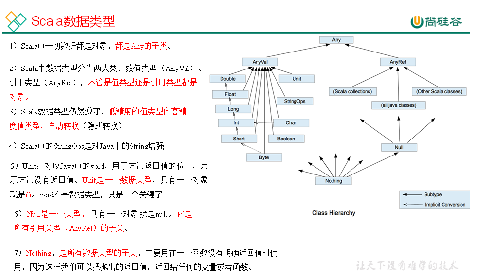
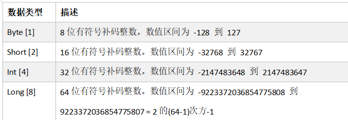
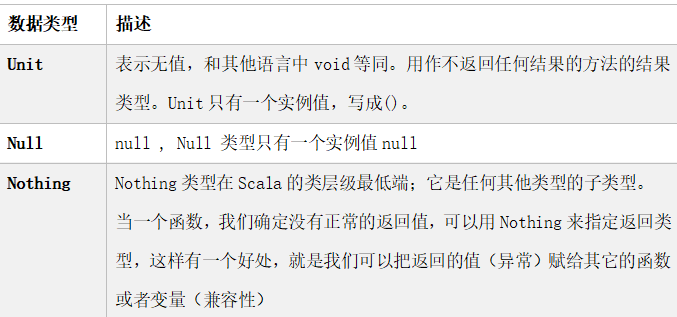
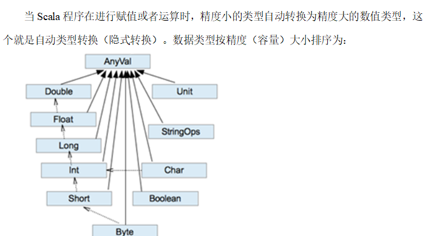
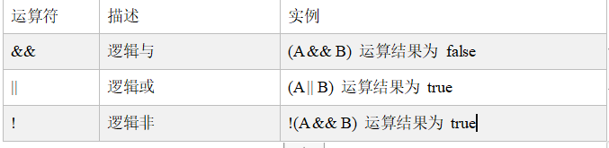

Scala支持两种编程范式面向对象和函数式编程

使用特殊的语法 伴生对象(单例对象) 来表示静态 里面写的所有内容都是静态的

object 类名

写在伴生对象中的属性都是静态属性

def define定义 关键字

main方法名 (args: Array[String]) 形参列表 参数名:参数类型

: Uint 返回值类型 unit表示没有返回值

// 伴生类 和伴生对象相同的名称

和java的类相对于 里面所有的东西都不是静态的

// 伴生对象和伴生类中的属性和方法不能重名

scala语言代码的本质 所有的代码都是代码块

// 函数式编程语言

// 如果代码块只有一行 {}会省略

代码块的返回值永远是最后一行代码的运算结果

  

  

Scala将面向对象和函数式编程结合成一种简洁的高级语言。

语言特点如下：

（1）Scala和Java一样属于JVM语言，使用时都需要先编译为class字节码文件，并且Scala能够直接调用Java的类库。

（2）Scala支持两种编程范式面向对象和函数式编程。

（3）Scala语言更加简洁高效；语法能够化简，函数式编程的思想使代码结构简洁。

（4）作者马丁·奥德斯基设计Scala借鉴了Java的设计思想，同时优秀的设计也推动了Java语言的发展。

# 变量与数据类型

var 变量名 [: 变量类型] = 初始值 var i:Int = 10

val 常量名[: 常量类型] = 初始值 val j:Int = 20

  

// val声明的值为常量 不能修改

// var修饰的值为变量 能修改

（1）声明一个值的时候，类型可以省略，编译器自动推导，即类型推导

（2）类型确定后，就不能修改，说明Scala是强数据类型语言。

（3）变量声明时，必须要有初始值 。

（4）在声明/定义一个变量时，可以使用var或者val来修饰，

// var修饰的变量可改变，val修饰的变量不可改。

// var和val修饰引用类型的时候 指地址值是否可以修改

var可以修改地址值 val不可以修改地址值

（5）var修饰的对象引用可以改变，val修饰的对象则不可改变，

// 但对象的状态（值）却是可以改变的。（比如：自定义对象、数组、集合等等）。

// 对象的值能否修改只取决于类中的属性在定义的时候是var和val修饰 , 和对象时val和var修饰无关

// 类中声明一个属性 一样要写初始值

// val的属性不能使用_来使用默认值

  

Scala对各种变量、方法、函数等命名时使用的字符序列称为标识符。即：凡是自己可以起名字的地方都叫标识符。

1）命名规则

Scala中的标识符声明，基本和Java是一致的，但是细节上会有所变化，有以下三种规则：

（1）以字母或者下划线开头，后接字母、数字、下划线

（2）以操作符开头，且只包含操作符（+ - \* / # !等）

（3）用反引号\`....\`包括的任意字符串，即使是Scala关键字（39个）也可以

注意：正常使用不能只遵守规则，必须按照规范来写，即使用大小驼峰命名法。

  

#### 字符串输出

基本语法

（1）字符串，通过+号连接。

（2）重复字符串拼接。

（3）printf用法：字符串，通过%传值。

（4）字符串模板（插值字符串）：通过$获取变量值。

  

（1）字符串，通过+号连接。

println("hi" + " linhai")

（2）重复字符串拼接。

val str: String = "linhai " \* 100

println(str)

（3）printf用法：字符串，通过%传值。

val age = 8

val name = "linhai"

printf("%d 岁的 %s \\n",age,name)

（4）字符串模板（插值字符串）：通过$获取变量值。

val value: String = s"${age + 1}岁的${name}"

println(value)

val str1: String = (age + 1) + "岁的" + name

(5)长字符串(原始字符串)""" """

输入的内容，带有空格、\\t之类，导致每一行的开始位置不能整洁对齐。应用scala的stripMargin方法，在scala中stripMargin默认是“|”作为连接符，在多行换行的行头前面加一个“|”符号即可。

  

#### 数据类型（重点）

  

#### 整数类型

  

#### 浮点类型

Scala的浮点类型可以表示一个小数，比如123.4f，7.8，0.12等等。

1）浮点型分类

| **数据** **类型** | **描述** |
| --- | --- |
| Float [4] | 32 位, IEEE 754标准的单精度浮点数 |
| Double [8] | 64 位IEEE 754标准的双精度浮点数 |

  

Scala的浮点型常量默认为Double型，声明Float型常量，须后加‘f’或‘F’。

  

  

#### 字符类型

字符类型可以表示单个字符，字符类型是Char。

（1）字符常量是用单引号 ' ' 括起来的单个字符。

（2）\\t ：一个制表位，实现对齐的功能

（3）\\n ：换行符

（4）\\\\ ：表示\\

（5）\\" ：表示"

  

#### 布尔类型

布尔类型也叫Boolean类型，Booolean类型数据只允许取值true和false

（2）boolean类型占1个字节。

  

#### Unit类型、Null类型和Nothing类型（重点）

（1）Unit类型用来标识过程，也就是没有明确返回值的函数。Unit类似于Java里的void。Unit只有一个实例——**( )**，这个实例也没有实质意义。

（2）Null类只有一个实例对象，Null类似于Java中的**null**引用。**Null可以赋值给任意引用类型（AnyRef），但是不能赋值给值类型（AnyVal）。**

unit的特殊用法

// 如果声明变量类型为unit 即为不接收后面代码块的返回值 结果一定为unit

// null 引用类型通用的子类 数值类型无法使用

// 表示引用类型使用空地址值

// nothing

// 表示当前代码块无法返回

// 任意的代码块 嵌套别的方法调用的

// nothing作为任何类的子类 不会影响最终的返回值 很好的兼容性

（3）Nothing，可以作为没有正常返回值的方法的返回类型，非常直观的告诉你这个方法不会正常返回，而且由于Nothing是其他任意类型的子类，他还能跟要求返回值的方法兼容。

  

  

  

#### 数值类型自动转换

（1）自动提升原则：有多种类型的数据混合运算时，系统首先自动将所有数据转换成精度大的那种数据类型，然后再进行计算。

（2）把精度大的数值类型赋值给精度小的数值类型时，就会报错，反之就会进行自动类型转换。

（3）（byte，short）和char之间不会相互自动转换。

（4）byte，short，char他们三者可以计算，在计算时首先转换为int类型。

  

Scala还提供了非常强大的隐式转换机制（隐式函数，隐式类等）

  

#### 强制类型转换

基本说明:自动类型转换的逆过程，将精度大的数值类型转换为精度小的数值类型。使用时要加上强制转函数，但可能造成精度降低或溢出，格外要注意。

Java : int num = (int)2.5

Scala : var num : Int = 2.7.toInt

  

（1）将数据由高精度转换为低精度，就需要使用到强制转换。

（2）强转符号只针对于最近的操作数有效，往往会使用小括号提升优先级。

  

#### 数值类型和String类型间转换

基本类型转String类型（语法：将基本类型的值+"" 即可）。

String类型转基本数值类型（语法：s1.toInt、s1.toFloat、s1.toDouble、s1.toByte、s1.toLong、s1.toShort）

**不能直接将小数类型的字符串转换为整数 需要先转换为double再转换int**

** **  

Java： ==比较两个变量本身的值，即两个对象在内存中的首地址；

equals比较字符串中所包含的内容是否相同。

Scala：==更加类似于Java中的equals，参照jd工具

####   

# 运算符

  

#### 算术运算符

  

  

#### 关系运算符(比较运算符)

| 运算符 | 运算 | 范例 | 结果 |
| --- | --- | --- | --- |
| == | 相等于 | 4==3 | false |
| != | 不等于 | 4！=3 | true |
| < | 小于 | 4<3 | false |
| > | 大于 | 4>3 | true |
| <= | 小于等于 | 4<=3 | false |
| >= | 大于等于 | 4>=3 | true |

#### 逻辑运算符

1）基本语法

用于连接多个条件（一般来讲就是关系表达式），最终的结果也是一个Boolean值。

假定：变量A为true，B为false

注意：Scala中没有++、--操作符，可以通过+=、-=来实现同样的效果；

  

#### 赋值运算符

1）基本语法

赋值运算符就是将某个运算后的值，赋给指定的变量。

| 运算符 | 描述 | 实例 |
| --- | --- | --- |
| = | 简单的赋值运算符，将一个表达式的值赋给一个左值 | C = A + B 将 A + B 表达式结果赋值给 C |
| += | 相加后再赋值 | C += A 等于 C = C + A |
| -= | 相减后再赋值 | C -= A 等于 C = C - A |
| *= | 相乘后再赋值 | C *= A 等于 C = C * A |
| /= | 相除后再赋值 | C /= A 等于 C = C / A |
| %= | 求余后再赋值 | C %= A 等于 C = C % A |
| <<= | 左移后赋值 | C <<= 2等于 C = C << 2 |
| >>= | 右移后赋值 | C >>= 2 等于 C = C >> 2 |
| &= | 按位与后赋值 | C &= 2 等于 C = C & 2 |
| ^= | 按位异或后赋值 | C ^= 2 等于 C = C ^ 2 |
| \|= | 按位或后赋值 | C \|= 2 等于 C = C \| 2 |

  

#### Scala运算符本质

在Scala中其实是没有运算符的，所有运算符都是方法。

（1）当调用对象的方法时，点.可以省略

（2）如果函数参数只有一个，或者没有参数，()可以省略

  

#### 位运算符

1）基本语法

下表中变量 a 为 60，b 为 13。

| 运算符 | 描述 | 实例 |
| --- | --- | --- |
| & | 按位与运算符 | (a & b) 输出结果 12 ，二进制解释： 0000 1100 |
| \| | 按位或运算符 | (a \| b) 输出结果 61 ，二进制解释： 0011 1101 |
| ^ | 按位异或运算符 | (a ^ b) 输出结果 49 ，二进制解释： 0011 0001 |
| ~ | 按位取反运算符 | (~a ) 输出结果 -61 ，二进制解释： 1100 0011， 在一个有符号二进制数的补码形式。 |
| << | 左移动运算符 | a << 2 输出结果 240 ，二进制解释： 0011 0000 |
| >> | 右移动运算符 | a >> 2 输出结果 15 ，二进制解释： 0000 1111 |
| >>> | 无符号右移 | a >>>2 输出结果 15, 二进制解释: 0000 1111 |

  

# 流程控制

让程序有选择的的执行，分支控制有三种：单分支、双分支、多分支

  

Scala中if else表达式其实是有返回值的，具体返回值取决于满足条件的代码体的最后一行内容。

Scala中返回值类型不一致，取它们共同的祖先类型

  

如果大括号{}内的逻辑代码只有一行，大括号可以省略。如果省略大括号，if只对最近的一行逻辑代码起作用。

  

在Scala中没有Switch，而是使用模式匹配来处理。

  

Scala也为for循环这一常见的控制结构提供了非常多的特性，这些for循环的特性被称为for推导式或for表达式。

  

for (i <- 0 to 5) {

println(i)

}

//0至5

for (i <- 0 until 5) {

println(i)

}

//0至4

**增强for循环** for (i <- Array(1, 2, 3, 4))

  

**for循环的本质 to是整数的方法 返回结果是一个集合 使用变量i 循环遍历一遍 后面集合的内容**

** **  

#### 补充语法

补充语法有：（1）循环守卫 for (i \<- 0 to 10 if i > 5)

（2）循环步长 for (i <- 0 to 10 by 2)

（3）嵌套循环 for (i <- 0 to 4) {

for (j <- 0 to 3) {

print(s"$i : $j \\t")

for (i <- 0 to 4; j <- 0 to 3)

（4）引入变量

（5）循环返回值

（6）倒序打印

  

  

### **While** **循环** **控制**

1）基本语法

循环变量初始化

while (循环条件) {

循环体(语句)

循环变量迭代

}

说明：

（1）循环条件是返回一个布尔值的表达式

（2）while循环是先判断再执行语句

（3）与for语句不同，while语句没有返回值，即整个while语句的结果是Unit类型()

（4）因为while中没有返回值，所以当要用该语句来计算并返回结果时，就不可避免的使用变量，而变量需要声明在while循环的外部，那么就等同于循环的内部对外部的变量造成了影响，所以不推荐使用，而是推荐使用for循环。

  

#### do..while循环控制

1）基本语法

循环变量初始化;

do{

循环体(语句)

循环变量迭代

} while(循环条件)

说明

（1）循环条件是返回一个布尔值的表达式

（2）do..while循环是先执行，再判断

  

#### 循环中断

Scala内置控制结构特地**去掉了break和continue**，是为了更好的适应**函数式编程**，推荐使用函数式的风格解决break和continue的功能，而不是一个关键字。Scala中使用breakable控制结构来实现break和continue功能。

  

1：采用异常的方式退出循环

try {

for (elem <- 1 to 10) {

println(elem)

if (elem == 5) throw new RuntimeException

}

}catch {

case e =>

}

2：采用Scala自带的函数，退出循环

Breaks.breakable(

for (elem <- 1 to 10) {

println(elem)

if (elem == 5) Breaks.break()

3：对break进行省略

breakable {

for (elem <- 1 to 10) {

println(elem)

if (elem == 5) break

  

