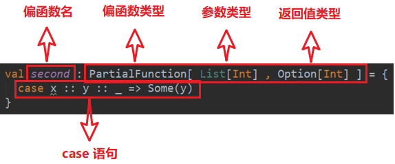

# 模式匹配

Scala中的模式匹配类似于Java中的switch语法

  

#### 基本语法

模式匹配语法中，采用match关键字声明，每个分支采用case关键字进行声明，当需要匹配时，会从第一个case分支开始，如果匹配成功，那么执行对应的逻辑代码，如果匹配不成功，继续执行下一个分支进行判断。如果所有case都不匹配，那么会执行case _分支，类似于Java中default语句。

  

说明

（1）如果所有case都不匹配，那么会执行case _ 分支，类似于Java中default语句，若此时没有case _ 分支，那么会抛出MatchError。

（2）每个case中，不需要使用break语句，自动中断case。

（3）match case语句可以匹配任何类型，而不只是字面量。

（4）=> 后面的代码块，直到下一个case语句之前的代码是**作为一个整体执行**，可以使用{}括起来，也可以不括。

  

### 模式匹配常见用法

  

#### 匹配类型

1）说明

需要进行类型判断时，可以使用前文所学的isInstanceOf[T]和asInstanceOf[T]，也可使用模式匹配实现同样的功能。

#### 匹配对象及样例类

  

小结

- val user = Person05("zhangsan",11)，该语句在执行时，实际调用的是Person05伴生对象中的**apply**方法，因此不用**new** **关键字**就能构造出相应的对象。

- 当将Person05 **("zhangsan", 11)**写在case后时[case User("zhangsan", 11) => "yes"]，会默认调用**unapply**方法(对象提取器)，**user** **作为** **unapply** **方法的参数**，unapply方法将user对象的name和age属性提取出来，与User("zhangsan", 11)中的属性值进行匹配

- case中对象的unapply方法(提取器)返回Some，且所有属性均一致，才算匹配成功,属性不一致，或返回None，则匹配失败。

- 若只提取对象的一个属性，则提取器为**unapply**(obj:Obj):**Option[** **T** **]**

若提取对象的多个属性，则提取器为**un** **apply**(obj:Obj):**Option[** **(T1,T2,T3…)** **]**

若提取对象的可变个属性，则提取器为**un** **applySeq**(obj:Obj):**Option[** **Seq\[T]** **\]**

**2** **）样例类**

（1）语法：

**case** **class** Person05 (name: String, age: Int)

（2）说明

1样例类仍然是类，和普通类相比，只是其自动生成了伴生对象，并且伴生对象中自动提供了一些常用的方法，如**apply**、**unapply**、**toString**、equals、hashCode和copy。

2样例类是为模式匹配而优化的类，因为其默认提供了unapply方法，因此，样例类可以直接使用模式匹配，而无需自己实现unapply方法。

3构造器中的每一个参数都成为val，除非它被显式地声明为var（不建议这样做）

（3）实操

上述匹配对象的案例使用样例类会节省大量代码

  

#### 偏函数中的模式匹配

偏函数也是函数的一种，通过偏函数我们可以方便的对输入参数做更精确的检查。例如该偏函数的输入类型为List[Int]，而我们需要的是第一个元素是0的集合，这就是通过模式匹配实现的。

  

**1）** **偏函数定义**

val second: **PartialFunction**[List\[Int], Option[Int]\] = {

case x :: y :: _ => Some(y)

}

  

**偏函数原理**

上述代码会被scala编译器翻译成以下代码，与普通函数相比，只是多了一个用于参数检查的函数——isDefinedAt，其返回值类型为Boolean。

  

**偏函数使用**

偏函数不能像second(List(1,2,3))这样直接使用，因为这样会直接调用apply方法，而应该调用applyOrElse方法，如下

second.applyOrElse(List(1,2,3), (_: List[Int]) => None)

  

applyOrElse方法的逻辑为 **if** (**ifDefinedAt(**list**)**) **apply(**list**)** else default。如果输入参数满足条件，即isDefinedAt返回true，则执行apply方法，否则执行defalut方法，default方法为参数不满足要求的处理逻辑。

  

#### 下划线的使用总结

附加内容：下划线的使用总结。

（1）用于类中的var属性，使用默认值。

（2）用于高阶函数的第一种用法，表示函数自身。

（3）匿名函数化简，用下划线代替变量。

（4）用于导包下的所有内容。

（5）用于起别名时表示匿名。

（6）用于模式匹配表示任意数据。

  

# 异常

  

#### Java异常处理

注意事项

（1）Java语言按照try—catch—finally的方式来处理异常

（2）不管有没有异常捕获，都会执行finally，因此通常可以在finally代码块中释放资源。

（3）可以有多个catch，分别捕获对应的异常，这时需要把范围小的异常类写在前面，把范围大的异常类写在后面，否则编译错误。

#### Scala异常处理

（1）我们将可疑代码封装在try块中。在try块之后使用了一个catch处理程序来捕获异常。如果发生任何异常，catch处理程序将处理它，程序将不会异常终止。

（2）Scala的异常的工作机制和Java一样，但是Scala没有“checked（编译期）”异常，即Scala没有编译异常这个概念，异常都是在运行的时候捕获处理。

（3）异常捕捉的机制与其他语言中一样，如果有异常发生，catch子句是按次序捕捉的。因此，在catch子句中，越具体的异常越要靠前，越普遍的异常越靠后，如果把越普遍的异常写在前，把具体的异常写在后，在Scala中也不会报错，但这样是非常不好的编程风格。

（4）finally子句用于执行不管是正常处理还是有异常发生时都需要执行的步骤，一般用于对象的清理工作，这点和Java一样。

（5）用throw关键字，抛出一个异常对象。所有异常都是Throwable的子类型。throw表达式是有类型的，就是Nothing，因为Nothing是所有类型的子类型，所以throw表达式可以用在需要类型的地方

def test():Nothing = {  
throw new Exception("不对")  
}

（6）Java提供了throws关键字来声明异常。可以使用方法定义声明异常。它向调用者函数提供了此方法可能引发此异常的信息。它有助于调用函数处理并将该代码包含在try-catch块中，以避免程序异常终止。在Scala中，可以使用throws注解来声明异常

def main(args: Array[String]): Unit = {  
f11()  
}  
  
@throws(classOf[NumberFormatException])  
def f11()={  
"abc".toInt  
}

  

# **隐式转换**

**当编译器第一次编译失败的时候，会在当前的环境中查找能让代码编译通过的方法，用于将类型进行转换，实现二次编译，用于拓展类的方法。**

  

#### 隐式函数

1）说明

隐式转换可以在不需改任何代码的情况下，扩展某个类的功能。

2）案例实操

需求：通过隐式转化为Int类型增加方法。

  

#### 隐式参数

普通方法或者函数中的参数可以通过**implicit**关键字声明为隐式参数，调用该方法时，就可以传入该参数，编译器会在相应的作用域寻找符合条件的隐式值。

1）说明

（1）同一个作用域中，相同类型的隐式值只能有一个。

（2）编译器按照隐式参数的类型去寻找对应类型的隐式值，与隐式值的名称无关。

  

案例实操

**//** **隐式参数 在调用的时候不写括号**

implicit val s: String = "lisi"

  

def sayHi(implicit name: String = "zhangsan"): Unit = {

println(s"hi $name")

}

  

** ****//** **默认填写的参数变成** **zhangsan**

sayHi("linhai")

  

** ****//** **参数默认值**

sayHi()

  

** ****//** **不写括号 是隐式参数**

sayHi

}

  

# **第11章泛型**

  

## **11.1** **协变和逆变**

  

class MyList[**+T**]{ //协变

}

class MyList[**-T**]{ //逆变

}

class MyList[**T**] //不变

2）说明

协变：Son是Father的子类，则MyList[Son] 也作为MyList[Father]的“子类”。

逆变：Son是Father的子类，则MyList[Son]作为MyList[Father]的“父类”。

不变：Son是Father的子类，则MyList[Father]与MyList[Son]“无父子关系”。

  

  

### 11.2 泛型上下限

1）语法

Class PersonList[**T <: Person]**{ //泛型上限

}

Class PersonList[**T >: Person**]{ //泛型下限

}

2）说明

泛型的上下限的作用是对传入的泛型进行限定。

  

### 11.3 上下文限定

1）语法

**def** f\[**B: C**\](a: B) = println(a) //等同于**def** f\[**B**\](a:B)**(implicit arg:C[B])**=println(a)

例如:

def sortBy\[B\](f: A => B)(implicit ord: Ordering[B]): Repr = sorted(ord on f)

可以简写为:

def sortBy\[B:Ordering\](f:A=>B) : Repr = sorted(ord on f)

2）说明

是一种同时使用泛型和隐式参数的简写形式。在判断填写的隐式参数时，需要判断具体的B的泛型。缩写之后方法内无法使用隐式参数名调用隐式参数，需要通过**implicitly[Ordering\[B]\]**获取隐式变量，如果此时无法查找到对应类型的隐式变量，会发生出错误。