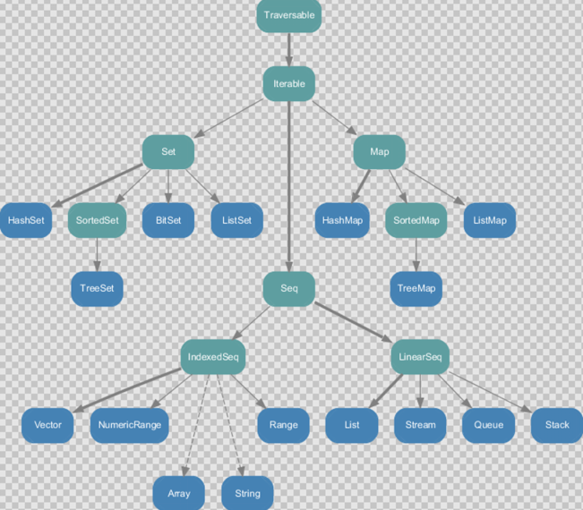
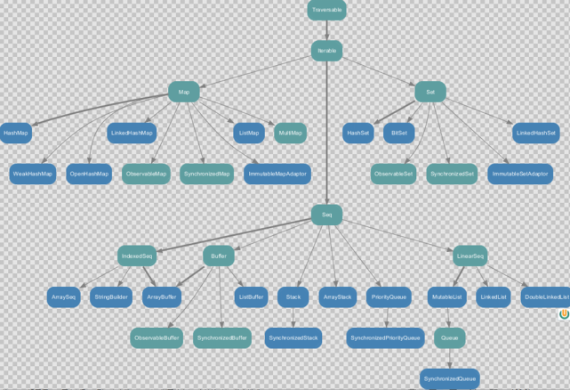

# 集合

### 集合简介

（1）Scala的集合有三大类：序列Seq、集Set、映射Map，所有的集合都扩展自Iterable特质。

（2）对于几乎所有的集合类，Scala都同时提供了**可变**和**不可变**的版本，分别位于以下两个包。

不可变集合：scala.collection.**immutable**

可变集合： scala.collection.**mutable**

（3）Scala不可变集合，就是指该集合对象不可修改，每次修改就会返回一个新对象，而不会对原对象进行修改。类似于java中的String对象。

（4）可变集合，就是这个集合可以直接对原对象进行修改，而不会返回新的对象。类似于java中StringBuilder对象。

**建议：在操作集合的时候，不可变用符号，可变用方法。**

### **不可变集合继承图**

1）Set、Map是Java中也有的集合。

2）Seq是Java没有的，我们发现List归属到Seq了，因此这里的List就和Java不是同一个概念了。.

3）我们前面的for循环有一个 1 to 3，就是IndexedSeq下的Range。

4）String也是属于IndexedSeq。

5）我们发现经典的数据结构比如Queue和Stack被归属到LinearSeq（线性序列）。

6）大家注意Scala中的Map体系有一个SortedMap，说明Scala的Map可以支持排序。

7）IndexedSeq和LinearSeq的区别。

（1）**IndexedSeq**是通过索引来查找和定位，因此速度快，比如String就是一个索引集合，通过索引即可定位。

（2）**LinearSeq**是线型的，即有头尾的概念，这种数据结构一般是通过遍历来查找。

  

### **可变集合继承图**

  

### 数组

#### 7.2.1 不可变数组

1）第一种方式定义数组

定义：val arr1 = new Array\[Int\](10)

（1）new是关键字。

（2）[Int]是指定可以存放的数据类型，如果希望存放任意数据类型，则指定Any。

（3）(10)，表示数组的大小，确定后就不可以变化。

#### 可变数组

1）定义变长数组

val arr01 = ArrayBuffer\[Any\](3, 2, 5)

（1）[Any]存放任意数据类型

（2）(3, 2, 5)初始化好的三个元素

（3）ArrayBuffer需要引入scala.collection.mutable.ArrayBuffer

2）案例实操

（1）ArrayBuffer是有序的集合。

（2）增加元素使用的是append方法()，支持可变参数。

  

#### 不可变数组与可变数组的转换

  

arr1.toBuffer //**不可变数组转可变数组**

arr2.toArray //**可变数组转不可变数组**

（1）arr2.toArray返回结果才是一个不可变数组，arr2本身没有变化。

（2）arr1.toBuffer返回结果才是一个可变数组，arr1本身没有变化。

  

#### 多维数组

多维数组定义

val arr = Array.ofDim\[Double\](3,4)

说明：二维数组中有三个一维数组，每个一维数组中有四个元素。

  

### Seq集合（List）

#### 不可变List

1）说明

（1）List默认为不可变集合

（2）创建一个List（数据有顺序，可重复）  
（3）遍历List

（4）List增加数据

（5）集合间合并：将一个整体拆成一个一个的个体，称为扁平化  
（6）取指定数据  
（7）空集合Nil

#### 可变ListBuffer

说明

（1）创建一个可变集合ListBuffer

（2）向集合中添加数据

（3）删除元素

（4）查看修改元素

### Set集合

默认情况下，Scala使用的是不可变集合，如果你想使用可变集合，需要引用 scala.collection.mutable.Set包。

  

#### 7.4.1 不可变Set

1）说明

（1）Set默认是不可变集合

（2）数据无序不可重复

（3）默认使用hash set

#### 7.4.2 可变mutable.Set

1）说明

（1）创建可变集合mutable.Set

（2）集合添加元素

（3）删除数据

  

### Map集合

Scala中的Map和Java类似，**也是一个散列表**，它存储的内容也是键值对（**key-value** **）**映射。

#### 7.5.1 不可变Map

1）说明

（1）创建不可变集合Map

（2）循环打印

（3）读取数据

#### 可变Map

1）说明

（1）创建可变集合

（2）向集合增加数据

（3）修改数据

（4）删除数据

  

### 元组

说明

元组也是可以理解为一个容器，可以存放各种相同或不同类型的数据。说的简单点，就是将多个无关的数据封装为一个整体，称为元组。

注意：元组中最大只能有22个元素。

2）案例实操

（1）声明元组的方式：（元素1，元素2，元素3）。

（2）访问元组。

（3）Map中的键值对其实就是元组,只不过元组的元素个数为2，称之为对偶

  

### 7.7 集合常用函数

#### 7.7.1 基本属性和常用操作

1）说明

（1）获取集合长度

（2）获取集合大小

（3）循环遍历

（4）迭代器

（5）生成字符串

（6）是否包含

#### 7.7.2 衍生集合

1）说明

（1）获取集合的头

（2）获取集合的尾（不是头的就是尾）

（3）集合最后一个数据

（4）集合初始数据（不包含最后一个）

（5）反转

（6）取前（后）n个元素

（7）去掉前（后）n个元素

（8）并集

（9）交集

（10）差集

（11）拉链

（12）滑窗

#### 7.7.3 集合计算初级函数

1）说明

（1）求和

（2）求乘积

（3）最大值

（4）最小值

（5）排序

1）sorted

对一个集合进行自然排序，通过传递隐式的Ordering。

2）sortBy

对一个属性或多个属性进行排序，通过它的类型。

3）sortWith

基于函数的排序，通过一个comparator函数，实现自定义排序的逻辑。

  

#### 7.7.4 集合计算高级函数

  

（1）过滤

遍历一个集合并从中获取满足指定条件的元素组成一个新的集合。

（2）**转化** **/** **映射（** **map** **）**

将集合中的每一个元素映射到某一个函数。

（3）扁平化

（4）扁平化+映射 注：flatMap相当于先进行map操作，在进行flatten操作。

集合中的每个元素的子元素映射到某个函数并返回新集合。

（5）**分组（** **group** **By** **）**

**按照指定的规则对集合的元素进行分组。**

（6）简化（归约）

（7）折叠

  

**Reduce** **方法**

Reduce简化（归约）：通过指定的逻辑将集合中的数据进行聚合，从而减少数据，最终获取结果。

**4）** **Fold方法**

Fold折叠：化简的一种特殊情况，可以添加初始值

  

### 队列

说明

Scala也提供了队列（Queue）的数据结构，队列的特点就是先进先出。进队和出队的方法分别为enqueue和dequeue。

#### 并行集合

1）说明

Scala为了充分使用多核CPU，提供了并行集合（有别于前面的串行集合），用于多核环境的并行计算。

  

  

