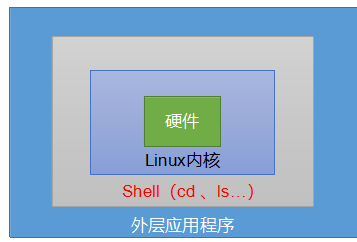

shell是一个命令解释器,接收程序,用户命令,再去调用操作系统内核.

也是一门编程语言

  

**Linux****提供的****Shell****解析器有：**

[atguigu@hadoop101 ~]$ cat /etc/shells

/bin/sh

/bin/bash

/sbin/nologin

/usr/bin/sh

/usr/bin/bash

/usr/sbin/nologin

/bin/tcsh

/bin/csh

**Centos****默认的****解析****器****是****b****ash**

[atguigu@hadoop101 bin]$ echo $SHELL

/bin/bash

​  

### shell脚本入门

脚本以#!/bin/bash开头（指定解析器）

​  

脚本的常用执行方式

第一种：采用bash或sh+脚本的相对路径或绝对路径（不用赋予脚本+x权限）

​  

sh+脚本的相对路径

[atguigu@hadoop101 shells]$ sh ./helloworld.sh

Helloworld

sh+脚本的绝对路径

[atguigu@hadoop101 shells]$ sh /home/atguigu/shells/helloworld.sh

helloworld

bash+脚本的相对路径

[atguigu@hadoop101 shells]$ bash ./helloworld.sh

Helloworld

bash+脚本的绝对路径

[atguigu@hadoop101 shells]$ bash /home/atguigu/shells/helloworld.sh

Helloworld

​  

第二种：采用输入脚本的绝对路径或相对路径执行脚本（必须具有可执行权限+x）

（a）首先要赋予helloworld.sh 脚本的+x权限

[atguigu@hadoop101 shells]$ chmod +x helloworld.sh

（b）执行脚本

相对路径

[atguigu@hadoop101 shells]$ ./helloworld.sh

Helloworld

绝对路径

[atguigu@hadoop101 shells]$ /home/atguigu/shells/helloworld.sh

Helloworld

注意：第一种执行方法，本质是bash解析器帮你执行脚本，所以脚本本身不需要执行权限。第二种执行方法，本质是脚本需要自己执行，所以需要执行权限。

​  

第三种：在脚本的路径前加上“.”或者 source

（a）有以下脚本

[atguigu@hadoop101 shells]$ cat test.sh

#!/bin/bash

A=5

echo $A

(b) 分别使用sh，bash，./ 和. 的方式来执行，结果如下：

[atguigu@hadoop101 shells]$ bash test.sh

[atguigu@hadoop101 shells]$ echo $A

​  

[atguigu@hadoop101 shells]$ sh test.sh

[atguigu@hadoop101 shells]$ echo $A

​  

[atguigu@hadoop101 shells]$ ./test.sh

[atguigu@hadoop101 shells]$ echo $A

​  

[atguigu@hadoop101 shells]$ . test.sh

[atguigu@hadoop101 shells]$ echo $A

5

原因：

前两种方式都是在当前shell中打开一个子shell来执行脚本内容，当脚本内容结束，则子shell关闭，回到父shell中。

第三种，也就是使用在脚本路径前加“.”或者 source的方式，可以使脚本内容在当前shell里执行，而无需打开子shell！这也是为什么我们每次要修改完/etc/profile文件以后，需要source一下的原因。

开子shell与不开子shell的区别就在于，环境变量的继承关系，如在子shell中设置的当前变量，父shell是不可见的。

​  

### 变量

系统预定义变量

**常用****系统变量**

$HOME、$PWD、$SHELL、$USER等

显示当前Shell中所有变量：set

​  

#### 自定义变量

**1****）****基本语法**

（1）定义变量：变量名\=变量值，注意\=号前后不能有空格

（2）撤销变量：unset 变量名

（3）声明静态变量：readonly变量，注意：不能unset

**2****）****变量定义规则**

（1）变量名称可以由字母、数字和下划线组成，但是不能以数字开头，环境变量名建议大写。

（2）等号两侧不能有空格

（3）在bash中，变量默认类型都是字符串类型，无法直接进行数值运算。

（4）变量的值如果有空格，需要使用双引号或单引号括起来。

​  

实例:（4）声明静态的变量B=2，不能unset

[atguigu@hadoop101 shells]$ readonly B=2

[atguigu@hadoop101 shells]$ echo $B

2

[atguigu@hadoop101 shells]$ B=9

\-bash: B: readonly variable

（5）在bash中，变量默认类型都是字符串类型，无法直接进行数值运算

[atguigu@hadoop102 ~]$ C=1+2

[atguigu@hadoop102 ~]$ echo $C

1+2

（6）变量的值如果有空格，需要使用双引号或单引号括起来

[atguigu@hadoop102 ~]$ D=I love banzhang

\-bash: world: command not found

[atguigu@hadoop102 ~]$ D="I love banzhang"

[atguigu@hadoop102 ~]$ echo $D

I love banzhang

（7）可把变量提升为全局环境变量，可供其他Shell程序使用

export 变量名

[atguigu@hadoop101 shells]$ vim helloworld.sh

在helloworld.sh文件中增加echo $B

#!/bin/bash

​  

echo "helloworld"

echo $B

​  

[atguigu@hadoop101 shells]$ ./helloworld.sh

Helloworld

发现并没有打印输出变量B的值。

[atguigu@hadoop101 shells]$ export B

[atguigu@hadoop101 shells]$ ./helloworld.sh

helloworld

2

​  

#### 特殊变量

$n

**1****）****基本语法**

$n （功能描述：n为数字，$0代表该脚本名称，$1-$9代表第一到第九个参数，十以上的参数，十以上的参数需要用大括号包含，如${10}）

$# （功能描述：获取所有输入参数个数，常用于循环,判断参数的个数是否正确以及加强脚本的健壮性）。

$\* （功能描述：这个变量代表命令行中所有的参数，$\*把所有的参数看成一个整体）

$@ （功能描述：这个变量也代表命令行中所有的参数，不过$@把每个参数区分对待）

$？ （功能描述：最后一次执行的命令的返回状态。如果这个变量的值为0，证明上一个命令正确执行；如果这个变量的值为非0（具体是哪个数，由命令自己来决定），则证明上一个命令执行不正确了。）

#### 第四章  
**基本语法**

“$((运算式))”或“$[运算式]”

#### 条件判断

**1****）****基本语法**

（1）test condition

（2）[ condition ]（注意condition前后要有空格）

注意：条件非空即为true，[ atguigu ]返回true，[ ] 返回false。

​  

**常用判断条件**

（1）两个整数之间比较

\-eq 等于（equal） \-ne 不等于（not equal）

\-lt 小于（less than） \-le 小于等于（less equal）

\-gt 大于（greater than） -ge 大于等于（greater equal）

（2）按照文件权限进行判断

\-r 有读的权限（read）

\-w 有写的权限（write）

\-x 有执行的权限（execute）

（3）按照文件类型进行判断

\-e 文件存在（existence）

\-f 文件存在并且是一个常规的文件（file）

\-d 文件存在并且是一个目录（directory）

​  

多条件判断（&& 表示前一条命令执行成功时，才执行后一条命令，|| 表示上一条命令执行失败后，才执行下一条命令）

  

### 第6章流程控制（重点）

#### if判断

（1）单分支

if [ 条件判断式 ];then

​程序

fi

或者

if [ 条件判断式 ]

then

​程序

fi

​  

（2）多分支

if [ 条件判断式 ]

then

​程序

elif [ 条件判断式 ]

then

程序

else

程序

fi

注意事项：

（1）[ 条件判断式 ]，中括号和条件判断式之间必须有空格

（2）if后要有空格

  

#### case语句

  

基础语法

case $变量名 in

"值1"）

​如果变量的值等于值1，则执行程序1

;;

"值2"）

​如果变量的值等于值2，则执行程序2

;;

​…省略其他分支…

\*）

​如果变量的值都不是以上的值，则执行此程序

;;

esac

​  

注意事项：

（1）case行尾必须为单词“in”，每一个模式匹配必须以右括号“）”结束。

（2）双分号“**;;**”表示命令序列结束，相当于java中的break。

（3）最后的“\*）”表示默认模式，相当于java中的default。

​  

#### for循环

基本语法1:

for (( 初始值;循环控制条件;变量变化 ))

do

​程序

done

**基本语法2:**

for 变量 in 值1 值2 值3…

do

​程序

done

​  

比较$\*和$@区别

$\*和$@都表示传递给函数或脚本的所有参数，不被双引号“”包含时，都以$1 $2 …$n的形式输出所有参数。

​  

#### while循环

**1****）****基本语法**

while [ 条件判断式 ]

do

​程序

done

​  

​  

### read读取控制台输入

**1****）****基本语法**

read (选项) (参数)

选项：

\-p：指定读取值时的提示符；

\-t：指定读取值时等待的时间（秒）如果\-t不加表示一直等待

参数

变量：指定读取值的变量名

​  

### 函数

#### 系统函数

#### 8.1.1 basename

**1****）****基本语法**

basename [string / pathname] [suffix] （功能描述：basename命令会删掉所有的前缀包括最后一个（‘/’）字符，然后将字符串显示出来。

basename 可以理解为取路径里的文件名称

选项：

suffix为后缀，如果suffix被指定了，basename会将pathname或string中的suffix去掉。

​  

​  

截取该/home/atguigu/banzhang.txt路径的文件名称

[atguigu@hadoop101 shells]$ basename /home/atguigu/banzhang.txt

banzhang.txt

[atguigu@hadoop101 shells]$ basename /home/atguigu/banzhang.txt .txt

banzhang

​  

#### dirname

**1****）****基本语法**

dirname 文件绝对路径 （功能描述：从给定的包含绝对路径的文件名中去除文件名（非目录的部分），然后返回剩下的路径（目录的部分））

dirname 可以理解为取文件路径的绝对路径名称

​  

​  

获取banzhang.txt文件的路径

[atguigu@hadoop101 ~]$ dirname /home/atguigu/banzhang.txt

/home/atguigu

​  

#### 自定义函数

**基本语法**

[ function ] funname[()]

{

Action;

[return int;]

}

**2****）****经验技巧**

（1）必须在调用函数地方之前，先声明函数，shell脚本是逐行运行。不会像其它语言一样先编译。

（2）函数返回值，只能通过$?系统变量获得，可以显示加：return返回，如果不加，将以最后一条命令运行结果，作为返回值。return后跟数值n(0-255)

​  

### Shell工具

  

#### cut

cut的工作就是“剪”，具体的说就是在文件中负责剪切数据用的。cut 命令从文件的每一行剪切字节、字符和字段并将这些字节、字符和字段输出。

**1****）基本用法**

cut [选项参数] filename

说明：默认分隔符是制表符

**2****）选项参数说明**

| 选项参数 | 功能 |
| --- | --- |
| -f | 列号，提取第几列 |
| -d | 分隔符，按照指定分隔符分割列，默认是制表符“\t” |
| -c | 按字符进行切割后加加n 表示取第几列 比如 -c 1 |

​  

选取系统PATH变量值，第2个“：”开始后的所有路径：

​  

切割ifconfig 后打印的IP地址

[atguigu@hadoop101 shells]$ ifconfig ens33 | grep netmask | cut -d "i" -f 2 | cut -d " " -f 2

192.168.6.101

​  

​  

#### awk

一个强大的文本分析工具，把文件逐行的读入，以空格为默认分隔符将每行切片，切开的部分再进行分析处理。

**1****）基本用法**

awk [选项参数] ‘/pattern1/{action1} /pattern2/{action2}...’ filename

pattern：表示awk在数据中查找的内容，就是匹配模式

action：在找到匹配内容时所执行的一系列命令

**2****）****选项参数说****明**

| 选项参数 | 功能 |
| --- | --- |
| -F | 指定输入文件折分隔符 |
| -v | 赋值一个用户定义变量 |

  

**a****wk****的内置变量**

| 变量 | 说明 |
| --- | --- |
| FILENAME | 文件名 |
| NR | 已读的记录数（行号） |
| NF | 浏览记录的域的个数（切割后，列的个数） |

  

**案例实操**

（1）统计passwd文件名，每行的行号，每行的列数

[atguigu@hadoop101 shells]$ awk -F : '{print "filename:" FILENAME ",linenum:" NR ",col:"NF}' passwd

filename:passwd,linenum:1,col:7

filename:passwd,linenum:2,col:7

filename:passwd,linenum:3,col:7

。。。

（2）查询ifconfig命令输出结果中的空行所在的行号

[atguigu@hadoop101 shells]$ ifconfig | awk '/^$/{print NR}'

9

18

26

（3）切割IP

[atguigu@hadoop101 shells]$ ifconfig ens33 | grep netmask | awk -F "inet" '{print $2}' | awk -F " " '{print $1}'

192.168.6.101

​  

#### sort

sort命令是在Linux里非常有用，它将文件进行排序，并将排序结果标准输出。

**1****）基本语法**

Sort (选项) (参数)

| 选项 | 说明 |
| --- | --- |
| -n | 依照数值的大小排序 |
| -r | 以相反的顺序来排序 |
| -t | 设置排序时所用的分隔字符 |
| -k | 指定需要排序的列 |

参数：指定待排序的文件列表

​  

#### wc

wc命令用来统计文件信息。利用wc指令我们可以计算文件的行数，字节数、字符数等。

**1****）基本语法**

wc [选项参数] filename

​  

| 选项参数 | 功能 |
| --- | --- |
| -l | 统计文件行数 |
| -w | 统计文件的单词数 |
| -m | 统计文件的字符数 |
| -c | 统计文件的字节数 |

**案例实操**

统计/etc/profile文件的行数、单词数、字节数！

[atguigu@hadoop101 shells]$ wc -l /etc/profile

[atguigu@hadoop101 shells]$ wc -w /etc/profile

[atguigu@hadoop101 shells]$ wc -m /etc/profile

​  

### 正则表达式

正则表达式使用单个字符串来描述、匹配一系列符合某个语法规则的字符串。在很多文本编辑器里，正则表达式通常被用来检索、替换那些符合某个模式的文本。在Linux中，grep，sed，awk等命令都支持通过正则表达式进行模式匹配。

​  

#### 常规匹配

一串不包含特殊字符的正则表达式匹配它自己，例如：

[atguigu@hadoop101 shells]$ cat /etc/passwd | grep atguigu

就会匹配所有包含atguigu的行

​  

### 常用特殊字符

**特殊字符：****^**

^ 匹配一行的开头，例如：

[atguigu@hadoop101 shells]$ cat /etc/passwd | grep ^a

会匹配出所有以a开头的行

**2****）特殊字符：****$**

$ 匹配一行的结束，例如

[atguigu@hadoop101 shells]$ cat /etc/passwd | grep t$

会匹配出所有以t结尾的行

**思考：****^****$** **匹配什么？**

**3****）特殊字符：****.**

. 匹配一个任意的字符，例如

[atguigu@hadoop101 shells]$ cat /etc/passwd | grep r..t

会匹配包含rabt,rbbt,rxdt,root等的所有行

**4****）特殊字符：****\***

\* 不单独使用，他和上一个字符连用，表示匹配上一个字符0次或多次，例如

[atguigu@hadoop101 shells]$ cat /etc/passwd | grep ro\*t

会匹配rt, rot, root, rooot, roooot等所有行

**思考：.\* 匹配什么？**

**5****）特殊字符：****[** **]**

[ ] 表示匹配某个范围内的一个字符，例如

[6,8]------匹配6或者8

[0\-9]------匹配一个0-9的数字

[0\-9]\*------匹配任意长度的数字字符串

[a-z]------匹配一个a-z之间的字符

[a-z]\* ------匹配任意长度的字母字符串

[a-c, e-f]-匹配a-c或者e-f之间的任意字符

[atguigu@hadoop101 shells]$ cat /etc/passwd | grep r[a,b,c]\*t

会匹配rt,rat, rbt, rabt, rbact,rabccbaaacbt等等所有行

**6****）特殊字符：****\\**

\\ 表示转义，并不会单独使用。由于所有特殊字符都有其特定匹配模式，当我们想匹配某一特殊字符本身时（例如，我想找出所有包含'$' 的行），就会碰到困难。此时我们就要将转义字符和特殊字符连用，来表示特殊字符本身，例如

[atguigu@hadoop101 shells]$ cat /etc/passwd | grep a\\$b

就会匹配所有包含a$b 的行。

#### 其他特殊字符

见参考资料的正则表达式语法。

​