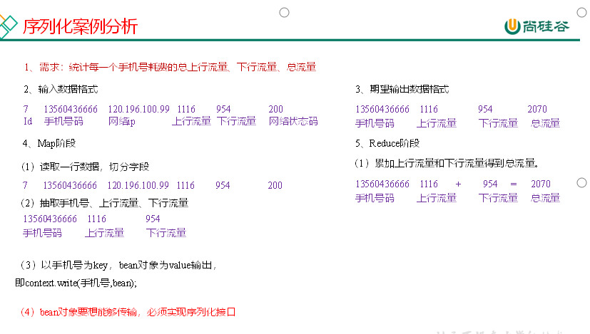

# Hadoop

## HDFS的API操作

**在** **IDEA** **中创建一个** **Maven** **工程** **HdfsClient** **Demo** **，并导入相应的依赖坐标** **+** **日志添加**

\<dependencies>

\<dependency>

\<groupId>org.apache.hadoop\</groupId>

\<artifactId>hadoop-client\</artifactId>

\<version>3.1.3\</version>

\</dependency>

\<dependency>

\<groupId>junit\</groupId>

\<artifactId>junit\</artifactId>

\<version>4.12\</version>

\</dependency>

\<dependency>

\<groupId>org.slf4j\</groupId>

\<artifactId>slf4j-log4j12\</artifactId>

\<version>1.7.30\</version>

\</dependency>

\</dependencies>

在项目的src/main/resources目录下，新建一个文件，命名为“log4j.properties”，在文件中填入

log4j.rootLogger=INFO, stdout

log4j.appender.stdout=org.apache.log4j.ConsoleAppender

log4j.appender.stdout.layout=org.apache.log4j.PatternLayout

log4j.appender.stdout.layout.ConversionPattern=%d %p [%c] - %m%n

log4j.appender.logfile=org.apache.log4j.FileAppender

log4j.appender.logfile.File=target/spring.log

log4j.appender.logfile.layout=org.apache.log4j.PatternLayout

log4j.appender.logfile.layout.ConversionPattern=%d %p [%c] - %m%n

**5** **）创建包名** **：** **com.atguigu.hdfs**

**6** **）** **创建** **HdfsClient** **类**

public class HdfsClient {

  

@Test

public void testMkdirs() throws IOException, URISyntaxException, InterruptedException {

  

// 1 获取文件系统

Configuration configuration = new Configuration();

  

// FileSystem fs = FileSystem.get(new URI("hdfs://hadoop102:8020"), configuration);

FileSystem fs = FileSystem.get(new URI("hdfs://hadoop102:8020"), configuration,"atguigu");

  

// 2 创建目录

fs.mkdirs(new Path("/xiyou/huaguoshan/"));

  

// 3 关闭资源

fs.close();

}

}

**7** **）执行** **程序**

客户端去操作HDFS时，是有一个用户身份的。默认情况下，HDFS客户端API会从采用Windows默认用户访问HDFS，会报权限异常错误。所以在访问HDFS时，一定要配置用户。

org.apache.hadoop.security.AccessControlException: Permission denied: user=56576, access=WRITE, inode="/xiyou/huaguoshan":atguigu:supergroup:drwxr-xr-x

### HDFS的API案例实操

#### 3.2.1 HDFS文件上传（测试参数优先级）

**1** **）** **编写源代码**

@Test

public void testCopyFromLocalFile() throws IOException, InterruptedException, URISyntaxException {

  

// 1 获取文件系统

Configuration configuration = new Configuration();

configuration.set("dfs.replication", "2");

FileSystem fs = FileSystem.get(new URI("hdfs://hadoop102:8020"), configuration, "atguigu");

  

// 2 上传文件

fs.copyFromLocalFile(new Path("d:/sunwukong.txt"), new Path("/xiyou/huaguoshan"));

  

// 3 关闭资源

fs.close();

｝

**2** **）将** **hdfs-site.xml** **拷贝到项目的** **resource** **s** **资源目录下**

<?xml version="1.0" encoding="UTF-8"?>

<?xml-stylesheet type="text/xsl" href="configuration.xsl"?>

  

\<configuration>

\<property>

\<name>dfs.replication\</name>

\<value>1\</value>

\</property>

\</configuration>

**3** **）参数** **优先级**

参数优先级排序：（1）客户端代码中设置的值 \>（2）ClassPath下的用户自定义配置文件 \>（3）然后是服务器的自定义配置（xxx-site.xml） >（4）服务器的默认配置（xxx-default.xml）

#### 3.2.2 HDFS文件下载

@Test

public void testCopyToLocalFile() throws IOException, InterruptedException, URISyntaxException{

  

// 1 获取文件系统

Configuration configuration = new Configuration();

FileSystem fs = FileSystem.get(new URI("hdfs://hadoop102:8020"), configuration, "atguigu");

  

// 2 执行下载操作

// boolean delSrc 指是否将原文件删除

// Path src 指要下载的文件路径

// Path dst 指将文件下载到的路径

// boolean useRawLocalFileSystem 是否开启文件校验

fs.copyToLocalFile(false, new Path("/xiyou/huaguoshan/sunwukong.txt"), new Path("d:/sunwukong2.txt"), true);

  

// 3 关闭资源

fs.close();

}

## **Hadooop序列化案例实操**

**1** **）** **需求**

统计每一个手机号耗费的总上行流量、总下行流量、总流量

（1）输入数据

（2）输入数据格式：

| 7 13560436666 120.196.100.99 1116 954 200 id 手机号码 网络ip 上行流量 下行流量 网络状态码 |
| --- |

（3）期望输出数据格式

| 13560436666 1116 954 2070 手机号码 上行流量 下行流量 总流量 |
| --- |

**2）需求分析**

**3** **）编写** **MapReduce** **程序**

（1）编写流量统计的Bean对象

package com.atguigu.mapreduce.writable;

  

import org.apache.hadoop.io.Writable;

import java.io.DataInput;

import java.io.DataOutput;

import java.io.IOException;

  

//1 继承Writable接口

public class FlowBean implements Writable {

  

private long upFlow; //上行流量

private long downFlow; //下行流量

private long sumFlow; //总流量

  

//2 提供无参构造

public FlowBean() {

}

  

//3 提供三个参数的getter和setter方法

public long getUpFlow() {

return upFlow;

}

  

public void setUpFlow(long upFlow) {

this.upFlow = upFlow;

}

  

public long getDownFlow() {

return downFlow;

}

  

public void setDownFlow(long downFlow) {

this.downFlow = downFlow;

}

  

public long getSumFlow() {

return sumFlow;

}

  

public void setSumFlow(long sumFlow) {

this.sumFlow = sumFlow;

}

  

public void setSumFlow() {

this.sumFlow = this.upFlow + this.downFlow;

}

  

//4 实现序列化和反序列化方法,注意顺序一定要保持一致

@Override

public void write(DataOutput dataOutput) throws IOException {

dataOutput.writeLong(upFlow);

dataOutput.writeLong(downFlow);

dataOutput.writeLong(sumFlow);

}

  

@Override

public void readFields(DataInput dataInput) throws IOException {

this.upFlow = dataInput.readLong();

this.downFlow = dataInput.readLong();

this.sumFlow = dataInput.readLong();

}

  

//5 重写ToString

@Override

public String toString() {

return upFlow + "\\t" + downFlow + "\\t" + sumFlow;

}

}

（2）编写Mapper类

package com.atguigu.mapreduce.writable;

  

import org.apache.hadoop.io.LongWritable;

import org.apache.hadoop.io.Text;

import org.apache.hadoop.mapreduce.Mapper;

import java.io.IOException;

  

public class FlowMapper extends Mapper\<LongWritable, Text, Text, FlowBean> {

private Text outK = new Text();

private FlowBean outV = new FlowBean();

  

@Override

protected void map(LongWritable key, Text value, Context context) throws IOException, InterruptedException {

  

//1 获取一行数据,转成字符串

String line = value.toString();

  

//2 切割数据

String[] split = line.split("\\t");

  

//3 抓取我们需要的数据:手机号,上行流量,下行流量

String phone = split[1];

String up = split[split.length - 3];

String down = split[split.length - 2];

  

//4 封装outK outV

outK.set(phone);

outV.setUpFlow(Long.parseLong(up));

outV.setDownFlow(Long.parseLong(down));

outV.setSumFlow();

  

//5 写出outK outV

context.write(outK, outV);

}

}

（3）编写Reducer类

package com.atguigu.mapreduce.writable;

  

import org.apache.hadoop.io.Text;

import org.apache.hadoop.mapreduce.Reducer;

import java.io.IOException;

  

public class FlowReducer extends Reducer\<Text, FlowBean, Text, FlowBean> {

private FlowBean outV = new FlowBean();

@Override

protected void reduce(Text key, Iterable\<FlowBean> values, Context context) throws IOException, InterruptedException {

  

long totalUp = 0;

long totalDown = 0;

  

//1 遍历values,将其中的上行流量,下行流量分别累加

for (FlowBean flowBean : values) {

totalUp += flowBean.getUpFlow();

totalDown += flowBean.getDownFlow();

}

  

//2 封装outKV

outV.setUpFlow(totalUp);

outV.setDownFlow(totalDown);

outV.setSumFlow();

  

//3 写出outK outV

context.write(key,outV);

}

}

（4）编写Driver驱动类

package com.atguigu.mapreduce.writable;

  

import org.apache.hadoop.conf.Configuration;

import org.apache.hadoop.fs.Path;

import org.apache.hadoop.io.Text;

import org.apache.hadoop.mapreduce.Job;

import org.apache.hadoop.mapreduce.lib.input.FileInputFormat;

import org.apache.hadoop.mapreduce.lib.output.FileOutputFormat;

import java.io.IOException;

  

public class FlowDriver {

public static void main(String[] args) throws IOException, ClassNotFoundException, InterruptedException {

  

//1 获取job对象

Configuration conf = new Configuration();

Job job = Job.getInstance(conf);

  

//2 关联本Driver类

job.setJarByClass(FlowDriver.class);

  

//3 关联Mapper和Reducer

job.setMapperClass(FlowMapper.class);

job.setReducerClass(FlowReducer.class);

  

//4 设置Map端输出KV类型

job.setMapOutputKeyClass(Text.class);

job.setMapOutputValueClass(FlowBean.class);

  

//5 设置程序最终输出的KV类型

job.setOutputKeyClass(Text.class);

job.setOutputValueClass(FlowBean.class);

  

//6 设置程序的输入输出路径

FileInputFormat.setInputPaths(job, new Path("D:\\\\inputflow"));

FileOutputFormat.setOutputPath(job, new Path("D:\\\\flowoutput"));

  

//7 提交Job

boolean b = job.waitForCompletion(true);

System.exit(b ? 0 : 1);

}

}

  

## hadoop压缩案例

#### Map输出端采用压缩

即使你的MapReduce的输入输出文件都是未压缩的文件，你仍然可以对Map任务的中间结果输出做压缩，因为它要写在硬盘并且通过网络传输到Reduce节点，对其压缩可以提高很多性能，这些工作只要设置两个属性即可，我们来看下代码怎么设置。

**1** **）给大家** **提供的** **Hadoop** **源码支持的压缩格式有：** **BZip2Codec** **、** **DefaultCodec**

package com.atguigu.mapreduce.compress;

import java.io.IOException;

import org.apache.hadoop.conf.Configuration;

import org.apache.hadoop.fs.Path;

import org.apache.hadoop.io.IntWritable;

import org.apache.hadoop.io.Text;

import org.apache.hadoop.io.compress.BZip2Codec;

import org.apache.hadoop.io.compress.CompressionCodec;

import org.apache.hadoop.io.compress.GzipCodec;

import org.apache.hadoop.mapreduce.Job;

import org.apache.hadoop.mapreduce.lib.input.FileInputFormat;

import org.apache.hadoop.mapreduce.lib.output.FileOutputFormat;

  

public class WordCountDriver {

  

public static void main(String[] args) throws IOException, ClassNotFoundException, InterruptedException {

  

Configuration conf = new Configuration();

  

// 开启map端输出压缩

conf.setBoolean("mapreduce.map.output.compress", true);

  

// 设置map端输出压缩方式

conf.setClass("mapreduce.map.output.compress.codec", BZip2Codec.class,CompressionCodec.class);

  

Job job = Job.getInstance(conf);

  

job.setJarByClass(WordCountDriver.class);

  

job.setMapperClass(WordCountMapper.class);

job.setReducerClass(WordCountReducer.class);

  

job.setMapOutputKeyClass(Text.class);

job.setMapOutputValueClass(IntWritable.class);

  

job.setOutputKeyClass(Text.class);

job.setOutputValueClass(IntWritable.class);

  

FileInputFormat.setInputPaths(job, new Path(args[0]));

FileOutputFormat.setOutputPath(job, new Path(args[1]));

  

boolean result = job.waitForCompletion(true);

  

System.exit(result ? 0 : 1);

}

}

**2** **）** **Mapper** **保持不变**

package com.atguigu.mapreduce.compress;

import java.io.IOException;

import org.apache.hadoop.io.IntWritable;

import org.apache.hadoop.io.LongWritable;

import org.apache.hadoop.io.Text;

import org.apache.hadoop.mapreduce.Mapper;

  

public class WordCountMapper extends Mapper\<LongWritable, Text, Text, IntWritable>{

  

Text k = new Text();

IntWritable v = new IntWritable(1);

  

@Override

protected void map(LongWritable key, Text value, Context context)throws IOException, InterruptedException {

  

// 1 获取一行

String line = value.toString();

  

// 2 切割

String[] words = line.split(" ");

  

// 3 循环写出

for(String word:words){

k.set(word);

context.write(k, v);

}

}

}

**3** **）** **Reducer** **保持不变**

package com.atguigu.mapreduce.compress;

import java.io.IOException;

import org.apache.hadoop.io.IntWritable;

import org.apache.hadoop.io.Text;

import org.apache.hadoop.mapreduce.Reducer;

  

public class WordCountReducer extends Reducer\<Text, IntWritable, Text, IntWritable>{

  

IntWritable v = new IntWritable();

  

@Override

protected void reduce(Text key, Iterable\<IntWritable> values,

Context context) throws IOException, InterruptedException {

int sum = 0;

  

// 1 汇总

for(IntWritable value:values){

sum += value.get();

}

v.set(sum);

  

 // 2 输出

context.write(key, v);

}

}

#### 4.5.2 Reduce输出端采用压缩

基于WordCount案例处理。

**1** **）** **修改驱动**

package com.atguigu.mapreduce.compress;

import java.io.IOException;

import org.apache.hadoop.conf.Configuration;

import org.apache.hadoop.fs.Path;

import org.apache.hadoop.io.IntWritable;

import org.apache.hadoop.io.Text;

import org.apache.hadoop.io.compress.BZip2Codec;

import org.apache.hadoop.io.compress.DefaultCodec;

import org.apache.hadoop.io.compress.GzipCodec;

import org.apache.hadoop.io.compress.Lz4Codec;

import org.apache.hadoop.io.compress.SnappyCodec;

import org.apache.hadoop.mapreduce.Job;

import org.apache.hadoop.mapreduce.lib.input.FileInputFormat;

import org.apache.hadoop.mapreduce.lib.output.FileOutputFormat;

  

public class WordCountDriver {

  

public static void main(String[] args) throws IOException, ClassNotFoundException, InterruptedException {

Configuration conf = new Configuration();

Job job = Job.getInstance(conf);

job.setJarByClass(WordCountDriver.class);

job.setMapperClass(WordCountMapper.class);

job.setReducerClass(WordCountReducer.class);

job.setMapOutputKeyClass(Text.class);

job.setMapOutputValueClass(IntWritable.class);

job.setOutputKeyClass(Text.class);

job.setOutputValueClass(IntWritable.class);

FileInputFormat.setInputPaths(job, new Path(args[0]));

FileOutputFormat.setOutputPath(job, new Path(args[1]));

// 设置reduce端输出压缩开启

FileOutputFormat.setCompressOutput(job, true);

  

// 设置压缩的方式

FileOutputFormat.setOutputCompressorClass(job, BZip2Codec.class);

// FileOutputFormat.setOutputCompressorClass(job, GzipCodec.class);

// FileOutputFormat.setOutputCompressorClass(job, DefaultCodec.class);

boolean result = job.waitForCompletion(true);

System.exit(result?0:1);

}

}

**2）Mapper和Reducer保持不变（** **详见4.5.** **1** **）**

  

  

## Hadoop的partiton分区案例实测

**在案例2.3的基础上(序列化案例实操)，增加一个分区类**

package com.atguigu.mapreduce.partitioner;

import org.apache.hadoop.io.Text;

import org.apache.hadoop.mapreduce.Partitioner;

  

public class ProvincePartitioner extends Partitioner\<Text, FlowBean> {

  

@Override

public int getPartition(Text text, FlowBean flowBean, int numPartitions) {

//获取手机号前三位prePhone

String phone = text.toString();

String prePhone = phone.substring(0, 3);

  

//定义一个分区号变量partition,根据prePhone设置分区号

int partition;

  

if("136".equals(prePhone)){

partition = 0;

}else if("137".equals(prePhone)){

partition = 1;

}else if("138".equals(prePhone)){

partition = 2;

}else if("139".equals(prePhone)){

partition = 3;

}else {

partition = 4;

}

  

//最后返回分区号partition

return partition;

}

}

**4** **）在驱动函数中增加自定义数据分区设置和** **R** **educe** **T** **ask** **设置**

package com.atguigu.mapreduce.partitioner;

import org.apache.hadoop.conf.Configuration;

import org.apache.hadoop.fs.Path;

import org.apache.hadoop.io.Text;

import org.apache.hadoop.mapreduce.Job;

import org.apache.hadoop.mapreduce.lib.input.FileInputFormat;

import org.apache.hadoop.mapreduce.lib.output.FileOutputFormat;

import java.io.IOException;

  

public class FlowDriver {

  

public static void main(String[] args) throws IOException, ClassNotFoundException, InterruptedException {

  

//1 获取job对象

Configuration conf = new Configuration();

Job job = Job.getInstance(conf);

  

//2 关联本Driver类

job.setJarByClass(FlowDriver.class);

  

//3 关联Mapper和Reducer

job.setMapperClass(FlowMapper.class);

job.setReducerClass(FlowReducer.class);

  

//4 设置Map端输出数据的KV类型

job.setMapOutputKeyClass(Text.class);

job.setMapOutputValueClass(FlowBean.class);

  

//5 设置程序最终输出的KV类型

job.setOutputKeyClass(Text.class);

job.setOutputValueClass(FlowBean.class);

  

//8 指定自定义分区器

job.setPartitionerClass(ProvincePartitioner.class);

  

//9 同时指定相应数量的ReduceTask

job.setNumReduceTasks(5);

  

//6 设置输入输出路径

FileInputFormat.setInputPaths(job, new Path("D:\\\\inputflow"));

FileOutputFormat.setOutputPath(job, new Path("D\\\\partitionout"));

  

//7 提交Job

boolean b = job.waitForCompletion(true);

System.exit(b ? 0 : 1);

}

}

  

## WritableComparable排序案例(全排序,区内排序)

_尚硅谷大数据技术之Hadoop（MapReduce&Yarn）V4.0.的3.3.5

  

## Combiner合并案例实操

_尚硅谷大数据技术之Hadoop（MapReduce&Yarn）V4.0.的3.3.8

  

## 自定义OutputFormat案例实超

3.4.2

  

## Join

map join, reduce Join

3.6

  

## Yarn案例实操

  

第六章

  

  

# Flume

见FLume文件的3.3.2

  

flume编写拦截器的代码实操

  

1. 实现interceptor接口

\* 2. 实现接口的4个方法

\* 3. 实现一个静态内部类创建拦截器

  

  

# Kafka

异步发送API

带回调函数的异步发送API

生产者自定义发送消息的分区策略

  

  

  

  

  

