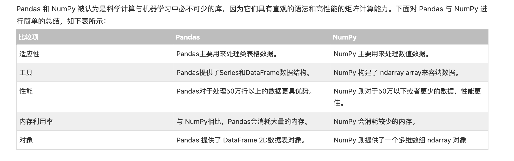

#### 概述

-   数据结构的组成，

-   series(一维)，由数据和标签(索引)组成，当不指定索引列的时候，默认是通过range生成对应的数字行号
-   dataframe(二维)，既有 行标签，也有列标签

-   创建dataframe，可以通过列表，字典，series，ndarray创建
-   读取数据的方式 可以通过 loc(标签访问)，iloc(位置/索引访问),[]直接通过key读取,指定多个key,传递一个数组[\[]\]
-   支持对索引的操作，比如修改名称，排序等
-   遍历dataframe的时候

-   默认以列的方式遍历
-   按照行的方式， iteritems，返回键值对，iterrows，返回(row\_index,row)，itertuples，返回命名的元组

-   注意操作是否改变原始数据，常见的是返回一个复制的数据，此时内存地址已经发生改变
-   自定义函数的使用

-   操作整个 DataFrame 的函数 pipe()
-   操作行或者列的函数apply()
-   操作单一元素的函数：map()

-   read\_scv,to\_csv，方法读取，处理csv文件，支持读取的时候支持转换数据类型，指定分隔符，从某行开始读取，如果将数据指定为object类型，这时对于空值无法直接表现为Nan，建议按照具体的类型指定好数据
-   pandas中的数据清洗，支持 对于全局数据，列数据，行数据 尺度下，过滤，替换，删除空值，格式化等，自定义空值等
-   pands 从 csv，excel，json，html，数据库中读取数据
-   pandas中支持使滑动窗口计算
-   pandas衍生出的框架 有 geopandas用于处理geojson格式数据