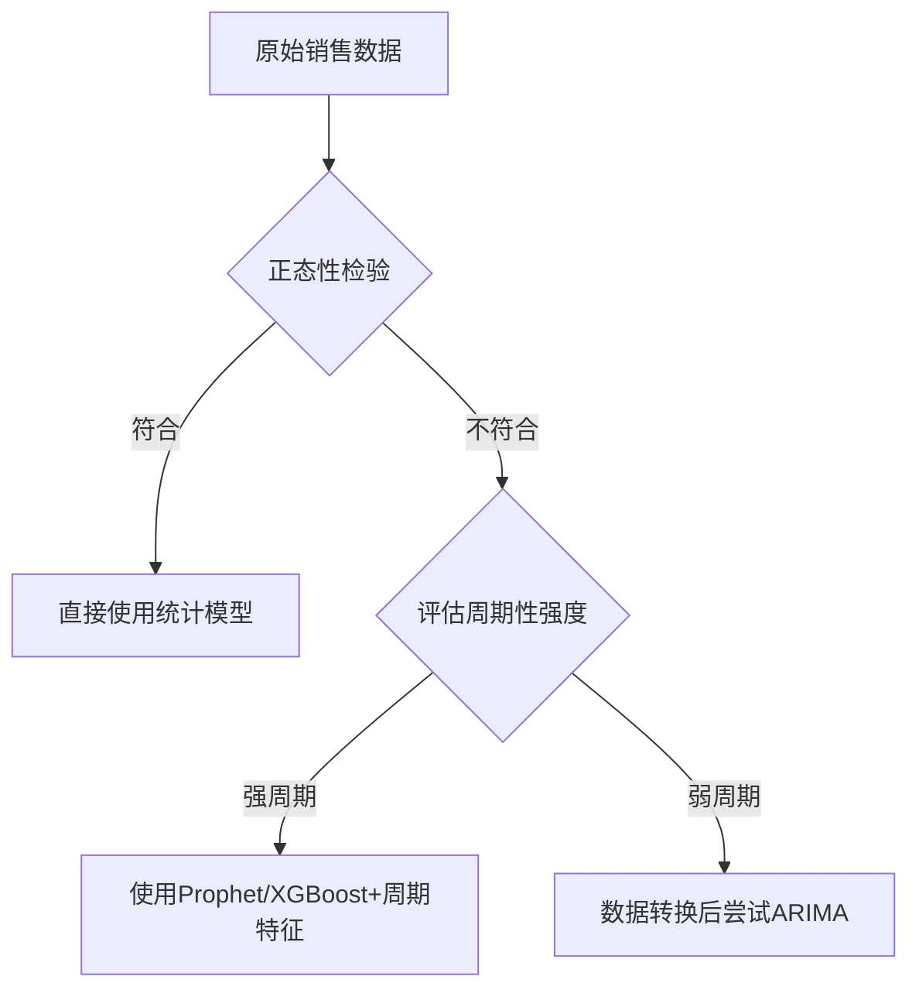

---
tags:
  - 存档
  - 待复核
  - 机器学习
created: 2026-08-30
source: "G:\\数据分析\\机器学习\\机器学习的疑问汇总.txt"
---

# 机器学习疑问汇总（入门存档）

> [!note] 存档说明
> 入门机器学习时期的疑问总汇总，2026-08-30 从 txt 转录为 md。**未复核哪些已掌握**，部分疑问和结论可能已过时；文中包含当时粘贴的网页 / AI 回答片段（如「网页8提到…」即为原摘录痕迹）。小节标题为转录时添加，内容顺序基本保持原文。
>
> 复核时可将每条疑问标记为：已掌握 / 仍存疑 / 已过时。

---

## 一、疑问清单（按环节）

### 特征工程

- 计算移动平均是什么
- LightGBM 是什么，是不是能用到我的项目中
- 特征怎么交叉
- 什么是自回归效应
- 方差是什么
- 差分法、一阶差分法
- 我要怎么看是不是时间序列：时间的系数和销售金额的系数 > 0.5？
- 模型数据的延迟性是什么意思
- 置信区间
- p、q 阶数值选择

### 验证

- 交叉验证检查准确率，怎么做
- 用 SHAP 值向业务方解释「为什么情人节销量预测高」是什么

### 模型选择

- ARIMA 可能在简单的时间序列趋势预测中表现更好。ARIMA 依赖于差分、自回归和移动平均项，而 Prophet 使用加法模型，分解趋势、季节性和节假日因素。需要解释这些技术差异如何影响模型的表现和适用性
- Kaggle 案例：Rossmann Store Sales（时间序列预测模板）
- Prophet 官方文档和 Kaggle 案例，同时利用 AutoML 工具如 PyCaret 加速模型选择
- Facebook Prophet；进阶方案：LightGBM（适合多特征融合）

### 训练

- 验证集和测试集的划分；通过 MAE / RMSE 等指标验证准确性，都是什么

### 运行方式

- 模型怎么跑，怎么用

## 二、零散概念疑问

- VIF 是什么
- 防止过拟合
- 自变量之间不存在多重共线性是什么意思
- 多重共线性问题是什么
- 正态分布、泊松分布、随机分布是什么
- 哑变量是什么
- 是否需要涉及分箱

## 三、分箱与 WOE 编码（摘录）

### 分箱（Binning）的意义

核心作用：将连续变量或无序类别变量转换为有序的离散区间。

具体优势：

- **解决非线性关系**：将非线性趋势分段线性化（如年龄与风险可能呈 U 型关系）
- **增强鲁棒性**：减少异常值影响（如收入 > 100 万的极端值单独分箱）
- **提升可解释性**：业务人员更易理解「年龄段」而非原始年龄值
- **适配模型要求**：逻辑回归等线性模型需输入离散化特征

### WOE 编码的作用

WOE（Weight of Evidence）公式：

```
WOE = ln( (Good_i / Good_total) / (Bad_i / Bad_total) )
```

其中 Good_i 表示第 i 箱的好样本数，Bad_i 为坏样本数。

核心价值：

- 将分箱结果映射为与目标变量相关的权重值，直接反映预测能力
- 消除量纲差异，所有特征转换为统一尺度（WOE 值）
- 提升模型稳定性：对分箱边缘的小波动不敏感

综合理解：分箱（Binning）是将连续变量离散化，或合并类别较少的分类变量，以便于后续的 WOE 编码和逻辑回归等模型处理。WOE 转换将分箱后的变量转换为能够反映其与目标变量（如好坏客户）关系的数值；IV（Information Value）用于评估变量的预测能力。检查单调性确保变量在分箱后的每一箱的坏账率变化符合预期，增强模型的稳定性和解释性。

其他：单个门店导致的过拟合。

### 评分卡核心代码（摘录）

卡核心代码分为六个部分：数据读取、特征工程、分箱和 WOE 编码、单变量和多变量分析、逻辑回归模型构建、测试集验证以及评分转换。需注意代码中的关键步骤：特征衍生、分箱处理、WOE 编码、变量筛选、模型训练与调优等。

## 四、线性回归学习记录

- 使用 LinearRegression 进行模型训练，拟合训练数据后，输出截距和系数，有助于理解每个特征对目标的影响
- 将特征名称和系数结合起来查看每个特征的权重；用模型预测测试集结果，绘制预测值和实际值对比图，用均方根误差（RMSE）评估模型性能
- Pytorch、Tensorflow
- `LinearRegression()`：使用线性回归模型
- `linreg.fit(X_train, y_train)`：拟合训练数据，输出截距（`intercept_`）和特征权重（`coef_`）
- `y_pred = linreg.predict(X_test)`：预测测试集结果
- 通过 `linreg.coef_` 可识别影响销量的关键因素

疑问：

- 这里的截距、特征权重的意义是什么
- 怎么选择这些字段，通过代码或者产品看出相关系数？
- 逐步回归或正则化方法

摘录：

- **标准化偏回归系数**：由于自变量与因变量都是有单位的，从数值上看样本取值的极差会有很大差异，均数与标准差也各不相同，所以不能由偏回归系数的大小直接说明对因变量线性影响的大小。常用变量标准化与计算标准化偏回归系数的方法处理。
- 将数据的数值范围进行标准化，类别型数据用独热编码等，提高模型准确性和稳定性。如红橙黄绿青蓝紫七种颜色可用独热编码，每种颜色映射为一个二进制向量，如红色 `[1,0,0,0,0,0,0]`、蓝色 `[0,0,0,0,0,1,0]`。
- 可以将变量转换为二分法变量或序数分类变量，再放入回归公式。这种转换是因为变量与结果可能不是线性关系，可能出现其他关系。
- 找规律：数学函数、求导、求对数；定义分组范围看趋势
- 标准差是什么
- 最优尺度回归
- 趋势分析：使用移动平均或指数平滑等方法识别数据中的趋势成分，将趋势成分从原始数据中分离出来，以便更好地预测
- 滑动平均是什么

### 回归假设与检验（摘录）

- 残差服从均值为 0、方差为 σ² 的正态分布（残差正态 + 方差齐性）
- 观测值之间相互独立，即残差之间不存在自相关。若残差违背相互独立假设，称为存在自相关性，可用 D-W 检验（杜宾-瓦特森检验）分析：D-W 值在 2 附近说明不存在自相关，模型构建较好；明显偏离 2 则存在自相关，模型构建较差
- 当自变量为定类数据时（如专业分为理科类、工科类、文科类），通常需进行哑变量处理后再回归分析
- 一般 VIF 值大于 10（严格大于 5），认为存在严重共线性
- R 方用于分析模型拟合优度，又称决定系数，取值 0~1，越大越好。如 R 方为 0.5，说明自变量可解释因变量 50% 的变化原因。实际研究中不会过多关注 R 方大小，因为回归分析更多关注自变量对因变量是否有影响关系。调整后 R 方本身无实际意义，通常在模型调整（增减变量个数）时使用，用于判断该不该加入想加入的变量
- 避免多重共线性

## 五、特征选择方法（摘录）

- 多元线性回归特征选择方法：全局择优法、逐步回归法等
- 过滤式方法（如皮尔逊相关系数）可快速筛出与目标相关性高的特征；但单因素分析有局限，需结合逐步回归或 L1 正则化
- Jamovi 软件：免费且支持多种统计方法（相关分析、逐步回归）
- R 语言 MuMIn 包可自动变量选择
- 仅依赖相关系数可能忽略特征间的交互作用（如促销活动与季节叠加效应）
- 结合 AIC / BIC 指标筛选最优特征组合，如 R 的 `step()` 函数或 Python 的 statsmodels：

```python
from statsmodels.api import OLS
import statsmodels.formula.api as smf
model = smf.ols('销量 ~ 特征1 + 特征2 + 特征3', data=df).fit()
final_model = model.step()  # 自动逐步回归
```

- 利用 PCA 降维、One-Hot 编码处理分类变量、特征交叉增强模型表达能力
- **L1 正则化（嵌入式方法）**：Lasso 回归压缩不重要特征的系数至零，直接实现特征选择，适合高维数据（几十个候选特征）：

```python
from sklearn.linear_model import Lasso
lasso = Lasso(alpha=0.1).fit(X_train, y_train)
selected_features = X.columns[lasso.coef_ != 0]
```

- 避免多重共线性：用方差膨胀因子（VIF）检测，VIF > 10 则剔除相关特征
- **时序交叉验证**：销量数据含时间序列特性，需按时间划分训练/测试集（而非随机划分）
- scikit-learn：`SelectKBest`（按统计检验筛选 Top K 特征）、`RFE`（递归特征消除）
- pandas：内置 `.corr()` 快速计算相关系数矩阵

### 特征工程实践（摘录）

- **关键业务变量强制纳入**：如促销活动、节假日标志、竞品价格等，即使统计显著性不足（P 值 > 0.05）也需保留。如已知「双十一」对销量影响巨大，即使模型未自动选中，也应手动添加
- **衍生特征工程**，从原始数据构造新特征：
    - 时间维度：月份、周几、是否为季末
    - 市场维度：价格差（自身价格 vs 竞品均价）
    - 促销效果：活动前 3 天的曝光量均值
- 代码中可用 ColumnTransformer 整合不同预处理步骤，再通过 NeuralProphet 的 `add_lagged_regressor` 添加特征；预测时需确保特征数据也包含在未来的数据框中，否则用 `add_future_regressor`
- NeuralProphet 对滞后回归器（lagged regressor）的处理需要历史数据，未来回归器（future regressor）需要未来的值。若特征在预测时无法提前知道，用滞后回归器：如产品价格是历史数据用滞后回归器；未来的促销活动作为未来回归器添加
- 疑问：就像 NeuralProphet 中的所有其他组件一样，季节性也可以被正则化——是什么意思
- 使用网格搜索

### 建模决策流程（原文图形）



## 六、时间序列建模思路

构建时间序列模型：可用 ARIMA（自回归积分滑动平均模型）或 SARIMA（季节性 ARIMA）等，考虑季节性和趋势因素进行销售预测。

模型清单：

- 时间序列模型：ARIMA、SARIMA、Prophet（Facebook 开源）
- 机器学习模型：线性回归、决策树、随机森林、SVM、XGBoost
- 深度学习模型：LSTM、GRU、RNN

方法论（自记）：

- 多维出图找规律
- 考虑特征怎么处理
- 考虑模型怎么叠加
- 考虑原始值怎么来
- 多维的特征的添加问题

## 七、项目数据问题与特征工程待办（销量预测项目）

待办：

- 补充 24 年之前的 rain 降雨概率数据
- 将节假日信息补充，要求法定节假日和情人节、七夕等，注意节假日对销量影响的开始结束日期
- 后续可考虑将天气数据级别调整到小时级别

原始数据存在的问题：

- 补充节假日产品标识
- 成本字段的值有 0 的情况，导致无法计算折扣率
- 天气数据只有 23 年的，减少训练集；最好分到购买的时间段，现在只到天级别
- 缺少节假日数据、节假日的影响范围

特征工程的建设：

- 剔除生日蛋糕、节假日产品的影响
- 补充：过去七日的平均销量、上周当天的销量、过去一个月的平均销量
- 节假日的数据处理
- Amount_Avg_7 改成过去七日的销售个数的平均情况
- 产品分类中固定聚类数为 5 可能不一定最优，应使用肘部法则、轮廓系数等确定最佳聚类数
- 优惠券的领取情况——添加字段
- 营销活动的维度要增加——添加字段、店面的促销活动
- sys_code 能不能整合进来
- 礼券的产品 ID、礼券的购买日期、礼券的过期日期、礼券的使用日期、礼券中产品的个数

数据细节（自记）：

- 缺失值不要随便填充；天气数据不能补 0；数值补充 0 要慎重
- 会员充值卡（不打折）过滤掉
- 加一个字段：saleprice 为 0 的时候，作为赠送
- 折扣率计算问题：

```python
# 折扣率
df['Discount_Rate'] = (df['Product_Price'] - df['Sales_Price']) / df['Product_Price']
# 不能这么算：第一是没有考虑相减为 0，第二是没有考虑售价为 0
```

疑问：

- 销售时段、生命周期的分箱是不是合理？
- 产品分箱怎么分合适？
- 怎么看分箱中的判断条件是什么？
- 业务上的交叉验证 / 预测的手段？

## 八、机器学习疑问（第二部分）

- 工具：nuralprophet + sklearn
- 规律 ---> 噪声、数据抖动
- 描述统计的工作：参数 API、网络搜索
- 树形、决策森林 ---> 节假日；销量大的、销售周期、常青树，找规律

### 缺失值机制（摘录）

- 线性回归通常需要完整数据，而树模型可以天然处理缺失值（如通过替代分裂）。但如果数据在预处理阶段被直接删除，所有模型都会受影响：训练集变小，且可能存在系统性偏差
- 如果缺失发生在数据收集阶段（非随机缺失），且缺失与某些特征相关（如周末或促销活动），可能导致模型无法捕捉这些模式，影响预测准确性
- 缺失机制三分法：完全随机缺失（MCAR）、随机缺失（MAR）、非随机缺失（MNAR）

### 宽表设计的隐患（摘录）

原始设计：`product_id | date | sales` 宽表直接丢弃无销售日。隐患：

- 时间序列断裂 → 无法计算正确的时间滞后特征
- 节假日标识丢失 → 模型无法学习周期模式
- 零值未区分「无销售」和「关门歇业」
- 时序模型如 ARIMA 可能需要不同的处理方式

其他：

- 将产品名称作为特征：转化为嵌入式或层次结构的类别特征，对产品进行聚类，用类别代替产品名称
- `count(distinct sales_Date1)`

### 数据中断对 Shapiro-Wilk 检验的影响（摘录）

- 检验敏感性：Shapiro-Wilk 检验对样本完整性和随机性敏感，非随机缺失会扭曲分布形态
- 典型偏差场景：工作日数据完整、周末缺失 → 剩余数据分布左偏（丢失高销量点）；连续缺供期 → 数据出现人为断层，分布呈多峰
- 数学表现：缺失导致经验分布函数（EDF）与正态 CDF 的偏离增大，降低 p 值可靠性

## 九、进阶方向摘录

- 时序模型可自动处理时间依赖：ARIMA / SARIMA 处理线性模式，LSTM 处理非线性模式，或更复杂的时序大模型如 TimeHF
- 决策树模型（随机森林、XGBoost、LightGBM）可能更适合，可自动处理特征组合和非线性关系
- 正态性检验（Shapiro-Wilk、Kolmogorov-Smirnov、QQ 图）：如果模型需要正态性，需转换数据（对数变换、Box-Cox 变换）；季节性因素需引入哑变量或傅里叶项处理周末和节假日影响
- 训练决策树的数据集要离散化，不然训练出来的树可能有些节点分支特别多，容易过拟合
- 量化每个箱子中信息的纯粹和混乱（信息量大小）：信息熵或基尼系数。信息熵是香农 1948 年提出的量化信息量指标
- 分布清单：二项分布、泊松分布、正态分布、指数分布、均匀分布
- 归一化 / 标准化的适用场景：当促销活动占比是连续数值时（如一个月中促销天数占比 30%、50%、80%），适合回归模型（线性回归、随机森林回归），保留促销强度的连续信息。示例：归一化后 0.3、0.5、0.8；假设均值 50%、标准差 20%，则标准化后 30% → -1、50% → 0、80% → 1.5
- 时间序列分解：未将序列分解为趋势、季节性和残差，导致模型无法分别捕捉；可用傅里叶变换捕捉周期性模式
- 模型选择：XGBoost / LightGBM 处理非线性；Prophet / SARIMA 内置季节性处理；LSTM / Transformer 捕捉长期依赖
- 误差分析和模型监控：分析预测误差在节假日和非节假日的差异，针对性优化；用 SHAP 值或特征重要性分析
- 模型集成：如用 Prophet 处理季节性，再用 XGBoost 捕捉非线性特征，或采用集成策略提升整体能力

### 待补的知识版图（当时的自我评估摘录）

- 更高级的特征工程（特征交叉、特征选择、特征降维）
- 自定义损失函数与评价指标（针对业务目标调整训练）
- 不同类型模型优势对比（树模型 vs 神经网络 vs 时间序列模型）
- 更系统的模型调优（超参数优化、正则化、集成学习）
- 训练集 / 验证集 / 测试集正确划分策略
- 生产环境部署（模型保存、自动再训练、线上监控）
- 尚未涉及：EDA、模型评估方法、超参数调优、模型解释性（SHAP、LIME）、部署与监控、类别不平衡处理、早停法、学习率调度、交叉验证的重要性

### 特征工程进阶（摘录）

- 分位数分析：识别极端值（销量为 0 或异常高峰），用箱线图、小提琴图
- 时间序列分解：`statsmodels.tsa.seasonal_decompose`
- 相关性分析：不仅皮尔逊系数，还要关注非线性关系（互信息、最大信息系数 MIC）
- 交互特征：数值特征间的乘除组合（如单价 × 促销力度）
- 基于模型的特征生成：用树模型（如 LightGBM）输出叶子节点索引作为新特征
- 特征选择高级方法：Wrapper 方法（RFE 结合交叉验证）；Embedded 方法（Lasso 回归、XGBoost 特征重要性）；稳定性分析（多次采样后观察特征重要性波动）

### 损失函数定制化（摘录）

- 场景适配：销量预测若需惩罚高估（如库存成本高），可用非对称损失（如 Huber Loss 调整参数）
- 长尾分布：对低频高销量事件赋予更高权重（加权 MSE）
