# 概述

Git是一个免费的、开源的分布式版本控制工具，可以快速高效地处理从小型到大型的各种项目。

Git易于学习，占地面积小，性能极快。它具有廉价的本地库，方便的暂存区域和多个工作流分支等特性。其性能优于Subversion、CVS、Perforce和ClearCase等版本控制工具。

#### 何为版本控制

版本控制是一种记录文件内容变化，以便将来查阅特定版本修订情况的系统。

版本控制其实最重要的是可以记录文件修改历史记录，从而让用户能够查看历史版本，方便版本切换。

便于团队协作

​  

版本控制工具可分为:集中版本控制工具

CVS、SVN(Subversion)、VSS……

缺点是中央服务器的单点故障。如果服务器宕机一小时，那么在这一小时内，谁都无法提交更新，也就无法协同工作。

分布式版本控制工具

分布式的版本控制系统出现之后,解决了集中式版本控制系统的缺陷:

1. 服务器断网的情况下也可以进行开发（因为版本控制是在本地进行的）

2\. 每个客户端保存的也都是整个完整的项目（包含历史记录，更加安全）

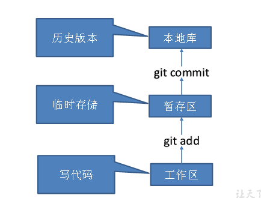

#### Git和代码托管中心

代码托管中心是基于网络服务器的远程代码仓库，一般我们简单称为远程库。

**Ø** **局域网**

ü GitLab

**Ø** **互联网**

ü GitHub（外网）

ü Gitee码云（国内网站）

# 安装

官网地址： https://git-scm.com/

# 常用命令

| **命令名称** | **作用** |
| --- | --- |
| git config --global user.name 用户名 | 设置用户签名 |
| git config --global user.email 邮箱 | 设置用户签名 |
| git init | 初始化本地库 |
| git status | 查看本地库状态 |
| git add 文件名 | 添加到暂存区 |
| git commit -m "日志信息" 文件名 | 提交到本地库 |
| git reflog | 查看历史记录 |
| git reset --hard 版本号 | 版本穿梭 |

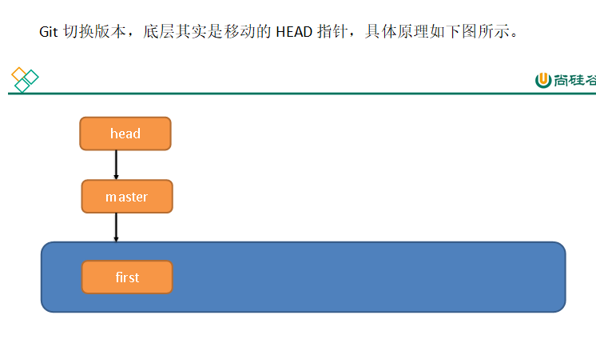

# 分支操作

### 什么是分支

在版本控制过程中，同时推进多个任务，为每个任务，我们就可以创建每个任务的单独分支。使用分支意味着程序员可以把自己的工作从开发主线上分离开来，开发自己分支的时候，不会影响主线分支的运行。对于初学者而言，分支可以简单理解为副本，一个分支就是一个单独的副本。（分支底层其实也是指针的引用）

同时并行推进多个功能开发，提高开发效率。

各个分支在开发过程中，如果某一个分支开发失败，不会对其他分支有任何影响。失败的分支删除重新开始即可。

#### 分支的操作

| **命令名称** | **作用** |
| --- | --- |
| git branch 分支名 | 创建分支 |
| git branch -v | 查看分支 |
| git checkout 分支名 | 切换分支 |
| git merge 分支名 | 把指定的分支合并到当前分支上 |

### **合并分支**

**1****）基本语法**

**git** **merge** **分支名**

**2****）案例实操 在****master****分支上合并****hot-fix****分支**

Layne@LAPTOP-Layne MINGW64 /d/Git-Space/SH0720 (master)

$ **git merge hot-fix**

Auto-merging hello.txt

CONFLICT (content): Merge conflict in hello.txt

Automatic merge failed; fix conflicts and then commit the result.

### **4.3.6** **产生冲突**

冲突产生的表现：后面状态为MERGING

Layne@LAPTOP-Layne MINGW64 /d/Git-Space/SH0720 (master|MERGING)

$ cat hello.txt

hello git! hello atguigu! 2222222222222

hello git! hello atguigu! 3333333333333

hello git! hello atguigu!

hello git! hello atguigu!

hello git! hello atguigu!

hello git! hello atguigu!

hello git! hello atguigu!

hello git! hello atguigu!

hello git! hello atguigu!

hello git! hello atguigu!

hello git! hello atguigu!

hello git! hello atguigu!

hello git! hello atguigu!

hello git! hello atguigu!

<<<<<<< HEAD

hello git! hello atguigu! master test

hello git! hello atguigu!

\=======

hello git! hello atguigu!

hello git! hello atguigu! hot-fix test

\>>>>>>> hot-fix

​  

冲突产生的原因：

合并分支时，两个分支在**同一个文件的同一个位置**有两套完全不同的修改。Git无法替我们决定使用哪一个。必须**人为决定**新代码内容。

注：同一个位置指的是**同一个文件**的同一行，或者是**同一个文件**相邻的上下两行。

查看状态（检测到有文件有两处修改）

Layne@LAPTOP-Layne MINGW64 /d/Git-Space/SH0720 (master|MERGING)

$ **git status**

On branch master

You have unmerged paths.

(fix conflicts and run "git commit")

(use "git merge --abort" to abort the merge)

​  

Unmerged paths:

(use "git add <file>..." to mark resolution)

​  

​both modified: hello.txt

​  

no changes added to commit (use "git add" and/or "git commit -a")

### 创建分支和切换分支图解

​  

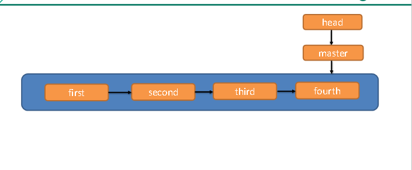

master、hot-fix其实都是指向具体版本记录的指针。当前所在的分支，其实是由HEAD决定的。所以创建分支的本质就是多创建一个指针。

HEAD如果指向master，那么我们现在就在master分支上。

HEAD如果执行hotfix，那么我们现在就在hotfix分支上。

所以切换分支的本质就是移动HEAD指针。

# 团队协作机制

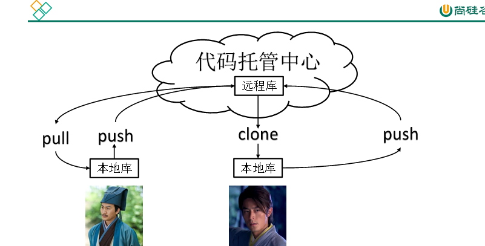

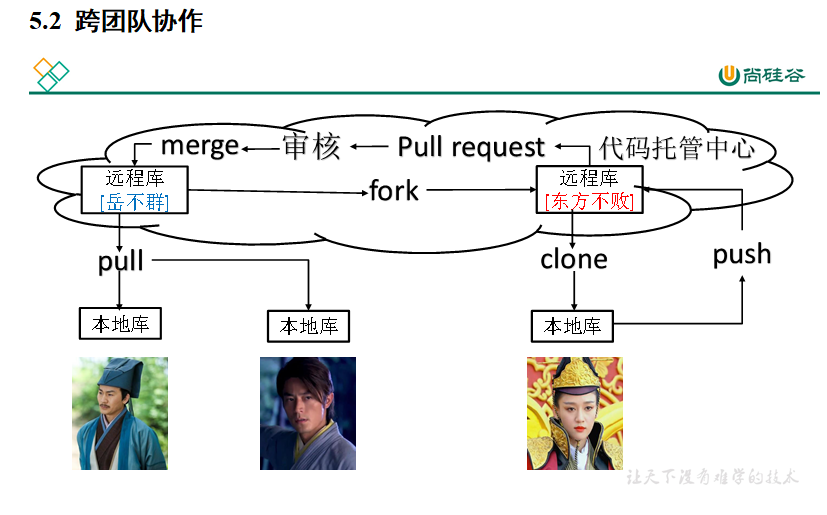

# 远程仓库操作

| **命令名称** | **作用** |
| --- | --- |
| git remote -v | 查看当前所有远程地址别名 |
| git remote add 别名 远程地址 | 起别名 |
| git push 别名 分支 | 推送本地分支上的内容到远程仓库 |
| git clone 远程地址 | 将远程仓库的内容克隆到本地 |
| git pull 远程库地址别名 远程分支名 | 将远程仓库对于分支最新内容拉下来后与当前本地分支直接合并 |

# Idea上集成GIT

#### 配置Git忽略文件

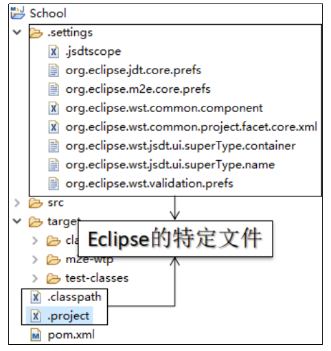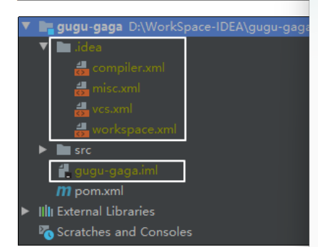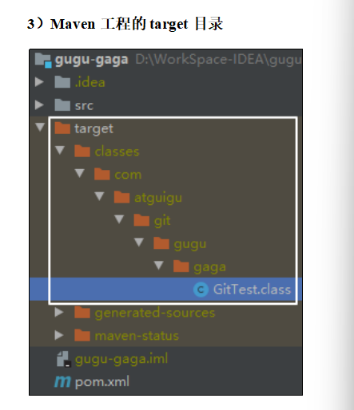

**问题****1:****为什么要忽略他们？**

答：与项目的实际功能无关，不参与服务器上部署运行。把它们忽略掉能够屏蔽IDE工具之间的差异。

**问题****2****：怎么忽略？**

1）创建忽略规则文件xxxx.ignore（前缀名随便起，建议是git.ignore）

这个文件的存放位置原则上在哪里都可以，为了便于让~/.gitconfig文件引用，建议也放在用户家目录下

git.ignore文件模版内容如下：

\# Compiled class file

\*.class

\# Log file

\*.log

\# BlueJ files

\*.ctxt

\# Mobile Tools for Java (J2ME)

.mtj.tmp/

\# Package Files #

\*.jar

\*.war

\*.nar

\*.ear

\*.zip

\*.tar.gz

\*.rar

\# virtual machine crash logs, see http://www.java.com/en/download/help/error\_hotspot.xml

hs\_err\_pid\*

.classpath

.project

.settings

target

.idea

\*.iml

2）在.gitconfig文件中引用忽略配置文件（此文件在Windows的家目录中）

[user]

name = Layne

email = Layne@atguigu.com

[core]

excludesfile = C:/Users/asus/git.ignore

注意：这里要使用“正斜线（/）”，不要使用“反斜线（\\）”

​  

初始化化本地库

右键点击项目选择Git -> Add将项目添加到暂存区。

提交到本地库

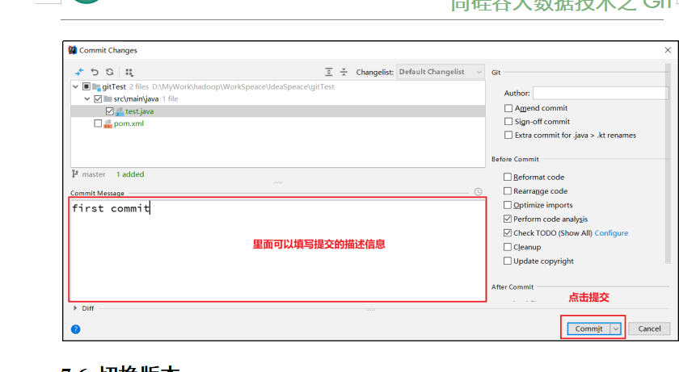

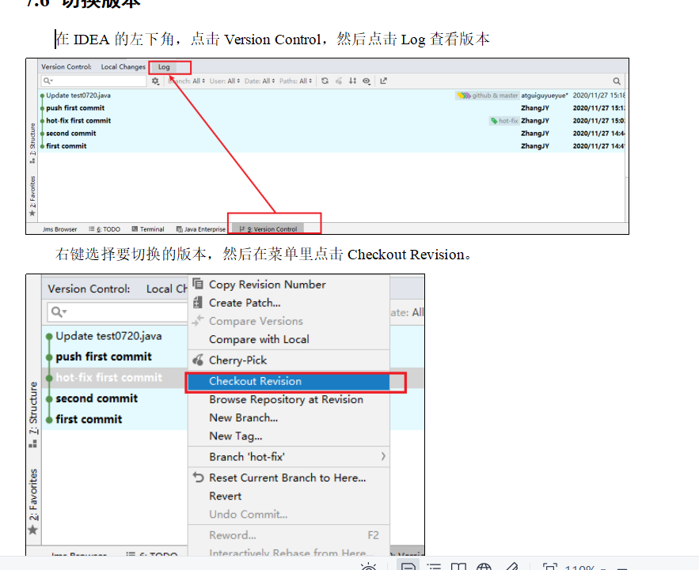

#### 创建分支

选择Git，在Repository里面，点击Branches按钮。

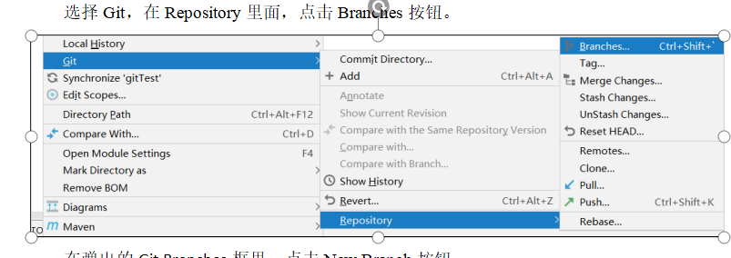

在弹出的Git Branches框里，点击New Branch按钮。

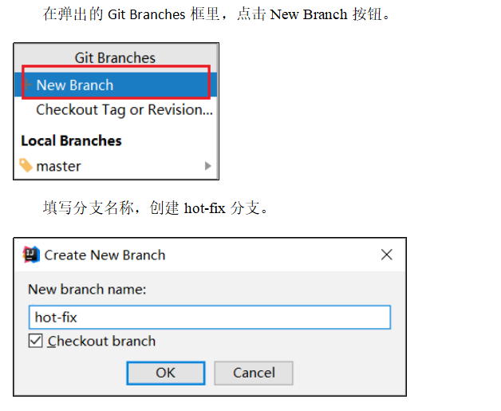

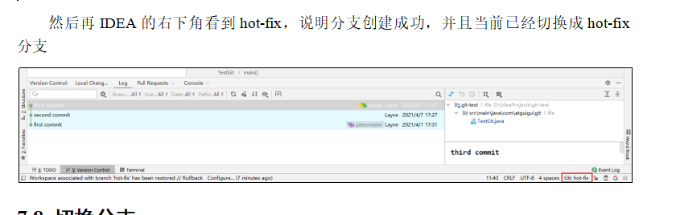

然后再IDEA的右下角看到hot-fix，说明分支创建成功，并且当前已经切换成hot-fix分支

​  

#### 切换分支

在IDEA窗口的右下角，切换到master分支。

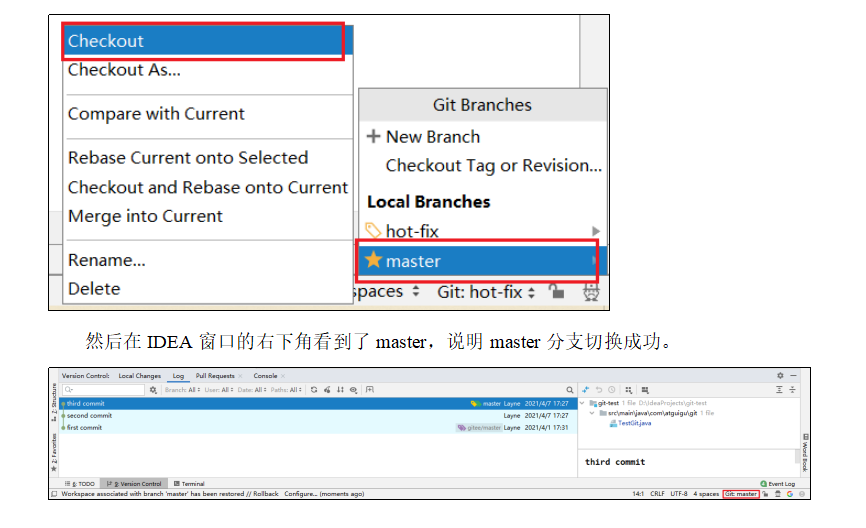

#### 合并分支

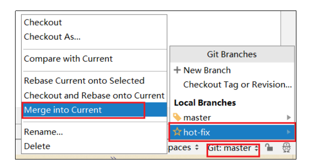

在IDEA窗口的右下角，将hot-fix分支合并到当前master分支。

​  

#### 解决代码冲突

如图所示，如果master分支和hot-fix分支都修改了代码，在合并分支的时候就会发生冲突。

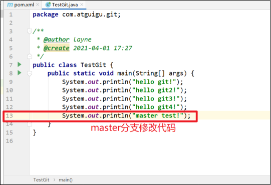

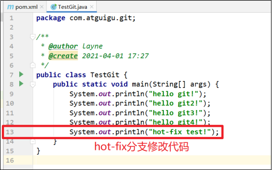

我们现在站在master分支上合并hot-fix分支，就会发生代码冲突。

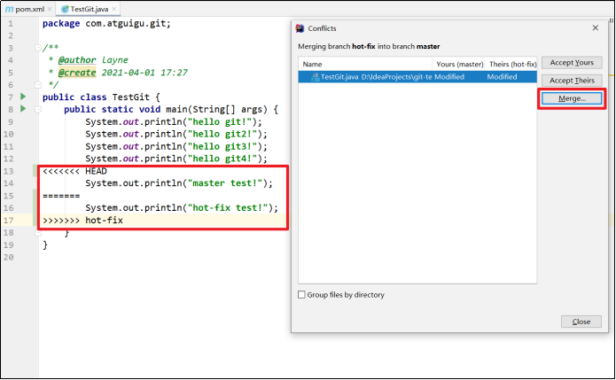

点击Conflicts框里的Merge按钮，进行手动合并代码。

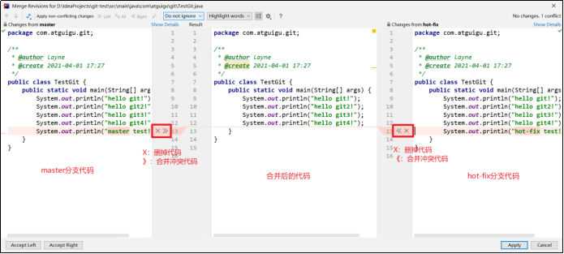

手动合并完代码以后，点击右下角的Apply按钮。

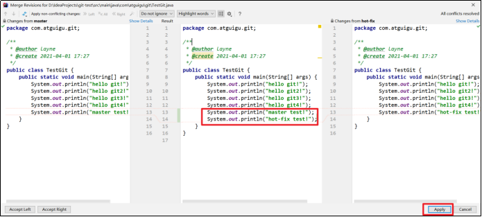

代码冲突解决，自动提交本地库。

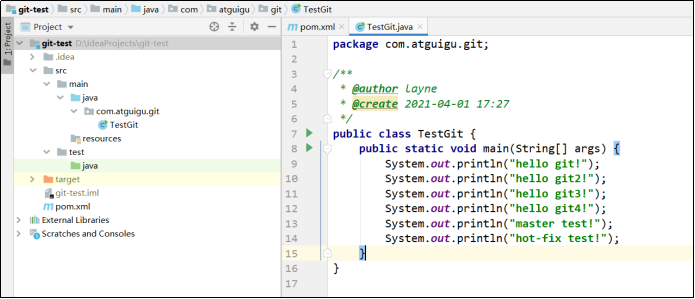