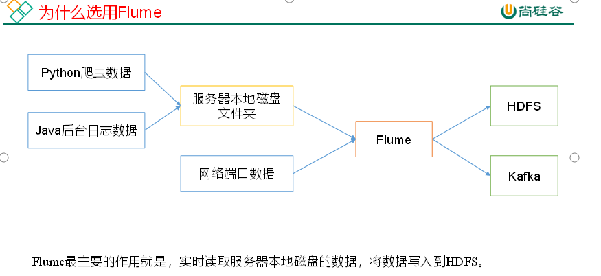
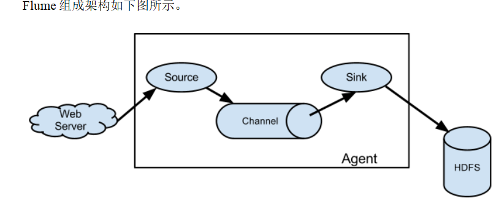
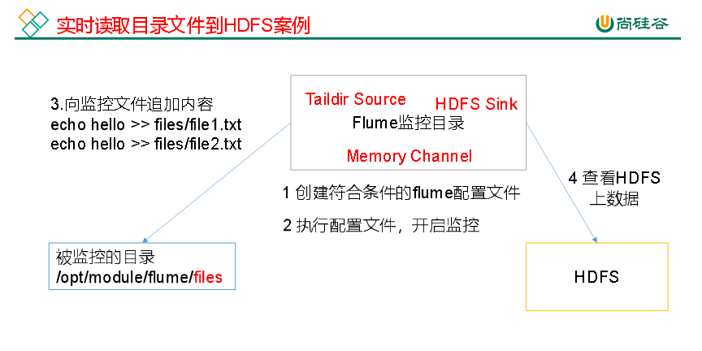
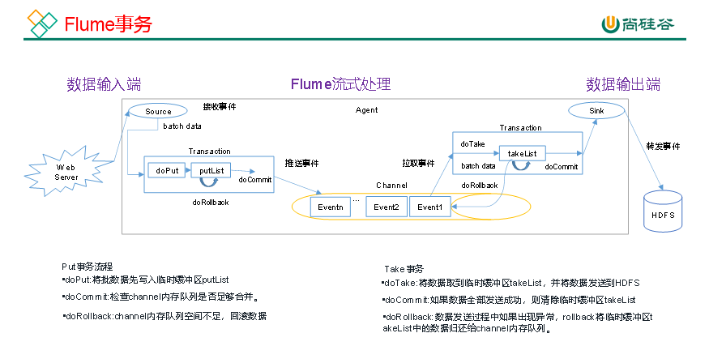
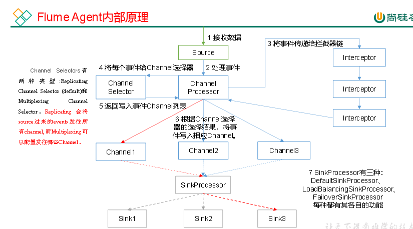
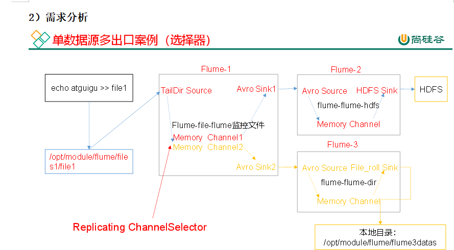
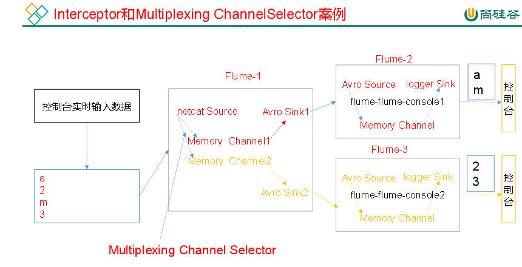
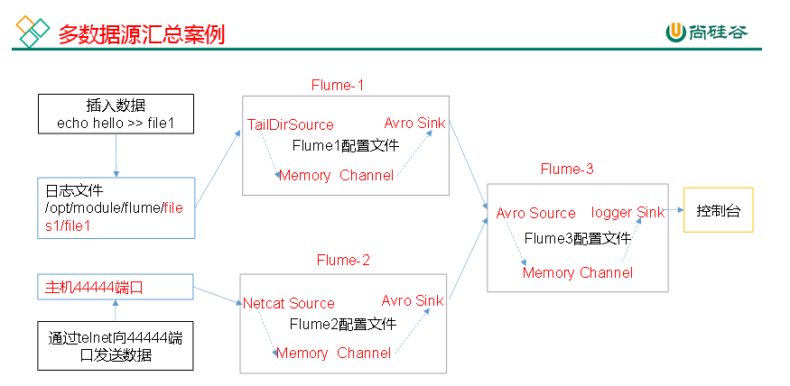

## 概述及其基础架构

  

Flume是Cloudera提供的一个高可用的，高可靠的，分布式的海量日志采集、聚合和传输的系统。Flume基于流式架构，灵活简单。

实时读取服务器本地磁盘的数据,将数据写入到HDFS中

  

#### 组成架构

FLume的组成有Source Channel Sink 这三部分共同组成了Agent(一个JVM进程)以事件的形式将数据从源头送至目的地。

  

Source作为负责接收数据到Flume Agent的组件,Source组件可以处理各种类型,格式的日志数据

  

channel是source与Sink中的缓冲区,所以Channel允许Source和Sink运行的速率不一样.

且channel是线程安全的,支持同时处理几个source的写入与sink的读取操作

channel自带的有两种,一种是Memory Channel 与 File Channel

Memory Channel是内存中的队列。Memory Channel在不需要关心数据丢失的情景下适用。如果需要关心数据丢失，那么Memory Channel就不应该使用，因为程序死亡、机器宕机或者重启都会导致数据丢失。

File Channel将所有事件写到磁盘。因此在程序关闭或机器宕机的情况下不会丢失数据。

  

Sink不断的轮询Channel中的事件并批量的移除它们,并将这些事件批量写入到存储或索引系统、或者被发送到另一个Flume Agent。

  

#### Event

Event是Flume数据传输的基本单元,以Event的形式将数据从源头送到目的地.它由Header, Body组成,

Header来存放event的一些属性,为K-V结构,Body来存放该条数据,为字节数组的形式

## 入门

#console表3 示同时将日志输出到控制台

flume.root.logger=INFO,LOGFILE,console

#固定日志输出的位置

flume.log.dir=/opt/module/flume/logs

  

  

修改nc-flume-log.conf文件

配置文件来源于官方手册[http://flume.apache.org/FlumeUserGuide.html](http://flume.apache.org/FlumeUserGuide.html)

  

#### Taildir Source

Taildir Source适合用于监听多个实时追加的文件，并且能够实现断点续传。

  

**案例需求:使用Flume监听整个目录的实时追加文件，并上传至HDFS**

# 必须精确到文件，可以写匹配表达式匹配多个文件

a1.sources.r1.filegroups.f1 = /opt/module/flume/files1/.\*file.\*

a1.sources.r1.filegroups.f2 = /opt/module/flume/files2/.\*log.\*

# 实现断点续传的文件存放位置不改有默认位置也能实现断点续传

a1.sources.r1.positionFile = /opt/module/flume/taildir_position.json

  

\# Describe the sink

a1.sinks.k1.type = hdfs

# 地址值可以填写hdfs://hadoop102:8020也可以省略,flume会自动读取hadoop配置文件信息获取地址

a1.sinks.k1.hdfs.path = hdfs://hadoop102:8020/flume/%Y%m%d/%H

#上传文件的前缀

a1.sinks.k1.hdfs.filePrefix = log-

  

#是否使用本地时间戳

a1.sinks.k1.hdfs.useLocalTimeStamp = true

#设置文件类型 分为二进制文件SequenceFile和文本文件DataStream(不能压缩) 和CompressedStream(可以压缩)

a1.sinks.k1.hdfs.fileType = DataStream

#多久生成一个新的文件

a1.sinks.k1.hdfs.rollInterval = 30

#设置每个文件的滚动大小大概是128M

a1.sinks.k1.hdfs.rollSize = 134217700

#文件的滚动与Event数量无关

a1.sinks.k1.hdfs.rollCount = 0

  

#### TaildirSoure可实现断点续传的原理说明：

Taildir Source维护了一个json格式的position File，其会定期的往position File中更新每个文件读取到的最新的位置，因此能够实现断点续传。

Position File的格式如下：

{"inode":2496272,"pos":12,"file":"/opt/module/flume/files1/file1.txt"}

{"inode":2496275,"pos":12,"file":"/opt/module/flume/files1/file2.txt"}

  

注：Linux中储存文件元数据的区域就叫做inode，每个inode都有一个号码，操作系统用inode号码来识别不同的文件，Unix/Linux系统内部不使用文件名，而使用inode号码来识别文件。TailDir source使用inode和文件的全路径一起识别同一个文件，所以修改文件名之后如果表达式也能够匹配上，会再重新读取一份文件的数据。

  

## 进阶

  

#### Flume事务

#### Fume Agent内部原理

**组件介绍：**

**1）** **ChannelSelector**

ChannelSelector的作用就是选出Event将要被发往哪个Channel。其共有两种类型，分别是Replicating（复制）和Multiplexing（多路复用）(原理是依据Header中的key的值,将不同的Event发送到不同的Channel)。

ReplicatingSelector会将同一个Event发往所有的Channel，Multiplexing会根据相应的原则，将不同的Event发往不同的Channel。

**2）SinkProcessor**

SinkProcessor共有三种类型，分别是DefaultSinkProcessor(默认1对1)、LoadBalancingSinkProcessor(负载均衡)和FailoverSinkProcessor(故障转移)

DefaultSinkProcessor对应的是单个的Sink，LoadBalancingSinkProcessor和FailoverSinkProcessor对应的是Sink Group，LoadBalancingSinkProcessor可以实现负载均衡的功能，FailoverSinkProcessor可以错误恢复的功能。

  

#### 企业开发案例

**案例** **需求**

使用Flume-1监控文件变动，Flume-1将变动内容传递给Flume-2，Flume-2负责存储到HDFS。同时Flume-1将变动内容传递给Flume-3，Flume-3负责输出到Local FileSystem。

**提示**：输出的本地目录必须是已经存在的目录，如果该目录不存在，并不会创建新的目录。

  

#### 多路复用及拦截器案例

**案例需求**

使用Flume采集服务器本地日志，需要按照日志类型的不同，将不同种类的日志发往不同的分析系统。

**2）需求分析**

在实际的开发中，一台服务器产生的日志类型可能有很多种，不同类型的日志可能需要发送到不同的分析系统。此时会用到Flume的channel selecter中的Multiplexing结构，Multiplexing的原理是，根据event中Header的某个key的值，将不同的event发送到不同的Channel中，所以我们需要自定义一个Interceptor，为不同类型的event的Header中的key赋予不同的值。** **

  

定义CustomInterceptor类并实现Interceptor接口。

\* 1. 实现interceptor接口

\* 2. 实现接口的4个方法

\* 3. 实现一个静态内部类创建拦截器

  

#### 聚合案例

  

hadoop102上的Flume-1监控文件/opt/module/flume/files1/.\*file.\*，

hadoop103上的Flume-2监控某一个端口的数据流，

Flume-1与Flume-2将数据发送给hadoop104上的Flume-3，Flume-3将最终数据打印到控制台。

  

  

  

  

## 数据流监控

  

#### Ganglia的安装与部署

Ganglia由gmond、gmetad和gweb三部分组成。

gmond（Ganglia Monitoring Daemon）是一种轻量级服务，安装在每台需要收集指标数据的节点主机上。使用gmond，你可以很容易收集很多系统指标数据，如CPU、内存、磁盘、网络和活跃进程的数据等。

gmetad（Ganglia Meta Daemon）整合所有信息，并将其以RRD格式存储至磁盘的服务。

gweb（Ganglia Web）Ganglia可视化工具，gweb是一种利用浏览器显示gmetad所存储数据的PHP前端。在Web界面中以图表方式展现集群的运行状态下收集的多种不同指标数据。