## Kafka概述

​  

kafka是一个分布式的基于发布/订阅模式的消息队列,主要应用于实时处理领域,是一个分布式事件流平台,被用于高性能的数据管道,流分析,数据集成,与关键任务应用.

发布/订阅: 消息的发布者不会将数据直接发送给特定的订阅者,而是将发布的消息分为不同的类别,订阅者仅 接收感兴趣的消息,

kafka中的消息压缩策列,**compression.type**. broker的值为none,默认和生产者保持一致,但是 当 a,指定了压缩格式,且和生产者不一样,那么将会解压后重新压缩 b,broker端发送了消息格式变化,常出现在kafka集群中同时保存多种版本的消息格式

生产者:max\-request-size 要小于message.max.bytes

consumer:fetch-max-bytes 要大于message.max.bytes

broker: message.max.bytes

replica.fetch.max.bytes\=6291456（6M）每个分区试图获取的消息字节数。要大于等于message.max.bytes

​  

​  

在大数据场景主 要采用Kafka作为消息队列。在JavaEE开发中主要采用ActiveMQ、RabbitMQ、RocketMQ。

  

传统的消息队列的主要应用场景包括：**缓存/消峰**、**解耦**和**异步通信。**

​  

应用场景: 缓冲/消峰-----------有助于控制与优化数据流经过系统的速度,解决产生消息与消费消息的处理速度不一致的情况,

解耦--------------

​  

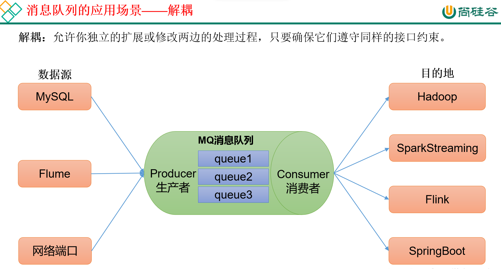

异步通信--------------------

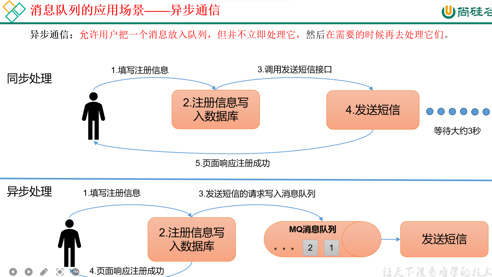

  

#### 消息队列的模式

点对点模式, 发布/订阅模式

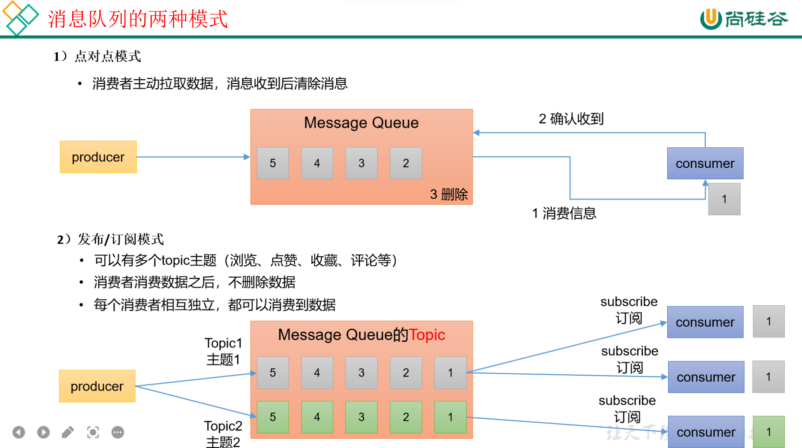

  

#### kafka的基础架构

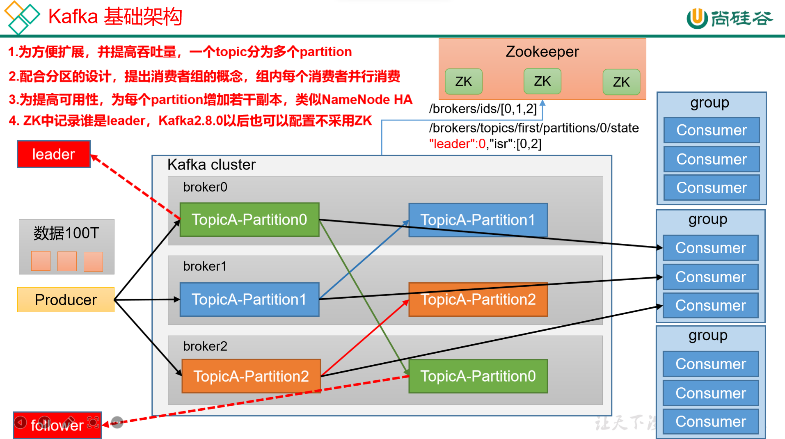

  

**（****1****）****Producer****：**消息生产者，就是向Kafka broker发消息的客户端。

**（****2****）****Consumer****：**消息消费者，向Kafka broker取消息的客户端。

**（****3****）****Consumer Group****（****CG****）：**消费者组，由多个consumer组成。**消费者组内每个消费者负责消费不同分区的数据，一个分区只能由一个组内消费者消费；消费者组之间互不影响。**所有的消费者都属于某个消费者组，即**消费者组是逻辑上的一个订阅者**。

**（****4****）****Broker****：**一台Kafka服务器就是一个broker。一个集群由多个broker组成。一个broker可以容纳多个topic。

**（****5****）****Topic****：**可以理解为多个队列，**生产者和消费者面向的都是一个****topic**。

**（****6****）****Partition****：**为了实现扩展性，一个非常大的topic可以分布到多个broker（即服务器）上，**一个****topic****可以分为多个****partition**，每个partition是一个有序的队列。

**（****7****）****Replica****：**副本。一个topic的每个分区都有若干个副本，一个**Leader**和若干个**Follower**。

**（****8****）****Leader****：**每个分区多个副本的“主”，生产者发送数据的对象，以及消费者消费数据的对象都是Leader。

**（9）Follower：**每个分区多个副本中的“从”，实时从Leader中同步数据，保持和Leader数据的同步。Leader发生故障时，某个Follower会成为新的Leader。

​  

​  

  

​  

## Kafka使用入门

**注意：**停止Kafka集群时，一定要等Kafka所有节点进程全部停止后再停止Zookeeper集群。因为Zookeeper集群当中记录着Kafka集群相关信息，Zookeeper集群一旦先停止，Kafka集群就没有办法再获取停止进程的信息，只能手动杀死Kafka进程了。  
  

  
查看操作主题命令参数 bin/kafka-topics.sh

| 参数 | 描述 |
| --- | --- |
| --bootstrap-server <String: server toconnect to> | 连接的Kafka Broker主机名称和端口号。 |
| --topic <String: topic> | 操作的topic名称。 |
| --create | 创建主题。 |
| --delete | 删除主题。 |
| --alter | 修改主题。 |
| --list | 查看所有主题。 |
| --describe | 查看主题详细描述。 |
| --partitions <Integer: # of partitions> | 设置分区数。 |
| --replication-factor<Integer: replication factor> | 设置分区副本。 |
| --config <String: name=value> | 更新系统默认的配置。 |

修改分区数（注意：分区数只能增加，不能减少）

  

  

查看操作生产者命令参数

[atguigu@hadoop102 kafka]$ bin/kafka-console-producer.sh

| 参数 | 描述 |
| --- | --- |
| --bootstrap-server <String: server toconnect to> | 连接的Kafka Broker主机名称和端口号。 |
| --topic <String: topic> | 操作的topic名称。 |

**查看操作消费者命令参数**

bin/kafka-console-consumer.sh

| 参数 | 描述 |
| --- | --- |
| --bootstrap-server <String: server toconnect to> | 连接的Kafka Broker主机名称和端口号。 |
| --topic <String: topic> | 操作的topic名称。 |
| --from-beginning | 从头开始消费。 |
| --group <String: consumer group id> | 指定消费者组名称。 |

​命令行中使用的消费者，如果不写消费者组，系统会默认分配一个随机的消费者组。所以每次启动都无法消费之前的数据。添加\--from-beginning 可以从头消费。

如果是同一个组的消费者，能实现断点续传的功能。添加\--from-beginning 也还是断点续传的。

如果生产消费到一个不存在的主题，系统会自动帮你创建这个主题，分区和副本的个数都为1个

  

## Kafka生产者

#### 生产者消息发送流程

有两个线程,一个是main,在其中创建了双端队列RecordAccumulator,main线程将消息发送给RecordAccumulator,另一个线程Sender不断地从RecordAccumulator拉取信息发送到Kafak Broker.

​  

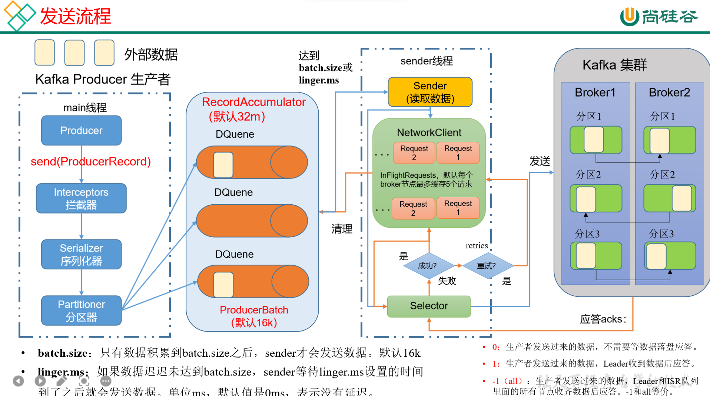

​  

#### 生产者重要参数列表

| 参数名称 | 描述 |
| --- | --- |
| bootstrap.servers | 生产者连接集群所需的broker地址清单。例如hadoop102:9092,hadoop103:9092,hadoop104:9092，可以设置1个或者多个，中间用逗号隔开。注意这里并非需要所有的broker地址，因为生产者从给定的broker里查找到其他broker信息。 |
| key.serializer和value.serializer | 指定发送消息的key和value的序列化类型。一定要写全类名。 |
| buffer.memory | RecordAccumulator缓冲区总大小，默认32m。 |
| batch.size | 缓冲区一批数据最大值，默认16k。适当增加该值，可以提高吞吐量，但是如果该值设置太大，会导致数据传输延迟增加。 |
| linger.ms | 如果数据迟迟未达到batch.size，sender等待linger.time之后就会发送数据。单位ms，默认值是0ms，表示没有延迟。生产环境建议该值大小为5-100ms之间。 |
| acks | 0：生产者发送过来的数据，不需要等数据落盘应答。 1：生产者发送过来的数据，Leader收到数据后应答。 -1（all）：生产者发送过来的数据，Leader+和isr队列里面的所有节点收齐数据后应答。默认值是-1，-1和all是等价的。 |
| max.in.flight.requests.per.connection | 允许最多没有返回ack的次数，默认为5，开启幂等性要保证该值是1-5的数字。 |
| retries | 当消息发送出现错误的时候，系统会重发消息。retries表示重试次数。默认是int最大值，2147483647。 如果设置了重试，还想保证消息的有序性，需要设置 MAX_IN_FLIGHT_REQUESTS_PER_CONNECTION=1否则在重试此失败消息的时候，其他的消息可能发送成功了。 |
| retry.backoff.ms | 两次重试之间的时间间隔，默认是100ms。 |
| enable.idempotence | 是否开启幂等性，默认true，开启幂等性。 |
| compression.type | 生产者发送的所有数据的压缩方式。默认是none，也就是不压缩。 支持压缩类型：none、gzip、snappy、lz4和zstd。 |

  

#### 异步发送API

普通异步发送

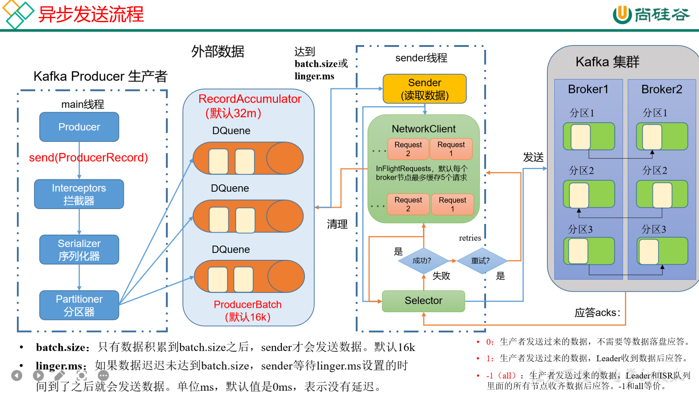

带回调函数的异步发送

​  

回调函数会在producer收到ack时调用，为异步调用，该方法有两个参数，分别是元数据信息（RecordMetadata）和异常信息（Exception），如果Exception为null，说明消息发送成功，如果Exception不为null，说明消息发送失败。

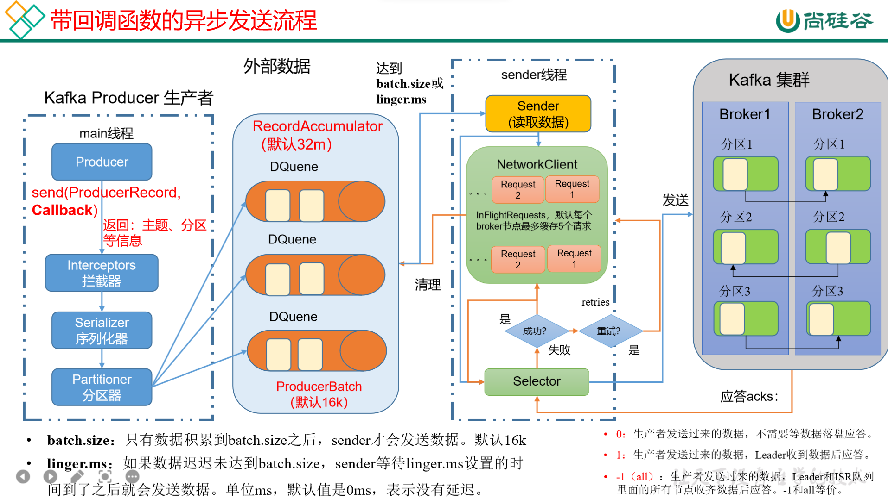

  

  

### 生产者分区

#### 分区的好处

(1)磁盘的负载均匀 (2)可以开启并行度

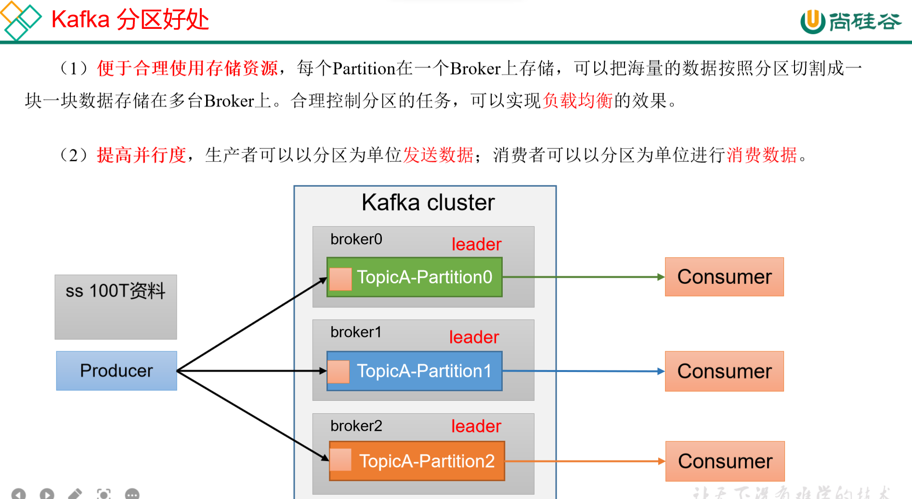

  

#### Kafka消费者分区策略

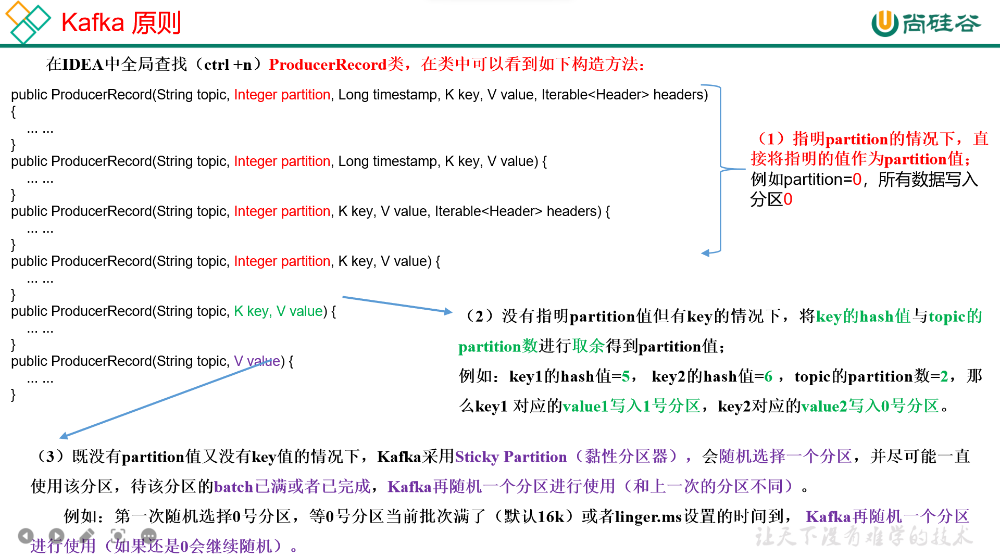

#### 自定义分区器

如果研发人员可以根据企业需求，自己重新实现分区器。

**实现步骤**

（1）定义类实现Partitioner接口。

（2）重写partition()方法。

/\*\*

​\* 1. 实现接口Partitioner

​\* 2. 实现3个方法:partition,close,configure

​\* 3. 编写partition方法,返回分区号

\*/

  

#### 生产者提高吞吐量

batch.size linger.ms compression.type RecordAccumulator

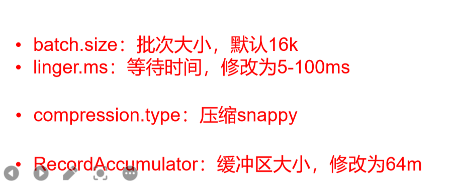

  

### 数据的可靠性

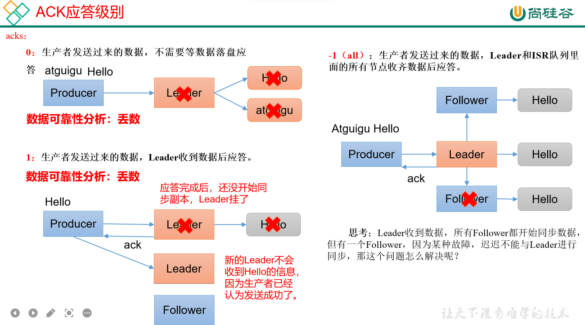

ISR队列:in-sync- replica set(ISR)与leader保持同步的Follower+leader的集合

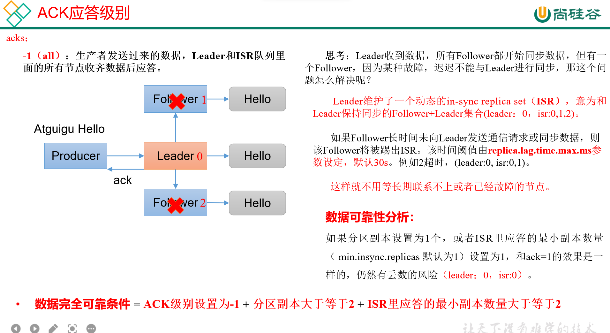

  

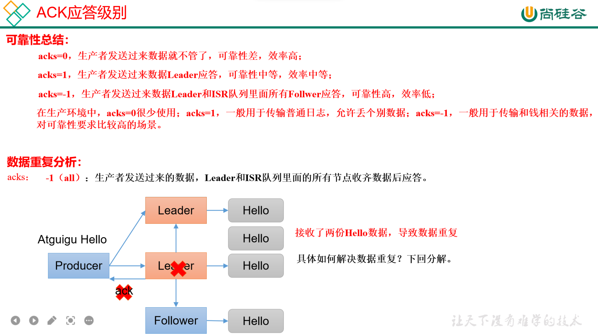

​  

3）副本介绍

（1）Kafka副本作用：提高数据可靠性。

（2）Kafka默认副本1个，生产环境一般配置为2个，保证数据可靠性；太多副本会增加磁盘存储空间，增加网络上数据传输，降低效率。

（3）Kafka中副本分为：Leader和Follower。Kafka生产者只会把数据发往Leader，然后Follower找Leader进行同步数据。

（4）Kafka分区中的所有副本统称为AR（Assigned Repllicas）。

AR = ISR + OSR

**ISR**，表示和Leader保持同步的Follower集合。如果Follower长时间未向Leader发送通信请求或同步数据，则该Follower将被踢出ISR。该时间阈值由**replica.lag.time.max.ms**参数设定，默认30s。Leader发生故障之后，就会从ISR中选举新的Leader。

**OSR，**表示Follower与Leader副本同步时，延迟过多的副本。

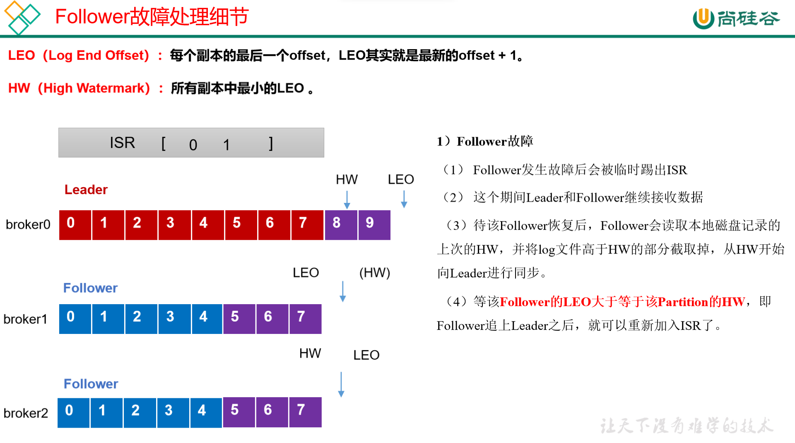

​  

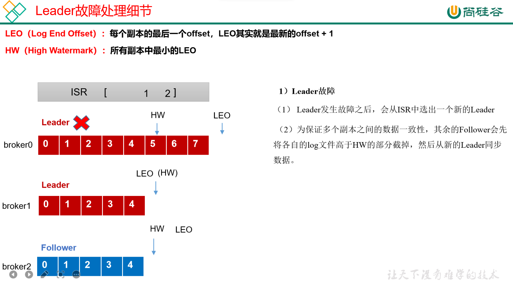

​  

### 数据去重

at least once at most once

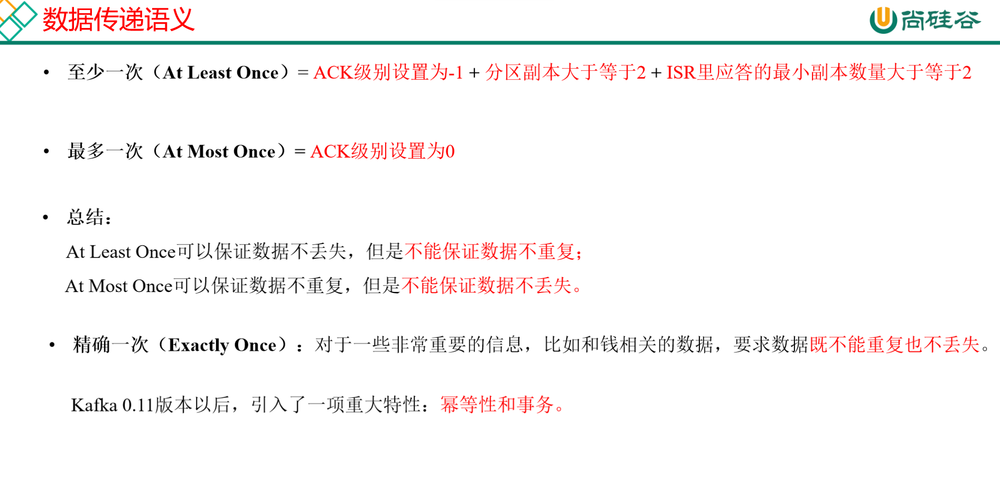

幂等性原理

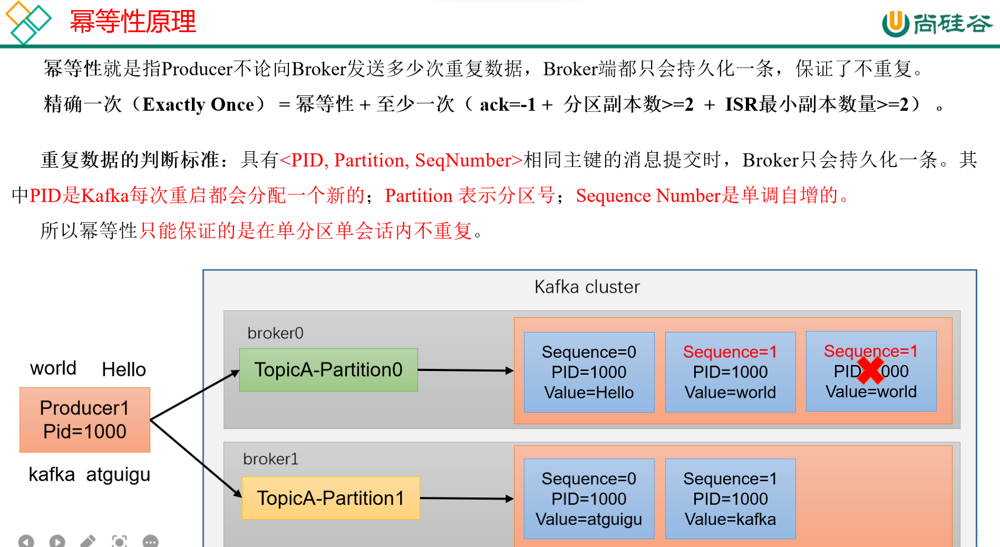

  

**如何使用幂等性**

开启参数**enable.idempotence** 默认为true，false关闭。

​  

生产者事务:

0.11版本的Kafka同时引入了事务的特性，为了实现跨分区跨会话的事务，需要引入一个全局唯一的Transaction ID，并将Producer获得的PID和Transaction ID绑定。这样当Producer重启后就可以通过正在进行的Transaction ID获得原来的PID。

为了管理Transaction，Kafka引入了一个新的组件Transaction Coordinator。Producer就是通过和Transaction Coordinator交互获得Transaction ID对应的任务状态。Transaction Coordinator还负责将事务所有写入Kafka的一个内部Topic，这样即使整个服务重启，由于事务状态得到保存，进行中的事务状态可以得到恢复，从而继续进行。

注意：提前开启幂等性!!!  
  

#### 数据有序

单分区间是有序的,分区间是无序的

​  

#### 数据乱序

  

max.in.flight.request.per.connnect

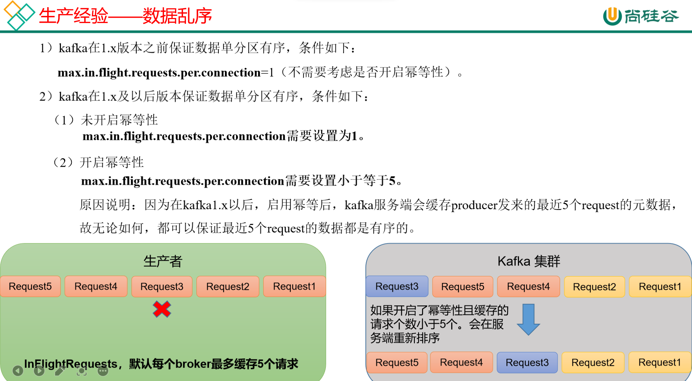

  

## Kafka Broker

#### 总工作流程

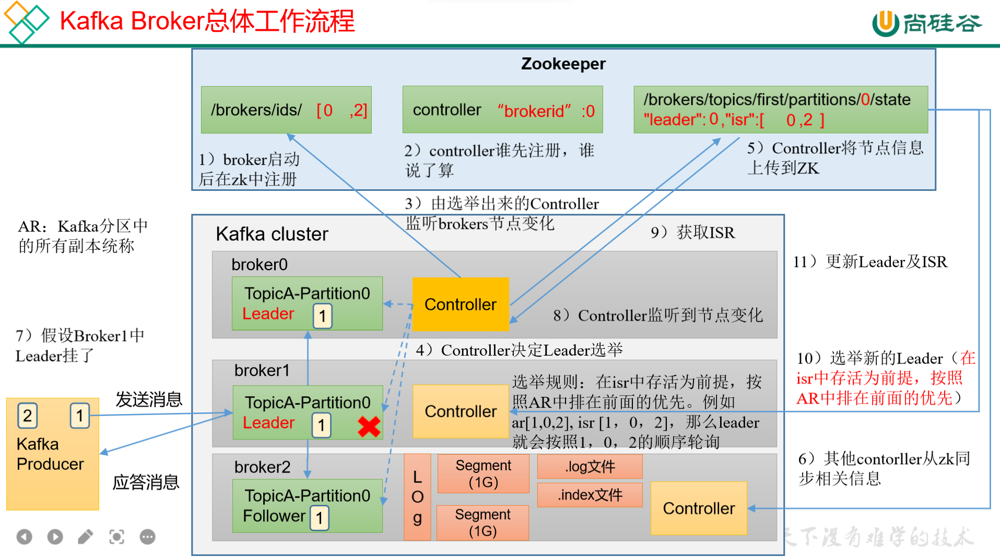

​  

​  

#### Broker重要参数

| 参数名称 | 描述 |
| --- | --- |
| replica.lag.time.max.ms | ISR中，如果Follower长时间未向Leader发送通信请求或同步数据，则该Follower将被踢出ISR。该时间阈值，默认30s。 |
| auto.leader.rebalance.enable | 默认是true。自动Leader Partition 平衡。 |
| leader.imbalance.per.broker.percentage | 默认是10%。每个broker允许的不平衡的leader的比率。如果每个broker超过了这个值，控制器会触发leader的平衡。 |
| leader.imbalance.check.interval.seconds | 默认值300秒。检查leader负载是否平衡的间隔时间。 |
| log.segment.bytes | Kafka中log日志是分成一块块存储的，此配置是指log日志划分 成块的大小，默认值1G。 |
| log.index.interval.bytes | 默认4kb，kafka里面每当写入了4kb大小的日志（.log），然后就往index文件里面记录一个索引。 |
| log.retention.hours | Kafka中数据保存的时间，默认7天。 |
| log.retention.minutes | Kafka中数据保存的时间，分钟级别，默认关闭。 |
| log.retention.ms | Kafka中数据保存的时间，毫秒级别，默认关闭。 |
| log.retention.check.interval.ms | 检查数据是否保存超时的间隔，默认是5分钟。 |
| log.retention.bytes | 默认等于-1，表示无穷大。超过设置的所有日志总大小，删除最早的segment。 |
| log.cleanup.policy | 默认是delete，表示所有数据启用删除策略； 如果设置值为compact，表示所有数据启用压缩策略。 |
| num.io.threads | 默认是8。负责写磁盘的线程数。整个参数值要占总核数的50%。 |
| num.replica.fetchers | 副本拉取线程数，这个参数占总核数的50%的1/3 |
| num.network.threads | 默认是3。数据传输线程数，这个参数占总核数的50%的2/3 。 |
| log.flush.interval.messages | 强制页缓存刷写到磁盘的条数，默认是long的最大值，9223372036854775807。一般不建议修改，交给系统自己管理。 |
| log.flush.interval.ms | 每隔多久，刷数据到磁盘，默认是null。一般不建议修改，交给系统自己管理。 |

#### 文件储存

​  

文件存储机制

​  

Topic数据的存储机制

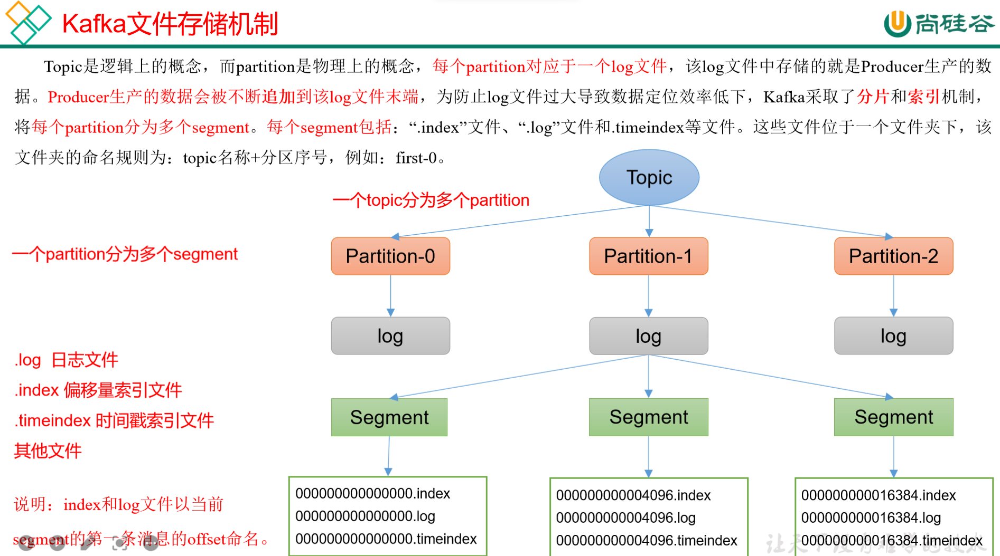

  

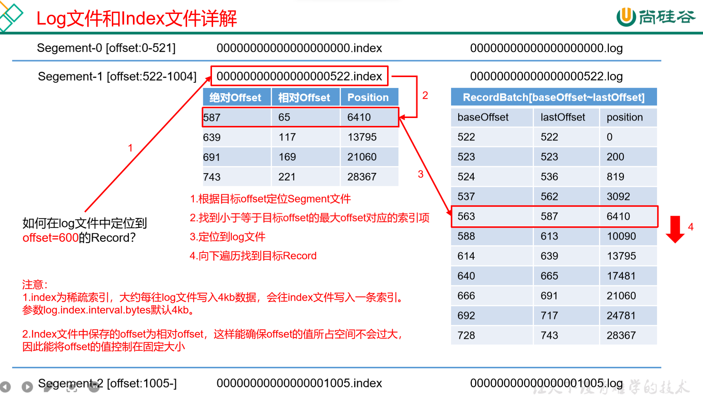

  

说明：日志存储参数配置

| 参数 | 描述 |
| --- | --- |
| log.segment.bytes | Kafka中log日志是分成一块块存储的，此配置是指log日志划分 成块的大小，默认值1G。 |
| log.index.interval.bytes | 默认4kb，kafka里面每当写入了4kb大小的日志（.log），然后就往index文件里面记录一个索引。 稀疏索引。 |

  

#### 文件清除策略

  

Kafka中默认的日志保存时间为7天，可以通过调整如下参数修改保存时间。

l log.retention.hours，最低优先级小时，默认7天。

l log.retention.minutes，分钟。

l log.retention.ms，最高优先级毫秒。

l log.retention.check.interval.ms，负责设置检查周期，默认5分钟。

那么日志一旦超过了设置的时间，怎么处理呢？

Kafka中提供的日志清理策略有delete和compact两种。

1）delete日志删除：将过期数据删除

l log.cleanup.policy \= delete 所有数据启用删除策略

（1）基于时间：默认打开。以segment中所有记录中的最大时间戳作为该文件时间戳。

（2）基于大小：默认关闭。超过设置的所有日志总大小，删除最早的segment。

log.retention.bytes，默认等于-1，表示无穷大。

​  

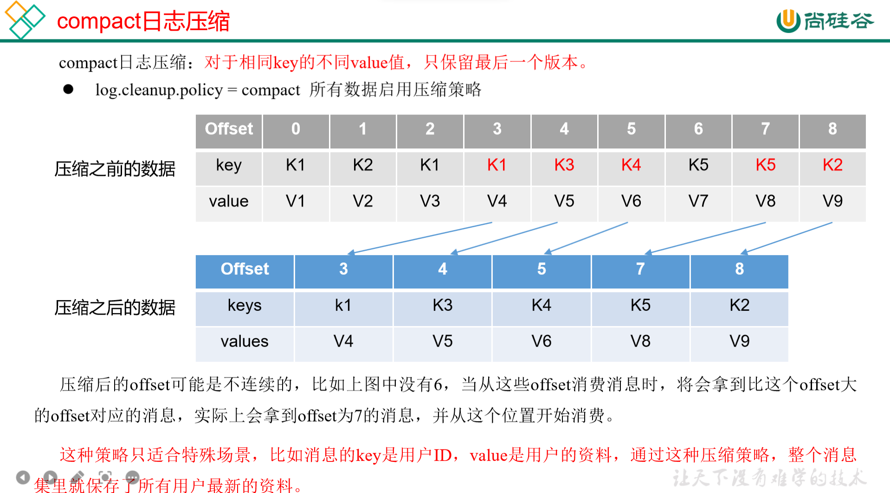

#### 高效读写数据

**1****）****Kafka****本身是分布式集群，可以采用分区技术，并行度高**

**2****）读数据采用稀疏索引，可以快速定位要消费的数据**

**3****）顺序写磁盘**

Kafka的producer生产数据，要写入到log文件中，写的过程是一直追加到文件末端，为顺序写。**官网有数据表明**，同样的磁盘，顺序写能到600M/s，而随机写只有100K/s。这与磁盘的机械机构有关，顺序写之所以快，是因为其省去了大量磁头寻址的时间。

(4)零拷贝(kafka Broker应用层不关心存储的数据,无需走应用层,效率高)

页缓存(先从PageCache(底层操作系统提供的,将空闲的内存当作磁盘的缓存)中查找,找不到再去磁盘)

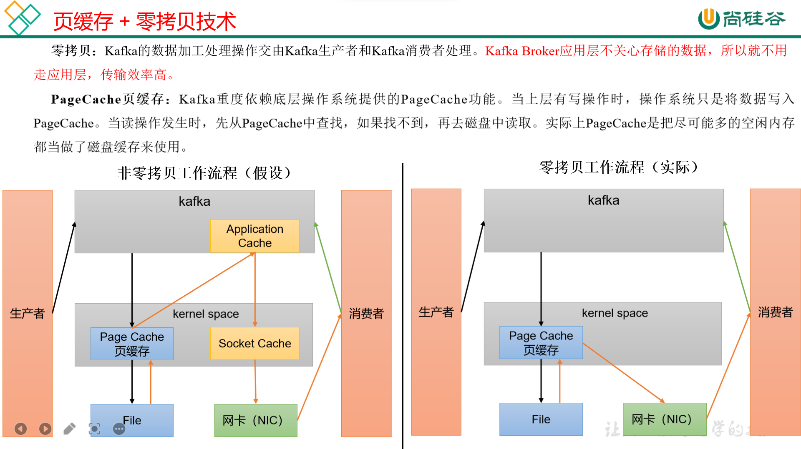

​  

| 参数 | 描述 |
| --- | --- |
| log.flush.interval.messages | 强制页缓存刷写到磁盘的条数，默认是long的最大值，9223372036854775807。一般不建议修改，交给系统自己管理。 |
| log.flush.interval.ms | 每隔多久，刷数据到磁盘，默认是null。一般不建议修改，交给系统自己管理。 |

## Kafka消费者

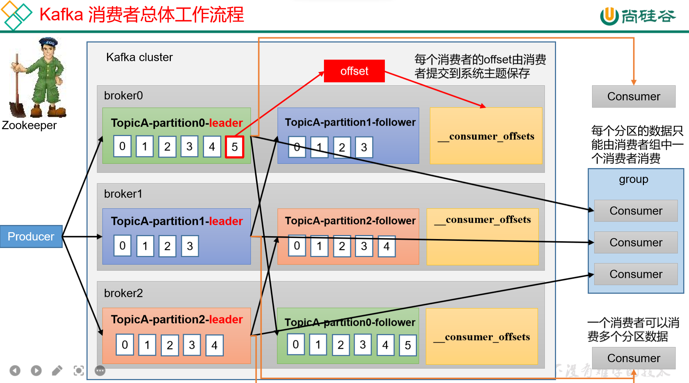

​  

​  

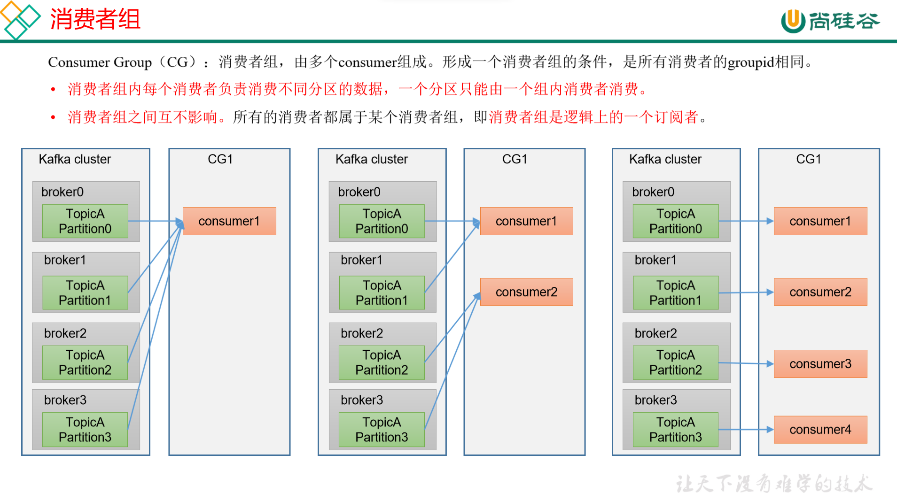

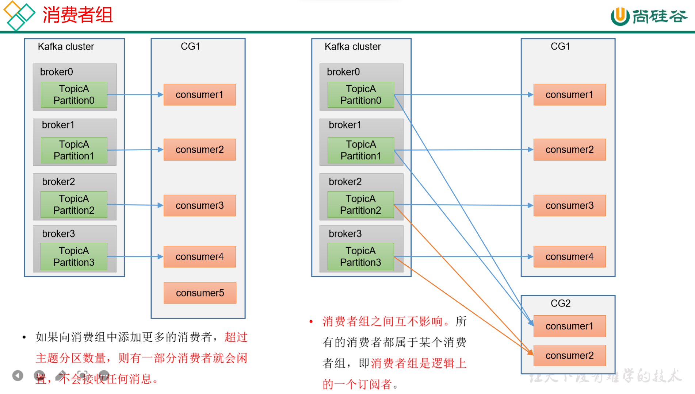

  

coordinator

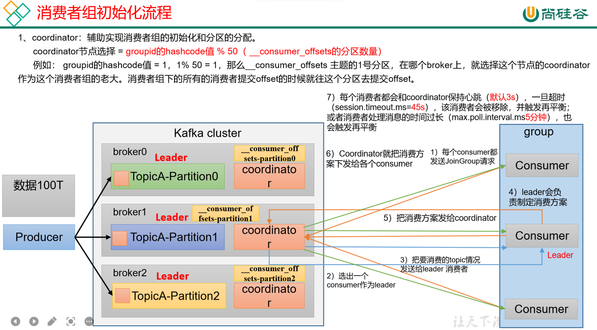

​  

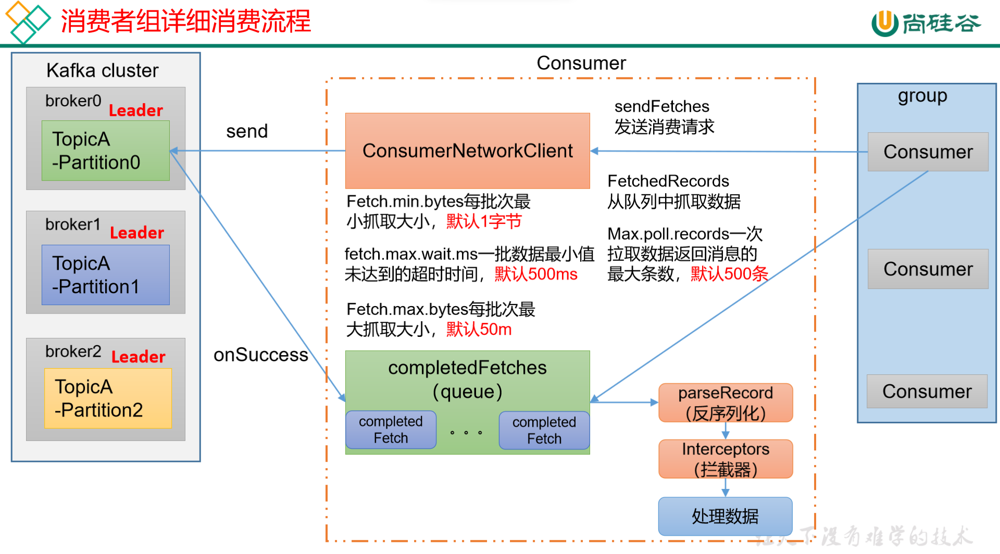

#### 5.2.3 消费者重要参数

| 参数名称 | 描述 |
| --- | --- |
| bootstrap.servers | 向Kafka集群建立初始连接用到的host/port列表。 |
| key.deserializer和value.deserializer | 指定接收消息的key和value的反序列化类型。一定要写全类名。 |
| group.id | 标记消费者所属的消费者组。 |
| enable.auto.commit | 默认值为true，消费者会自动周期性地向服务器提交偏移量。 |
| auto.commit.interval.ms | 如果设置了 enable.auto.commit 的值为true， 则该值定义了消费者偏移量向Kafka提交的频率，默认5s。 |
| auto.offset.reset | 当Kafka中没有初始偏移量或当前偏移量在服务器中不存在（如，数据被删除了），该如何处理？ earliest：自动重置偏移量到最早的偏移量。 latest：默认，自动重置偏移量为最新的偏移量。 none：如果消费组原来的（previous）偏移量不存在，则向消费者抛异常。 anything：向消费者抛异常。 |
| offsets.topic.num.partitions | __consumer_offsets的分区数，默认是50个分区。 |
| heartbeat.interval.ms | Kafka消费者和coordinator之间的心跳时间，默认3s。 该条目的值必须小于 session.timeout.ms ，也不应该高于 session.timeout.ms 的1/3。 |
| session.timeout.ms | Kafka消费者和coordinator之间连接超时时间，默认45s。超过该值，该消费者被移除，消费者组执行再平衡。 |
| max.poll.interval.ms | 消费者处理消息的最大时长，默认是5分钟。超过该值，该消费者被移除，消费者组执行再平衡。 |
| fetch.min.bytes | 默认1个字节。消费者获取服务器端一批消息最小的字节数。 |
| fetch.max.wait.ms | 默认500ms。如果没有从服务器端获取到一批数据的最小字节数。该时间到，仍然会返回数据。 |
| fetch.max.bytes | 默认Default: 52428800（50 m）。消费者获取服务器端一批消息最大的字节数。如果服务器端一批次的数据大于该值（50m）仍然可以拉取回来这批数据，因此，这不是一个绝对最大值。一批次的大小受message.max.bytes （broker config）or max.message.bytes （topic config）影响。 |
| max.poll.records | 一次poll拉取数据返回消息的最大条数，默认是500条。 |

  

#### 分区的分配以及再平衡

Ranger,RoundRobin,Sticky,CooperativeSticky

  

  

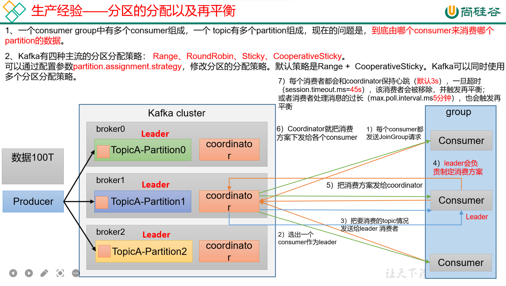

| 参数名称 | 描述 |
| --- | --- |
| heartbeat.interval.ms | Kafka消费者和coordinator之间的心跳时间，默认3s。 该条目的值必须小于 session.timeout.ms，也不应该高于 session.timeout.ms 的1/3。 |
| session.timeout.ms | Kafka消费者和coordinator之间连接超时时间，默认45s。超过该值，该消费者被移除，消费者组执行再平衡。 |
| max.poll.interval.ms | 消费者处理消息的最大时长，默认是5分钟。超过该值，该消费者被移除，消费者组执行再平衡。 |
| partition.assignment.strategy | 消费者分区分配策略，默认策略是Range + CooperativeSticky。Kafka可以同时使用多个分区分配策略。可以选择的策略包括：Range、RoundRobin、Sticky、CooperativeSticky |

  

**Range分区策略原理**

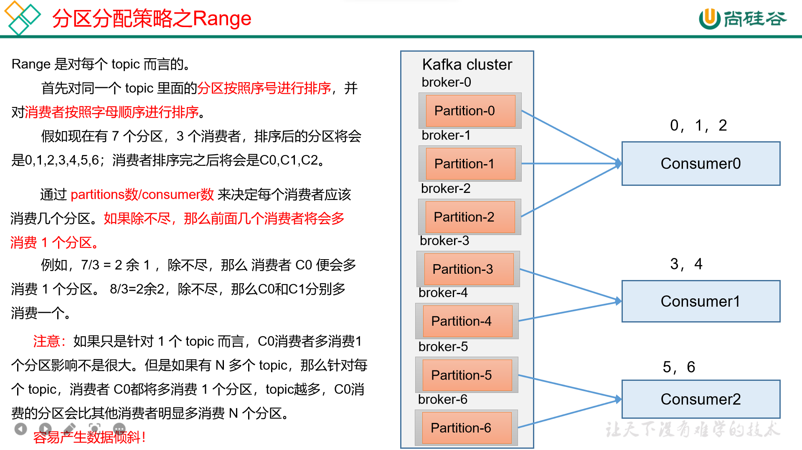

注意：分区数可以增加，但是不能减少。

说明：Kafka默认的分区分配策略就是Range + CooperativeSticky，所以不需要修改策略。

​  

**RoundRobin分区策略原理**

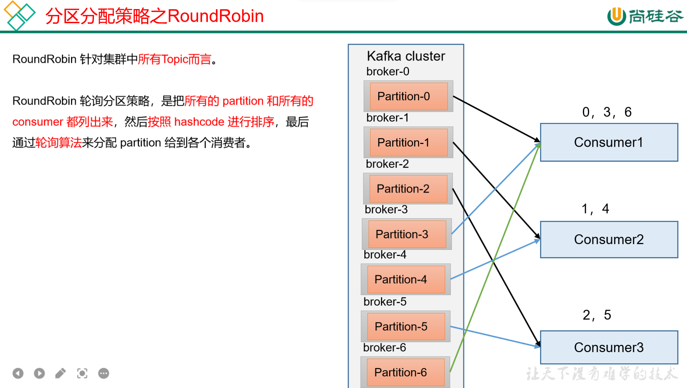

  

  

#### Sticky以及再平衡

**粘性分区定义：**可以理解为分配的结果带有“粘性的”。即在执行一次新的分配之前，考虑上一次分配的结果，尽量少的调整分配的变动，可以节省大量的开销。

粘性分区是Kafka从0.11.x版本开始引入这种分配策略，首先会尽量均衡的放置分区到消费者上面，在出现同一消费者组内消费者出现问题的时候，会尽量保持原有分配的分区不变化。

  

  

#### offset位移问题

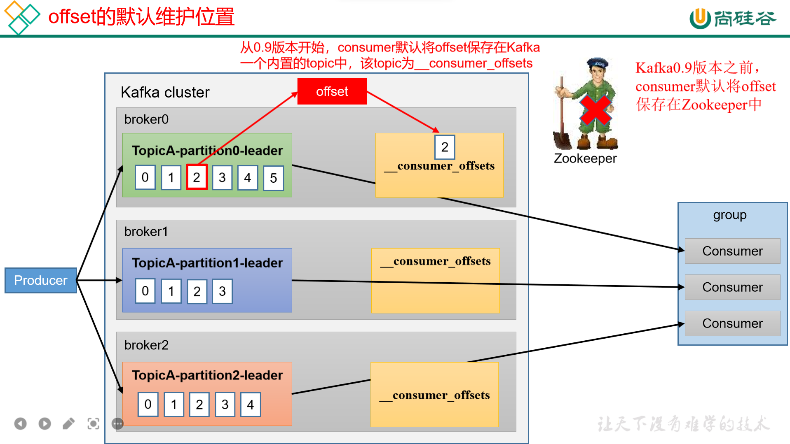

\_\_consumer\_offsets主题里面采用key和value的方式存储数据。key是group.id+topic+分区号，value就是当前offset的值。每隔一段时间，kafka内部会对这个topic进行compact，也就是每个group.id+topic+分区号就保留最新数据。

​  

| 参数名称 | 描述 |
| --- | --- |
| enable.auto.commit | 默认值为true，消费者会自动周期性地向服务器提交偏移量。 |
| auto.commit.interval.ms | 如果设置了 enable.auto.commit 的值为true， 则该值定义了消费者偏移量向Kafka提交的频率，默认5s。 |

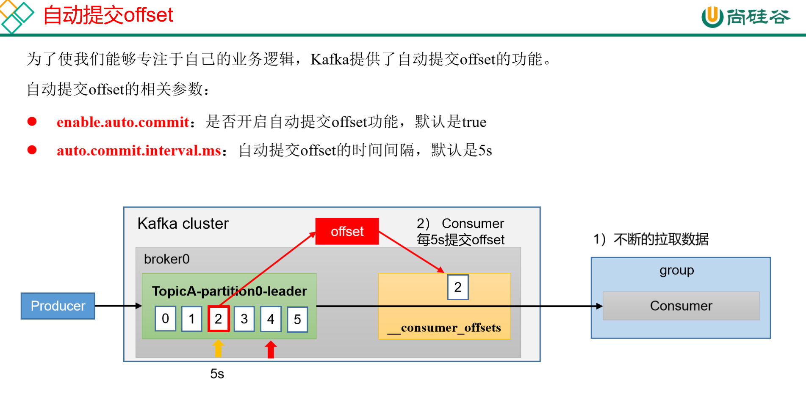

​  

| 参数名称 | 描述 |
| --- | --- |
| enable.auto.commit | 默认值为true，消费者会自动周期性地向服务器提交偏移量。 |
| auto.commit.interval.ms | 如果设置了 enable.auto.commit 的值为true， 则该值定义了消费者偏移量向Kafka提交的频率，默认5s。 |

commitSync (同步提交)阻塞提交当前线程 ,且会自动失败重试 commitAsync(异步提交) 无失败重试

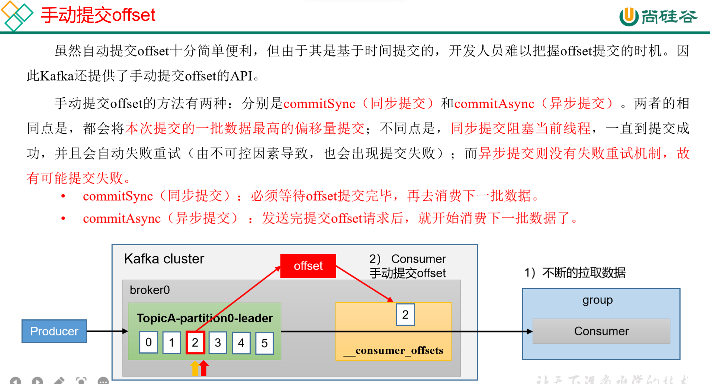

  

  

指定Offset消费

auto.offset.reset = earliest | latest | none 默认是latest。

当Kafka中没有初始偏移量（消费者组第一次消费）或服务器上不再存在当前偏移量时（例如该数据已被删除），该怎么办？

（1）earliest：自动将偏移量重置为最早的偏移量，\-\-from\-beginning。

（2）latest（默认值）：自动将偏移量重置为最新偏移量。

（3）none：如果未找到消费者组的先前偏移量，则向消费者抛出异常。

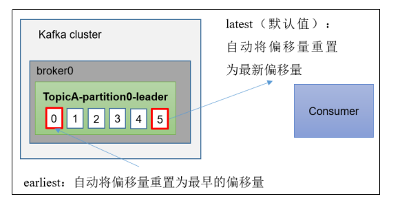

#### 漏消费和重复消费

**重复消费：**已经消费了数据，但是offset没提交。

**漏消费：**先提交offset后消费，有可能会造成数据的漏消费。

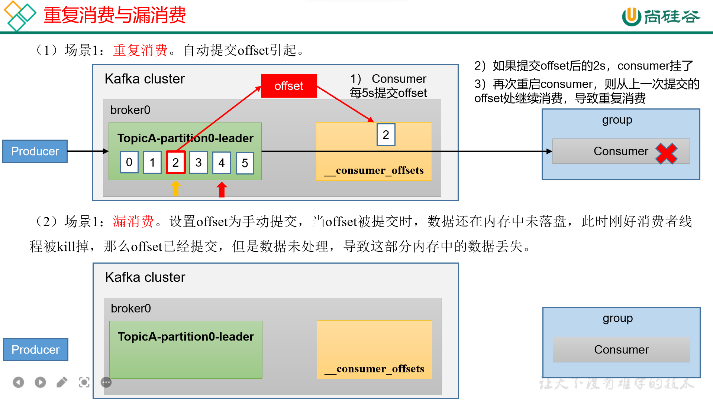

#### 消费者事务

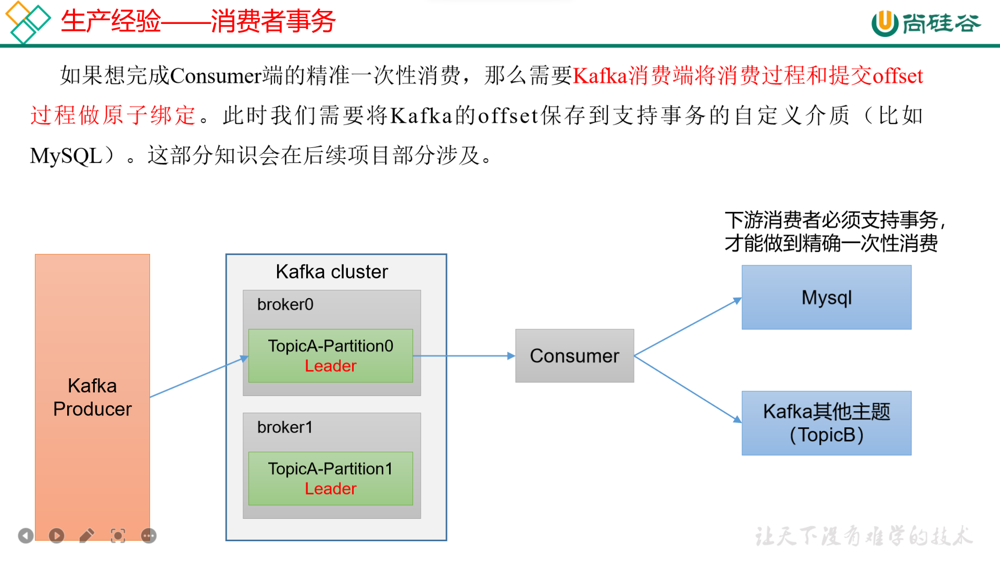

#### 数据积压

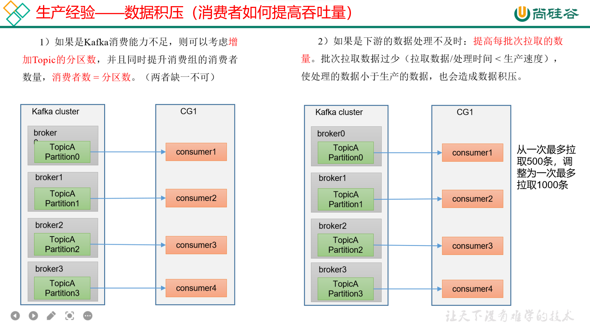

| 参数名称 | 描述 |
| --- | --- |
| fetch.max.bytes | 默认Default: 52428800（50 m）。消费者获取服务器端一批消息最大的字节数。如果服务器端一批次的数据大于该值（50m）仍然可以拉取回来这批数据，因此，这不是一个绝对最大值。一批次的大小受message.max.bytes （broker config）or max.message.bytes （topic config）影响。 |
| max.poll.records | 一次poll拉取数据返回消息的最大条数，默认是500条 |

  

  

  

kafka是一个分布式的基于发布,订阅模式(消息的发布者将发布的消息分为不同的类型,订阅者只接受感兴趣的消息)的消息队列(Message Queue),大数据实时处理领域

最新定义: 是一个分布式事件流平台(Event Streaming Platform),用于高性能数据管道,流分析,数据集成,关键任务应用

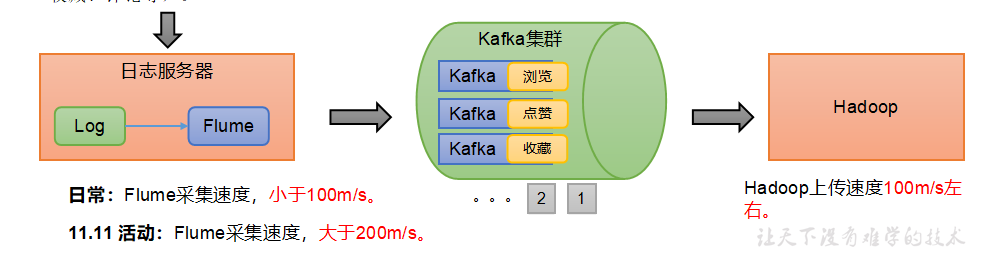

  

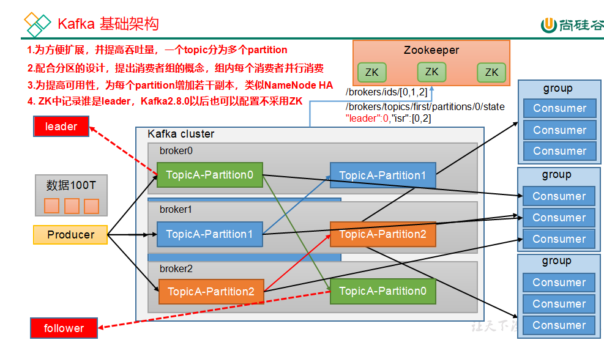

**（****1****）****Producer****：**消息生产者，就是向Kafka broker发消息的客户端。

**（****2****）****Consumer****：**消息消费者，向Kafka broker取消息的客户端。

**（****3****）****Consumer Group****（****CG****）：**消费者组，由多个consumer组成。**消费者组内每个消费者负责消费不同分区的数据，一个分区只能由一个组内消费者消费；消费者组之间互不影响。**所有的消费者都属于某个消费者组，即**消费者组是逻辑上的一个订阅者**。

**（4）Broker：**一台Kafka服务器就是一个broker。一个集群由多个broker组成。一个broker可以容纳多个topic。

**（****5****）****Topic****：**可以理解为一个队列，**生产者和消费者面向的都是一个****topic**。

**（****6****）****Partition****：**为了实现扩展性，一个非常大的topic可以分布到多个broker（即服务器）上，**一个****topic****可以分为多个****partition**，每个partition是一个有序的队列。

**（****7****）****Replica****：**副本。一个topic的每个分区都有若干个副本，一个**Leader**和若干个**Follower**。

**（****8****）****Leader****：**每个分区多个副本的“主”，生产者发送数据的对象，以及消费者消费数据的对象都是Leader。

**（9）Follower：**每个分区多个副本中的“从”，实时从Leader中同步数据，保持和Leader数据的同步。Leader发生故障时，某个Follower会成为新的Leader。

​  

**注意：**停止Kafka集群时，一定要等Kafka所有节点进程全部停止后再停止Zookeeper集群。因为Zookeeper集群当中记录着Kafka集群相关信息，Zookeeper集群一旦先停止，Kafka集群就没有办法再获取停止进程的信息，只能手动杀死Kafka进程了。

​  

查看操作主题命令参数

[atguigu@hadoop102 kafka]$ bin/kafka-topics.sh

\--topic 定义topic名

\--replication-factor 定义副本数

\--partitions 定义分区数

​  

修改分区数（注意：分区数只能增加，不能减少）

​  

生产者消息发送流程

### **​****发送原理**

在消息发送的过程中，涉及到了**两个线程——main线程和Sender线程**。在main线程中创建了**一个双端队列RecordAccumulator**。main线程将消息发送给RecordAccumulator，Sender线程不断从RecordAccumulator中拉取消息发送到Kafka Broker。

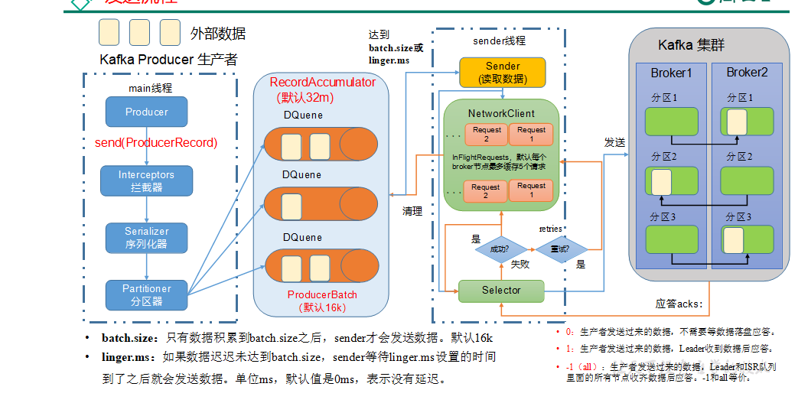

### **普通异步发送**

1）需求：创建Kafka生产者，采用异步的方式发送到Kafka Broker

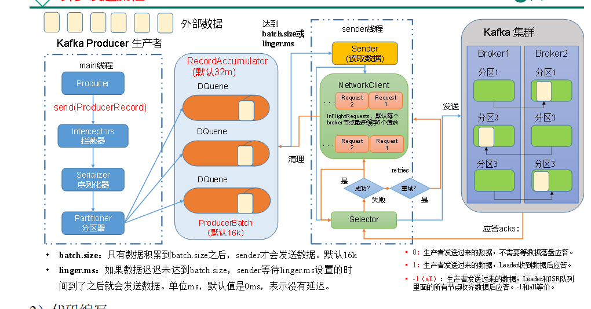

### **带回调函数的异步发送**

回调函数会在producer收到ack时调用，为异步调用，该方法有两个参数，分别是元数据信息（RecordMetadata）和异常信息（Exception），如果Exception为null，说明消息发送成功，如果Exception不为null，说明消息发送失败

​  

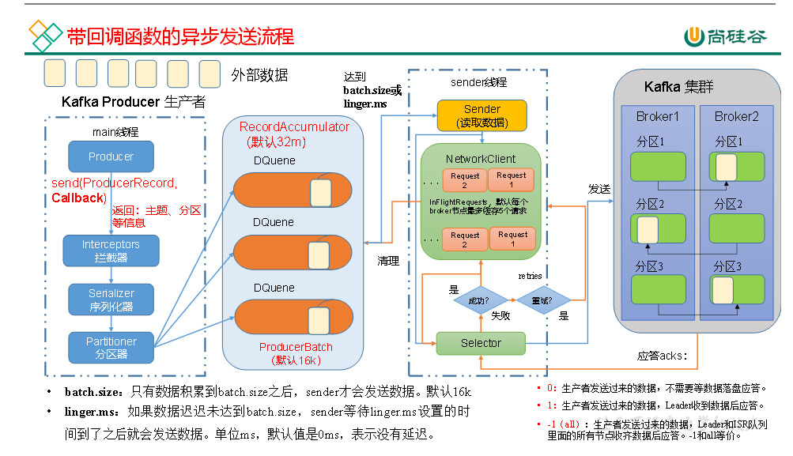

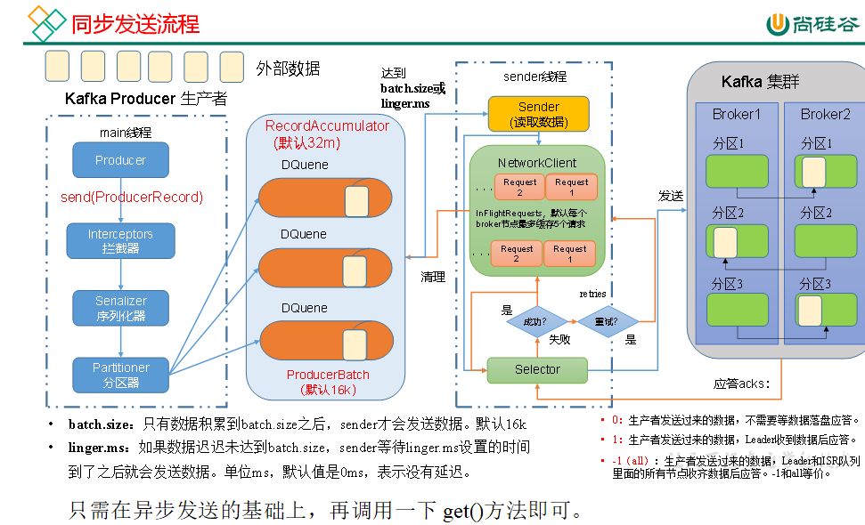

  

kafka分区的好处:便于合理使用存储资源,提高并行度

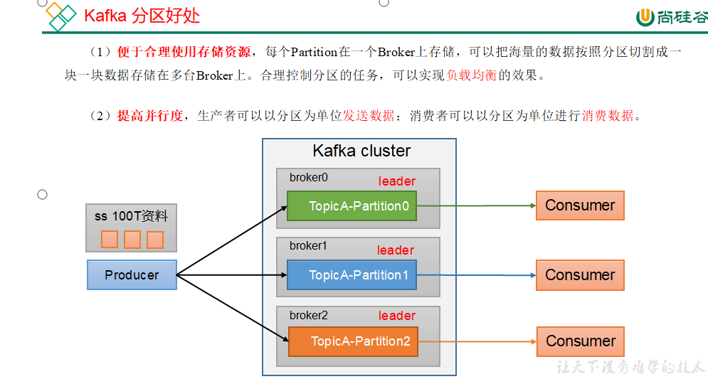

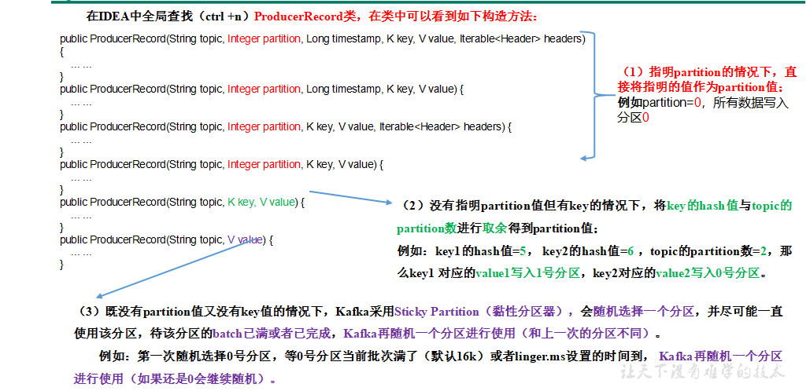

  

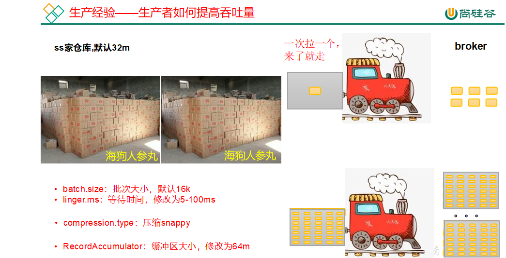

  

  

## Kafka-Eagle监控

Kafka-Eagle框架可以监控Kafka集群的整体运行情况，在生产环境中经常使用。

  

## Kafka-Kraft模式

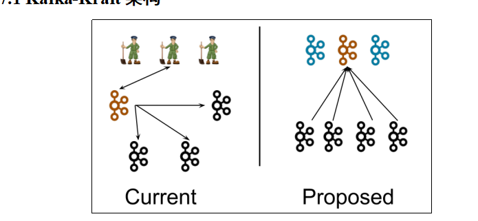

左图为Kafka现有架构，元数据在zookeeper中，运行时动态选举controller，由controller进行Kafka集群管理。右图为kraft模式架构（实验性），不再依赖zookeeper集群，而是用三台controller节点代替zookeeper，元数据保存在controller中，由controller直接进行Kafka集群管理。

这样做的好处有以下几个：

Kafka不再依赖外部框架，而是能够独立运行；

controller管理集群时，不再需要从zookeeper中先读取数据，集群性能上升；

由于不依赖zookeeper，集群扩展时不再受到zookeeper读写能力限制；

controller不再动态选举，而是由配置文件规定。这样我们可以有针对性的加强controller节点的配置，而不是像以前一样对随机controller节点的高负载束手无策。

  

# 工作中的感悟

-   kafka中的消费服务,可能是直接使用kafka提供的API,但是也可能是使用的第三方,例如 spout,那么这个时候消费不由kafka管理,查看消费者组也就会提示,has no active consumer