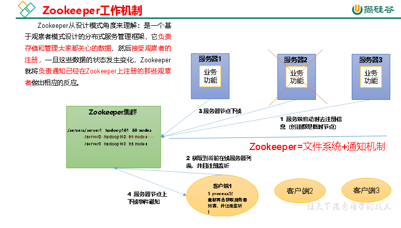
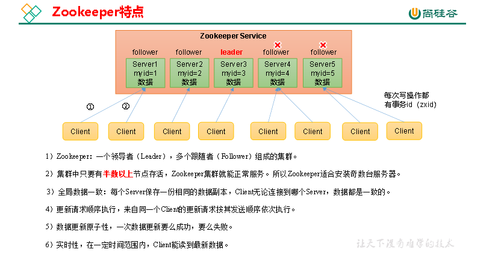
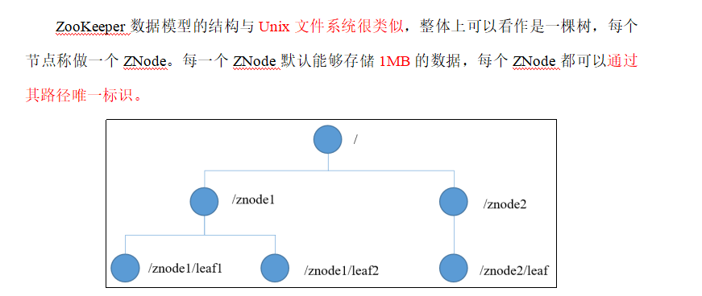
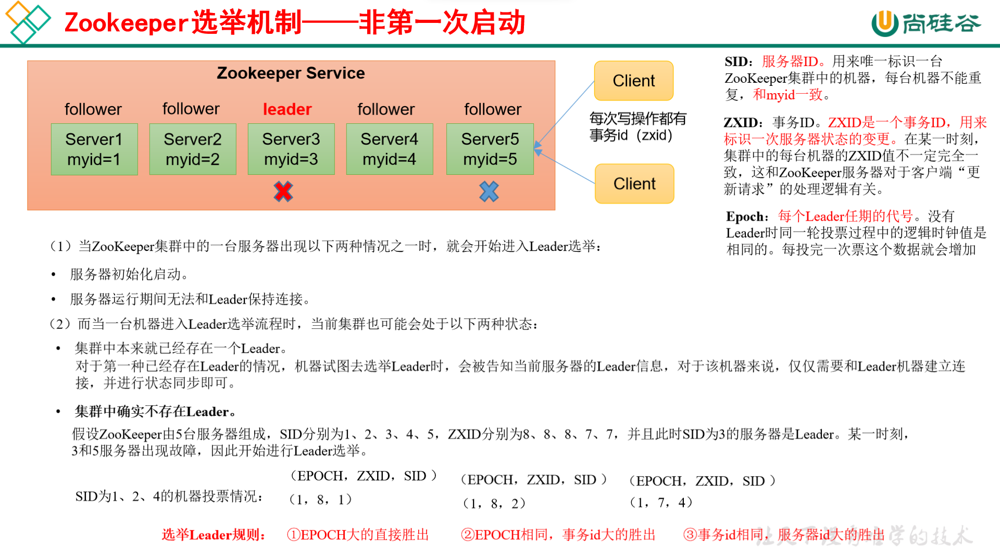
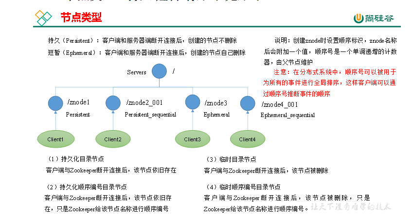
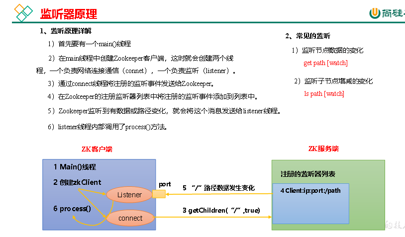
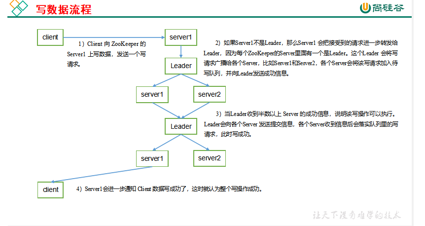

### 概述

Zookeeper是一个开源的分布式的，为分布式框架提供协调服务的Apache项目。

​  

工作机制

从设计者模式的角度来分析:是一个基于观察者模式设计的分布式服务关联框架,负责存储与管理一些重要的数据,然后接受观察者的注册,一旦这些数据的状态发生了变化,zookeeper的 就将负责通知已经存在的zookeeper上注册

的那些观察者做出相对的反应

​  

半数机制,全局数据一致性,

  

  

应用场景

服务包括:统一命名,统一配置,统一集群,服务器节点动态上下线,软负载均衡

  

  

### 安装

#### 配置参数解读

Zookeeper中的配置文件zoo.cfg中参数含义解读如下：

**1）tickTime = 2000：通信心跳时间，Zookeeper服务器与客户端心跳时间，单位毫秒**

**initLimit = 10：LF初始通信时限**

Leader和Follower初始连接时能容忍的最多心跳数（tickTime的数量）

**syncLimit = 5：LF同步通信时限**

Leader和Follower之间通信时间如果超过syncLimit \* tickTime，Leader认为Follwer死掉，从服务器列表中删除Follwer。

### 实战

  

#### zookeeper的的选举机制问题:

概括:第一次启动与非第一次启动

三种状态:Following leading looking

未达到半数机制的时候,相互之间看myid,统一投票给myid最大的那个

​  

#### 集群操作

| **命令基本语法** | **功能描述** |
| --- | --- |
| help | 显示所有操作命令 |
| ls path | 使用ls 命令来查看当前znode的子节点 [可监听] -w 监听子节点变化 -s 附加次级信息 |
| create | 普通创建 -s 含有序列 -e 临时（重启或者超时消失） |
| get path | 获得节点的值[可监听] -w 监听节点内容变化 -s 附加次级信息 |
| set | 设置节点的具体值 |
| stat | 查看节点状态 |
| delete | 删除节点 |
| deleteall | 递归删除节点 |

​  

#### 客户端命令行操作

（1）czxid：创建节点的事务zxid

每次修改ZooKeeper状态都会产生一个ZooKeeper事务ID。事务ID是ZooKeeper中所有修改总的次序。每次修改都有唯一的zxid，如果zxid1小于zxid2，那么zxid1在zxid2之前发生。

（2）ctime：znode被创建的毫秒数（从1970年开始）

（3）mzxid：znode最后更新的事务zxid

（4）mtime：znode最后修改的毫秒数（从1970年开始）

（5）pZxid：znode最后更新的子节点zxid

（6）cversion：znode子节点变化号，znode子节点修改次数

（7）dataversion：znode数据变化号

（8）aclVersion：znode访问控制列表的变化号

（9）ephemeralOwner：如果是临时节点，这个是znode拥有者的session id。如果不是临时节点则是0。

（10）dataLength：znode的数据长度

（11）numChildren：znode子节点数量

#### 监听器原理

客户端注册监听它关心的目录节点，当目录节点发生变化（数据改变、节点删除、子目录节点增加删除）时，ZooKeeper会通知客户端。监听机制保证ZooKeeper保存的任何的数据的任何改变都能快速的响应到监听了该节点的应用程序。

  

#### 写数据流程

