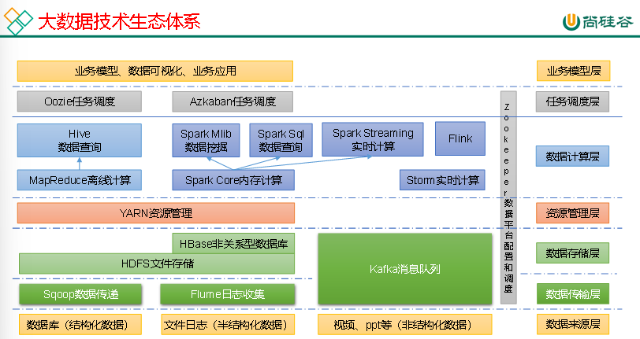
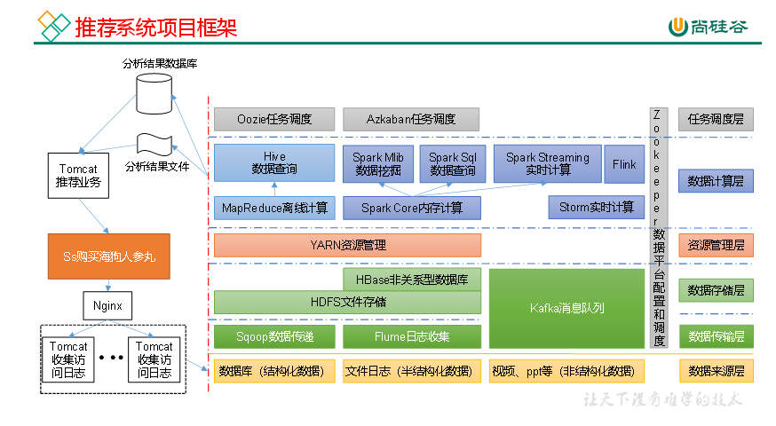
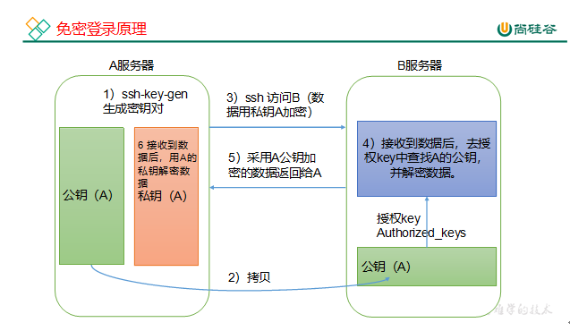
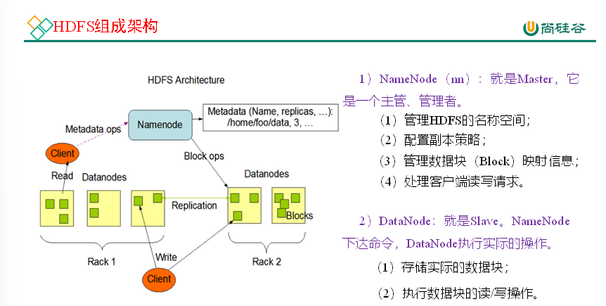
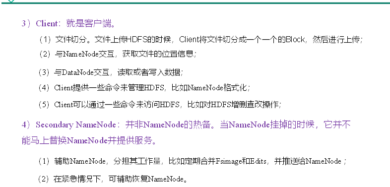

KB:kilobyte MB:MegaByte GB:GigaByte TB:TrillionByte PB:PetaByte EB:ExaByte ZB:ZettaByte

大数据特点:volume velocity variety value

数据挖掘:211硕士

### Hadoop概述

分布式系统基础架构,解决数据的存储,分析计算

Hadoop四大优势:高可靠,高拓展,高效性,高容错性

Hadoop2.x增加了yarn来负责资源调度,mapreduce仅负责运算

HDFS:Hadoop Distributed File System 分布式文件系统

NameNode(nn):存储文件的元数据,文件名,目录结构,文件属性,文件的块列表,块所在的DataNode

DataNode(DN):在本地文件系统存储文件块系统,以及块数据的校验和

SecondaryNameNode(2nn):每隔一段时间对nn元数据备份

#### YARN架构概述

YetAnotherResourceNegotiator(YARN):hadoop的资源管理器

ResourceManager(RM):整个集群资源(内存,CPU等)的boss

NodeManger(NM):单个节点服务器资源的boss

ApplicationMaster(AM):单个任务运行的boss

Container:容器,相当于一台单独的服务器,封装了运行任务所需的资源,例如CPU,内存,磁盘,网络

#### MapReduce架构概述

分为两个阶段:Map(并行处理输入数据) Reduce(对Map结果进行汇总)

（1）Sqoop：Sqoop是一款开源的工具，主要用于在Hadoop、Hive与传统的数据库（MySQL）间进行数据的传递，可以将一个关系型数据库（例如：MySQL，Oracle 等）中的数据导进到Hadoop的HDFS中，也可以将HDFS的数据导进到关系型数据库中。

（2）Flume：Flume是一个高可用的，高可靠的，分布式的海量日志采集、聚合和传输的系统，Flume支持在日志系统中定制各类数据发送方，用于收集数据；

（3）Kafka：Kafka是一种高吞吐量的分布式发布订阅消息系统；

（4）Spark：Spark是当前最流行的开源大数据内存计算框架。可以基于Hadoop上存储的大数据进行计算。

（5）Flink：Flink是当前最流行的开源大数据内存计算框架。用于实时计算的场景较多。

（6）Oozie：Oozie是一个管理Hadoop作业（job）的工作流程调度管理系统。

（7）HBase：HBase是一个分布式的、面向列的开源数据库。HBase不同于一般的关系数据库，它是一个适合于非结构化数据存储的数据库。

（8）Hive：Hive是基于Hadoop的一个数据仓库工具，可以将结构化的数据文件映射为一张数据库表，并提供简单的SQL查询功能，可以将SQL语句转换为MapReduce任务进行运行。其优点是学习成本低，可以通过类SQL语句快速实现简单的MapReduce统计，不必开发专门的MapReduce应用，十分适合数据仓库的统计分析。

（9）ZooKeeper：它是一个针对大型分布式系统的可靠协调系统，提供的功能包括：配置维护、名字服务、分布式同步、组服务等

Hadoop运行模式:本地模式,伪分布式,完全分布式(多台服务器组成)

**scp（secure copy）安全****拷贝**定义 scp可以实现服务器与服务器之间的数据拷贝

scp -r $pdir/$fname $user@$host:$pdir/$fname

命令 递归 要拷贝的文件路径/名称 目的地用户@主机:目的地路径/名称

#### rsync远程同步工具

rsync主要用于备份和镜像。具有速度快、避免复制相同内容和支持符号链接的优点。

rsync和scp区别：用rsync做文件的复制要比scp的速度快，rsync只对差异文件做更新。scp是把所有文件都复制过去

（1）基本语法

rsync -a(归档拷贝)v(显示复制过程) $pdir/$fname $user@$host:$pdir/$fname

命令 选项参数 要拷贝的文件路径/名称 目的地用户@主机:目的地路径/名称

#### xsync集群分发脚本

（1）需求：循环复制文件到所有节点的相同目录下

期望脚本在任何路径都能使用（脚本放在声明了全局环境变量的路径）

SSH无密登录配置

然后敲（三个回车），就会生成两个文件id\_rsa（私钥）、id\_rsa.pub（公钥）

​  

**ssh****文件夹下（****~/.ssh****）的文件功能解释**

| known_hosts | 记录ssh访问过计算机的公钥（public key） |
| --- | --- |
| id_rsa | 生成的私钥 |
| id_rsa.pub | 生成的公钥 |
| authorized_keys | 存放授权过的无密登录服务器公钥 |

  

  

**如果集群是第一次启动**，需要在hadoop102节点格式化NameNode（注意：格式化NameNode，会产生新的集群id，导致NameNode和DataNode的集群id不一致，集群找不到已往数据。如果集群在运行过程中报错，需要重新格式化NameNode的话，一定要先停止namenode和datanode进程，并且要删除所有机器的data和logs目录，然后再进行格式化。）

​  

### ​  

### HDFS概述

分布式文件管理系统的一种,适合一次写入,多次写出

高容错性,适合处理大数据,可搭建在廉价机器上,不适合低延时数据访问,无法高效对大小文件进行存储,

不支持并发写入,文件随机修改(仅支持文件追加)

Hdfs的文件在物理上分块(block)处理,默认大小128(2,3.x),可通过配置参数修改

HDFS块的大小设置主要取决于磁盘传输速率

​