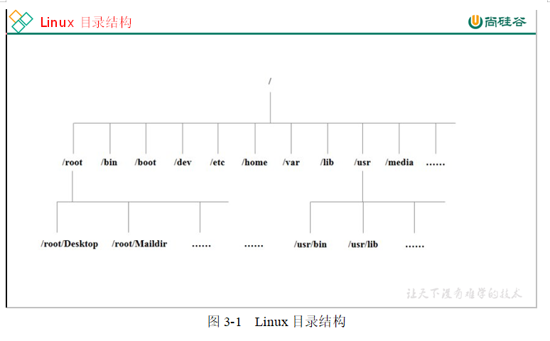
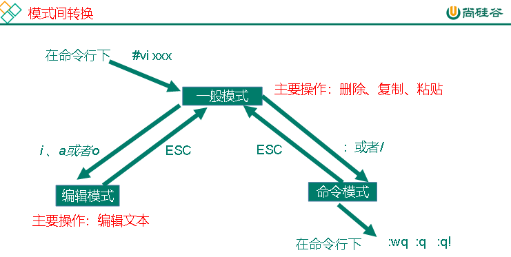
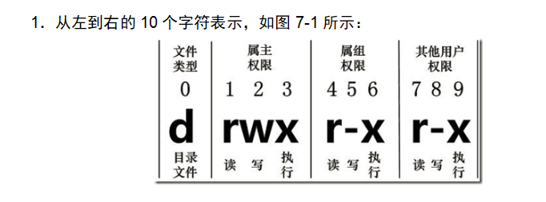
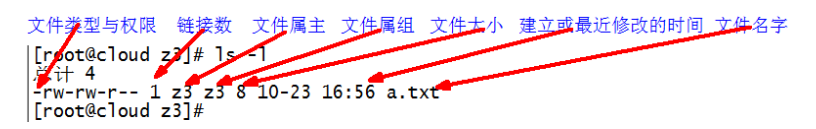

Linux是基于POSIX和UNIX的多任务,多用户,支持多线程,多CPU的操作系统

知名的发行版有:Ubuntu,RetHat,CentOS,Debain

  

Linux中一切都是文件.

  

/bin是Binary的缩写,存放着最常用的命令

/sbin是Super User的意思,存放的是系统管理员使用的系统管理程序

/home 存放普通用户的主目录,在linux中的每个用户都有一个自己的目录,一般以改用户的账号名来命名

/root 改目录为系统管理员,也被称为超级权限的用户主目录

/lib 保存着系统开机需要的最基本的动态连接贡献库,作用类似于Windows的DLL文件

/lost+found保存着系统非法关机后存放的文件

/etc 保存着所有的系统管理所需要的配置文件和子文件

/uesr 存放着用户的应用程序与文件,类似于windows下的program files目录

/boot 存放的是启动Linux时使用的一些核心文件,包括一些连接文件,与镜像文件

/proc 虚拟的目录,是系统内存的映射,可以通过直链接来获取系统的信息

/srv service缩写,保存一些服务启动之后需要提取的数据

/sys 安装了2.6之后出现的新文件系统sysfs

/tmp 存放一些临时文件

/dev 类似于windows的设备管理器,将所有的硬件用文件的形式存储

/media(CentOS6) linux自动识别一些设备,将识别的设备挂载到这个目录下

/mnt 让用户挂载别的文件系统

/opt 给主机安装别的软件的目录

/var 存放着不断扩充的东西,将被修改的目录存放在此,包括各种日志文件

linux的黑洞:

②/dev/null代表Linux的空设备文件，所有往这个文件里面写入的内容都会丢失，俗称“黑洞”。

标准输入0：从键盘获得输入 /proc/self/fd/0

标准输出1：输出到屏幕（即控制台） /proc/self/fd/1

错误输出2：输出到屏幕（即控制台） /proc/self/fd/2

VI是Unix操作系统和类Unix操作系统中最通用的文本编辑器。

VIM编辑器是从VI发展出来的一个性能更强大的文本编辑器。可以主动的以字体颜色辨别语法的正确性，方便程序设计。VIM与VI编辑器完全兼容。

  

  

  

#### 一般模式

以vi打开一个档案就直接进入一般模式了（这是默认的模式）。在这个模式中， 你可以使用『上下左右』按键来移动光标，你可以使用『删除字符』或『删除整行』来处理档案内容， 也可以使用『复制、贴上』来处理你的文件数据。

表4-1常用语法

| 语法 | 功能描述 |
| --- | --- |
| yy | 复制光标当前一行 |
| y数字y | 复制一段（从光标当前行到后n行） |
| p | 箭头移动到目的行粘贴 |
| u | 撤销上一步 |
| dd | 删除光标当前行 |
| d数字d | 删除光标（含）后多少行 |
| x | 剪切一个字母(当前光标)，相当于del |
| X | 剪切一个字母(当前光标的前一个)，相当于Backspace |
| yw | 复制一个词 |
| dw | 删除一个词 |
| shift+6(^) | 移动到行头 |
| shift+4($) | 移动到行尾 |
| 1+shift+g | 移动到页头，数字 |
| shift+g | 移动到页尾 |
| 数字N+shift+g | 移动到目标行 |

#### 编辑模式

在一般模式中可以进行删除、复制、粘贴等的动作，但是却无法编辑文件内容的！要等到你按下『i, I, o, O, a, A』等任何一个字母之后才会进入编辑模式。

注意了！通常在Linux中，按下这些按键时，在画面的左下方会出现『INSERT或 REPLACE』的字样，此时才可以进行编辑。而如果要回到一般模式时， 则必须要按下『Esc』这个按键即可退出编辑模式。

1．进入编辑模式

表4-2 常用语法

| 按键 | 功能 |
| --- | --- |
| i | 当前光标前 |
| a | 当前光标后 |
| o | 当前光标行的下一行 |
| I | 光标所在行最前 |
| A | 光标所在行最后 |
| O | 当前光标行的上一行 |

#### 指令模式

在一般模式当中，输入『 : / ?』3个中的任何一个按钮，就可以将光标移动到最底下那一行。

在这个模式当中，可以提供你『搜寻资料』的动作，而读取、存盘、大量取代字符、离开 vi 、显示行号等动作是在此模式中达成的！

1．基本语法

表4-3

| 命令 | 功能 |
| --- | --- |
| :w | 保存 |
| :q | 退出 |
| :! | 强制执行 |
| /要查找的词 | n 查找下一个，N 往上查找 |
| :noh | 取消高亮显示 |
| :set nu | 显示行号 |
| :set nonu | 关闭行号 |
| :%s/old/new/g | 替换内容 /g global替换匹配到的所有内容 |

  

#### 模式间转换

  

网络配置和系统管理操作

第五章

  

#### 远程登录

主流的远程登录工具:Xshell,SSH Secure Shell ,SecureCRT,FinalShell

  

#### 常用的基本命令

1,man

1. 基本语法

man [命令或配置文件] （功能描述：获得帮助信息）

2．显示说明

| 信息 | 功能 |
| --- | --- |
| NAME | 命令的名称和单行描述 |
| SYNOPSIS | 怎样使用命令 |
| DESCRIPTION | 命令功能的深入讨论 |
| EXAMPLES | 怎样使用命令的例子 |
| SEE ALSO | 相关主题（通常是手册页） |

查看ls命令的帮助信息 man ls

  

2,help

help 命令 （功能描述：获得shell内置命令的帮助信息）

  

#### 常用的快捷键

| 常用快捷键 | 功能 |
| --- | --- |
| ctrl + c | 停止进程 |
| ctrl+l | 清屏；彻底清屏是：reset |
| ctrl + q | 退出 |
| 善于用tab键 | 提示(更重要的是可以防止敲错) |
| 上下键 | 查找执行过的命令 |
| ctrl +u | 清除当前敲的命令 |

  

#### 文件目录类

pwd （功能描述：显示当前工作目录的绝对路径）

ls:list 列出目录内容

1．基本语法 ls [选项] [目录或是文件]

2．选项说明

| 选项 | 功能 |
| --- | --- |
| -a | 全部的文件，连同隐藏档( 开头为 . 的文件) 一起列出来(常用) |
| -l | 长数据串列出，包含文件的属性与权限等等数据；(常用) |

每行列出的信息依次是： 文件类型与权限 链接数 文件属主 文件属组 文件大小用byte来表示 建立或最近修改的时间 名字

  

cd:Change Directory切换路径

1．基本语法

cd [参数]

2．参数说明

| 参数 | 功能 |
| --- | --- |
| cd 绝对路径 | 切换路径 |
| cd相对路径 | 切换路径 |
| cd ~或者cd | 回到自己的家目录 |
| cd - | 回到上一次所在目录 |
| cd .. | 回到当前目录的上一级目录 |
| cd -P | 跳转到实际物理路径，而非快捷方式路径 |

  

mkdir:Make directory 建立目录

1．基本语法

mkdir [选项] 要创建的目录

2．选项说明

| 选项 | 功能 |
| --- | --- |
| -p | 创建多层目录 |

  

rmdir:Remove directory 移动目录

1．基本语法：

rmdir 要删除的空目录

  

touch 创建空文件

1．基本语法

touch 文件名称

  

cp 复制文件或目录

1．基本语法

cp [选项] source dest （功能描述：复制source文件到dest）

2．选项说明

| 选项 | 功能 |
| --- | --- |
| -r | 递归复制整个文件夹 |

3．参数说明

| 参数 | 功能 |
| --- | --- |
| source | 源文件 |
| dest | 目标文件 |

4．经验技巧

强制覆盖不提示的方法：\\cp

  

rm 删除文件或目录

1．基本语法

rm [选项] deleteFile （功能描述：递归删除目录中所有内容）

2．选项说明

| 选项 | 功能 |
| --- | --- |
|  |  |
| -r | 递归删除目录中所有内容 |
| -f | 强制执行删除操作，而不提示用于进行确认。 |
| -v | 显示指令的详细执行过程 |

  

mv 移动文件与目录或重命名

1．基本语法

（1）mv oldNameFile newNameFile （功能描述：重命名）

（2）mv /temp/movefile /targetFolder （功能描述：移动文件）

  

cat 查看文件内容

查看文件内容，从第一行开始显示。

1．基本语法

cat [选项] 要查看的文件

2．选项说明

| 选项 | 功能描述 |
| --- | --- |
| -n | 显示所有行的行号，包括空行。 |

3．经验技巧

一般查看比较小的文件，一屏幕能显示全的。

  

more 文件内容分屏查看器

more指令是一个基于VI编辑器的文本过滤器，它以全屏幕的方式按页显示文本文件的内容。more指令中内置了若干快捷键，详见操作说明。

1．基本语法

more 要查看的文件

2．操作说明

| 操作 | 功能说明 |
| --- | --- |
| 空白键(space) | 代表向下翻一页； |
| Enter | 代表向下翻『一行』； |
| q | 代表立刻离开more ，不再显示该文件内容。 |
| Ctrl+F | 向下滚动一屏 |
| Ctrl+B | 返回上一屏 |
| = | 输出当前行的行号 |
| :f | 输出文件名和当前行的行号 |

  

less 分屏显示文件内容

less指令用来分屏查看文件内容，它的功能与more指令类似，但是比more指令更加强大，支持各种显示终端。less指令在显示文件内容时，并不是一次将整个文件加载之后才显示，而是根据显示需要加载内容，对于显示大型文件具有较高的效率。

1．基本语法

less 要查看的文件

2．操作说明

| 操作 | 功能说明 |
| --- | --- |
| 空白键 | 向下翻动一页； |
| [pagedown] | 向下翻动一行 |
| [pageup] | 向上翻动一行； |
| /字串 | 向下搜寻『字串』的功能；n：向下查找；N：向上查找； |
| ?字串 | 向上搜寻『字串』的功能；n：向上查找；N：向下查找； |
| q | 离开less 这个程序； |

用SecureCRT时[pagedown]和[pageup]可能会出现无法识别的问题。

  

head 显示文件头部内容

head用于显示文件的开头部分内容，默认情况下head指令显示文件的前10行内容。

1. 基本语法

head 文件 （功能描述：查看文件头10行内容）

head -n 5 文件 （功能描述：查看文件头5行内容，5可以是任意行数）

2．选项说明

表7-12

| 选项 | 功能 |
| --- | --- |
| -n\<行数> | 指定显示头部内容的行数 |

  

tail 输出文件尾部内容

tail用于输出文件中尾部的内容，默认情况下tail指令显示文件的后10行内容。

1. 基本语法

（1）tail 文件 （功能描述：查看文件尾部10行内容）

（2）tail -n 5 文件 （功能描述：查看文件尾部5行内容，5可以是任意行数）

（3）tail -f 文件 （功能描述：实时追踪该文档的所有更新）

2． 选项说明

表7-13

| 选项 | 功能 |
| --- | --- |
| -n\<行数> | 输出文件尾部n行内容 |
| -f | 显示文件最新追加的内容，监视文件变化 |

  

echo

echo输出内容到控制台

1. 基本语法

echo [选项] [输出内容]

选项：

-e： 支持反斜线控制的字符转换

| 控制字符 | 作用 |
| --- | --- |
| \\ | 输出\本身 |
| \n | 换行符 |
| \t | 制表符，也就是Tab键 |

  

\> 输出重定向和 >> 追加

1．基本语法

（1）ls -l > 文件 （功能描述：列表的内容写入文件a.txt中（**覆盖写**））

（2）ls -al \>> 文件 （功能描述：列表的内容**追加**到文件aa.txt的末尾）

（3）cat 文件1 > 文件2 （功能描述：将文件1的内容覆盖到文件2）

（4）echo “内容” >> 文件

  

ln 软链接

软链接也成为符号链接，类似于windows里的快捷方式，有自己的数据块，主要存放了链接其他文件的路径。

1．基本语法

ln -s [原文件或目录] [软链接名] （功能描述：给原文件创建一个软链接）

2．经验技巧

删除软链接： rm -rf 软链接名，而不是rm -rf 软链接名/

查询：通过ll就可以查看，列表属性第1位是l，尾部会有位置指向。

  

history 查看已经执行过历史命令

1．基本语法

history （功能描述：查看已经执行过历史命令）

  

#### 时间日期类

1．基本语法

date [OPTION]... [+FORMAT]

2．选项

| 选项 | 功能 |
| --- | --- |
| -d\<时间字符串> | 显示指定的“时间字符串”表示的时间，而非当前时间 |
| -s\<日期时间> | 设置系统日期时间 |

3．参数说明

| 参数 | 功能 |
| --- | --- |
| \<+日期时间格式> | 指定显示时使用的日期时间格式 |

1．基本语法

（1）date （功能描述：显示当前时间）

（2）date +%Y （功能描述：显示当前年份）

（3）date +%m （功能描述：显示当前月份）

（4）date +%d （功能描述：显示当前是哪一天）

（5）date "+%Y-%m-%d %H:%M:%S" （功能描述：显示年月日时分秒）

  

date 显示非当前时间

1．基本语法

（1）date -d '1 days ago' （功能描述：显示前一天时间）

（2）date -d '-1 days ago' （功能描述：显示明天时间）

  

date 设置系统时间

1．基本语法

date -s 字符串时间

  

cal 查看日历

1．基本语法

cal [选项] （功能描述：不加选项，显示本月日历）

2．选项说明

| 选项 | 功能 |
| --- | --- |
| 具体某一年 | 显示这一年的日历 |

  

#### 用户管理命令

useradd 添加新用户

1．基本语法

useradd 用户名 （功能描述：添加新用户）

useradd -g 组名 用户名 （功能描述：添加新用户到某个组）

  

passwd 设置用户密码

passwd 用户名 （功能描述：设置用户密码）

  

id 查看用户是否存在

1．基本语法

id 用户名

  

cat /etc/passwd 查看创建了哪些用户

  

su 切换用户

su: swith user 切换用户

1．基本语法

su 用户名称 （功能描述：切换用户，只能获得用户的执行权限，不能获得环境变量）

su - 用户名称 （功能描述：切换到用户并获得该用户的环境变量及执行权限）

  

userdel 删除用户

1．基本语法

（1）userdel 用户名 （功能描述：删除用户但保存用户主目录）

（2）userdel -r 用户名 （功能描述：用户和用户主目录，都删除）

2．选项说明

| 选项 | 功能 |
| --- | --- |
| -r | 删除用户的同时，删除与用户相关的所有文件。 |

who 查看登录用户信息

1．基本语法

（1）whoami （功能描述：显示自身用户名称）

（2）who am i （功能描述：显示登录用户的用户名）

  

#### sudo 设置普通用户具有root权限

1．添加atguigu用户，并对其设置密码。

[root@hadoop101 ~]#useradd atguigu

[root@hadoop101 ~]#passwd atguigu

2．修改配置文件

[root@hadoop101 ~]#vi /etc/sudoers

修改 /etc/sudoers 文件，找到下面一行(91行)，在root下面添加一行，如下所示：

\## Allow root to run any commands anywhere

root ALL=(ALL) ALL

atguigu ALL=(ALL) ALL

或者配置成采用sudo命令时，不需要输入密码

\## Allow root to run any commands anywhere

root ALL=(ALL) ALL

atguigu ALL=(ALL) NOPASSWD:ALL

修改完毕，现在可以用atguigu帐号登录，然后用命令 sudo ，即可获得root权限进行操作。

  

usermod 修改用户

1．基本语法

usermod -l 新用户名 老用户名

usermod -d /home/新用户名 -m新用户名

2．选项说明

| 选项 | 功能 |
| --- | --- |
| -l | 改变用户名 |
| -d | 修改家目录 |

  

#### 用户组管理命令

每个用户都有一个用户组，系统可以对一个用户组中的所有用户进行集中管理。不同Linux 系统对用户组的规定有所不同，

如Linux下的用户属于与它同名的用户组，这个用户组在创建用户时同时创建。

用户组的管理涉及用户组的添加、删除和修改。组的增加、删除和修改实际上就是对/etc/group文件的更新。

groupadd 新增组

1．基本语法

groupadd 组名

groupdel 删除组

1．基本语法

groupdel 组名

  

groupmod 修改组

1．基本语法

groupmod -n 新组名 老组名

2．选项说明

| 选项 | 功能描述 |
| --- | --- |
| -n\<新组名> | 指定工作组的新组名 |

  

usermod 修改用户组

1．基本语法

usermod -g 组名 用户名

2．选项说明

| 选项 | 功能描述 |
| --- | --- |
| -g | 指定用户需要加入的用户组得写id |

  

cat /etc/group 查看创建了哪些组

  

#### 文件权限类

Linux系统是一种典型的多用户系统，不同的用户处于不同的地位，拥有不同的权限。为了保护系统的安全性，Linux系统对不同的用户访问同一文件（包括目录文件）的权限做了不同的规定。在Linux中我们可以使用ll或者ls -l命令来显示一个文件的属性以及文件所属的用户和组。

如果没有权限，就会出现减号[ - ]而已。从左至右用0-9这些数字来表示:

（1）0首位表示类型

在Linux中第一个字符代表这个文件是目录、文件或链接文件等等

- 代表文件

d 代表目录

l 链接文档(link file)；

（2）第1-3位确定属主（该文件的所有者）拥有该文件的权限。---User

（3）第4-6位确定属组（所有者的同组用户）拥有该文件的权限，---Group

（4）第7-9位确定其他用户拥有该文件的权限 ---Other

  

2．rxw作用文件和目录的不同解释

（1）作用到文件：

[ r ]代表可读(read): 可以读取，查看

[ w ]代表可写(write): 可以修改，但是不代表可以删除该文件，删除一个文件的前提条件是对该文件所在的目录有写权限，才能删除该文件.

[ x ]代表可执行(execute):可以被系统执行

（2）作用到目录：

[ r ]代表可读(read): 可以读取，ls查看目录内容

[ w ]代表可写(write): 可以修改，目录内创建+删除+重命名目录

[ x ]代表可执行(execute):可以进入该目录

  

如果查看到是文件：链接数指的是硬链接个数。创建硬链接方法

ln [原文件] [目标文件]

（2）如果查看的是文件夹：链接数指的是子文件夹个数。

  

#### chmod改变权限

第一种方式变更权限

chmod [{ugoa}{+-=}{rwx}] 文件或目录

第二种方式变更权限

chmod [mode=421 ] [文件或目录]

2．经验技巧

u:所有者 g:所有组 o:其他人 a:所有人(u、g、o的总和)

r=4 w=2 x=1 rwx=4+2+1=7

3．案例实操

（1）修改文件使其所属主用户具有执行权限

[root@hadoop101 ~]# cp xiyou/dssz/houge.txt ./

[root@hadoop101 ~]# chmod u+x houge.txt

（2）修改文件使其所属组用户具有执行权限

[root@hadoop101 ~]# chmod g+x houge.txt

（3）修改文件所属主用户执行权限,并使其他用户具有执行权限

[root@hadoop101 ~]# chmod u-x,o+x houge.txt

（4）采用数字的方式，设置文件所有者、所属组、其他用户都具有可读可写可执行权限。

[root@hadoop101 ~]# chmod 777 houge.txt

（5）修改整个文件夹里面的所有文件的所有者、所属组、其他用户都具有可读可写可执行权限。

[root@hadoop101 ~]# chmod -R 777 xiyou/

  

chown 改变所有者

  

1．基本语法

chown [选项] [最终用户] [文件或目录] （功能描述：改变文件或者目录的所有者）

2．选项说明

| 选项 | 功能 |
| --- | --- |
| -R | 递归操作 |

  

chgrp 改变所属组

1．基本语法

chgrp [最终用户组] [文件或目录] （功能描述：改变文件或者目录的所属组）

  

  

#### 搜索查找类

find 查找文件或者目录

find指令将从指定目录向下递归地遍历其各个子目录，将满足条件的文件显示在终端。

1．基本语法

find [搜索范围] [选项]

2．选项说明

| 选项 | 功能 |
| --- | --- |
| -name\<查询方式> | 按照指定的文件名查找模式查找文件 |
| -user\<查询方式> | 查找属于指定用户名所有文件 |
| -size\<文件大小> | 按照指定的文件大小查找文件,单位为:** ** **b** —— 块（512字节） **c** —— 字节 **w** —— 字（2字节） **k** —— 千字节 **M** —— 兆字节 **G** —— 吉字节 |

locate快速定位文件路径

locate指令利用事先建立的系统中所有文件名称及路径的locate数据库实现快速定位给定的文件。Locate指令无需遍历整个文件系统，查询速度较快。为了保证查询结果的准确度，管理员必须定期更新locate时刻,注意locate这个命令不能搜索/tmp目录下的文件。

1．基本语法

locate 搜索文件

2．经验技巧

由于locate指令基于数据库进行查询，所以第一次运行前，必须使用updatedb指令创建locate数据库。

  

grep 过滤查找及“|”管道符

管道符，“|”，表示将前一个命令的处理结果输出传递给后面的命令处理

1．基本语法

grep 选项 查找内容 源文件

2．选项说明

表7-22

| 选项 | 功能 |
| --- | --- |
| -n | 显示匹配行及行号。 |

#### 压缩和解压类

gzip 文件 （功能描述：压缩文件，只能将文件压缩为\*.gz文件）

gunzip 文件.gz （功能描述：解压缩文件命令）

2．经验技巧

（1）只能压缩文件不能压缩目录

（2）不保留原来的文件

  

zip/unzip 压缩

1．基本语法

zip [选项] XXX.zip 将要压缩的内容 （功能描述：压缩文件和目录的命令）

unzip [选项] XXX.zip （功能描述：解压缩文件）

2．选项说明

| zip选项 | 功能 |
| --- | --- |
| -r | 压缩目录 |

| unzip选项 | 功能 |
| --- | --- |
| -d\<目录> | 指定解压后文件的存放目录 |

#### tar 打包

1．基本语法

tar [选项] XXX.tar.gz 将要打包进去的内容 （功能描述：打包目录，压缩后的文件格式.tar.gz）

2．选项说明

表7-25

| 选项 | 功能 |
| --- | --- |
| -c | 产生.tar打包文件 |
| -v | 显示详细信息 |
| -f | 指定压缩后的文件名 |
| -z | 打包同时压缩 |
| -x | 解包.tar文件 |

#### 磁盘分区类

df: disk free 空余硬盘

1．基本语法

df 选项 （功能描述：列出文件系统的整体磁盘使用量，检查文件系统的磁盘空间占用情况）

2．选项说明

| 选项 | 功能 |
| --- | --- |
| -h | 以人们较易阅读的GBytes, MBytes, KBytes 等格式自行显示； |

du 文件和目录的磁盘使用空间

1．基本语法

du 目录/文件（功能描述：显示每个文件和目录的磁盘使用空间）

2．选项说明

| 选项 | 功能 |
| --- | --- |
| -a | 显示当前目录下所有的文件目录及子目录大小 |

fdisk 查看分区

fdisk -l （功能描述：查看磁盘分区详情）

2．选项说明

| 选项 | 功能 |
| --- | --- |
| -l | 显示所有硬盘的分区列表 |

3．经验技巧

该命令必须在root用户下才能使用

  

lsblk 查看设备挂载情况

1．基本语法

lsblk （功能描述：查看设备挂载情况）

2．选项说明

| 选项 | 功能 |
| --- | --- |
| -f | 查看详细的设备挂载情况，显示文件系统信息 |

mount/umount 挂载/卸载

对于Linux用户来讲，不论有几个分区，分别分给哪一个目录使用，它总归就是一个根目录、一个独立且唯一的文件结构。

Linux中每个分区都是用来组成整个文件系统的一部分，它在用一种叫做“挂载”的处理方法，它整个文件系统中包含了一整套的文件和目录，并将一个分区和一个目录联系起来，要载入的那个分区将使它的存储空间在这个目录下获得。

mount [-t vfstype] [-o options] device dir （功能描述：挂载设备）

umount 设备文件名或挂载点 （功能描述：卸载设备）

3．参数说明

表7-29

| 参数 | 功能 |
| --- | --- |
| -t vfstype | 指定文件系统的类型，通常不必指定。mount 会自动选择正确的类型。常用类型有： 光盘或光盘镜像：iso9660 DOS fat16文件系统：msdos [Windows](http://blog.csdn.net/hancunai0017/article/details/6995284) 9x fat32文件系统：vfat Windows NT ntfs文件系统：ntfs Mount Windows文件[网络](http://blog.csdn.net/hancunai0017/article/details/6995284)共享：smbfs [UNIX](http://blog.csdn.net/hancunai0017/article/details/6995284)(LINUX) 文件网络共享：nfs |
| -o options | 主要用来描述设备或档案的挂接方式。常用的参数有： loop：用来把一个文件当成硬盘分区挂接上系统 ro：采用只读方式挂接设备 rw：采用读写方式挂接设备 iocharset：指定访问文件系统所用字符集 |
| device | 要挂接(mount)的设备 |
| dir | 设备在系统上的挂接点(mount point) |

#### 进程线程类

进程是正在执行的一个程序或命令，每一个进程都是一个运行的实体，都有自己的地址空间，并占用一定的系统资源。

ps:process status 进程状态

1．基本语法

ps -aux | grep xxx （功能描述：查看系统中所有进程）

ps -ef | grep xxx （功能描述：可以查看子父进程之间的关系）

2．选项说明

| 选项 | 功能 |
| --- | --- |
| -a | 选择所有进程 |
| -u | 显示所有用户的所有进程 |
| -x | 显示没有终端的进程 |

3．功能说明

（1）ps -aux显示信息说明

USER：该进程是由哪个用户产生的

PID：进程的ID号

%CPU：该进程占用CPU资源的百分比，占用越高，进程越耗费资源；

%MEM：该进程占用物理内存的百分比，占用越高，进程越耗费资源；

VSZ：该进程占用虚拟内存的大小，单位KB；

RSS：该进程占用实际物理内存的大小，单位KB；

TTY：该进程是在哪个终端中运行的。其中tty1-tty7代表本地控制台终端，tty1-tty6是本地的字符界面终端，tty7是图形终端。pts/0-255代表虚拟终端。

STAT：进程状态。常见的状态有：R：运行、S：睡眠、T：停止状态、s：包含子进程、+：位于后台

START：该进程的启动时间

TIME：该进程占用CPU的运算时间，注意不是系统时间

COMMAND：产生此进程的命令名

（2）ps -ef显示信息说明

UID：用户ID

PID：进程ID

PPID：父进程ID

C：CPU用于计算执行优先级的因子。数值越大，表明进程是CPU密集型运算，执行优先级会降低；数值越小，表明进程是I/O密集型运算，执行优先级会提高

STIME：进程启动的时间

TTY：完整的终端名称

TIME：CPU时间

CMD：启动进程所用的命令和参数

4．经验技巧

如果想查看进程的CPU占用率和内存占用率，可以使用aux;

如果想查看进程的父进程ID可以使用ef;

kill 终止进程

1．基本语法

kill [选项] 进程号 （功能描述：通过进程号杀死进程）

killall 进程名称 （功能描述：通过进程名称杀死进程，也支持通配符，这在系统因负载过大而变得很慢时很有用）

2．选项说明

| 选项 | 功能 |
| --- | --- |
| -9 | 表示强迫进程立即停止 |

pstree 查看进程树

1．基本语法

pstree [选项]

2．选项说明

| 选项 | 功能 |
| --- | --- |
| -p | 显示进程的PID |
| -u | 显示进程的所属用户 |

#### top 查看系统健康状态

top [选项]

2．选项说明

| 选项 | 功能 |
| --- | --- |
| -d 秒数 | 指定top命令每隔几秒更新。默认是3秒在top命令的交互模式当中可以执行的命令： |
| -i | 使top不显示任何闲置或者僵死进程。 |
| -p | 通过指定监控进程ID来仅仅监控某个进程的状态。 |

3．操作说明

| 操作 | 功能 |
| --- | --- |
| P | 以CPU使用率排序，默认就是此项 |
| M | 以内存的使用率排序 |
| N | 以PID排序 |
| q | 退出top |

4．查询结果字段解释

第一行信息为任务队列信息

| 内容 | 说明 |
| --- | --- |
| 12:26:46 | 系统当前时间 |
| up 1 day, 13:32 | 系统的运行时间，本机已经运行1天 13小时32分钟 |
| 2 users | 当前登录了两个用户 |
| load average: 0.00, 0.00, 0.00 | 系统在之前1分钟，5分钟，15分钟的平均负载。一般认为小于1时，负载较小。如果大于1，系统已经超出负荷。 |

第二行为进程信息

| Tasks: 95 total | 系统中的进程总数 |
| --- | --- |
| 1 running | 正在运行的进程数 |
| 94 sleeping | 睡眠的进程 |
| 0 stopped | 正在停止的进程 |
| 0 zombie | 僵尸进程。如果不是0，需要手工检查僵尸进程 |

第三行为CPU信息

| Cpu(s): 0.1%us | 用户模式占用的CPU百分比 |
| --- | --- |
| 0.1%sy | 系统模式占用的CPU百分比 |
| 0.0%ni | 改变过优先级的用户进程占用的CPU百分比 |
| 99.7%id | 空闲CPU的CPU百分比 |
| 0.1%wa | 等待输入/输出的进程的占用CPU百分比 |
| 0.0%hi | 硬中断请求服务占用的CPU百分比 |
| 0.1%si | 软中断请求服务占用的CPU百分比 |
| 0.0%st | st（Steal time）虚拟时间百分比。就是当有虚拟机时，虚拟CPU等待实际CPU的时间百分比。 |

第四行为物理内存信息

| Mem: 625344k total | 物理内存的总量，单位KB |
| --- | --- |
| 571504k used | 已经使用的物理内存数量 |
| 53840k free | 空闲的物理内存数量，我们使用的是虚拟机，总共只分配了628MB内存，所以只有53MB的空闲内存了 |
| 65800k buffers | 作为缓冲的内存数量 |

第五行为交换分区（swap）信息

| Swap: 524280k total | 交换分区（虚拟内存）的总大小 |
| --- | --- |
| 0k used | 已经使用的交互分区的大小 |
| 524280k free | 空闲交换分区的大小 |
| 409280k cached | 作为缓存的交互分区的大小 |

#### netstat 显示网络统计信息和端口占用情况

1．基本语法

netstat -anp |grep 进程号 （功能描述：查看该进程网络信息）

netstat -nlp | grep 端口号 （功能描述：查看网络端口号占用情况）

2．选项说明

表7-40

| 选项 | 功能 |
| --- | --- |
| -n | 拒绝显示别名，能显示数字的全部转化成数字 |
| -l | 仅列出有在listen（监听）的服务状态 |
| -p | 表示显示哪个进程在调用 |

#### crontab 系统定时任务

  

crontab 定时任务设置

1．基本语法

crontab [选项]

2．选项说明

| 选项 | 功能 |
| --- | --- |
| -e | 编辑crontab定时任务 |
| -l | 查询crontab任务 |
| -r | 删除当前用户所有的crontab任务 |

参数说明

[root@hadoop101 ~]# crontab -e

（1）进入crontab编辑界面。会打开vim编辑你的工作。

\* \* \* \* \* 执行的任务

表7-42

| 项目 | 含义 | 范围 |
| --- | --- | --- |
| 第一个“*” | 一小时当中的第几分钟 | 0-59 |
| 第二个“*” | 一天当中的第几小时 | 0-23 |
| 第三个“*” | 一个月当中的第几天 | 1-31 |
| 第四个“*” | 一年当中的第几月 | 1-12 |
| 第五个“*” | 一周当中的星期几 | 0-7（0和7都代表星期日） |

（2）特殊符号

表7-43

| 特殊符号 | 含义 |
| --- | --- |
| * | 代表任何时间。比如第一个“*”就代表一小时中每分钟都执行一次的意思。 |
| ， | 代表不连续的时间。比如“0 8,12,16 * * * 命令”，就代表在每天的8点0分，12点0分，16点0分都执行一次命令 |
| - | 代表连续的时间范围。比如“0 5 * * 1-6命令”，代表在周一到周六的凌晨5点0分执行命令 |
| */n | 代表每隔多久执行一次。比如“*/10 * * * * 命令”，代表每隔10分钟就执行一遍命令 |

（3）特定时间执行命令

表7-44

| 时间 | 含义 |
| --- | --- |
| 45 22 * * * 命令 | 在22点45分执行命令 |
| 0 17 * * 1 命令 | 每周1 的17点0分执行命令 |
| 0 5 1,15 * * 命令 | 每月1号和15号的凌晨5点0分执行命令 |
| 40 4 * * 1-5 命令 | 每周一到周五的凌晨4点40分执行命令 |
| */10 4 * * * 命令 | 每天的凌晨4点，每隔10分钟执行一次命令 |
|  |  |
| 0 0 1,15 * 1 命令 | 每月1号和15号，每周1的0点0分都会执行命令。注意：星期几和几号最好不要同时出现，因为他们定义的都是天。非常容易让管理员混乱。 |

4．案例实操

（1）每隔1分钟，向/root/bailongma.txt文件中添加一个11的数字

\*/1 \* \* \* \* /bin/echo ”11” >> /root/bailongma.txt

  

### 软件包管理

### **RPM** **概述**

RPM（RedHat Package Manager），RedHat软件包管理工具，类似windows里面的setup.exe

是Linux这系列操作系统里面的打包安装工具，它虽然是RedHat的标志，但理念是通用的。

RPM查询命令（rpm -qa）

1．基本语法

rpm -qa （功能描述：查询所安装的所有rpm软件包）

2．经验技巧

由于软件包比较多，一般都会采取过滤。rpm -qa | grep rpm软件包

  

RPM卸载命令（rpm -e）

1．基本语法

（1）rpm -e RPM软件包

（2） rpm -e --nodeps 软件包

2．选项说明

| 选项 | 功能 |
| --- | --- |
| -e | 卸载软件包 |
| --nodeps | 卸载软件时，不检查依赖。这样的话，那些使用该软件包的软件在此之后可能就不能正常工作了。 |

RPM安装命令（rpm -ivh）

1．基本语法

rpm -ivh RPM包全名

2．选项说明

表8-2

| 选项 | 功能 |
| --- | --- |
| -i | -i=install，安装 |
| -v | -v=verbose，显示详细信息 |
| -h | -h=hash，进度条 |
| --nodeps | --nodeps，不检测依赖进度 |

#### YUM概述

YUM（全称为 Yellow dog Updater, Modified）是一个在Fedora和RedHat以及CentOS中的Shell前端软件包管理器。基于RPM包管理，能够从指定的服务器自动下载RPM包并且安装，可以自动处理依赖性关系，并且一次安装所有依赖的软件包，无须繁琐地一次次下载、安装，如图8-1所示

  

### **YUM** **的常用命令**

1．基本语法

yum [选项] [参数]

2．选项说明

表8-3

| 选项 | 功能 |
| --- | --- |
| -y | 对所有提问都回答“yes” |

3．参数说明

表8-4

| 参数 | 功能 |
| --- | --- |
| install | 安装rpm软件包 |
| update | 更新rpm软件包 |
| check-update | 检查是否有可用的更新rpm软件包 |
| remove | 删除指定的rpm软件包 |
| list | 显示软件包信息 |
| clean all | 清理yum过期的缓存 |
| makecache | 将当前yum源里的rpm包列表缓存到本地 |
| deplist | 显示yum软件包的所有依赖关系 |