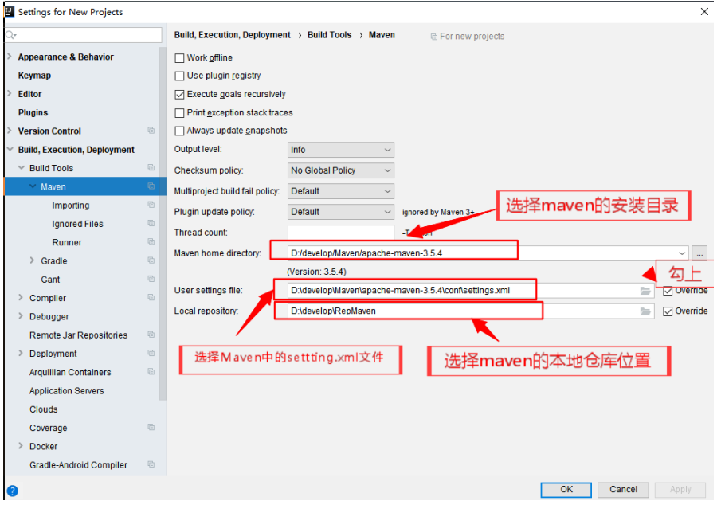
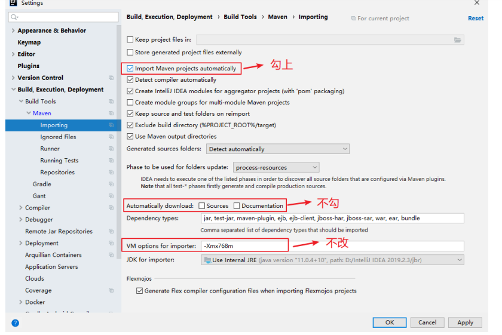
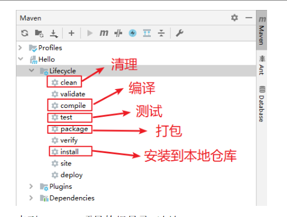

## **概述**

（1）Maven这个单词的本意是：专家，内行。读音是['meɪv(ə)n]或['mevn]，不要读作“妈文”。

（2）Maven是一款自动化构建工具，专注服务于Java平台的项目构建和依赖管理。在JavaEE开发的历史上构建工具的发展也经历了一系列的演化和变迁：Make→Ant→Maven→Gradle→其他……

​  

#### 构建环节

（1）清理：删除以前的编译结果，为重新编译做好准备。

（2）编译：将Java源程序编译为字节码文件。

（3）测试：针对项目中的关键点进行测试，确保项目在迭代开发过程中关键点的正确性。

（4）报告：在每一次测试后以标准的格式记录和展示测试结果。

（5）打包：将一个包含诸多文件的工程封装为一个压缩文件用于安装或部署。Java工程对应jar包，Web工程对应war包。

（6）安装：在Maven环境下特指将打包的结果——jar包或war包安装到本地仓库中。

（7）部署：将打包的结果部署到远程仓库或将war包部署到服务器上运行。

​  

## 使用

安装,配置环境变量

​  

（1）Maven默认的本地仓库：~\\.m2\\repository目录。

配置阿里云镜像（下载速度快）

<mirror>

<id>nexus-aliyun</id>

<mirrorOf>central</mirrorOf>

<name>Nexus aliyun</name>

<url>http://maven.aliyun.com/nexus/content/groups/public</url>

</mirror>

​  

​  

#### Maven编译版本

在settings.xml中的<profiles></profiles>标签中加入如下内容

<profile>

<id>jdk-1.8</id>

<activation>

<activeByDefault>true</activeByDefault>

<jdk>1.8</jdk>

</activation>

<properties>

<maven.compiler.source>1.8</maven.compiler.source>

<maven.compiler.target>1.8</maven.compiler.target>

<maven.compiler.compilerVersion>1.8</maven.compiler.compilerVersion>

</properties>

</profile>

​  

​  

​  

​  

#### 在Idea中配置Maven

1）close project所有项目后，回到如下页面，点击右下角的Configure --->点击setting

  

2）设置Maven的安装目录及本地仓库

Ø Maven home directory：可以指定本地Maven 的安装目录所在，因为我已经配置了MAVEN\_HOME系统参数，所以直接这样配置IntelliJ IDEA是可以找到的。但是假如你没有配置的话，这里可以选择你的Maven安装目录。此外，这里不建议使用IDEA默认的。

Ø User settings file / Local repository：我们还可以指定Maven 的 settings.xml 位置和本地仓库位置。

3）配置Maven自动导入依赖的jar包

Ø Import Maven projects automatically：表示 IntelliJ IDEA 会实时监控项目的 pom.xml 文件，进行项目变动设置，勾选上。

Ø Automatically download：在Maven 导入依赖包的时候是否自动下载源码和文档。默认是没有勾选的，也不建议勾选，原因是这样可以加快项目从外网导入依赖包的速度，如果我们需要源码和文档的时候我们到时候再针对某个依赖包进行联网下载即可。IntelliJ IDEA 支持直接从公网下载源码和文档的。

Ø VM options for importer：可以设置导入的VM参数。一般这个都不需要主动改，除非项目真的导入太慢了我们再增大此参数。

​  

​  

  

#### Maven打包插件

Maven本身的打包插件不负责将依赖的jar包一并打入到jar包中。如果项目所依赖的jar包在服务器环境中提供了还好，如果服务器环境中没有提供，则比较悲惨，运行各种ClassNotFound….你们懂的!

因此需要一款能够将项目所依赖的jar包 一并打入到jar中的插件来解决这些问题.

​  

​  

在pom.xml中加入如下内容:

<build>  
<plugins>  
<plugin>  
<artifactId>maven-assembly-plugin</artifactId>  
<configuration>  
<descriptorRefs>  
<descriptorRef>jar-with-dependencies</descriptorRef>  
</descriptorRefs>  
</configuration>  
<executions>  
<execution>  
<id>make-assembly</id>  
<phase>package</phase>  
<goals>  
<goal>single</goal>  
</goals>  
</execution>  
</executions>  
</plugin>  
</plugins>  
</build>

​  

​  

## Maven核心概念

Maven的核心概念包括：POM、约定的目录结构、坐标、依赖、仓库、生命周期、插件和目标、继承、聚合。

  

#### 4.1 POM

Project Object Model：项目对象模型。**将****Java****工程的相关信息封装为****对象**作为便于操作和管理的模型。Maven工程的核心配置。可以说学习Maven就是学习pom.xml文件中的配置。

#### 4.2 约定的目录结构

现在JavaEE开发领域普遍认同一个观点：约定>配置>编码。意思就是能用配置解决的问题就不编码，能基于约定的就不进行配置。而Maven正是因为指定了特定文件保存的目录才能够对我们的Java工程进行自动化构建。

  

#### 4.3 坐标

1）几何中的坐标

（1）在一个平面中使用x、y两个向量可以唯一的确定平面中的一个点。

（2）在空间中使用x、y、z三个向量可以唯一的确定空间中的一个点。

2）Maven的坐标

使用如下三个向量在Maven的仓库中唯一的确定一个Maven工程。

（1）groupId：公司或组织的域名倒序+当前项目名称

（2）artifactId：当前项目的模块名称

（3）version：当前模块的版本

在项目的pom.xml文件中存储坐标

​  

​  

​  

### **依赖****的范围**

1）compile（默认就是这个范围）

（1）main目录下的Java代码**可以**访问这个范围的依赖

（2）test目录下的Java代码**可以**访问这个范围的依赖

（3）部署到Tomcat服务器上运行时**要**放在WEB-INF的lib目录下

例如：对Hello的依赖。主程序、测试程序和服务器运行时都需要用到。

2）test

（1）main目录下的Java代码**不能**访问这个范围的依赖

（2）test目录下的Java代码**可以**访问这个范围的依赖

（3）部署到Tomcat服务器上运行时**不会**放在WEB-INF的lib目录下

例如：对junit的依赖。仅仅是测试程序部分需要。

3）provided

（1）main目录下的Java代码**可以**访问这个范围的依赖

（2）test目录下的Java代码**可以**访问这个范围的依赖

（3）部署到Tomcat服务器上运行时**不会**放在WEB-INF的lib目录下

例如：servlet-api在服务器上运行时，Servlet容器会提供相关API，所以部署的时候不需要。

4）其他：runtime、import、system等。

各个依赖范围的作用可以概括为下图：

​  

### **4.5.2** **依赖的传递性**

当存在间接依赖的情况时，主工程对间接依赖的jar可以访问吗？这要看间接依赖的jar包引入时的依赖范围——只有依赖范围为compile时可以访问。例如：

| Maven工程 |  |  | 依赖范围 | 对A的可见性 |
| --- | --- | --- | --- | --- |
| A | B | C | compile | √ |
|  |  | D | test | × |
|  |  | E | provided | × |

### **4.5.3** **依赖的原则：解决****jar****包冲突**

1）路径最短者优先

​  

2）路径相同时先声明者优先

​  

这里“声明”的先后顺序指的是dependency标签配置的先后顺序。

### **4.5.4** **依赖的排除**

有的时候为了确保程序正确可以将有可能重复的间接依赖排除。请看如下的例子：

假设当前工程为MakeFriend，直接依赖OurFriends。

OurFriends依赖commons-logging的1.1.1对于MakeFriend来说是间接依赖。

当前工程MakeFriend直接依赖commons-logging的1.1.2

加入exclusions配置后可以在依赖OurFriends的时候排除版本为1.1.1的commons-logging的间接依赖

<dependency>

<groupId>com.atguigu.maven</groupId>  
<artifactId>OurFriends</artifactId>  
<version>1.0-SNAPSHOT</version>

  
<!--依赖排除-->  
<exclusions\>  
<exclusion>  
<groupId>commons-logging</groupId>  
<artifactId>commons-logging</artifactId>  
</exclusion>  
</exclusions\>  
</dependency>  
  
<dependency>  
<groupId>commons-logging</groupId>  
<artifactId>commons-logging</artifactId>  
<version>1.1.2</version>  
</dependency>

​  

​  

### **4.5.5** **统一管理目标****Jar****包的版本**

以对Spring的jar包依赖为例：Spring的每一个版本中都包含spring-context，springmvc等jar包。我们应该导入版本一致的Spring jar包，而不是使用4.0.0的spring-context的同时使用4.1.1的springmvc。

| <**dependency**> <**groupId**>org.springframework</**groupId**> <**artifactId**>spring-context</**artifactId**> <**version**>4.0.0.RELEASE</**version**> </**dependency**> <**dependency**> <**groupId**>org.springframework</**groupId**> <**artifactId**>spring-webmvc</**artifactId**> <**version**>4.0.0.RELEASE</**version**> </**dependency**> <**dependency**> <**groupId**>org.springframework</**groupId**> <**artifactId**>spring-jdbc</**artifactId**> <**version**>4.0.0.RELEASE</**version**> </**dependency**> <**dependency**> <**groupId**>org.springframework</**groupId**> <**artifactId**>spring-orm</**artifactId**> <**version**>4.0.0.RELEASE</**version**> </**dependency**> |
| --- |

问题是如果我们想要将这些jar包的版本统一升级为4.1.1，是不是要手动一个个修改呢？显然，我们有统一配置的方式：

| *<!--**统一管理当前模块的**jar**包的版本**-->** *<**properties**> <**spring.version**>4.0.0.RELEASE</**spring.version**> </**properties**> ​ |
| --- |
| …… |
| <**dependency**> <**groupId**>org.springframework</**groupId**> <**artifactId**>spring-context</**artifactId**> <**version**>${spring.version}</**version**> </**dependency**> <**dependency**> <**groupId**>org.springframework</**groupId**> <**artifactId**>spring-webmvc</**artifactId**> <**version**>${spring.version}</**version**> </**dependency**> <**dependency**> <**groupId**>org.springframework</**groupId**> <**artifactId**>spring-jdbc</**artifactId**> <**version**>${spring.version}</**version**> </**dependency**> <**dependency**> <**groupId**>org.springframework</**groupId**> <**artifactId**>spring-orm</**artifactId**> <**version**>${spring.version}</**version**> </**dependency**> |

这样一来，进行版本调整的时候只改一改地方就行了。

​  

  

### 生命周期

1）什么是Maven的生命周期？

Maven生命周期定义了各个构建环节的执行顺序，有了这个清单，Maven就可以自动化的执行构建命令了。

Maven有三套相互独立的生命周期，分别是：

Ø Clean Lifecycle在进行真正的构建之前进行一些清理工作。

Ø Default Lifecycle构建的核心部分，编译，测试，打包，安装，部署等等。

Ø Site Lifecycle生成项目报告，站点，发布站点。

再次强调一下它们是**相互独立的**，你可以仅仅调用clean来清理工作目录，仅仅调用site来生成站点。当然你也可以直接运行 **mvn clean install site** 运行所有这三套生命周期。

每套生命周期都由一组阶段(Phase)组成，我们平时在命令行输入的命令总会对应于一个特定的阶段。比如，运行mvn clean，这个clean是Clean生命周期的一个阶段。有Clean生命周期，也有clean阶段。

2）clean生命周期

Clean生命周期一共包含了三个阶段：

Ø pre-clean 执行一些需要在clean之前完成的工作

Ø clean 移除所有上一次构建生成的文件

Ø post-clean 执行一些需要在clean之后立刻完成的工作

3）Site生命周期

Ø pre-site执行一些需要在生成站点文档之前完成的工作

Ø site生成项目的站点文档

Ø post-site执行一些需要在生成站点文档之后完成的工作，并且为部署做准备

Ø site-deploy将生成的站点文档部署到特定的服务器上

这里经常用到的是site阶段和site-deploy阶段，用以生成和发布Maven站点，这可是Maven相当强大的功能，Manager比较喜欢，文档及统计数据自动生成，很好看。

4）Default生命周期

Default生命周期是Maven生命周期中最重要的一个，绝大部分工作都发生在这个生命周期中。这里，只解释一些比较重要和常用的阶段：

validate

generate-sources

process-sources

generate-resources

process-resources 复制并处理资源文件，至目标目录，准备打包。

**compile** 编译项目的源代码。

process-classes

generate-test-sources

process-test-sources

generate-test-resources

process-test-resources 复制并处理资源文件，至目标测试目录。

**test-compile** 编译测试源代码。

process-test-classes

**test** 使用合适的单元测试框架运行测试。这些测试代码不会被打包或部署。

prepare-package

**package** 接受编译好的代码，打包成可发布的格式，如JAR。

pre-integration-test

integration-test

post-integration-test

verify

**install**将包安装至本地仓库，以让其它项目依赖。

deploy将最终的包复制到远程的仓库，以让其它开发人员与项目共享或部署到服务器上运行。

5）生命周期与自动化构建

**运行任何一个阶段的时候，它前面的所有阶段都会被运行**，例如我们运行mvn install 的时候，代码会被编译，测试，打包。这就是Maven为什么能够自动执行构建过程的各个环节的原因。此外，Maven的插件机制是完全依赖Maven的生命周期的，因此理解生命周期至关重要。

### 4.8 插件和目标

（1）Maven的核心仅仅定义了抽象的生命周期，具体的任务都是交由插件完成的。

（2）每个插件都能实现多个功能，每个功能就是一个插件目标。

（3）Maven的生命周期与插件目标相互绑定，以完成某个具体的构建任务。

例如：compile就是插件maven-compiler-plugin的一个功能；pre-clean是插件maven-clean-plugin的一个目标。

​  

​  

​  

## **5.1** **为什么需要****继承机制？**

由于非compile范围的依赖信息是不能在“依赖链”中传递的，所以有需要的工程只能单独配置。例如：

| Hello | <**dependency**> <**groupId**>junit</**groupId**> <**artifactId**>junit</**artifactId**> <**version**>4.0</**version**> <**scope**>test</**scope**> </**dependency**> |
| --- | --- |
| HelloFriend | <**dependency**> <**groupId**>junit</**groupId**> <**artifactId**>junit</**artifactId**> <**version**>4.9</**version**> <**scope**>test</**scope**> </**dependency**> |
| MakeFriend | <**dependency**> <**groupId**>junit</**groupId**> <**artifactId**>junit</**artifactId**> <**version**>4.12</**version**> <**scope**>test</**scope**> </**dependency**> |

此时如果项目需要将各个模块的junit版本统一为4.9，那么到各个工程中手动修改无疑是非常不可取的。使用继承机制就可以将这样的依赖信息统一提取到父工程模块中进行统一管理。

#### 5.2 创建父工程

父工程的打包方式为pom

<groupId>com.atguigu.maven</groupId>

<artifactId>Parent</artifactId>

<packaging>pom</packaging>

<version>1.0-SNAPSHOT</version>

父工程只需要保留pom.xml文件即可

#### 5.3 在子工程中引用父工程

<parent>

<!-- 父工程坐标 -->

<groupId>...</groupId>

<artifactId>...</artifactId>

<version>...</version>

​  

<!--指定从当前pom.xml文件出发寻找父工程的pom.xml文件的相对路径\-->

<relativePath>..</relativePath>

</parent>

| *<!--**继承**-->** *<**parent**> <**groupId**>com.atguigu.maven</**groupId**> <**artifactId**>Parent</**artifactId**> <**version**>1.0-SNAPSHOT</**version**> *<!--**指定从当前**pom.xml**文件出发寻找父工程的**pom.xml**文件的相对路径**-->** *<**relativePath**>../Parent/pom.xml</**relativePath**> </**parent**> |
| --- |

此时如果子工程的groupId和version如果和父工程重复则可以删除。

#### 5.4 在父工程中管理依赖

将Parent项目中的dependencies标签，用dependencyManagement标签括起来

| *<!--**依赖管理**-->** *<**dependencyManagement**> <**dependencies**> <**dependency**> <**groupId**>junit</**groupId**> <**artifactId**>junit</**artifactId**> <**version**>4.0</**version**> <**scope**>test</**scope**> </**dependency**> </**dependencies**> </**dependencyManagement**> |
| --- |

在子项目中重新指定需要的依赖，删除范围和版本号

| <**dependency**> <**groupId**>junit</**groupId**> <**artifactId**>junit</**artifactId**> </**dependency**> |
| --- |

## 聚合

#### 为什么要使用聚合？

将多个工程拆分为模块后，需要手动逐个安装到仓库后依赖才能够生效。修改源码后也需要逐个手动进行clean操作。而使用了聚合之后就可以批量进行Maven工程的安装、清理工作。

#### 6.2 如何配置聚合？

在总的聚合工程中使用modules/module标签组合，指定模块工程的相对路径即可

| *<!--**聚合**-->** *<**modules**> <**module**>../MakeFriend</**module**> <**module**>../OurFriends</**module**> <**module**>../HelloFriend</**module**> <**module**>../Hello</**module**> </**modules**> |
| --- |

Maven可以根据各个模块的继承和依赖关系自动选择安装的顺序

# **第****7****章****Maven****酷站**

我们可以到http://mvnrepository.com/搜索需要的jar包的依赖信息。

http://search.maven.org/