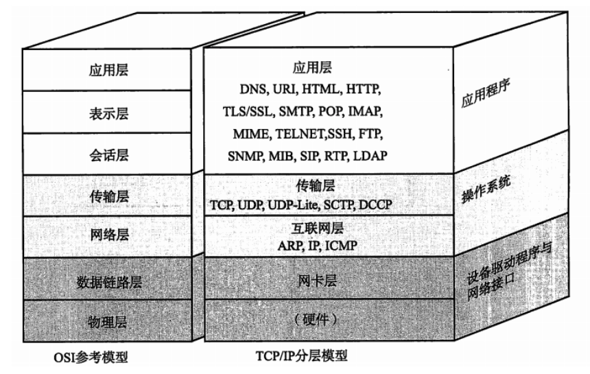

-   惊群现象：一个网路连接到来，多个睡眠的进程被同时叫醒，但只有一个进程能获得链接，这样会影响系统性能
-   同一个端口,可以同时支持不同的传输层协议 TCP,UDP协议(传输层下又可分为不同的应用层协议)

端口的唯一标识性由,端口号和协议号助组成.

连接的唯一标识性,由[clientID,client\_port,serverID,server\_port]组成,

线程listen 端口,一个端口bind 一个socket， Socket：Socket不属于协议范畴，而是一个调用接口（API），Socket是对TCP/IP协议的封装，通过调用Socket，才能使用TCP/IP协议。Socket连接属于请求-响应形式，服务端可主动将消息推送给客户端。

-   防火墙的相关命令:

查看防火墙状态：firewall-cmd --state

​

-   协议栈的分层 整个tcp/ip 协议族:

-   链路层 : wlan等,
-   网络层 IP等
-   传输层: TCP,UDP等
-   应用层: HTTP,FTP,DNS等

-   websocket和socket不一样，websoccket是基于tcp协议，用于浏览器与web服务器之间的全双工通信，建立连接需要通过http(基于tcp)进行升级
-   端口号只有被监听才是被启用的
-   tcp协议的 有序，不丢失数据，依靠 发送的数据的序号，ack确认，消息重传确认，当传输层出现了 数据乱序，丢失数据，接收方处置，保证应用层的数据是有序的，但是处理需要耗时，TCP 的有序性保证的是数据包的顺序，即使底层传输乱序，最终送达应用层的数据流会被 TCP 按序重组。例如，如果发送的是应用数据流 “a b c”，即使 b 出现网络波动并重传，接收端的 TCP 会等待 b 重传成功后再将数据按 “a b c” 顺序提供给应用层。这个过程中可能会有一些延迟，但对于应用层，数据始终是有序的，当缓冲区溢出的时候，发送消息给发送方，停止发送

1.  使用tcp协议但是出现了数据丢失的原因主要来自：应用层主动关闭连接，网络突然中断后的超时处理，操作系统的资源回收，进程异常退出，连接被重置（RST）

  

  

​