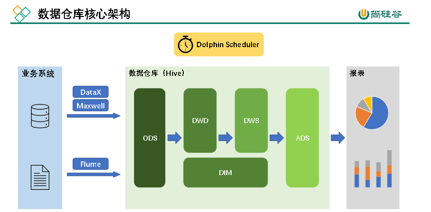
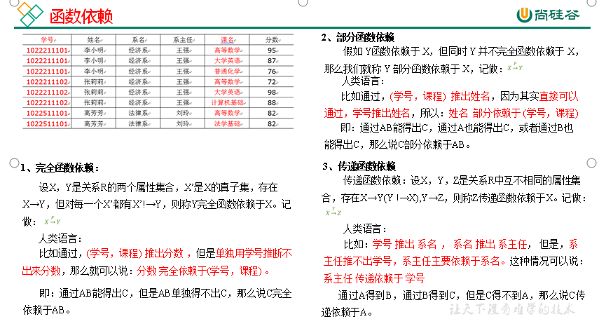
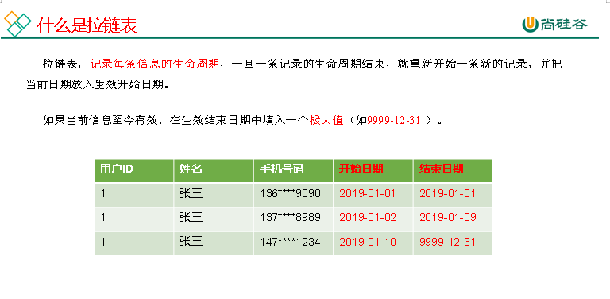
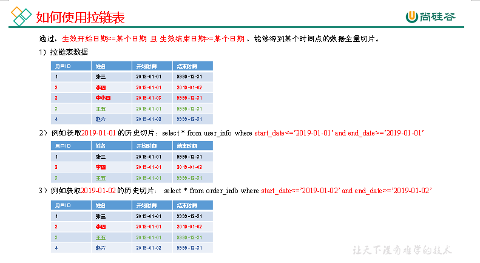
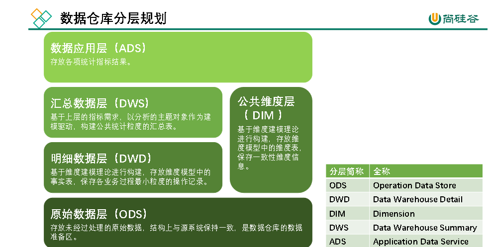
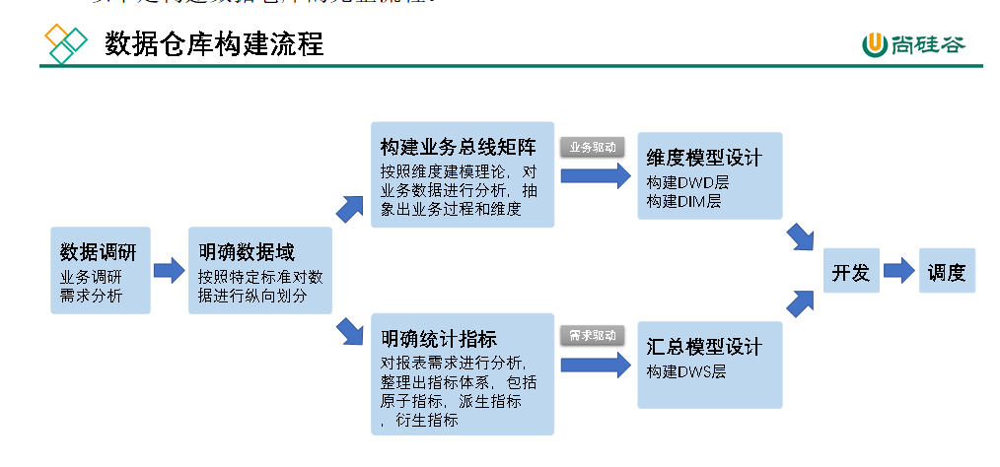

1.  专利转化成果上限8分
2.  软著转化成果上限4分

​  

分层，

  

  

数据仓库是一个为数据分析而设计的企业级数据管理系统

​  

架构

数据模型就是数据组织和存储方法，它强调从业务、数据存取和使用角度合理存储数据。只有将数据有序的组织和存储起来之后，数据才能得到高性能、低成本、高效率、高质量的使用。

高性能：良好的数据模型能够帮助我们快速查询所需要的数据。

低成本：良好的数据模型能减少重复计算，实现计算结果的复用，降低计算成本。

高效率：良好的数据模型能极大的改善用户使用数据的体验，提高使用数据的效率。

高质量：良好的数据模型能改善数据统计口径的混乱，减少计算错误的可能性。

​  

#### 数据仓库建模方法论

实体关系（Entity Relationship，ER）模型来描述企业业务，并用规范化的方式表示出来，在范式理论上符合3NF。一般是java后台开发使用.

​  

实体关系模型将复杂的数据抽象为两个概念——实体和关系。实体表示一个对象，例如学生、班级，关系是指两个实体之间的关系，例如学生和班级之间的从属关系。

数据库规范化是使用一系列范式设计数据库（通常是关系型数据库）的过程，其目的是减少数据冗余，增强数据的一致性。

关系型数据库的范式一共有六种，分别是第一范式（1NF）、第二范式（2NF）、第三范式（3NF）、巴斯-科德范式（BCNF）、第四范式(4NF）和第五范式（5NF）。遵循的范式级别越高，数据冗余性就越低。

**函数依赖**

第一范式:属性不可切割,1NF是所有关系型数据库的最基本要求,

第二范式:不能存在部分依赖

第三范式:不能存在传递函数依赖

​  

这种建模方法的出发点是整合数据，其目的是将整个企业的数据进行组合和合并，并进行规范处理，减少数据冗余性，保证数据的一致性。这种模型并不适合直接用于分析统计。

​  

### **维度模型**

维度模型将复杂的业务通过事实和维度两个概念进行呈现。事实通常对应业务过程，而维度通常对应业务过程发生时所处的环境。(业务过程可以概括为一个个不可拆分的行为事件)

​  

维度建模以数据分析作为出发点，为数据分析服务，因此它关注的重点的用户如何更快的完成需求分析以及如何实现较好的大规模复杂查询的响应性能。

#### 事实表

事实表作为数据仓库维度建模的核心，紧紧围绕着业务过程来设计。其包含与该业务过程有关的维度引用（维度表外键）以及该业务过程的度量（通常是可累加的数字类型字段）。

事实表有三种类型：分别是事务事实表、周期快照事实表和累积快照事实表，每种事实表都具有不同的特点和适用场景.

事务事实表用来记录各业务过程，它保存的是各业务过程的原子操作事件，即最细粒度的操作事件。(粒度是指事实表中一行数据所表达的业务细节程度。)

事务型事实表可用于分析与各业务过程相关的各项统计指标，由于其保存了最细粒度的记录，可以提供最大限度的灵活性，可以支持无法预期的各种细节层次的统计需求。

设计流程:**选择业务过程→声明粒度→确认维度→确认事实**

通常情况下，一个业务过程对应一张事务型事实表。2)业务过程确定后，需要为每个业务过程声明粒度。即精确定义每张事务型事实表的每行数据表示什么，应该尽可能选择最细粒度，以此来应各种细节程度的需求。(**典型的粒度声明如下：**订单事实表中一行数据表示的是一个订单中的一个商品项。) **3）确定维度** 确定维度具体是指，确定与每张事务型事实表相关的维度有哪些。

(维度的丰富程度就决定了维度模型能够支持的指标丰富程度) 4)确定事实 此处的“事实”一词，指的是每个业务过程的度量值（通常是可累加的数字类型的值，例如：次数、个数、件数、金额等）。

**备注**:第一步选择业务过程可以确定有哪些事务型事实表，第二步可以确定每张事务型事实表的每行数据是什么，第三步可以确定每张事务型事实表的维度外键，第四步可以确定每张事务型事实表的度量值字段。

​  

**事务型事实表缺点**:但对于某些特定类型的需求，其逻辑可能会比较复杂，

**1）存量型指标** 周期型快照事实表

**2）多事务关联统计** 累积型快照事实表

三者互补

​  

#### 周期型快照事实表

周期快照事实表以具有规律性的、可预见的时间间隔来记录事实，主要用于分析一些存量型（例如商品库存，账户余额）或者状态型（空气温度，行驶速度）指标。

存量型指标 定期同步一份全量数据到数据仓库，构建周期型快照事实表，就能轻松应对此类统计需求，而无需再对事务型事实表中大量的历史记录进行聚合了。

状态型指标 定期对其进行采样，构建周期型快照事实表。

设计流程: **1）确定粒度** 周期型快照事实表的粒度可由采样周期和维度描述

**2）确认事实** 事实也可根据统计指标决定

**事实类型**:此处的事实类型是指度量值的类型，而非事实表的类型。事实（度量值）共分为三类，分别是可加事实(指可以按照与事实表相关的所有维度进行累加，例如事务型事实表中的事实)，半可加事实(半可加事实是指只能按照与事实表相关的一部分维度进行累加)和不可加事实(不可加事实是指完全不具备可加性)。

#### 累积型快照事实表

累积型快照事实表是基于一个业务流程中的多个关键业务过程联合处理而构建的事实表，如交易流程中的下单、支付、发货、确认收货业务过程。累积型快照事实表主要用于分析业务过程（里程碑）之间的时间间隔等需求。

累积型快照事实表通常具有多个日期字段，每个日期对应业务流程中的一个关键业务过程（里程碑）。

**设计流程:1）选择业务过程** 选择一个业务流程中需要关联分析的多个关键业务过程，多个业务过程对应一张累积型快照事实表 **2）声明粒度** 精确定义每行数据表示的是什么，尽量选择最小粒度。**3）确认维度** 选择与各业务过程相关的维度，需要注意的是，每个业务过程均需要一个日期维度。**4）确认事实** 选择各业务过程的度量值。

​  

### 维度建模理论之维度表

维度表是维度建模的基础和灵魂。前文提到，事实表紧紧围绕业务过程进行设计，而维度表则围绕业务过程所处的环境进行设计。维度表主要包含一个主键和各种维度字段，维度字段称为维度属性。

维度表设计步骤:**1）确定维度（表）**在设计事实表时，已经确定了与每个事实表相关的维度，理论上每个相关维度均需对应一张维度表 可能存在多个事实表与同一个维度都相关的情况，这种情况需保证维度的唯一性，即只创建一张维度表 , 如果某些维度表的维度属性很少，例如只有一个\*\*名称，则可不创建该维度表，而把该表的维度属性直接增加到与之相关的事实表中，这个操作称为**维度退化**。**2）确定主维表和相关维表** 此处的主维表和相关维表均指**业务系统**中与某维度相关的表。 维度表的粒度通常与主维表相同。**3）确定维度属性** 确定维度属性即确定维度表字段 维度属性主要来自于业务系统中与该维度对应的主维表和相关维表。(需要遵循以下要求：

**（1）尽可能生成丰富的维度属性** 维度属性是后续做分析统计时的查询约束条件、分组字段的基本来源，是数据易用性的关键。维度属性的丰富程度直接影响到数据模型能够支持的指标的丰富程度。**（2）尽量不使用编码，而使用明确的文字说明，一般可以编码和文字共存。（3）尽量沉淀出通用的维度属性** 有些维度属性的获取需要进行比较复杂的逻辑处理，例如需要通过多个字段拼接得到。为避免后续每次使用时的重复处理，可将这些维度属性沉淀到维度表中)

#### 规范化与反规范化

**规范化**是指使用一系列范式设计数据库的过程，其目的是减少数据冗余，增强数据的一致性。通常情况下，规范化之后，一张表的字段会拆分到多张表。

**反规范化**是指将多张表的数据冗余到一张表，其目的是减少join操作，提高查询性能。

在设计维度表时，如果对其进行规范化，得到的维度模型称为雪花模型，如果对其进行反规范化，得到的模型称为星型模型。

#### 维度变化

维度属性通常不是静态的，而是会随时间变化的，数据仓库的一个重要特点就是反映历史的变化，所以如何保存维度的历史状态是维度设计的重要工作之一。保存维度数据的历史状态，通常有以下两种做法，分别是全量快照表和拉链表。

**1）全量快照表** 离线数据仓库的计算周期通常为每天一次，所以可以每天保存一份全量的维度数据。 简单而有效，开发和维护成本低，且方便理解和使用。缺点是浪费存储空间，尤其是当数据的变化比例比较低时。

**2）****拉链表**

拉链表的意义就在于能够更加高效的保存维度信息的历史状态。

适合于:数据会发生变化,但是变化的频率并不高(缓慢变化),在此情况下做每日全量的效率低

#### 多值维度

如果事实表中一条记录在某个维度表中有多条记录与之对应，称为多值维度。

通常采用以下两种方案解决。

第一种：降低事实表的粒度，例如将订单事实表的粒度由一个订单降低为一个订单中的一个商品项。

第二种：在事实表中采用多字段保存多个维度值，每个字段保存一个维度id。这种方案只适用于多值维度个数固定的情况。

​  

#### 多值属性

维表中的某个属性同时有多个值，称之为“多值属性”

针对这种情况，通常有可以采用以下两种方案。

第一种：将多值属性放到一个字段，该字段内容为key1:value1，key2:value2的形式，例如一个手机商品的平台属性值为“品牌:华为，系统:鸿蒙，CPU:麒麟990”。

第二种：将多值属性放到多个字段，每个字段对应一个属性。这种方案只适用于多值属性个数固定

​  

### 数据仓库设计

构建流程:

数据调研重点要做两项工作，分别是业务调研(主要目标是**熟悉业务流程**、**熟悉业务数据**)和需求分析(将数据（包括埋点日志和业务数据表）与业务过程对应起来)

分析需求时，需要明确需求所需的**业务过程**及**维度**，例如该需求所需的业务过程就是买家下单，所需的维度有日期，省份，商品品类。

做完业务分析和需求分析之后，要保证每个需求都能找到与之对应的业务过程及维度。

​  

数据仓库模型设计除横向的分层外，通常也需要根据业务情况进行纵向划分数据域。

划分数据域的意义是**便于数据的管理和应用**。

通常可以根据业务过程或者部门进行划分，本项目根据业务过程进行划分，需要注意的是一个业务过程只能属于一个数据域。

​  

#### 构建业务总线 矩阵

业务总线矩阵中包含维度模型所需的所有事实（业务过程）以及维度，以及各业务过程与各维度的关系。矩阵的行是一个个业务过程，矩阵的列是一个个的维度，行列的交点表示业务过程与维度的关系。

一个业务过程对应维度模型中一张事务型事实表，一个维度则对应维度模型中的一张维度表。所以构建业务总线矩阵的过程就是设计维度模型的过程。但是需要注意的是，总线矩阵中通常只包含事务型事实表. 按照事务型事实表的设计流程，**选择业务过程->声明粒度->确认维度->确认事实**，

#### 明确统计指标

明确统计指标具体的工作是，深入分析需求，构建指标体系。构建指标体系的主要意义就是指标定义标准化。所有指标的定义，都必须遵循同一套标准，这样能有效的避免指标定义存在歧义，指标定义重复等问题。

**（1）原子指标（2）派生指标（3）衍生指标**

原子指标基于某一**业务过程**的**度量值**，是业务定义中不可再拆解的指标，原子指标的核心功能就是对指标的**聚合逻辑**进行了定义。我们可以得出结论，原子指标包含三要素，分别是业务过程、度量值和聚合逻辑。

衍生指标是在一个或多个派生指标的基础上，通过各种逻辑运算复合而成的。例如比率、比例等类型的指标。衍生指标也会对应实际的统计需求。

当统计需求足够多时，必然会出现部分统计需求对应的派生指标相同的情况。这种情况下，我们就可以考虑将这些公共的派生指标保存下来，这样做的主要目的就是减少重复计算，提高数据的复用性。

这些公共的派生指标统一保存在数据仓库的DWS层。因此DWS层设计，就可以参考我们根据现有的统计需求整理出的派生指标。

### 数据仓库环境准备

Hive on Spark：Hive既作为存储元数据又负责SQL的解析优化，语法是HQL语法，执行引擎变成了Spark，Spark负责采用RDD执行。

**兼容性说明**

注意：官网下载的Hive3.1.2和Spark3.0.0默认是不兼容的。因为Hive3.1.2支持的Spark版本是2.4.5，所以需要我们重新编译Hive3.1.2版本。

编译步骤：官网下载Hive3.1.2源码，修改pom文件中引用的Spark版本为3.0.0，如果编译通过，直接打包获取jar包。如果报错，就根据提示，修改相关方法，直到不报错，打包获取jar包。

**向HDFS上传Spark纯净版jar包**

说明1：由于Spark3.0.0非纯净版默认支持的是hive2.3.7版本，直接使用会和安装的Hive3.1.2出现兼容性问题。所以采用Spark纯净版jar包，不包含hadoop和hive相关依赖，避免冲突。

说明2：Hive任务最终由Spark来执行，Spark任务资源分配由Yarn来调度，该任务有可能被分配到集群的任何一个节点。所以需要将Spark的依赖上传到HDFS集群路径，这样集群中任何一个节点都能获取到。

**增加ApplicationMaster资源比例**

**​**  

数仓开发工具可选用DBeaver或者DataGrip。两者都需要用到JDBC协议连接到Hive，故需要启动HiveServer2

**增量表首日全量同步**

1清除Maxwell断点记录

由于Maxwell支持断点续传，而上述重新生成业务数据的过程，会产生大量的binlog操作日志，这些日志我们并不需要。故此处需清除Maxwell的断点记录，另其从binlog最新的位置开始采集。

​  

### 数仓开发之ODS层

ODS层的设计要点如下：

1）ODS层的表结构设计依托于从业务系统同步过来的数据结构。

2）ODS层要保存全部历史数据，故其压缩格式应选择压缩比较高的，此处选择gzip。

3）ODS层表名的命名规范为：ods\_表名\_单分区增量全量标识（inc/full）。

​  

ods之日志表

用户日志的相关字段,common,page,actions,displays,start,err,ts 分区以dt

使用结构体,

org.apache.hadoop.hive.serde2.hsonserde的序列化与反序列化器

用户日志采集是搭建的当天才能拿到,之前的历史数据必然缺失,将有所妥协

​  

业务表之活动信息(全量表)

null值defined为''

活动规则(全量表)

一级品类表(全量表)

二级品类表(全量表)

三级品类表(全量表)

编码字典表(全量表)

省份表(全量表)

地区表(全量表)

品牌表(全量表)

购物车表(全量表)

优惠卷信息表(全量表)

商品平台属性表(全量表)

商品表(全量表)

商品销售属性值表(全量表)

SPU表(全量表)

购物车表(增量表) :data数据使用结构体 old字段使用map,jsonserde使用

评论表(增量表) data使用结构体 old字段使用map,jsonserde

优惠券领用表(增量表) :同上

收藏表(增量表)同上

订单明细表(增量表) : 同上

订单明细活动关联表(增量表): 同上

订单明细优惠券关联表(增量表): 同上

订单表(增量表): 同上

退单表(增量表): 同上

订单状态流水表(增量表) :同上

支付表(增量表) :同上

退款表(增量表) : 同上

用户表(增量表) : 同上

​