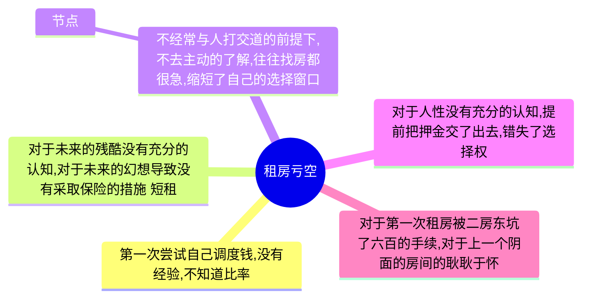
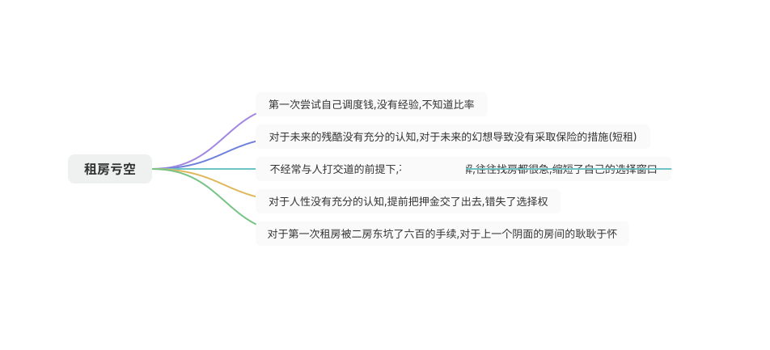

目前来讲本次的教训是在物质经济上损失最严重的一次,直接的结果最起码三个月的经济窘迫,买不了任何的物质,让我想起来在这之前我一直要求掌握一个学期的钱,好让我规划安排,在我以为我已经成熟了之后这次是当面一棒,正如我对大数据的就业的盲目乐观一样.以下是对金额的详细的得失图.

| 2022/08 | 2022/09 | 2022/10 |
| --- | --- | --- |
| 悦来公寓的房租3000+150(物业)+100(电费) | 九亭的阳面的独卫大房间(3200)+3200(押金)+1500(中介费) | 因为房间的设计不规范加上自己的鲁莽(800)用于医疗 |

以事后诸葛亮的眼光来看,完全就是没有必要追求住房的体验,但是当时的自己满脑子都是精致的小资生活,并在对未来的职业规划的风险中评估不足,导致了最严重的3200押金的全军覆没.损失的总价在一台iPadPro外加一只pencil,可谓是惨痛.总结背后的原因如下:

在为人处世,不吃亏的这方面我值得学习的对象就是刘克,他虽然有点扣,但是不会让人家坑了,这一点我的值得学习,我总是自诩成熟,但是一和人家打交道,总是被动的挨坑,他对于就业课即将挂科的时候及时挽救的态度让我想到了要是我想他一样的为人处世,那么会不会在腾讯的工作还有挽救的余地,毕竟在那个时候我就是什么都靠着我的上司,一天到晚沉默不语,想着自己的心事,结果不知道被哪个领导嫌弃了,直接被一脚踹开了.