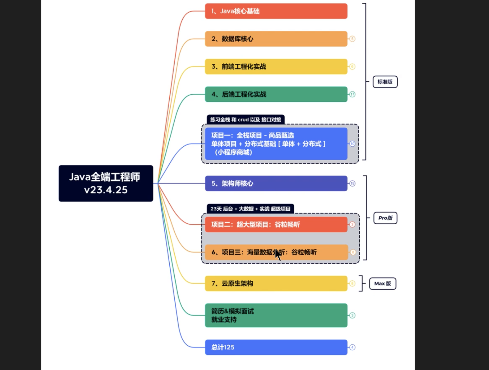

## 棘手

aop切片类中包含 事务，但是事务中的norollkup 未能成功生效的问题

事务的作用周期，声明位置，环绕方法中的事务生效周期

  

  

事务中获取的异常

和 try catch 处理后的异常 导致事务无法判断

## 短期

  

ssm

tx，想要将事务放在切面类中，执行数据库操作的时候出现异常回滚，但是在配置类中没有试成功过，两次操作中间出现异常，前一次一直不回滚，除非直接将事务配置在执行的方法上

  

我们可以将autoMappingBehavior设置为full,进行多表resultMap映射的时候，可以省略符合列和属性命名映射规则（列名=属性名，或者开启驼峰映射也可以自定映射）的result标签！

  

父工程中指定了parent，子模块的启动报错，找不到对应的bean，重新编译后报错，日志框架冲突，

暂时搁置，ssm下的项目

  

微头条的重构整理，与前段的调试，相关知识点的笔记整理，框架流程图

  

python爬虫进度的学习

  

基于springboot的健康监控模式

  

  

王鹤老师，springboot

  

## 待做项

docker

dockerFile文件的编写

使用docker部署mysql，redis，按照集群的方式配置主从，动态扩缩容

springboot项目编译，通过docker部署

整理一个完整的项目中涉及的各个组件的依赖版本

JUC的基本和进阶使用

异步回调，事件驱动netty，虚拟线程，响应式编程，异步需求的实现CompletableFuture

二十三种设计模式

  
  

线程阻塞，异步回调，同步方法，异步方法，异步阻塞，响应式编程

  

python中的协程，并发是什么，装饰器是什么

python中的多并发是什么

nginx的学习

数仓的建模体系

对于网络协议的掌握很少，tcp，UDp的开发，mqtt的开发，socket的开发

debug的能力很弱，

功能测试也很少基本没有展开过

  

数据分析下的统计指标相关的东西

  

**协方差**是什么

**相关系数(corr)**

相关系数显示任意两个 Series 之间的线性关系。Pandas 提供了计算相关性的三种方法，分别是 pearson(default)、spearman() 和 kendall()。

加权平均数是什么，怎么计算的，有什么场景使用到