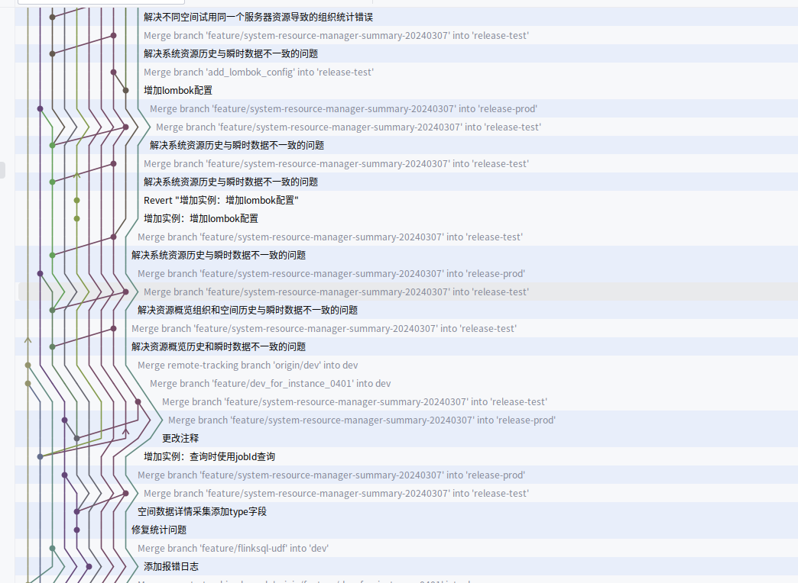
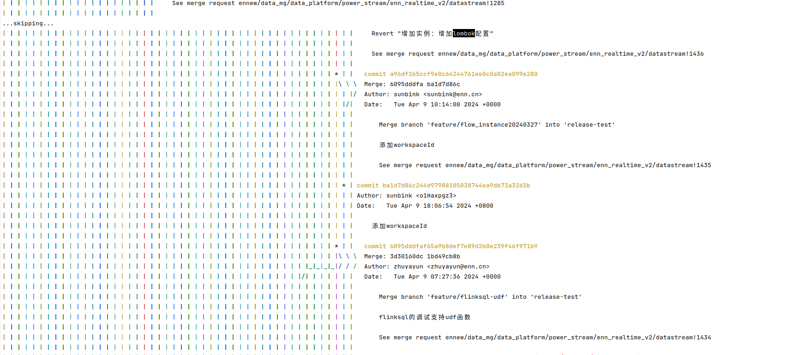

# 一.不要使用pull组合命令

拿pull举例 pull=fetch+merge这2个步奏组成，

1.fetch可以同步远程与本地分支版本树，不影响你当前节点和文件系统，也不会影响你当前的工作，有什么事等把当前工作保存再说(完成一次提交)

2.当完成一次提交后，就要开始合并了，先用ide工具或其他工具对2个版本进行比较，看看如何避免冲突，能避免就在自己这里改，不能避免就进行本地合并，本地合并后再push远程

3.如果push不能保证是不是远程有冲突，那么你再回到1那里重新fetch+merge走一遍，这样把冲突尽量再本地解决

# 二.使用gitlab的合并请求时的技巧

一般，合并到测试分支和生产分支，会用到合并请求功能，此时多人的代码合并，可能会远程产生冲突，可以用以下几步解决此问题

1.小组内由一个人把组内所有人代码合并到一个预合并分支，之后使用预合并分支进行合并

2.小组与小组之间商讨合并顺序，一个小组完成后再另一个小组执行，如果2个小组代码合并成一个预合并分支可以跳过本步骤

3.合并前先fetch，将远程分支结构拉下来，然后再本地先将预合并分支合并到目标分支（本地解决冲突），此时再进行合并请求合并，就没有远程冲突

4.合并后将预合并分支删除，切记不要在预合并分支上进行开发提交，尤其时测试和生产分为2个分支时，那样有可能将测试分支上不准备上线的内容带到生产上去

5.如果改动比较简单，影响范围小，可以之间合并请求合并，但一旦合并时产生冲突，请关闭合并请求，本地解决冲突后再开新的合并请求

# 三.冲突尽量再本地解决，不要把冲突带到远程

# 四.不到万不得已，尽量不使用命令行进行操作

1.可能这个和其他教程不太一样，git的核心时版本提交树，gui环境可以看着提交树操作，这样更加准确

2.当版本树过于复杂情况，命令行哪个简单的显示，很不直观，下面时一个真实项目的版本树，一个时idea里面，一个时命令行

很明显，图1慢慢梳理还是能梳理明白的，图2基本就看着都是一堆竖线

​