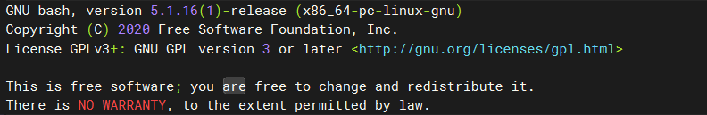

1.  需要安装bashdb，只能采用源码安装
2.  确定你本机的bash版本，bash --version,我的版本为5.1.16



3.  git将bashdb源码clone下来

```bash
git clone https://git.code.sf.net/p/bashdb/code bashdb-code
cd bashdb-code
```

4.  切换到与你的bash大版本对应的分支，我的为5.1.16，这里应该用bash-5.1的分支

```bash
git checkout bash-5.1
```

5.  安装构建软件

```bash
apt-get install autoconf -y
apt-get install binutils -y  
apt-get install make -y  
apt-get install texinfo -y  
```

6.  构建

```bash
./autogen.sh
```

7.  检查构建情况

```bash
ls | grep bashdb
```

看到目录里是否有

bashdb

bashdb-main.inc

bashdb-main.inc.in

bashdb-part2.sh

bashdb-trace

bashdb-trace.in

bashdb.in

8.  安装

```bash
make install
```

9.  测试

测试是否可以执行bashdb命令

10.  安装vscode插件Bash Debug

  

​  

​