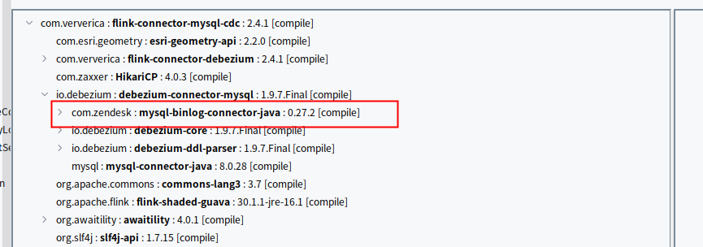
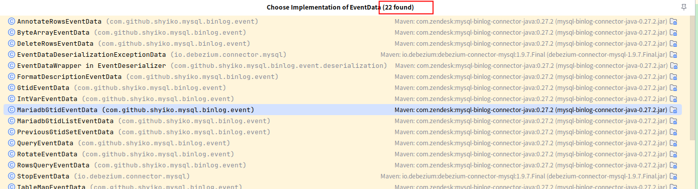
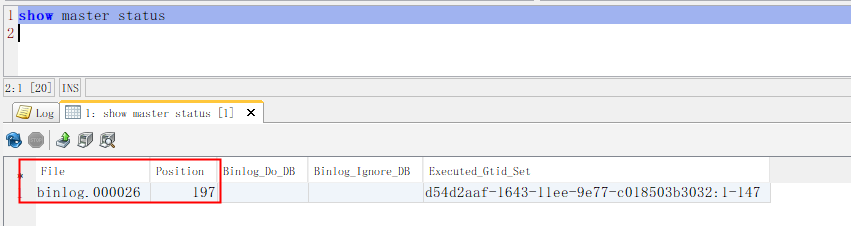
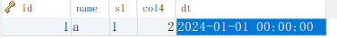
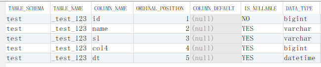
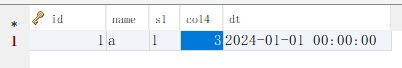

# 1.一个java写的备库

canal，maxwall，flinkcdc是用java实现的备库，但都过于重量级了，其实，这几个都是依赖同一个库shyiko

没错你没听过，我也是看源码里找到的，我们看下flinkcdc里有没有



这个就是，为啥名字不一样，原因不知道，可能是收购了吧

看下github上的源码：[https://github.com/zendesk/mysql-binlog-connector-java](https://github.com/zendesk/mysql-binlog-connector-java)，发现时从原来的仓库fork过来的，原来的仓库中也写有要使用这个仓库，但是其中的包名都没有改，都是含有"shyiko"的


## 2.怎么用，pom.xml加入引用，

```xml
<dependency>
  <groupId>com.github.shyiko</groupId>
  <artifactId>mysql-binlog-connector-java</artifactId>
  <version>0.7.1</version>
</dependency>
```

main方法代码是这样的

```java
package org.example;

import com.github.shyiko.mysql.binlog.BinaryLogClient;
import com.github.shyiko.mysql.binlog.event.Event;
import com.github.shyiko.mysql.binlog.event.EventData;

import java.io.IOException;

public class MysqlNativeCdc {

    public static void main(String[] args) throws IOException {
        BinaryLogClient client = new BinaryLogClient("localhost",3306,"root","1");
        client.registerEventListener(new BinaryLogClient.EventListener(){
            @Override
            public void onEvent(Event event) {
                EventData data = event.getData();
                System.out.println(data);
            }
        });
        client.connect();
    }
}
```

代码比较简单，就是监听数据库binlog，获取事件，打印事件，我们看看事件有多少种



一共找到了22种事件，有2个以Mariadb开头的事件，这2个是Mariadb的特殊事件，Mariadb是mysql拆分出来的一个分支，是防止oracle公司将mysql闭源，单独发展出来的，暂时不用管这2个特殊的

代码运行前要确定mysql权限，保证用户有这个权限[REPLICATION SLAVE](http://dev.mysql.com/doc/refman/5.5/en/privileges-provided.html#priv_replication-slave)权限，如果需要从特殊位置消费，还要有 [REPLICATION CLIENT](http://dev.mysql.com/doc/refman/5.5/en/privileges-provided.html#priv_replication-client)，一般都会给赋予2个权限的。这次我使用root权限，是最大的权限，所以不用赋权

# 3.开始拦截事件

### 开启mysql，配置好binlog为row格式，启动main方法

我们第一时间收到了2条event

```plain
RotateEventData{binlogFilename='binlog.000026', binlogPosition=197}
FormatDescriptionEventData{binlogVersion=4, serverVersion='8.0.33', headerLength=19, dataLength=98, checksumType=CRC32}
```

RotateEventData有2个属性binlogFilename，和binlogPosition，我们这时候数据库执行show master status命令，结果如下



会发现这2个值是一样的

在MYSQL的主从复制中 ，通过命令show master status，可以查看主库当前正在使用的二进制日志及当前执行二进制日志位置

你会发现，我们是从这个位置开始消费事件的，这个也是mysql-binlog最后的位置，这里，我们可以把binlog文件当成一个队列，此时，队列的便宜量为197

第二条数据很明显，时mysql数据库版本等基础信息，这个咱们暂时用不到

### 下面当我们执行插入test库\_test\_123这张表1条数据时



我们拦截下来以下事件

```plain
GtidEventData{flags=0, gtid='d54d2aaf-1643-11ee-9e77-c018503b3032:148'}
QueryEventData{threadId=11, executionTime=0, errorCode=0, database='test', sql='BEGIN'}
TableMapEventData{tableId=92, database='test', table='_test_123', columnTypes=8, 15, 15, 8, 18, columnMetadata=0, 150, 150, 0, 0, columnNullability={1, 2, 3, 4}, eventMetadata=TableMapEventMetadata{signedness={1}, defaultCharset=33, charsetCollations=null, columnCharsets=null, columnNames=null, setStrValues=null, enumStrValues=null, geometryTypes=null, simplePrimaryKeys=null, primaryKeysWithPrefix=null, enumAndSetDefaultCharset=null, enumAndSetColumnCharsets=null,visibility=null}}
WriteRowsEventData{tableId=92, includedColumns={0, 1, 2, 3, 4}, rows=[
    [1, a, 1, 2, Mon Jan 01 08:00:00 CST 2024]
]}
XidEventData{xid=68}
```

我们重点看TableMapEventData和WriteRowsEventData

WriteRowsEventData种rows字段，和我们上图具体的插入数据一模一样，你会发现，这条evert种没有库表名，没有列名，但有个tableId为92，那数据怎么对应库表列属性呢，这就需要TableMapEventData事件做辅助了

TableMapEventData，也有有个tableId为92，有库名，表名这样就知道92号表对应表test.\_test\_123了，但是还是没解决列名的问题

github官网给出了解决方案，到mysql上执行SQL

```sql
SELECT
    TABLE_SCHEMA,
    TABLE_NAME,
    COLUMN_NAME,
    ORDINAL_POSITION,
    COLUMN_DEFAULT,
    IS_NULLABLE,
    DATA_TYPE,
    CHARACTER_MAXIMUM_LENGTH,
    CHARACTER_OCTET_LENGTH,
    NUMERIC_PRECISION,
    NUMERIC_SCALE,
    CHARACTER_SET_NAME,
    COLLATION_NAME
FROM
    INFORMATION_SCHEMA.COLUMNS
WHERE
    TABLE_SCHEMA='test'
AND TABLE_NAME='_test_123';
```

结果如下



在根据includedColumns这个属性，这样列名和值对应起来

### 下面看看对数据进行update时，看看什么情况

我们把col4将2改为3



此时我们拦截到以下事件

```plain
GtidEventData{flags=0, gtid='d54d2aaf-1643-11ee-9e77-c018503b3032:149'}
QueryEventData{threadId=11, executionTime=0, errorCode=0, database='test', sql='BEGIN'}
TableMapEventData{tableId=92, database='test', table='_test_123', columnTypes=8, 15, 15, 8, 18, columnMetadata=0, 150, 150, 0, 0, columnNullability={1, 2, 3, 4}, eventMetadata=TableMapEventMetadata{signedness={1}, defaultCharset=33, charsetCollations=null, columnCharsets=null, columnNames=null, setStrValues=null, enumStrValues=null, geometryTypes=null, simplePrimaryKeys=null, primaryKeysWithPrefix=null, enumAndSetDefaultCharset=null, enumAndSetColumnCharsets=null,visibility=null}}
UpdateRowsEventData{tableId=92, includedColumnsBeforeUpdate={0, 1, 2, 3, 4}, includedColumns={0, 1, 2, 3, 4}, rows=[
    {before=[1, a, 1, 2, Mon Jan 01 08:00:00 CST 2024], after=[1, a, 1, 3, Mon Jan 01 08:00:00 CST 2024]}
]}
XidEventData{xid=120}
```

此时比较一下上次把WriteRowsEventData替换了，UpdateRowsEventData，观察这个事件，发现我只改了1个字段，事件把整个列都发过来了，所以就有row格式占用磁盘大的说法

我们看见有rows里before和after字段，before字段col4字段为2，after为3，这样我们新老数据都有了，字段对应方式依然一样

### 下面看看对数据进行delete时，看看什么情况

我们将上面那条数据删除，事件如下

```plain
GtidEventData{flags=0, gtid='d54d2aaf-1643-11ee-9e77-c018503b3032:150'}
QueryEventData{threadId=11, executionTime=0, errorCode=0, database='test', sql='BEGIN'}
TableMapEventData{tableId=92, database='test', table='_test_123', columnTypes=8, 15, 15, 8, 18, columnMetadata=0, 150, 150, 0, 0, columnNullability={1, 2, 3, 4}, eventMetadata=TableMapEventMetadata{signedness={1}, defaultCharset=33, charsetCollations=null, columnCharsets=null, columnNames=null, setStrValues=null, enumStrValues=null, geometryTypes=null, simplePrimaryKeys=null, primaryKeysWithPrefix=null, enumAndSetDefaultCharset=null, enumAndSetColumnCharsets=null,visibility=null}}
DeleteRowsEventData{tableId=92, includedColumns={0, 1, 2, 3, 4}, rows=[
    [1, a, 1, 3, Mon Jan 01 08:00:00 CST 2024]
]}
XidEventData{xid=136}
```

会发现DeleteRowsEventData事件和WriteRowsEventData格式几乎一模一样，只是内部数据为上一步改过后的数据由于有了以上2次基础，我们就不继续分析了

### 事件重放

我们第一条事件为RotateEventData里面有binlogFilename='binlog.000026', binlogPosition=197这2个属性

这时我们停掉java程序，再启动发现这2个事件

```plain
RotateEventData{binlogFilename='binlog.000026', binlogPosition=1180}
FormatDescriptionEventData{binlogVersion=4, serverVersion='8.0.33', headerLength=19, dataLength=98, checksumType=CRC32}
```

由于我们再binlog最末尾开始消费，之前的几次修改都无法看见了，此时我们可以采取一以下方式重发

我们再源代码中添加这2行

```java
client.setBinlogFilename("binlog.000026");
client.setBinlogPosition(197L);
```

将第1次的2个属性填入，重启程序看下，我们拦截到以下事件

```plain
RotateEventData{binlogFilename='binlog.000026', binlogPosition=197}
FormatDescriptionEventData{binlogVersion=4, serverVersion='8.0.33', headerLength=19, dataLength=98, checksumType=CRC32}
GtidEventData{flags=0, gtid='d54d2aaf-1643-11ee-9e77-c018503b3032:148'}
QueryEventData{threadId=11, executionTime=0, errorCode=0, database='test', sql='BEGIN'}
TableMapEventData{tableId=92, database='test', table='_test_123', columnTypes=8, 15, 15, 8, 18, columnMetadata=0, 150, 150, 0, 0, columnNullability={1, 2, 3, 4}, eventMetadata=TableMapEventMetadata{signedness={1}, defaultCharset=33, charsetCollations=null, columnCharsets=null, columnNames=null, setStrValues=null, enumStrValues=null, geometryTypes=null, simplePrimaryKeys=null, primaryKeysWithPrefix=null, enumAndSetDefaultCharset=null, enumAndSetColumnCharsets=null,visibility=null}}
WriteRowsEventData{tableId=92, includedColumns={0, 1, 2, 3, 4}, rows=[
    [1, a, 1, 2, Mon Jan 01 08:00:00 CST 2024]
]}
XidEventData{xid=68}
GtidEventData{flags=0, gtid='d54d2aaf-1643-11ee-9e77-c018503b3032:149'}
QueryEventData{threadId=11, executionTime=0, errorCode=0, database='test', sql='BEGIN'}
TableMapEventData{tableId=92, database='test', table='_test_123', columnTypes=8, 15, 15, 8, 18, columnMetadata=0, 150, 150, 0, 0, columnNullability={1, 2, 3, 4}, eventMetadata=TableMapEventMetadata{signedness={1}, defaultCharset=33, charsetCollations=null, columnCharsets=null, columnNames=null, setStrValues=null, enumStrValues=null, geometryTypes=null, simplePrimaryKeys=null, primaryKeysWithPrefix=null, enumAndSetDefaultCharset=null, enumAndSetColumnCharsets=null,visibility=null}}
UpdateRowsEventData{tableId=92, includedColumnsBeforeUpdate={0, 1, 2, 3, 4}, includedColumns={0, 1, 2, 3, 4}, rows=[
    {before=[1, a, 1, 2, Mon Jan 01 08:00:00 CST 2024], after=[1, a, 1, 3, Mon Jan 01 08:00:00 CST 2024]}
]}
XidEventData{xid=120}
GtidEventData{flags=0, gtid='d54d2aaf-1643-11ee-9e77-c018503b3032:150'}
QueryEventData{threadId=11, executionTime=0, errorCode=0, database='test', sql='BEGIN'}
TableMapEventData{tableId=92, database='test', table='_test_123', columnTypes=8, 15, 15, 8, 18, columnMetadata=0, 150, 150, 0, 0, columnNullability={1, 2, 3, 4}, eventMetadata=TableMapEventMetadata{signedness={1}, defaultCharset=33, charsetCollations=null, columnCharsets=null, columnNames=null, setStrValues=null, enumStrValues=null, geometryTypes=null, simplePrimaryKeys=null, primaryKeysWithPrefix=null, enumAndSetDefaultCharset=null, enumAndSetColumnCharsets=null,visibility=null}}
DeleteRowsEventData{tableId=92, includedColumns={0, 1, 2, 3, 4}, rows=[
    [1, a, 1, 3, Mon Jan 01 08:00:00 CST 2024]
]}
XidEventData{xid=136}
```

你会发现，我们的几次修改，都一次性消费到了

当然还有一种方式可以，添加如下代码

```java
client.setGtidSet("d54d2aaf-1643-11ee-9e77-c018503b3032:1-147");
```

这个就涉及到gtid知识了，就不在这里详细的讲解了