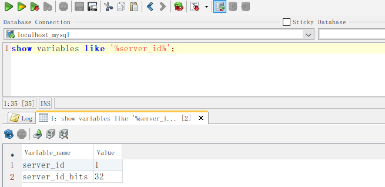
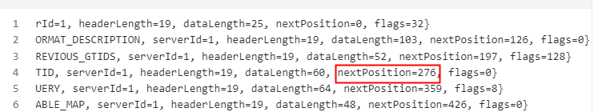

看这篇前请看[第一篇](https://www.yuque.com/yuncengshangdelantian/ghbp0u/ler8a0780pgxnhzd)

### 解析事件头

上一篇代码中有一句

```java
EventData data = event.getData();
```

这次我们改成

```java
EventHeader header = event.getHeader();
```

看看Event头有什么东西,我们使用上篇方法，把event全部重放得到下面的事件头

```plain
EventHeaderV4{timestamp=0, eventType=ROTATE, serverId=1, headerLength=19, dataLength=25, nextPosition=0, flags=32}
EventHeaderV4{timestamp=1713926159000, eventType=FORMAT_DESCRIPTION, serverId=1, headerLength=19, dataLength=103, nextPosition=126, flags=0}
EventHeaderV4{timestamp=1713926159000, eventType=PREVIOUS_GTIDS, serverId=1, headerLength=19, dataLength=52, nextPosition=197, flags=128}
EventHeaderV4{timestamp=1713926834000, eventType=GTID, serverId=1, headerLength=19, dataLength=60, nextPosition=276, flags=0}
EventHeaderV4{timestamp=1713926834000, eventType=QUERY, serverId=1, headerLength=19, dataLength=64, nextPosition=359, flags=8}
EventHeaderV4{timestamp=1713926834000, eventType=TABLE_MAP, serverId=1, headerLength=19, dataLength=48, nextPosition=426, flags=0}
EventHeaderV4{timestamp=1713926834000, eventType=EXT_WRITE_ROWS, serverId=1, headerLength=19, dataLength=42, nextPosition=487, flags=0}
EventHeaderV4{timestamp=1713926834000, eventType=XID, serverId=1, headerLength=19, dataLength=12, nextPosition=518, flags=0}
EventHeaderV4{timestamp=1713927845000, eventType=GTID, serverId=1, headerLength=19, dataLength=60, nextPosition=597, flags=0}
EventHeaderV4{timestamp=1713927845000, eventType=QUERY, serverId=1, headerLength=19, dataLength=65, nextPosition=681, flags=8}
EventHeaderV4{timestamp=1713927845000, eventType=TABLE_MAP, serverId=1, headerLength=19, dataLength=48, nextPosition=748, flags=0}
EventHeaderV4{timestamp=1713927845000, eventType=EXT_UPDATE_ROWS, serverId=1, headerLength=19, dataLength=69, nextPosition=836, flags=0}
EventHeaderV4{timestamp=1713927845000, eventType=XID, serverId=1, headerLength=19, dataLength=12, nextPosition=867, flags=0}
EventHeaderV4{timestamp=1713928321000, eventType=GTID, serverId=1, headerLength=19, dataLength=60, nextPosition=946, flags=0}
EventHeaderV4{timestamp=1713928321000, eventType=QUERY, serverId=1, headerLength=19, dataLength=56, nextPosition=1021, flags=8}
EventHeaderV4{timestamp=1713928321000, eventType=TABLE_MAP, serverId=1, headerLength=19, dataLength=48, nextPosition=1088, flags=0}
EventHeaderV4{timestamp=1713928321000, eventType=EXT_DELETE_ROWS, serverId=1, headerLength=19, dataLength=42, nextPosition=1149, flags=0}
EventHeaderV4{timestamp=1713928321000, eventType=XID, serverId=1, headerLength=19, dataLength=12, nextPosition=1180, flags=0}
```

观察发现，所有类型event头，都有一样属性，

eventType:标记着当前event的类型，

timestamp:ROTATE类型为0，其余类型都标记这个事件发生的时间戳

serverId:主库的id，可以通过配置文件改，可通过sql：show variables like '%server\_id%'查看



上图除了server\_id外，还有server\_id\_bits字段值为32也就是server\_id是个32位的整数，由于其不能为负数，所以对于当前mysql，server\_id范围为0-2^32,也就是0-4294967295，我觉得是足够用了，应该不会有那家公司备库数超过吧，如果有告诉我一声，哈哈哈哈哈哈哈

headerLength:事件头长度

dataLength:事件数据长度

nextPosition：下一条event开始位置，也就是本条的结束位置（除了ROTATE类型，因为这种类型数据作用特殊，具体请看第3篇）

flag：2个字节具体文档查看[这里](https://dev.mysql.com/doc/dev/mysql-server/latest/group__group__cs__binglog__event__header__flags.html)，一般用不到

这里我们做个测试，选择一个事件的nextPosistion字段，比如这个



将代码中添加如下内容，会有什么效果？

```java
client.setBinlogFilename("binlog.000026");
client.setBinlogPosition(276L);
```

我们得到以下事件

```plain
EventHeaderV4{timestamp=0, eventType=ROTATE, serverId=1, headerLength=19, dataLength=25, nextPosition=0, flags=32}
EventHeaderV4{timestamp=1713926159000, eventType=FORMAT_DESCRIPTION, serverId=1, headerLength=19, dataLength=103, nextPosition=0, flags=0}
EventHeaderV4{timestamp=1713926834000, eventType=QUERY, serverId=1, headerLength=19, dataLength=64, nextPosition=359, flags=8}
EventHeaderV4{timestamp=1713926834000, eventType=TABLE_MAP, serverId=1, headerLength=19, dataLength=48, nextPosition=426, flags=0}
EventHeaderV4{timestamp=1713926834000, eventType=EXT_WRITE_ROWS, serverId=1, headerLength=19, dataLength=42, nextPosition=487, flags=0}
EventHeaderV4{timestamp=1713926834000, eventType=XID, serverId=1, headerLength=19, dataLength=12, nextPosition=518, flags=0}
EventHeaderV4{timestamp=1713927845000, eventType=GTID, serverId=1, headerLength=19, dataLength=60, nextPosition=597, flags=0}
EventHeaderV4{timestamp=1713927845000, eventType=QUERY, serverId=1, headerLength=19, dataLength=65, nextPosition=681, flags=8}
EventHeaderV4{timestamp=1713927845000, eventType=TABLE_MAP, serverId=1, headerLength=19, dataLength=48, nextPosition=748, flags=0}
EventHeaderV4{timestamp=1713927845000, eventType=EXT_UPDATE_ROWS, serverId=1, headerLength=19, dataLength=69, nextPosition=836, flags=0}
EventHeaderV4{timestamp=1713927845000, eventType=XID, serverId=1, headerLength=19, dataLength=12, nextPosition=867, flags=0}
EventHeaderV4{timestamp=1713928321000, eventType=GTID, serverId=1, headerLength=19, dataLength=60, nextPosition=946, flags=0}
EventHeaderV4{timestamp=1713928321000, eventType=QUERY, serverId=1, headerLength=19, dataLength=56, nextPosition=1021, flags=8}
EventHeaderV4{timestamp=1713928321000, eventType=TABLE_MAP, serverId=1, headerLength=19, dataLength=48, nextPosition=1088, flags=0}
EventHeaderV4{timestamp=1713928321000, eventType=EXT_DELETE_ROWS, serverId=1, headerLength=19, dataLength=42, nextPosition=1149, flags=0}
EventHeaderV4{timestamp=1713928321000, eventType=XID, serverId=1, headerLength=19, dataLength=12, nextPosition=1180, flags=0}
```

我们重点看第3条event，是不是上次nextPosition=276那条之后的那条数据，也就是276为nextPosition=359这条数据的起始位置

那么我们再算以下这条数据headerLength=19, dataLength=64，276+19+64=359，你会发现和这条数据的nextPosition值一样

## 得出的结论

1.这样我们就知道了，binlog结构从当前event可算出下一条event起始位置，但如果不拿到下一条event的头，没法算出再下一条event的开始位置，因此binlog只能顺序消费，中间不能跳过一些event

2.我们再看flink cdc的机制，全表同步分为2步

历史数据同步:通过select语句查询

增量数据同步:通过消费binlog

历史数据同步，只要设定号数字主键，根据主键切片很容易可以事件多并行度

增量数据同步，由于上面讲的binlog结构，无法实现多并行度，即便可实现多并行度，也只能是主备模式

​